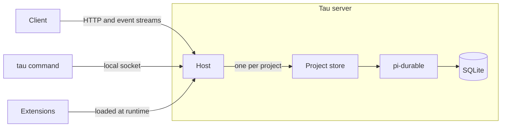

<picture>
  <source media="(prefers-color-scheme: dark)" srcset="assets/tau-wordmark-on-dark.svg">
  
</picture>

# Tau

Tau runs a durable agent on a server so you can leave, reconnect elsewhere, and continue delegated work. Clients can inspect work, read events, and answer requests for human decisions. Clients live outside this repository.

Tau is built on [pi-durable](https://github.com/earendil-works/pi/tree/main/packages/durable). The server stores project state and loads workflows and tools as extensions.

## How it works

A client connects to the server over HTTP to start and inspect work. The `tau` command starts the server and uses a local socket for administration. Each project has a store for decisions and events, backed by pi-durable and SQLite. Extensions supply workflows and tools to agents.



See the [design](docs/design.md) for the core layers and their limits, the [protocol](docs/protocol.md) for client calls, and the [extensions guide](docs/extensions.md) for workflows and tools.

## Run Tau

The server listens on `127.0.0.1:6283` by default and stores state under `~/.tau`. Starting Tau does not install extensions. Install them separately using the [extension guide](docs/extensions.md#install-an-extension). Model provider credentials live on the server. See the [host reference](docs/host.md) for configuration and credentials.

### With Nix

With Nix flakes enabled, run Tau from a checkout:

```sh
nix run .#tau -- --port 6283
```

You can also run it without a checkout:

```sh
nix run github:vicrdguez/tau#tau -- --port 6283
```

See the [Nix guide](nix/README.md) for the Linux container image and other build options.

### From source without Nix

Install Node.js 24 and npm, then clone the repository and start the server:

```sh
git clone https://github.com/vicrdguez/tau.git
cd tau
npm ci
npx tsc -b core
node core/dist/src/command/main.js --port 6283
```

Use a separate checkout for npm-managed dependencies if you also use the Nix development shell, which manages the checkout's `node_modules`.

## Extensions

The repository includes sample extensions. [W1](extensions/w1/README.md) coordinates work using agent roles and human decisions. [W2](extensions/w2/README.md) runs a forecasting workflow. [Web search](extensions/websearch/README.md) adds a search tool.

Extensions are trusted code and are not sandboxed. Read the [design limits](docs/design.md#limits) before installing them. The same section describes recovery and upgrade limitations.

## Development

From a checkout with Nix flakes enabled:

| Task | Command |
| --- | --- |
| Build the core executable | `nix build .#tau` |
| Test core | `nix run .#test-core` |
| Test an extension | `nix run .#test-w2` |
| Run real-server tests | `nix run .#test-e2e` |
| Run the full acceptance gate | `nix flake check -L` |

Use `nix develop` for an interactive shell with formatting, lint, typechecking, and test commands. In an interactive shell, use `env test` to avoid the shell builtin. Packaging an extension does not typecheck or test it. The [Nix guide](nix/README.md) describes test selectors, extension builds, and installed-artifact verification. The [documentation index](docs/README.md) links to the architecture and API guides.
