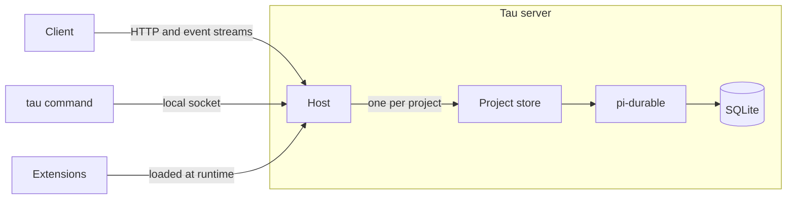

<picture>
  <source media="(prefers-color-scheme: dark)" srcset="assets/tau-wordmark-on-dark.svg">
  
</picture>

# Tau

Tau runs a durable agent on a server so you can leave, reconnect elsewhere, and continue delegated work. Clients can inspect work, read events, and answer requests for human decisions. Clients live outside this repository.

Tau is built on [pi-durable](https://github.com/earendil-works/pi/tree/main/packages/durable). The server stores project state and loads workflows and tools as extensions.

## How it works

A client connects to the server over HTTP to start and inspect work. The `tau` command starts the server and uses a local socket for administration. Each project has a store for decisions and events, backed by pi-durable and SQLite. Extensions supply workflows and tools to agents.



See the [design](docs/design.md) for the core layers and their limits, the [protocol](docs/protocol.md) for client calls, and the [extensions guide](docs/extensions.md) for workflows and tools.

## Run Tau

The server listens on `127.0.0.1:6283` by default and stores state under `~/.tau`. Starting Tau does not install extensions. Install them separately using the [extension guide](docs/extensions.md#install-an-extension). Model provider credentials live on the server. See the [host reference](docs/host.md) for configuration and credentials.

### From a standalone download

Download the archive for your system from [GitHub Releases](https://github.com/vicrdguez/tau/releases). Choose Apple Silicon macOS or glibc-based Linux on arm64 or x64. The archive includes Node.js 24. You do not need Nix or Docker. Compare the archive's SHA-256 hash with `SHA256SUMS` from the same release.

Extract the archive and run this command from its top-level directory:

```sh
./bin/tau --port 6283
```

Keep the extracted files together. Use the same `bin/tau` for [device pairing](docs/host.md#run-the-server).

#### Run at login on macOS

The macOS archive includes a LaunchAgent that starts Tau at login and restarts it if it exits. Move the extracted directory to its permanent location and stop any Tau server already running. From the extracted directory, run:

```sh
agent="$HOME/Library/LaunchAgents/dev.tau.server.plist"
mkdir -p "$(dirname "$agent")"
install -m 644 ./dev.tau.server.plist "$agent"
plutil -remove ProgramArguments.0 "$agent"
plutil -insert ProgramArguments.0 -string "$PWD/bin/tau" "$agent"
launchctl bootstrap "gui/$(id -u)" "$agent"
```

To stop the service, run `launchctl bootout "gui/$(id -u)/dev.tau.server"`. To prevent it from starting at the next login, remove the installed plist. Neither step removes `~/.tau`.

### With Docker Compose

From one [GitHub Release](https://github.com/vicrdguez/tau/releases), download `compose.yaml` and the `tau-docker-linux-*.tar.gz` archive for your Docker engine. Use arm64 on Apple Silicon. From the directory with `compose.yaml`, load the image and start Tau. This example uses arm64:

```sh
docker load -i tau-docker-linux-arm64.tar.gz
docker compose up -d
docker compose exec tau tau device pair phone
```

Connect your client to `http://127.0.0.1:6283`. Compose keeps project stores and devices in a named Docker volume. It does not share your host's `~/.tau`. Create a local `tau.env` next to `compose.yaml` to supply provider API keys, then start or recreate Tau. If a project needs access to a host checkout, mount it separately and use its container-side path. Use an encrypted tunnel or TLS proxy for access from another machine.

### With Nix

With Nix flakes enabled, run Tau from a checkout:

```sh
nix run .#tau -- --port 6283
```

You can also run it without a checkout:

```sh
nix run github:vicrdguez/tau#tau -- --port 6283
```

On Apple Silicon macOS, stop any Tau server you started in a terminal. To install Tau as a login service, run this from your checkout:

```sh
nix run .#install-launchagent
```

Rerun this command after `git pull` to update the service. It uses your existing `~/.tau` and does not require `sudo`. To stop the service, follow the [LaunchAgent instructions](#run-at-login-on-macos).

See the [Nix guide](nix/README.md) for the Linux container image and other build options.

### From source without Nix

Install Node.js 24 and npm, then clone the repository and start the server:

```sh
git clone https://github.com/vicrdguez/tau.git
cd tau
npm ci
npx tsc -b core
node core/dist/src/command/main.js --port 6283
```

Use a separate checkout for npm-managed dependencies if you also use the Nix development shell, which manages the checkout's `node_modules`.

## Extensions

The repository includes three extensions. [W1](extensions/w1/README.md) coordinates work using agent roles and human decisions. [W2](extensions/w2/README.md) runs a forecasting workflow. [Webkit](extensions/webkit/README.md) provides zero-config search, page extraction, and durable source retrieval. It is a trimmed, Tau-native derivative of pi-web-access 0.46.0.

Extensions are trusted code and are not sandboxed. Read the [design limits](docs/design.md#limits) before installing them. The same section describes recovery and upgrade limitations.

## Development

From a checkout with Nix flakes enabled:

| Task | Command |
| --- | --- |
| Build the core executable | `nix build .#tau` |
| Test core | `nix run .#test-core` |
| Test an extension | `nix run .#test-w2` |
| Run real-server tests | `nix run .#test-e2e` |
| Run the full acceptance gate | `nix flake check -L` |

Use `nix develop` for an interactive shell with formatting, lint, typechecking, and test commands. In an interactive shell, use `env test` to avoid the shell builtin. Packaging an extension does not typecheck or test it. The [Nix guide](nix/README.md) describes test selectors, extension builds, and installed-artifact verification. The [documentation index](docs/README.md) links to the architecture and API guides.

The [release workflow](.github/workflows/release.yml) builds and checks the standalone and Docker archives with Nix on pull requests to `trunk`. Pushing a `vX.Y.Z` tag publishes the archives, `compose.yaml`, and their checksums only if the tagged commit is in `main` and all platform checks pass.
