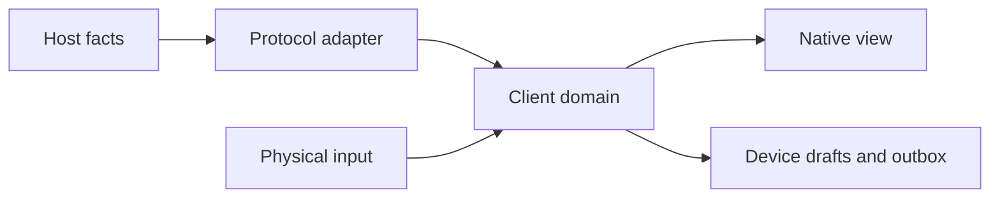

# Modules

The host owns acknowledged work. The desktop keeps local drafts and renders host facts without turning them into authority.

## Ledger

Ledger owns **accepted Contracts**, immutable document revisions, command receipts and scoped observations. A successful response follows the committed record, not the other way around.

- Check scope and revocation before every read and command.
- Reject a changed payload under an existing command ID.
- Keep rejected and superseded records readable.

## Engine

Engine advances work from retained commitments and evidence. An assignment identifies its role, generation, attempt and exact source.

> A model report is not a runner receipt. Chronological adjacency does not establish causality.

## Desktop

The desktop renders the basis it actually showed. A new host observation does not silently replace that basis beneath a confirmation key.

```rust
match outcome {
    Accepted(receipt) => retain(receipt),
    Refused(reason) => keep_draft(reason),
    Unknown => query_original_command(),
}
```

## Boundaries



| Owner | Retained state | Cannot claim |
| --- | --- | --- |
| Host | Revisions, receipts, scope | That a client saw a frame |
| Device | Draft bytes, original envelopes | That a remote command failed |
| Session | Cursor, tabs, visible basis | That unsaved text is acknowledged |

The review concerns r2. Opening another revision is an explicit navigation, never a fallback for missing bytes.
