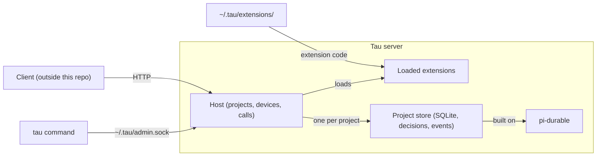

# Documentation

Tau runs a durable agent on a server so clients can connect to inspect and direct its work.

## How the parts fit

The diagram shows how a client, the `tau` command, stores, and extensions connect to the server.

## Guides

- [Design](design.md) explains the core, extensions, and their boundaries.
- [Decisions and events](primitives.md) covers durable requests and the event log.
- [Host](host.md) covers projects, conversations, options, and client calls.
- [Protocol](protocol.md) covers HTTP, streams, devices, and pairing.
- [Extensions](extensions.md) covers writing, loading, and reloading extensions.
- Extensions include [W1](../extensions/w1/README.md), [W2](../extensions/w2/README.md), and [Webkit](../extensions/webkit/README.md).
