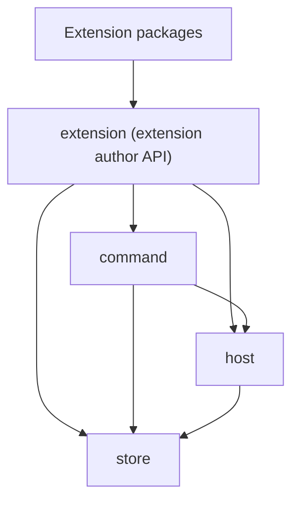

# Tau's design

Tau runs a durable agent on a server so you can leave, reconnect elsewhere, and continue delegated work. It records events and requests for human decisions. A client connects to inspect and direct that work.

The core is the `tau` package, built on pi-durable 1.5.2. Extensions load at run time and supply workflows without the core knowing any extension by name. A client speaks the [protocol](protocol.md) and lives outside this repository.

## Core layers

Each core layer has a distinct job. The table also shows which of the other named core layers it may import.

| Layer | Responsibility | Permitted core imports |
| --- | --- | --- |
| `core/src/store` | Opens a harness and adds [decisions and events](primitives.md). | None of the other named layers. |
| `core/src/host` | Manages projects, devices, client calls, and extensions. See the [host reference](host.md). | Store. |
| `core/src/command` | Starts and administers the server. | Store and host. |
| `core/src/extension` | Exports the extension author API, including functions, helpers, and pi types. See the [extension guide](extensions.md). | Store, host, and command. |

Core code stays independent of extension packages. Extensions import the extension author API through `tau`, `tau/durable`, `tau/schema`, and `tau/chord`. Their tests may also import `tau/testing`. The workspace [import policy](../boundaries.json) and [boundary checker](../tools/check-boundaries.mjs) enforce these rules as part of `lint` and the build checks.

Arrows show permitted imports between the core layers and the extension author API, not runtime calls.

## Admission to the core

The core stays small so that workflows can change independently. The bare agent and the sample workflows [W1](../extensions/w1/README.md) and [W2](../extensions/w2/README.md) test the design. A proposal for a core addition must meet all five checks:

1. **Show a real failure.** Name a task the bare agent, W1, or W2 cannot do.
2. **Check pi-durable.** Cite the pi-durable functionality examined and show that it does not provide the feature.
3. **Try an extension.** Show where an extension fell short. The feature must either control who may act at the interface with the human and client, or define a record that every client and extension must read with the same meaning. Convenience alone is insufficient.
4. **Show two unlike users.** Two extensions that do different jobs must use the feature with the same meaning. Alternatively, show that a client which knows no extension cannot work without it. A server safety repair is the exception.
5. **Keep the feature small and workflow-independent.** Express it as a type and a few functions over a `Tx` or the host, with no scheduler, loop, background process, or storage engine. A specific role such as "the designer", a phase, and an artifact type are workflow concepts. A way to define roles is not. Apply the first four checks to the proposed shape.

When pi-durable gains a feature that the core provides, remove the core's copy. Remove a core feature with fewer than two users, subject to the client and safety exceptions above.

## Admission of a helper

A proposal for a helper exported to extension authors must name its call sites and meet four checks:

1. It has two call sites in W1 or W2. Both may be in one workflow.
2. It uses the public APIs of pi-durable and the core without adding a guarantee. A workflow that makes the same calls itself loses nothing.
3. It owns no stored name, makes no commit, and starts no timer. It has no document, entry kind, task, or extension under its own name. It may write through the caller's `tx` or define a document named for the caller that holds only the caller's data.
4. It names no workflow concept. A way to define roles qualifies, but a specific role such as "the designer" does not.

Remove a helper when it has fewer than two call sites or pi-durable provides it.

## Limits

### Trust and secrets

Extensions are trusted code, not sandboxed code. An extension can terminate the server process. If its top-level code never finishes, it can also prevent startup. Changes to an extension's own dependencies require a restart.

The [answer interface](primitives.md#who-can-answer) prevents accidental answers by extensions. An agent with access outside that interface can still answer by other means. Option masking depends on the current schema, so removing an option's secret marking exposes its stored value in option replies.

### Recovery and upgrades

SQLite uses `synchronous=NORMAL`, so a power failure can lose recent commits. An upgrade can also change an open decision's meaning because the store looks up its task when an answer arrives. Keep open decisions compatible with their task code, or withdraw them before an incompatible upgrade.

On restart, Tau has no old task definitions to compare with the installed code. A stored task can fault if its phase was removed. Clients can inspect faulted tasks, but Tau has no general call to restart or delete them.

### Clients and extensions

When selected extensions provide tools with the same name, the last selected definition wins without a warning. Use distinct names to avoid running the wrong tool. Annotations travel with an answer, while an unsent review stays on the device where it was written.

A repeated request to create a conversation can create another conversation. Tau has no call to delete a conversation, unbind a project, or remove an extension from a project. See the [host reference](host.md) for client calls.
