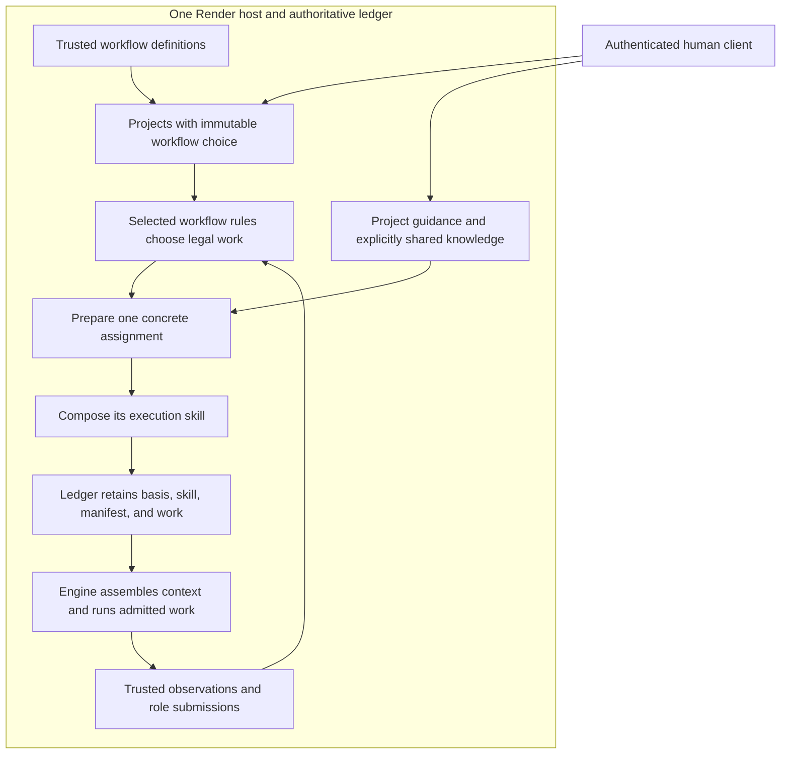
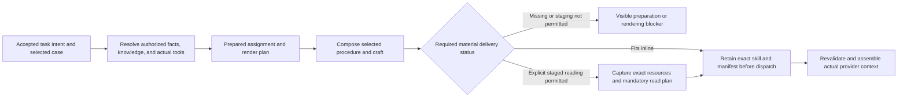
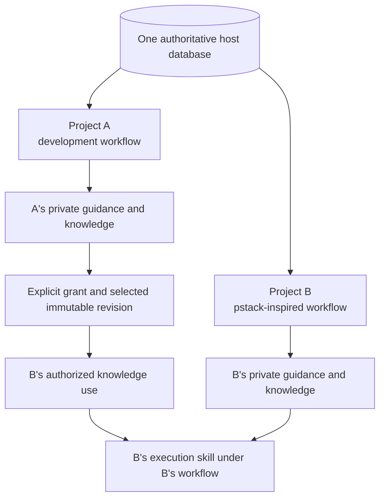

# Workflow-owned execution skills and pluggable workflows

Render should let each new project select how its agents work. The selected workflow owns its roles, procedures, reusable craft, deterministic task selection, and the tailored execution skills its agents receive. Project knowledge is a separate input that can be reused through explicit sharing.

**Revision 2 is a proposed design for review. Nothing here is implemented or an accepted amendment to v1.** It responds to [issue #59](https://github.com/vicrdguez/render/issues/59) and the user's clarification. It supersedes the first draft's one-project-per-database mapping and permanent project-level artifact-digest gate.

The target is **one authoritative SQLite database per Render host, with logically isolated projects**. Each project selects a workflow definition. It does not select a separate database or an Engine containing another set of hardcoded prompts.

## Start with the domain

The [proposed glossary](CONTEXT.md) defines the terms. These distinctions organize the design.

| Concept | Meaning |
| --- | --- |
| Workflow definition | A versioned way of working, including rules, roles, procedures, craft composition, and result contracts. |
| Workflow run | One instance of that definition within a project. The current source's `Workflow` record is closest to this concept. |
| Project | An ownership and working-context scope with its chosen workflow, configuration, guidance, and runs. |
| Project knowledge | Explicitly selected guidance or evidence, with provenance and access rules. It is not another workflow. |
| Prepared assignment | The selected task, exact basis, resolved inputs, actual capabilities, and instruction-content selection for bounded work. |
| Execution skill | The immutable, tailored instructions and task information rendered for one assignment basis. |
| Effective provider context | What a provider call actually receives, including that skill, runtime instructions, history, tools, and refresh state. |

A programming project can use finance knowledge and a pstack-inspired workflow. That does not require a copy of pstack containing finance prose, and it does not select the finance project's workflow.



The graph describes proposed responsibility and data flow. It is not executed evidence. The shared composition machinery contains no built-in Ground, Seams, Audit, Watchdog, or pstack procedure.

## What changes from the first draft

The original draft treated instructions as a small property of role recipes. That left Render's central purpose implicit. This revision makes instruction preparation, composition, provenance, and inspection an explicit part of the extension contract.

It also separates project identity from storage placement. The old one-store-one-project recommendation followed today's implicit authority boundary. It was not evidence that each project needs its own SQLite file. The [storage comparison](storage-and-knowledge.md) recommends one host database and explains its costs.

The initial specification does capture parts of the intended behavior, including exact packet references, instruction versions, project principles, continuation, and enforced authority. What needs redesign is ownership and composition of the authored material, not deletion of those promises.

## Current source, not assumed delivery

The source baseline is now `proposal/render-v1` at `eea2a7cb047f55683c4bf83658315b41129be62a`. PR #79 is merged. The earlier pilot snapshots remain historical in the [original source register](sources.md). The [revision 2 register](sources/revision-2.md) gives current citations and the captured issue requirements.

Current `Engine.render` resolves exact retained inputs and conditionally assembles substantial procedure and role prose. Provider admission uses additional runtime context beyond that rendered packet. Current storage shares one Durable session across workflows but has no project field on the workflow record. Separate project work exists as unmerged WIP and is not treated as delivered functionality.

These facts rule out a selector around `change`, moving strings without an ownership model, or calling a standalone render preview the model's effective context.

## Responsibility and extension interface

| Module | Responsibility |
| --- | --- |
| Workflow definition | Legal transitions, role meanings, task and procedure-case selection, workflow-owned content catalogue, composition declarations, result contracts, and workflow views. |
| Ledger | Principal establishment, host and project scope, exact reference resolution, current authority, IDs, basis checks, receipts, knowledge grants, atomic records, and retained skill provenance. |
| Execution-skill composition | Pure assembly of the selected content and verified bindings, required-material checks, declared serialization, manifests, and inspectable output. It contains no workflow selectors. |
| Engine | Durable lifecycle, scheduling, continuity, context assembly, model and tool configuration, provider admission, capacity, cancellation, and quiescence. |
| Sandboxes and Effects | Existing isolated execution and trusted source or forge operations, under current admission and source checks. |

The execution-skill module earns its seam by keeping composition, mandatory-material checks, and provenance out of every workflow implementation. It need not be a new process or separately published package.

Human-only main merge and current source and effect admission remain host constraints. Selecting an external methodology does not authorize operations beyond those constraints. A pstack adaptation must respect them rather than inherit an automatic-merge instruction from another environment.

### Shapes before methods

The following is an unimplemented interface sketch. It summarizes ownership, not a complete SDK or storage migration.

```typescript
type WorkflowChoice = Readonly<{
	definition: WorkflowDefinitionId;
	meaning: WorkflowMeaningVersion;
}>;

type Project = Readonly<{
	id: ProjectId;
	workflow: WorkflowChoice;
	contentSelection: RevisionRef;
	knowledgeBindings: readonly KnowledgeBindingRef[];
}>;

type PreparedAssignment = Readonly<{
	binding: AssignmentBasis;
	task: ResolvedTask;
	instructions: RenderPlan;
	capabilities: AdmittedCapabilities;
	knowledge: readonly KnowledgeUseRef[];
}>;

type ExecutionSkill = Readonly<{
	assignment: AssignmentRef;
	revision: RevisionRef;
	manifest: RenderingManifest;
	content: RetainedContentRef;
}>;

interface WorkflowDefinition<State, Command> {
	readonly identity: WorkflowChoice;
	readonly roles: RoleCatalogue;
	readonly contentContract: InstructionContentContract;
	readonly commands: CommandCatalogue<Command>;

	needs(input: BoundInput<State, WorkflowInput<Command>>): readonly HostRead[];
	decide(input: VerifiedInput<State, WorkflowInput<Command>>): Decision<State>;
	prepareTask(input: VerifiedTaskInputs): PreparedAssignment | PreparationBlocker;
	present(input: VisibleInputs<State>): WorkflowView;
}

type WorkflowInput<Command> =
	| { kind: "command"; command: Command }
	| { kind: "host-notice"; notice: HostNotice }
	| { kind: "host-request"; request: WorkRebindRequest | OperationAdmissionRequest };

interface ExecutionSkillComposer {
	compose(input: AuthorizedRenderInputs): ExecutionSkillDraft | StagedExecutionSkillDraft | RenderBlocker;
}
```

Workflow decisions select the legal task and procedure case. `prepareTask` specializes that accepted intent; it does not reconsider whether a different workflow branch should run. It is pure and synchronous. Its inputs are authoritative facts about actual host facilities, not handles with which to perform I/O. The render plan is its content projection, not another independent policy record.

Only the host supplies admitted capabilities. Preparation cannot change the supplied project, assignment, selected role, or capability grant. Ledger validates those bindings and the declared result contract against the accepted intent before retaining the result. The `AdmittedCapabilities` sketch is not permission for a workflow to mint a grant.

The composer receives the selected asset closure and bindings. It does not inspect live workflow state, perform I/O, or decide permissions. The detailed contracts, alternatives, examples, and format comparison are in [execution-skills.md](execution-skills.md).

Roles are namespaced by the selected definition. A shared string such as `candidate` does not imply common procedure, tools, or result semantics. First release uses trusted registered definitions and existing host facilities. It adds no package loader, arbitrary tool registration, or untrusted-code sandbox.

### Host inputs remain explicit

The public envelope distinguishes closed host commands from namespaced workflow commands. It carries project and authority identity, target scope, expected basis, command ID, and a bounded body. Ledger computes the fingerprint independently of a workflow payload.

Host-only startup fencing, enrollment, revocation, and inspection do not depend on a selected workflow's rules. Domain-sensitive authority changes do.

The selected workflow accepts a typed input union containing its commands, trusted host notices, and preflighted host decision requests. `work.rebind` and `operation.admit` require a matching authorization output from the workflow plus all host currency, source, scope, and quiescence checks. A human or worker payload cannot impersonate a host notice or mint a capability.

Ledger preloads project and target-run state before `needs` plans additional typed references. Host-request scope comes from the authoritative execution or operation record. Ledger compares expected host resource revisions. Workflow code checks domain legality. Additional reads and all resulting writes remain within checked scope.

A verified observation remains retained even if workflow progression refuses. Its transaction stages notice delivery through existing Durable facilities. Notice handling uses stable input identity. A refusal leaves blocked delivery state and no dependent authority. Explicit retry reuses the input identity and current checks. Ordinary role-result handoffs still commit their domain result and next work atomically.

## How tailored instructions become work

A workflow definition selects a procedure case using accepted state. For a development implementer, same-pass Audit fixes and a new pass after Watchdog have different procedures. The worker receives the selected instructions and exact inputs, not both branches with a request to infer which one applies.



Known mechanical choices belong in workflow code. Genuine judgment remains an explicit task. A missing fact creates preparation work or a blocker, not an invented branch-free answer.

Instruction assets are authored separately from Engine implementation. The recommendation is Markdown bodies plus an explicit typed catalogue, after comparison with JSON libraries and structured blocks. That recommendation concerns authoring locality. It is not evidence that Markdown makes a model follow instructions better. Preserve the current worker-facing structure during extraction until a separately evaluated change is justified.

Every packet retains the required project principle statements and relevant full principles, including Forbidden-decision citations. Required material is not silently omitted or summarized for budget. Where accepted policy permits staged reading, the skill binds exact captured resources and required read steps. Otherwise inability to fit is a blocker. Metadata can resolve named citations; it cannot prove semantic relevance. Missing, stale, conflicting, oversized, or unresolved material gets explicit handling under accepted policy.

Rendered text grants nothing. Its tool descriptions and result contract must agree with actual host admission. A project principle, shared knowledge item, or procedure body cannot approve a Contract, change scope, or expand capabilities.

## One host database, explicit project and knowledge scope

One host database gives Render a shared transaction space and consistent reference ownership. Projects are logical scopes within it. The database is not automatically shared visibility, and the host's single source of truth is an authority property rather than a file-count property.



Project ID must scope commands, state, receipts, artifacts, history, exports, source operations, background jobs, previews, and provider admission. A device or assignment cannot acquire another project's authority by changing a request field. Selecting another project in the UI is not authorization.

Knowledge revision, project knowledge binding, share grant, and assignment knowledge use are distinct. A grant permits the stated access. A binding declares how the consumer project uses that revision. Adoption as guidance is not inferred from retrieval. Verification catalogue data, Testing craft, project principles, and source observations do not become interchangeable because all can be retained as content.

The proposed sharing default is prospective revocation. New acquisitions and new assignment uses stop after revocation. Previously disclosed content is not erased from retained skills or provider contexts. Stopping ongoing work uses cancellation and fencing. This policy is explicit and needs product review before implementation.

The [storage design](storage-and-knowledge.md) compares separate databases fairly, defines scope propagation, and lists isolation and sharing cases. Separate databases remain an option for concrete physical lifecycle or isolation requirements. They are not the default here.

## Versions and continuation

The first draft conflated project workflow choice with an eternal implementation artifact digest. This revision separates them.

- Workflow choice fixes the selected way of working and its persisted meaning. Switching an existing project to another definition or meaning remains out of scope.
- Instruction-content selection is versioned independently under that meaning. Authorized project configuration can adopt a compatible release for future assignments.
- Each prepared-assignment revision pins exact instruction assets, guidance, facts, implementation provenance, and tool identities. A continuing assignment can have several linked revisions without replacing its identity.
- A compatible content fix is not proven compatible by schema validation alone. Changing required steps, role semantics, or obligations is not a prose-only fix.
- A complete compatible code-repair and retirement policy is still needed before production. No automatic state migration, default fallback, or meaning substitution is introduced here.

A refresh reuses pinned authored material. A legitimate change in task basis can produce a newly retained skill revision within the same assignment. It does not reset an implementation pass, review count, or current authority. Freezing every continuation to its first rendered bytes would lose legitimate newly accepted facts.

A preview of a retained skill shows its exact bytes and manifest. A preview of proposed settings is labeled prospective. The effective provider context also contains runtime instructions, history, tools, compaction, and accepted results. The adapter must correlate actual provider input with the retained skill revision rather than claim the preview is the whole request.

## Failure boundaries and feasibility gates

Expected missing-content, scope, overflow, or compatibility failures block the affected work. Unsupported host storage or task meaning can block the whole host. Missing workflow code for one project is a different condition; the target is project-scoped dispatch blockage with compatible projects able to continue.

That target requires proof on the pinned Durable runtime. Current startup is shared. Do not claim project fault isolation merely because records have project IDs.

Unexpected trusted-workflow or renderer defects roll back acceptance and fail-stop the host under the proposed minimal failure policy. A host-wide stop can affect every project. A known defect needs a distinct error from an uncertain storage outcome and must not invite automatic retry. This design adds no durable quarantine or automatic restart policy.

Before production implementation, establish these seams with disposable fixtures and failure cases.

1. **Host bootstrap and project dispatch.** Inspect supported envelopes without missing workflow code, then prove safe project guards before any model or external work. Preserve host-wide schema refusal and fencing.
2. **Execution extraction.** Move workflow prose and role policy out of Engine while preserving interrupted writer, experiment, review, pass, and handoff rules. Rebind still requires both host and workflow checks.
3. **Skill and context binding.** Retain exact selected content before execution, refresh correctly, and inspect the actual provider section and tools. Required material must survive compaction or block explicitly.

No such prototype or model behavior evaluation ran for this revision.

## Adoption path and accepted-scope changes

The intended sequence is definition-first, not a string-moving sweep.

1. Review the [domain](CONTEXT.md), content ownership, shared-host project model, and sharing default.
2. Compare and validate content authoring, selection, provenance, and preview contracts. Write independent failure cases before production code.
3. Establish the host and execution feasibility gates. Reuse compatible existing project work rather than introduce a competing project identity.
4. Extract the built-in development definition without changing its accepted workflow. Preserve all existing authority, source, review, and verification obligations.
5. Add a second genuinely different definition and project knowledge bindings. A pstack adaptation needs its own scoped definition and examples; it is not implemented by loading a generic skill file.
6. Validate cross-project sharing and context isolation. Evaluate worker-facing format and instruction behavior separately from syntax and snapshots.
7. Consider publishing a stable extension SDK only after both definitions work through the same host interfaces.

The implementation would need approved changes to specification ownership in sections 4 and 6, project and record scope in section 5, prose handling around section 8's code-playbook guidance, and relevant compatibility rules in section 10. Existing Contracts affected by those changes must be identified and amended through the normal Workflow process before implementation.

Issue #59 explicitly distinguishes its design request from durable scoped work in #8 and verification maintenance in #28. This branch does not silently redefine those Slices or edit the accepted specification.

## Evidence, alternatives, and open decisions

- [Execution-skill design](execution-skills.md) contains ownership alternatives, format tradeoffs, procedure, craft and principle examples, lifecycle, and the unrun evaluation plan.
- [Storage and shared knowledge](storage-and-knowledge.md) explains the host-wide database recommendation and its limits.
- [Current source register](sources/revision-2.md) records issue #59, the latest inspected proposal, prior art, and unmerged WIP limits.
- [Revision record](revision-2.md) tracks coverage, reviews, and verification. The [decision trail](decisions.tsv) preserves superseded choices rather than erase them.
- The [first-round comparison](comparison.md) and [first-round reviews](reviews/README.md) are historical. Their source and artifact checks do not validate this revision.

Product review is still needed for sharing and revocation semantics, the exact rights to adopt compatible instruction content, and any production code-update policy. Engineering probes must establish shared-host startup isolation, execution extraction, and skill-to-provider binding. Behavioral comparisons remain unrun. This is a reviewable redesign, not a claim of a working extension system.
