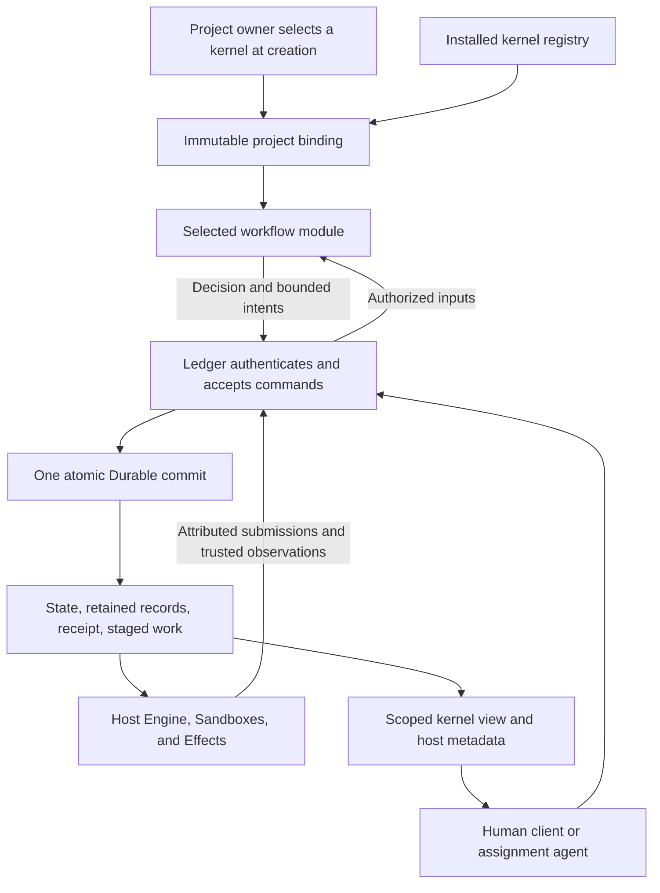
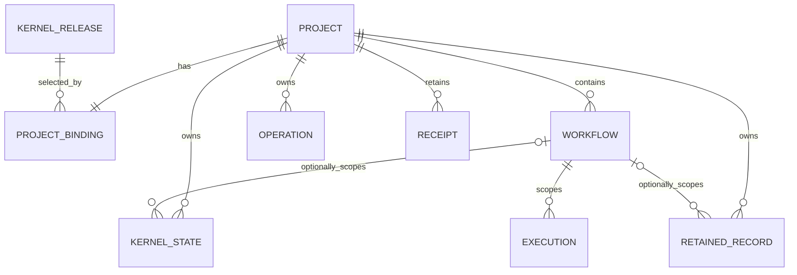
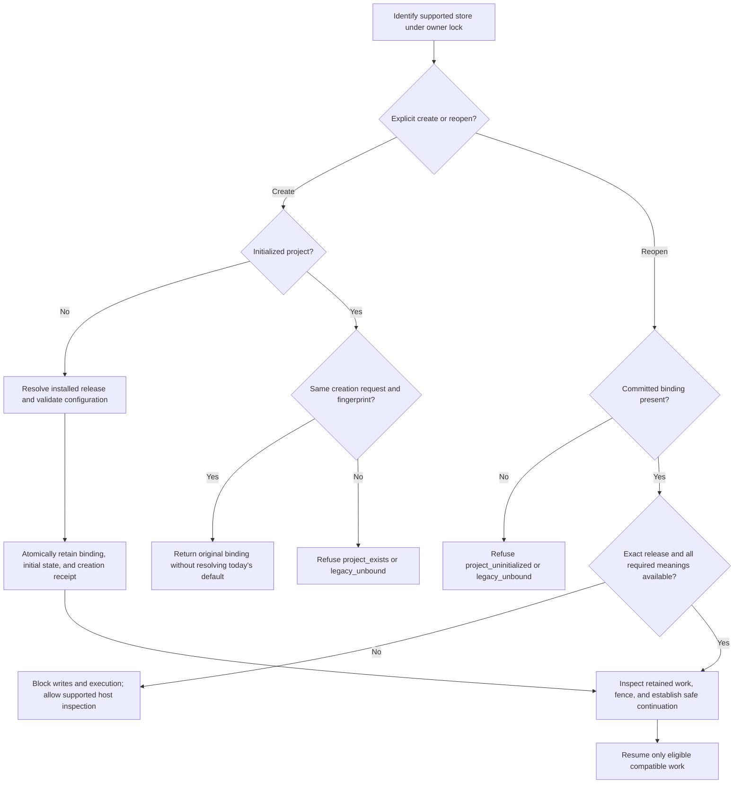
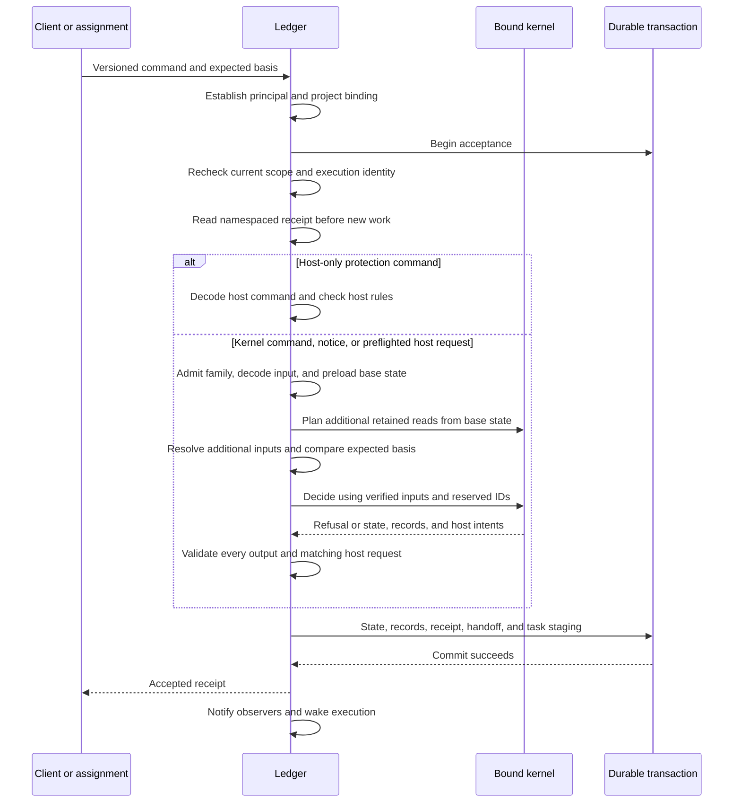
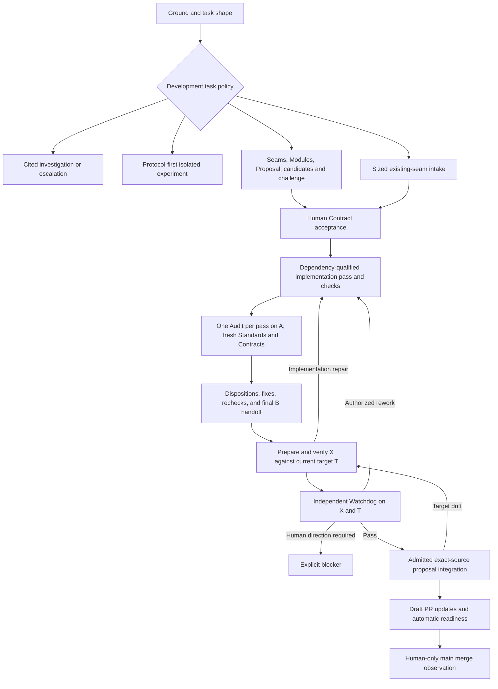
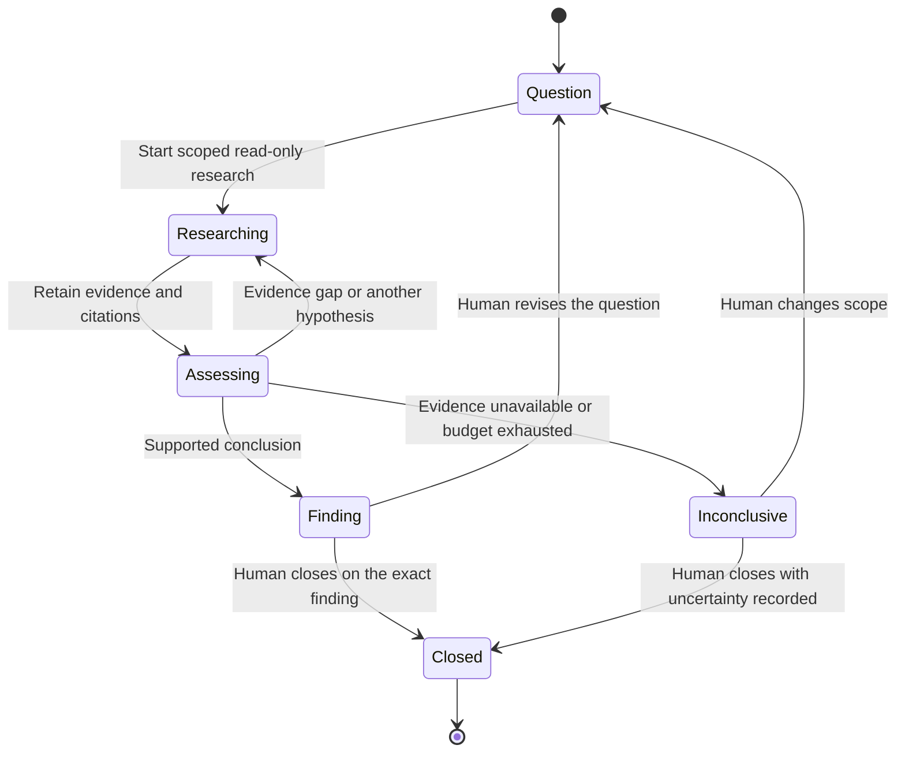

# Pluggable workflow kernels for new projects

Render should let each new project select its workflow kernel. A project owner could choose the full development workflow or a smaller investigation workflow. Kernel authors should reuse Render's authority, persistence, and execution facilities rather than fork them.

**Status is a proposed design for review. Nothing here is implemented or accepted as a new product contract.** Kernel selection applies only to new projects. Changing an existing project's kernel, upgrading its binding, and hot swapping are out of scope.

## Recommendation

Make a kernel a **versioned workflow module**. It supplies command schemas, domain state, decisions, role recipes, and presentation. Select the whole module when the project is created. Record the resolved selection in Ledger and use it on every reopen.

Render keeps one accepting authority. Ledger owns transactions, authenticated identity, current authorization, receipts, and durable records. Engine owns execution lifecycle. Sandboxes and Effects retain their existing execution responsibilities. A kernel requests work through typed host intents. It cannot obtain authority by returning a JSON field.

Use Effect for composition and asynchronous execution. Keep the transactional decision interface deterministic and synchronous. These choices are compatible. An Effect-composed host does not require arbitrary Effects inside its acceptance transaction.

Start with trusted, explicitly registered code modules and two kernels. Do not start with a workflow language, dynamic package loader, marketplace, or separately published SDK.



The diagram describes the proposed responsibility split. It is not a deployment diagram or executed evidence.

## What the current source tells us

This design uses PR #32 at `3983eacad1be8196d7d67263f03ecdecb9558329` and PR #79 at `994cbfbe9e97fd8443c01dc1d431bb9d0c81066d`. The [source register](sources.md) provides fixed-commit citations.

- There is no explicit project or kernel binding in the inspected store. One data directory composes one Ledger and Engine. `createWorkflow` creates an instance inside that authority, not a new project. [S2](sources.md#s2-the-inspected-store-has-no-explicit-project-or-kernel-binding)
- A selector around `change` is insufficient. Decoders, input resolution, write application, role execution, and views all contain built-in workflow knowledge. [S5](sources.md#s5-the-current-kernel-is-a-coherent-workflow-not-a-ready-extension-slot)
- Ledger already commits state, records, receipts, and staged work together. Current documents plus retained records are authoritative. The facts are not demonstrated to be a replay-complete event store. [S3 and S4](sources.md)
- PR #79 pins Effect 4.1.2 and preserves synchronous decision interpretation. It is a vertical pilot, not an implemented kernel service or a complete Effect migration. [S6](sources.md#s6-pr-79-preserves-synchronous-interpretation)
- Accepted v1 excludes a generic plugin framework. This is a future proposal, not an amendment silently added to PR #32 or PR #79. [S1](sources.md#s1-the-accepted-v1-design-is-narrower-than-this-proposal)

## The data model comes first

Use four distinct concepts.

| Concept | Meaning and owner |
| --- | --- |
| Kernel release | Installed workflow code, codecs, and recipes under an exact identity. The operator controls installation. |
| Project binding | Ledger's immutable record of the selected release and validated initial configuration. |
| Workflow instance | A host-owned identity, conversation, and visibility scope inside the project. The kernel owns its workflow state. |
| Execution | Host-owned assignments, attempts, generations, executor epochs, admitted operations, and observations. |

For the first release, map one initialized Render store to one project. Give the project its own `ProjectId`. Do not reuse `authorityEpoch` or `executorEpoch` as a product identity. This is a proposed explicit model over today's implicit store boundary. It does not require several projects in one database.

The following types are documentation sketches. Semantic IDs and references represent distinct validated types, not interchangeable strings. Implementation types should derive from authoritative schemas.

```typescript
type KernelRelease = Readonly<{
	id: KernelId;
	release: ReleaseVersion;
	artifactDigest: Digest;
}>;

type ProjectBinding = Readonly<{
	project: ProjectId;
	kernel: KernelRelease;
	kernelApi: 1;
	initialConfig: RetainedRef;
	creationRequest: RequestId;
	creationFingerprint: Digest;
}>;

type KernelStateEnvelope = Readonly<{
	scope: ProjectScope | WorkflowScope;
	key: KernelStateKey;
	schema: SchemaVersion;
	revision: RevisionId;
	payload: Json;
}>;
```

The release digest identifies the installed implementation, codecs, and recipes. It is not a proof of trustworthy code or a promise of reproducible external execution. Host compatibility is a separate declared requirement.

Initial configuration contains workflow defaults, not provider secrets or executable paths. Retain its validated canonical bytes. Later policy changes use revisioned kernel commands. Editing a configuration file cannot replace the binding or alter an already captured decision basis.



This is a conceptual relationship diagram, not an application SQL schema. A state envelope has either project scope or workflow scope. It does not have both.

## The host protects authority, the kernel defines workflow meaning

| Render owns | A selected kernel owns |
| --- | --- |
| Principal establishment and current identity. | Command catalogue and permitted domain transitions. |
| Device scope, assignment currency, revocation, and visibility. | Role names and the work each role may request within host ceilings. |
| Exact retained bytes, digests, and provenance of trusted observations. | Which evidence satisfies a workflow obligation. |
| IDs, sequence allocation, optimistic basis enforcement, and receipt deduplication. | Domain state, immutable domain records, and refusal reasons. |
| Atomic acceptance and task staging. | When legal work becomes eligible. |
| Attempts, capacity, fencing, cancellation, and quiescence. | Instructions, result interpretation, independent-context requirements, and workflow budgets. |
| Effect admission, dispatch observations, and uncertain-outcome handling. | Whether the current domain basis qualifies for an operation. |
| Human-attributed decisions over an exact requested basis. | Which decisions require a human. |

The last row needs a firm distinction. A kernel can require an authenticated human decision. It cannot label a machine submission as human approval. Host attribution records the actual actor and exact requested subject. An ordinary kernel record named `approved` establishes no human consent.

Likewise, host provenance establishes where evidence came from and which bytes or source it concerns. It does not establish that a model's conclusion is correct. The kernel evaluates evidence sufficiency under its declared workflow.

The full development kernel retains its accepted Seams, Modules, Contract, Audit, Watchdog, dependency, and integration rules. These rules belong to that kernel. They are not universal stages that every investigation or support workflow must traverse.

Main merge remains outside autonomous host operations. Kernel pluggability does not expand that authority.

## The extension interface

Bind one coherent module, not independently replaceable Ledger services. Its interface includes ordering, schemas, failure behavior, and compatibility obligations as well as methods.

```typescript
interface WorkflowKernel<Config, State, Command> {
	readonly manifest: KernelManifest;
	readonly codecs: KernelCodecs<Config, State, Command>;
	readonly commands: ReadonlyMap<CommandName, CommandSpec>;
	readonly recipes: ReadonlyMap<RecipeRef, RoleRecipe>;

	initialize(input: InitialInputs<Config>): InitialState<State>;
	needs(input: ReadPlanningInputs<State, KernelInput<Command>>): readonly HostRead[];
	decide(input: DecisionInputs<State, KernelInput<Command>>): Decision<State>;
	present(input: VisibleInputs<State>): KernelView;
}

type KernelInput<Command> =
	| { kind: "command"; command: Command }
	| { kind: "host-notice"; notice: HostNotice }
	| { kind: "host-request"; request: HostDecisionRequest };

type HostDecisionRequest =
	| { kind: "work.rebind"; request: HostRequestId; work: ExecutionRef }
	| { kind: "operation.admit"; request: HostRequestId; operation: OperationRef };

type Decision<State> =
	| KernelRefusal
	| Readonly<{
		outcome: "accepted";
		state: readonly StateReplacement<State>[];
		records: readonly KernelRecordDraft[];
		intents: readonly HostIntent[];
		result: Json;
	}>;

type HostIntent =
	| CreateWorkflow
	| RetainArtifact
	| RecordHumanDecision
	| RequestAgent
	| RequestSupportedJob
	| RequestSupportedOperation
	| CancelOwnedWork
	| AuthorizeRebind
	| AuthorizeOperation;

type RequestAgent = Readonly<{
	kind: "agent.request";
	workflow: WorkflowId;
	assignment: ReservedAssignmentId;
	recipe: RecipeRef;
	packet: RetainedRef;
	requestedProfile: ToolProfileRef;
}>;

type HostRead =
	| ReadAdditionalScopedState
	| ReadRetainedContent
	| ReadExecutionStatus
	| ReadOperationStatus
	| ReadTrustedSourceObservation;
```

`HostIntent` is a closed union of versioned host requests. The names above summarize contracts, not arbitrary callbacks or unchecked JSON escape hatches.

- The manifest identifies the release, host compatibility, kernel interface version, supported schemas, and required host facilities.
- Codecs parse configuration, command payloads, private state, domain records, recipe inputs, and results. Unknown command formats refuse. Unsupported stored meaning blocks writable use. There is no implicit migration.
- Command specifications declare principal families, scope, payload decoding, and a pure selector for required expected-basis references. They can narrow host permissions, not grant new principal classes. Ledger compares those expected resource revisions with current host envelopes. The kernel checks domain legality and any finer domain-specific conditions.
- Ledger preloads the kernel's project-state cells and the envelope's target workflow cells after authorization. This is the base state passed to `needs`. It is not a result of `needs`.
- `needs` plans additional scoped state, typed retained references, and trusted observations from that base state and decoded input. Planning has one bounded round. It cannot request SQL, filesystem paths, arbitrary URLs, or a storage transaction. Ledger resolves those additional reads in the same transaction and checks reference integrity and permitted scope. The kernel cannot discover another hidden read during `decide`.
- `decide` receives decoded state, the actual established principal, verified inputs, reserved IDs, and the exact basis. State replacements can affect only allowed scopes in the read set or newly allocated workflow scopes.
- Records and intents contain data and references. They contain no fibers, closures, service handles, credentials, or caller-minted capabilities.
- `present` receives caller-visible state and references. Project-private state is not passed to a workflow-scoped viewer. The host cannot safely redact arbitrary kernel JSON after the fact.

Retain existing host resource limits. Determine any additional payload or fan-out limits against real v1 fixtures before implementation acceptance. This pre-design does not invent numeric budgets.

`initialize`, `needs`, `decide`, codecs, and presentation are deterministic and synchronous. Expected refusals accept nothing in the kernel acceptance transaction. A thrown defect, invalid output, or returned Promise rolls that transaction back and fail-stops the project host through its fatal-error path. It is not a routine domain refusal. Known storage uncertainty preserves the existing same-command retry behavior.

The host protocol needs a distinct `kernel_defect` error when the decision failed and rollback is known. It must not reuse today's generic fatal reply that says storage failed and requests a same-command retry. If storage outcome is genuinely uncertain, retain `outcome_unknown` instead. Neither error is an accepted receipt. The client must not automatically retry a deterministic kernel defect.

This design does not introduce a durable project quarantine. Restart after a defect is an explicit operator action and may encounter the same defect again. Automatic process restart is not part of this recovery contract. A deployment that needs it must first define persistent dispatch inhibition. This is less machinery than a new block registry and does not imply that stopping a process retracts an external effect already admitted.

These are trusted-code contracts. Import discipline, deterministic fixtures, and output validation help detect mistakes. They do not sandbox a malicious installed module. Supporting untrusted code requires a separate design.

### Host commands, notices, and domain checks

Keep a closed host command catalogue separate from the selected kernel catalogue. The current `recordStartup`, `enrollDevice`, and `revokeDevice` protections must move out of today's kernel. Host epoch fencing, revocation, receipt access, and inspection cannot require an available kernel to decide their meaning. [S9](sources.md#s9-host-protections-currently-pass-through-the-built-in-kernel)

A strict host envelope carries protocol version, project and authority identity, scope, command ID, expected basis, and a bounded body. The body distinguishes host commands from namespaced kernel commands. Ledger computes the fingerprint from that canonical envelope before plugin decoding. A kernel payload cannot override scope, identity, or fingerprint.

Host-only protections use host codecs, authority checks, and host writes without calling `decide`. A transition that grants new execution authority is different. After host preflight, Ledger constructs a `HostDecisionRequest` and sends it through `needs` and `decide` in the same transaction. Acceptance of that request requires exactly one corresponding authorization output. `AuthorizeRebind` and `AuthorizeOperation` are valid only for that matching preflighted request and checked basis. They request host action, not a returned capability. An ordinary kernel command or client payload cannot fabricate one.

A host request takes its scope from the authoritative execution or operation envelope during preflight. A workflow-scoped request preloads that workflow and project state. A project-scoped operation preloads only project state, with additional workflow reads planned explicitly. The caller cannot choose a broader scope.

Host lifecycle results enter as versioned `HostNotice` values containing references to established host facts. Host-owned codecs decode notices and decision requests. Kernel codecs decode private state and kernel commands. Trusted adapters mint these host inputs; external clients cannot select those input variants.

A verified host observation remains true even if domain progression cannot run. Its host transaction retains the observation and stages a notice task through existing Durable facilities. Handling that task re-enters Ledger with a stable event-derived command ID. A kernel refusal leaves the observation intact. The notice task retains a blocked delivery checkpoint with the input reference, refusal, and basis. It neither marks the notice handled nor retries it automatically. An explicit authorized retry reuses the same input identity and current checks. This is task-delivery state, not a project-wide defect quarantine.

A refused or blocked notice cannot erase the fact or authorize dependent work. Role-result handoffs that are kernel commands still commit their domain changes and next work atomically.

### How Effect fits

A project-scoped Effect service can hold the resolved kernel. Layers can construct Ledger, Engine, provider clients, and external executors around that selection. Do not use a process-wide mutable default to select a project's kernel.

The public decision seam returns the existing accepted-or-refused data shape. A kernel may use synchronous Effect programs internally, as PR #79 does. Effect's environment type does not establish synchrony or purity. A local probe and the official Effect 4 documentation confirm that asynchronous work can continue after synchronous interpretation returns a failure. [S6](sources.md#s6-pr-79-preserves-synchronous-interpretation)

Therefore, dependencies that perform I/O remain outside the decision seam. Schema validates shape at entry. Trusted host resolvers establish provenance. Effect error channels distinguish expected failures from defects. None of those facilities replaces transaction checks, fencing, or Git compare-and-swap.

## New-project selection and reopen

Introduce an explicit fresh-project creation operation. The exact CLI spelling is not a design commitment. `createWorkflow` remains a later operation inside the selected project.

Creation uses the existing authenticated `local-admin` route for the OS owner and the existing ownership lock. It checks the creation receipt before resolving a new default. Then it validates the installed release and initial configuration. One Durable acceptance commits project identity, binding, initial kernel state, and the creation receipt. Creation does not perform external work.

The fingerprint covers the canonical user request. An omitted kernel selection remains omitted for fingerprinting. The receipt records the concrete default resolved on the first acceptance. A lost reply followed by a changed system default must still return the original binding.



A different request against an initialized store returns `project_exists`. Reopening never resolves the current default. Missing code, a changed artifact digest, or unsupported schemas cannot cause fallback to another kernel.

An interrupted but recognizable uninitialized store can finish the same creation protocol. An arbitrary or incompatible database cannot become a fresh project.

Existing unbound stores are not converted. They remain with their compatible original host. This proposal introduces no `declare-legacy`, implicit binding, or existing-project migration command.

Reopen of an uninitialized store refuses `project_uninitialized`. Reopen of an initialized legacy store without a binding refuses `legacy_unbound`. Both remain distinct from an unavailable selected kernel.

The implementation must replace today's implicit Meta initialization in `openLedger` and its startup import of `checkpoint-settings.json`. Explicit creation retains validated initial kernel configuration. Ordinary reopen neither initializes a project nor imports new kernel policy from a file. Later policy import, if offered by a kernel, is an explicit authorized command. [S9](sources.md#s9-host-protections-currently-pass-through-the-built-in-kernel)

### Bootstrap is a feasibility gate

Today's startup constructs runtime definitions and calls `Harness.open` before reading Meta. Its uncertainty scan itself uses `Harness.commit`. It later commits the startup fence. Calling that sequence inspection does not establish a read-only bootstrap. [S7](sources.md#s7-startup-compatibility-comes-before-dispatch)

The proposed host needs a supported, kernel-free way to read the stable binding and inspect understood host envelopes without scheduling, migration, or startup writes. That mechanism has not been demonstrated. Neither a speculative two-open Harness sequence nor a second authoritative sidecar file is accepted here.

Prove this on a disposable store before implementing the extension interface. If the pinned Durable interfaces cannot support it, revise the bootstrap contract before choosing a storage workaround.

## Ledger layout and transaction contract

Continue using Durable document families and immutable entries. Do not introduce plugin SQL or require event sourcing. [S4](sources.md#s4-durable-documents-and-entries-already-provide-two-different-kinds-of-persistence)

| Proposed record | Host envelope and kernel content |
| --- | --- |
| Project binding | Host-owned immutable project identity, release, configuration reference, and creation receipt. |
| Workflow envelope | Host-owned identity, conversation, title, and visibility scope. No mandatory Seams or Contract fields. |
| Kernel state family | Host-owned scope, kernel identity, schema, and revision around typed private state. |
| Kernel record entry | Exact immutable payload with kernel kind and schema. Host stamps author, scope, sequence, basis, typed references, digest, and length. |
| Execution records | Host-owned assignments, attempts, granted profiles, current generation, task and recipe identity, and outcomes. |
| Operation records | Host-owned project or workflow scope, intent, admission attempt, executor epoch, observations, and unresolved outcome. |
| Existing content and receipts | Shared retained bytes, reference indexes, attribution, and deduplication. |

A kernel cannot override envelope metadata by repeating a field inside its payload. Host references resolve to actual records with checked ownership and integrity.

There is no universal `WorkItem` that renames a Slice. Slices and implementation passes remain development-kernel state. Questions, hypotheses, and findings remain investigation-kernel state. Workflow, retained content, execution, and operations are shared because each has a host responsibility.



Command family admission precedes payload decoding and input-dependent reads. Duplicate receipt disclosure requires current authorization. Kernel legality and host output validation occur before any acceptance is committed. Notifications are not the work queue.

Unknown kernel code must not prevent supported host inspection. The inspector reads identity, scopes, envelope provenance, and authorized raw bytes without interpreting domain meaning. Unknown payloads remain visibly undecoded. Unknown host schemas do not become trusted remote data.

History and export need deliberate format and independent-reader work. Include exact kernel record envelopes and honest declarations of unsupported or omitted kinds. Today's bounded export is not already a generic kernel archive. It remains history, not a backup or a replay proof. [S8](sources.md#s8-transport-and-export-require-deliberate-extension-work)

## Execution without a second authority

The kernel supplies versioned role recipes. Each recipe declares packet and result schemas, an immutable instruction renderer, allowed submissions, required context independence, and a requested tool profile.

Engine retains conversation continuity, child lifecycle, scheduling fairness, capacity, cancellation, and quiescence. It interprets supported host job requests for model work, source collection, isolated checks and experiments, deterministic preparation, notifications, and existing Git and forge operations.

A recipe does not grant its own tools. The effective capability set is the intersection of the installed recipe ceiling, operator configuration, current delegation authority, assignment scope, and requested profile. Permission to request another worker is distinct from the requesting worker's own tool access. Missing facilities produce a precise refusal or blocker.

Retain exact packets, rendered instructions, input references, and recipe identity before execution. Each durable task names its host definition version and exact kernel recipe meaning. A later installation cannot reinterpret an old checkpoint.

Role submissions pass through Ledger as their actual assignment principal. Reserved host routes supply the `host-notice` and `host-request` variants defined above. Their stable task-result or request identities supply deduplication keys. Neither bypasses kernel decisions to write private state.

An operation request is not a dispatch permit. Before dispatch, Ledger rechecks current authority, cancellation, and exact source and target where relevant. It sends `operation.admit` through the kernel input protocol to re-evaluate domain eligibility. Only a matching `AuthorizeOperation` plus passing host checks can cause the host to issue the attempt-bound permit. Unresolved external outcomes require reconciliation, not a new blind attempt.

### Extracting execution authority is the other feasibility gate

Today's `RoleWork` mixes assignment currency with development-specific pass and handoff rules. Today's Engine also branches on writer, experiment, and Watchdog work. [S5](sources.md#s5-the-current-kernel-is-a-coherent-workflow-not-a-ready-extension-slot)

Writer rebind currently checks the retained pass workspace, absence of a handoff, exact source scope, stopped environment, and current executor epoch together. The [current rebind rule](https://github.com/vicrdguez/render/blob/3983eacad1be8196d7d67263f03ecdecb9558329/src/kernel/roles.ts#L1381-L1422) makes this a concrete extraction risk.

Revocation and fencing remain unilateral host protections. Granting or rebinding live work must pass both the host's currency and quiescence checks and the kernel's domain checks in the same Ledger transaction. For rebind, the host sends `work.rebind` and requires the matching `AuthorizeRebind`. A generic host command cannot bypass pass or handoff legality.

Prove that this shared acceptance protocol can preserve those guarantees while recipes and domain rules move into the development kernel. A renamed role string is not enough. If preservation requires new host requests, justify each with a concrete existing behavior before accepting it into the interface.

The first release supports a finite set of host facilities. A kernel needing a fundamentally new executor or effect family requires a deliberate host extension. It cannot register arbitrary tools or Durable task code through an unchecked callback.

## Two genuinely different kernels

### The development kernel retains the full v1 contract

The example below abbreviates accepted v1 behavior. The existing specification remains the detailed authority for that kernel. [S1](sources.md#s1-the-accepted-v1-design-is-narrower-than-this-proposal)



Captured checkpoint settings, exact review bases, immutable accepted obligations, pass identity, Watchdog counts, dependency qualification, and uncertainty remain development rules. Deterministic preparation retries do not invent a new implementation pass. Source-changing Record work follows the same delivery path.

### The investigation kernel has no delivery graph

Its state consists of a question revision, research scope, evidence, hypotheses, findings, and remaining uncertainty.



This kernel never creates a proposal, Slice, implementation pass, Audit, Watchdog, or integration request. It requests only read-only research and retained evidence. A revised question cannot silently inherit a conclusion bound to the previous question.

| Shared facility | Development kernel | Investigation kernel |
| --- | --- | --- |
| Host workflow scope | Development journey. | Question and research history. |
| Private state | Checkpoints, obligations, passes, and dependencies. | Hypotheses, evidence sufficiency, and uncertainty. |
| Host execution | Coordinators, challengers, writers, and independent reviewers. | Read-only researchers. |
| Immutable records | Contracts, reviews, and handoffs. | Cited findings and human dispositions. |
| External operation authority | Supported source and proposal operations. | None for source mutation or forge publication. |

Passing both examples through the same Ledger and Engine is the test of the abstraction. Two renamed stage graphs would not establish it.

## Presentation follows the selected kernel

Snapshots and incremental updates use the same kernel view version. Both include the project binding so clients know which workflow they are presenting.

The host provides identity, authorized record navigation, receipts, evidence links, execution status, and honest compatibility blockers. A kernel provides its workflow-specific state and available command descriptions. The client must not infer `reviewIntake` or `reviewCheckpoint` for an unrelated kernel.

A minimal client can display host metadata, retained documents, and supported action descriptions. Rich interactions can use identity-bound client adapters later. This proposal does not claim that a generic form renderer supplies every kernel's user experience or that a third-party client can safely execute arbitrary kernel UI code.

When a client does not understand a view or action schema, it shows an unavailable action and a compatibility explanation. It does not guess a v1 command. Scoped clients receive only authorized inputs and records. Project-wide settings remain project-wide authority rather than mislabeled workflow settings.

## Failure traces the implementation must preserve

These are required future outcomes, not executed kernel tests.

| Situation | Required result |
| --- | --- |
| Creation accepted, reply lost, default changes. | Retrying the same request returns the original binding and project. No second initializer or default resolution. |
| Same command ID, same payload. | Reauthorize and return the readable stored receipt. No new state transition or task. |
| Same ID, different payload. | Conflict. Do not reinterpret the old receipt. |
| Stale decision basis. | Refuse without committing state, records, or work. Refreshing the view does not silently approve it. |
| Missing kernel, changed artifact, or unsupported schema. | Block mutation and dispatch. Inspect only understood host envelopes. No fallback or rewrite. |
| Crash after acceptance, before execution. | The receipt and staged work survive together. Resume retained work after compatibility checks and fencing. Do not recreate it from a notification. |
| Host observation accepted before its kernel notice is handled. | Preserve the fact and staged notice. Retry handling with the same event identity. A kernel refusal cannot erase the observation or authorize progression. |
| Old worker survives restart. | Reject stale authority. Preserve late evidence where authorized, but do not treat it as current completion. Reuse waits for quiescence. |
| External effect may have succeeded. | Retain the unresolved attempt. Reconcile actual state before retry or dependent work. Never infer success or absence. |
| Kernel returns malformed output or throws. | Roll back acceptance and fail-stop the project host. Operator restart is explicit and may hit the same defect. No new durable quarantine or automatic-restart guarantee is claimed. |

## Alternatives and tradeoffs

| Approach | What it buys | What it costs | Judgment |
| --- | --- | --- | --- |
| Replace only `change`. | A small initial edit. | Decoding, Ledger, Engine, and clients still encode v1. Every new workflow adds host branches. | Reject. |
| Independently replaceable Effect services. | Broad dependency substitution. | Makes transaction, authority, and lifecycle obligations part of plugin composition. Does not remove the need for coherent intents. | Reject as the public extension contract. Use Effect composition inside the recommended design. |
| Declarative graph and guard language. | Compact descriptions of simple stage order. | Needs another language for evidence, exact basis, source identity, cancellation, and recovery. | Reject for now. Ordinary typed code expresses these rules. |
| Kernel-owned Ledger and Engine. | Complete freedom. | Every kernel reimplements authority, receipts, fencing, and uncertain effects. | Reject. |
| Versioned workflow module with host intents. | Workflow changes stay local. Host integrity and execution remain shared. | Requires careful extraction of existing coupling and a finite capability contract. | Recommend, subject to the two feasibility gates. |

Exact release pinning also has an operational cost. Operators must retain compatible code and host definitions for projects that still need them. A deterministic defect can leave a pinned project unable to make progress. This is a real limitation of the proposed default, not something fail-stop fixes.

A maintenance and security-update policy must be accepted before production use of this extension architecture. The separate design must explain how fixes preserve retained meaning without switching workflow semantics. This proposal does not silently solve that problem by allowing existing-project upgrades. The cross-judge's semantic compatibility contract remains a concrete alternative to review.

## Implementation order, when authorized

Write failure cases and tests before production changes in each unit. The project requires this ordering.

1. **Prove the two uncertain seams.** Use disposable stores and fixtures for kernel-free bootstrap and host execution extraction. Define zero scheduling and no ledger mutation as inspection outcomes. Exercise interrupted writer, experiment, and Watchdog paths rather than a happy-path model role alone.
2. **Add new-project binding.** Test duplicate requests, changed defaults, conflicting creators, invalid configuration, partial initialization, absent releases, and explicit legacy refusal. Replace implicit initialization and startup settings import. No existing-store conversion.
3. **Extract the development module.** First separate the host envelope and host-only startup, enrollment, revocation, and fencing commands. Then route kernel commands, notices, admission requests, schemas, retained reads, decisions, state, recipes, and views through the interface. Test base-state loading before read planning, host basis checks, notice durability, matching rebind and admission responses, and failure without a kernel. Preserve public v1 behavior and exact evidence. Keep every extraction step verified before the next.
4. **Add the investigation kernel.** Run cited, inconclusive, revised-question, restart, and closure cases. Run with the development kernel absent. Verify that writer and integration requests are unavailable.
5. **Finish client and history compatibility.** Test scoped snapshots and change frames, unsupported views, independent exports, exact bytes, omissions, and kernel-unavailable inspection.
6. **Consider a public SDK only after both work.** Freeze the smallest demonstrated contract. A new host facility must have an actual consumer and its own failure cases. Before production release, also accept a maintenance policy for pinned projects. Test the distinct defect reply and explicit blocked-notice retry protocol.

During implementation, use focused existing checks while editing. Run the required cumulative source-specific gate on the final implementation candidate. Nothing in this document claims that those product checks ran.

## Decisions for review

The proposal recommends these defaults.

- One store is one project for the initial implementation. Project identity is distinct from authority and execution epochs.
- New projects default to the built-in development kernel, but Ledger records the exact resolved release.
- Kernels are trusted installed modules with explicit registration. A repository cannot cause arbitrary code installation by naming a package.
- A kernel defect fail-stops its project host. An unrelated project host need not stop. This is not a new durable quarantine or an automatic restart policy.
- Existing stores and existing-project upgrades stay outside this work.

The operator still needs to review the exact-release maintenance policy and the desired first-release client experience. Bootstrap feasibility and execution extraction are engineering questions for the named probes, not questions to settle by preference.

## Evidence and recovery of this design

The [source register](sources.md) separates observed behavior from proposals. The [comparison](comparison.md) records the three independent designs and a genuine disagreement with the cross-judge. The [review dispositions](reviews/README.md) explain corrections after adversarial review. The [research record](research.md) records method and verification limits. The [alternative drafts](alternatives/README.md) preserve those designs. The [decision trail](decisions.tsv) records the choices and their evidence.

This is a source-grounded pre-design. It is not runtime proof that the kernel interface, bootstrap, or extraction works. No implementation files or accepted specifications were changed.
