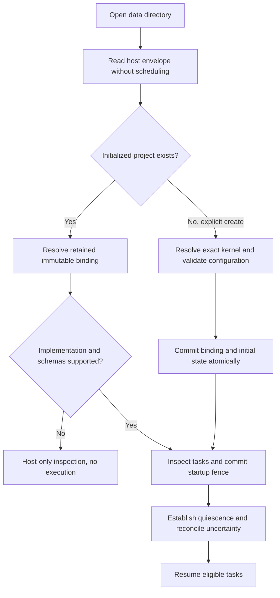
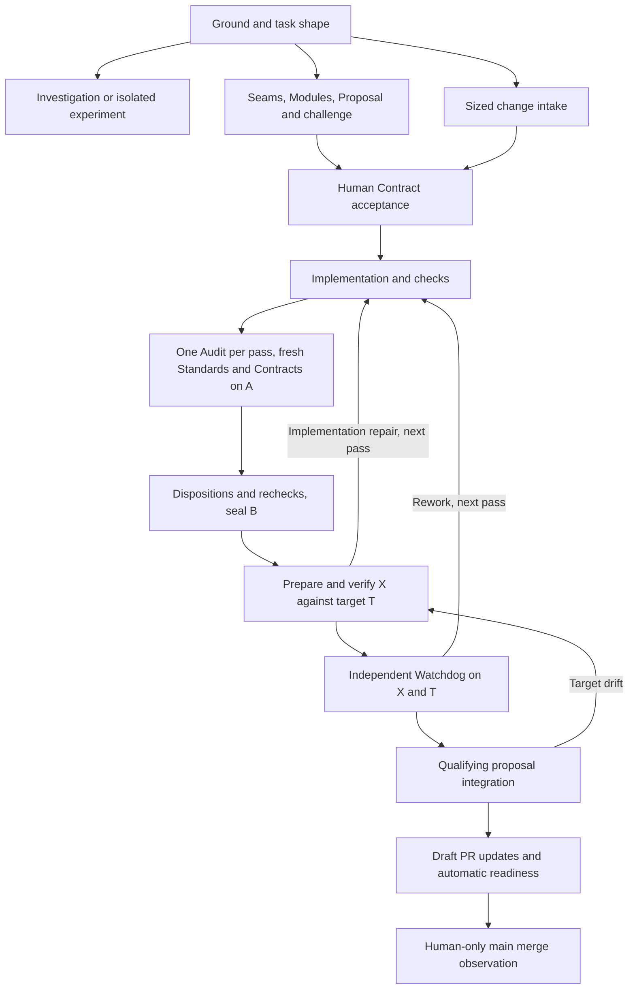
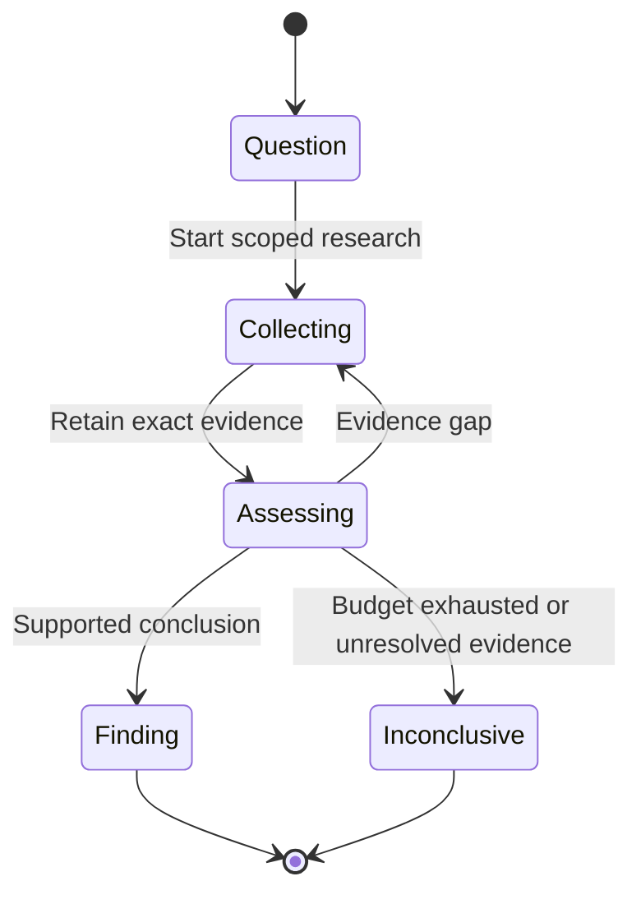

# One project, one workflow kernel

The goal is to choose a workflow kernel once for each new Render project, without switching existing projects. Project owners get different workflows. Kernel authors inherit one authority and recovery model rather than implementing another Ledger.

## Key concepts and ownership

Begin with four separate data shapes. These are proposed, not existing records.

| Shape | Owner and meaning |
|---|---|
| `KernelIdentity` | A registered implementation, identified by name, release, and content digest. |
| `ProjectBinding` | Host-owned immutable project identity, resolved kernel identity, interface version, and validated initial configuration. |
| `KernelState` | Kernel-private project settings or workflow state, tagged with schema and owning scope. A workflow is an instance inside the project. |
| `Execution` | Host-owned task, attempt, generation, executor epoch, admitted operations, and observations. Kernel state references these records but cannot rewrite them. |

```typescript
type KernelIdentity = Readonly<{
	name: KernelName; release: string; digest: Digest;
}>;
type ProjectBinding = Readonly<{
	project: ProjectId;
	kernel: KernelIdentity;
	interfaceVersion: 1;
	initialConfig: VersionedJson;
	createRequest: RequestId;
	createFingerprint: Digest;
}>;
type StateEnvelope = Readonly<{
	scope: ProjectId | WorkflowId;
	kernel: KernelIdentity;
	schema: number; revision: RevisionId; payload: BoundedJson;
}>;
```

All snippets are unimplemented documentation. Semantic identifiers represent distinct validated types. Persisted values contain data and references, never capabilities, closures, or fibers.

`WorkflowId` remains shared because it names an authorization, conversation, and history scope. It does not imply Slices, Contracts, or implementation stages. Those belong exclusively to the Render v1 kernel.

## Overview

**PASS for design review only.** This recommendation has source grounding, not runtime proof. It proposes future scope, not an amendment to accepted v1.

Citations use two immutable snapshot roots.

- B is `/tmp/render-kernel-design.d4hjii/v1` at `3983eacad1be8196d7d67263f03ecdecb9558329`.
- E is `/tmp/render-kernel-design.d4hjii/effect` at `994cbfbe9e97fd8443c01dc1d431bb9d0c81066d`.

Observed baseline supports one Engine and Ledger per data directory. `Meta` contains neither project ID nor kernel identity. `createWorkflow` creates an instance inside that authority, not a project. [B `src/host/host.ts:22-33`; `src/ledger/records.ts:19-51`; `src/ledger/ledger.ts:1364-1376`]

Recommend a **trusted synchronous transition module with host intents**, packaged with its codecs, task catalogue, and presentation. A compiled registry resolves the complete package once. The selected module owns workflow semantics. Ledger keeps transaction and authority semantics.

| Alternative | Judgment |
|---|---|
| Transition module with host intents | Chosen. Concentrates policy while preserving one commit and execution path. Authors must understand explicit evidence and admission contracts. |
| Effect-composed plugin bundle | Useful composition technique, unsuitable as the extension contract. Arbitrary service replacements spread authority and lifecycle obligations across Layers. |
| Declarative workflow graph | Useful diagram, insufficient implementation. Exact evidence, target drift, cancellation, and uncertain effects require executable rules. Adding expression hooks creates another workflow language. |

The seam replaces decoding, input resolution, decisions, projections, and runtime policy together. This gives callers workflow-level leverage and keeps changes local to one package. Its interface burden includes versioning and recovery, not merely function signatures. Wrapping only `change` leaves closed command routing and fixed task dispatch. [B `src/kernel/kernel.ts:200-330`; `src/engine/runtime.ts:1039-1082`]

## How it works

### Create once, reopen exactly

A project means one Render data directory and its authority. Add `ProjectBinding` to a new host record schema. Keep project ID distinct from authority and executor epochs.

Creation requires an authenticated local-owner request with a stable request ID. Under the existing owner lock, verify that no initialized Render project exists. Resolve the requested name or current creation default to an exact registered identity. Validate configuration and required host capabilities. Atomically commit identity, binding, initial kernel project state, and creation receipt. Do not start tasks during creation.

The receipt retains the original request fingerprint and resolved default. A duplicate request returns that binding before resolving today's default. Changed arguments with the same ID conflict. A different creation request against an initialized store returns `project_exists`. An interrupted empty initialization can retry. An ambiguous or unrecognized store cannot become a fresh project.

Reopen reads the host binding before constructing Engine or loading kernel state. It requires the exact implementation digest, supported interface and state schemas, and all retained task definitions. A missing package or mismatched version blocks mutation and scheduling. Never substitute a default. Existing stores without a binding remain explicitly legacy and require their existing compatible host. This proposal neither backfills identities nor converts stores.

Initial configuration contains kernel defaults, not credentials. Once initialized, policy changes use kernel commands and revisioned records. Provider credentials remain host configuration. Replacing a file cannot mutate the binding or an accepted request's captured policy.



Current startup inspects definitions and uncertainty before its executor fence and resume. The proposed bootstrap must move binding resolution ahead of runtime composition without weakening that ordering. [B `src/ledger/startup.ts:50-190`]

### The author-facing interface

Use one package, not independently selectable extensions. `Result` below is a local tagged union, not an Effect library API.

```typescript
type Result<A, E> =
	| { ok: true; value: A }
	| { ok: false; error: E };

type HostIntent =
	| { kind: "create-workflow"; local: LocalId; title: string }
	| { kind: "retain"; local: LocalId; bytes: BoundedBytes }
	| { kind: "attest-human"; basis: ExactBasis; content: RetainedRef }
	| { kind: "start-task"; definition: TaskRef; input: BoundedJson }
	| { kind: "cancel-task"; execution: ExecutionRef }
	| { kind: "stage-effect"; request: SupportedHostOperation };

type Accepted<S> = Readonly<{
	next: BoundedList<{ scope: ScopeRef; value: S }>;
	records: BoundedList<KernelRecordDraft>;
	intents: BoundedList<HostIntent>;
	result: BoundedJson;
}>;

interface Kernel<C, S, Q> {
	manifest: KernelManifest;
	codecs: VersionedCodecs<C, S, Q>;
	commands: ReadonlyMap<CommandName, CommandDescriptor>;
	initialize(config: C): Result<S, Refusal>;
	needs(state: S, command: Q): BoundedList<HostRead>;
	decide(input: DecisionInput<S, Q>): Result<Accepted<S>, Refusal>;
	present(input: VisibleInput<S>): KernelView;
	tasks: ReadonlyMap<TaskRef, TaskSpec>;
}

type TaskSpec = Readonly<{
	template: VersionedHostTemplate;
	input: Codec<BoundedJson>; output: Codec<BoundedJson>;
	tools: HostToolProfile;
	packet: (input: VerifiedTaskInput) => ImmutablePacket;
	onResult: (result: VerifiedTaskResult) => BoundedList<CommandDraft>;
}>;
```

`S` is the kernel's typed union of project and workflow state. `next` replaces only authorized scopes in the transaction's read set or newly allocated workflow scopes. `KernelManifest` declares identity, readable schemas, current write schemas, required host facilities, and output limits. Codecs synchronously parse commands, configuration, state, records, task inputs, and results. Unknown command versions refuse. Unsupported persisted schemas block writable open. Read codecs may support older representations without rewriting records. There is no implicit schema migration.

`HostRead` is a closed request for retained content, scoped state, execution status, or a trusted observation. It is not SQL or an I/O callback. Ledger authorizes every requested reference and verifies exact bytes and provenance. Network collection happens earlier through an admitted task. `DecisionInput` carries immutable decoded state, command, established principal, verified facts, exact basis, and reserved IDs. Transaction-local IDs resolve draft references before commit.

Command descriptors declare accepted principal classes and input schemas. These declarations can narrow host permissions, never grant them. Ledger checks current scope and execution identity, then deduplicates, resolves inputs, checks basis, decides, validates outputs, and commits. Freshness uses relevant resource revisions, not every unrelated workflow change.

Output lists, payload bytes, reads, and projections have host-enforced limits. The package declares maxima no larger than host limits. Select initial budgets against v1 fixtures before implementation acceptance. Oversized output refuses atomically. Typed refusal commits nothing. A thrown defect or invalid package output rolls back and stops writable operation rather than masquerading as a domain refusal.

Decisions must return synchronously and deterministically. Frozen inputs, import restrictions against I/O, clocks and randomness, thenable rejection, and determinism tests support this trusted-code contract. TypeScript alone cannot prove it.

The pilot pins Effect 4.1.2 and interprets decisions with `Effect.runSync(Effect.result(...))`. An environment-free Effect can still suspend. [E `package.json:80`; `src/kernel/kernel.ts:523-533`] Keep public decisions as plain results. If host composition adopts Effect, Context carries the immutable selected module and host facilities. Scoped Layers acquire runtime resources outside the transaction. Plugins cannot replace Ledger, credential issuance, or Effects Layers. This is not a repository-wide Effect migration.

### Authority and execution

Host guarantees include principal establishment, current authorization, ID allocation, deduplication, exact retained bytes, attribution, atomic acceptance, visibility, and execution fencing. Kernel policy includes checkpoint routing, allowed transitions, task roles, evidence sufficiency, and completion criteria.

A kernel record saying `approved` is only a claim. `attest-human` requires the authenticated human and exact retained basis. Ledger stamps identity itself. Likewise, workers submit evidence claims. Trusted collectors establish source identity, execution provenance, and observations. Kernels decide whether established evidence satisfies their rules.

A task request receives only the intersection of host configuration, current delegation authority, assignment scope, and the requested tool profile. Host-approved delegation rules distinguish permission to request a writer from permission to use writable tools. A read-only coordinator cannot invent that delegation. Host code issues ephemeral capabilities after admission. A returned payload cannot create one. Main merge has no automatic host operation.

Engine owns scheduling, cancellation, quiescence, capacity, conversation continuity, and trusted execution. Kernels supply versioned role instructions, immutable packets, result codecs, and pure result-to-command mappings. First release supports host templates for role conversations, preparation and checks, and notifications. Roles can vary without new Engine branches. New execution mechanisms or external operation families require host development, not a plugin callback.

`packet` and `onResult` are synchronous and deterministic. Engine submits mapped commands through Ledger with IDs derived from durable task/result identity. They cannot mutate state directly.

Task identity includes kernel identity, task name/version, and host template version. Retained definitions keep their original meaning, including prompt semantics. Startup checks every retained definition before resume. Existing code already preserves an older preparation definition for admitted work. [B `src/engine/runtime.ts:870-934`]

`stage-effect` records an intent, not permission to dispatch. A later admission transaction rechecks cancellation, exact basis, kernel eligibility, and host authority. It allocates an epoch-bound attempt. Effects consumes that attempt and records a trusted observation through Ledger. Uncertain dispatch is reconciled, never blindly retried. This preserves the distinction already present in integration admission and trusted Git execution. [B `src/kernel/integration.ts:334-379`; E `src/effects/source.ts:312-362`]

### Two different workflows

The v1 package retains its full product contract, including Ground, investigations, protocol-first experiments, shortened change intake, and design candidates. Design proceeds through Seams, Modules, and Proposal with challenge, annotations, dispositions, and captured checkpoint routing. Final Contract acceptance remains human. Immutable Contracts, dependency qualification, and implementation passes remain v1 state.



Source-changing Record work uses the same delivery path. Preparation-only retries do not create a new pass. Watchdog counting and human escalation remain intact. These are accepted v1 guarantees, not universal stages. [B `docs/spec.md:19-83`]

The investigation kernel instead stores a human question, bounded collection requests, retained evidence, hypotheses, and a cited finding or explicit inconclusive result. Its researcher can request another collection round or close the investigation. Human scope changes create a new question revision and invalidate affected conclusions.



It has no proposal, Contract acceptance, source integration, Audit, or Watchdog. Host templates run read-only researchers and retain web or repository evidence. Kernel codecs and projections expose question revision, citations, uncertainty, and remaining work. Neither Ledger nor Engine invents missing delivery stages.

## Where things live

Use existing Durable documents and entries, not application SQL tables. Current records already distinguish mutable documents from immutable entries. [B `src/ledger/records.ts:1-95,165-274`]

| Proposed location | Responsibility |
|---|---|
| Host `Meta` | Project binding, epochs, global sequence, scope indexes. |
| Host `Workflow` envelope | Workflow identity, conversation, title, creation sequence. |
| `KernelState` document family | Current private state, keyed by project or workflow scope. |
| `KernelRecord` entries | Kernel kind/schema, payload, typed relationships inside host envelopes. |
| Host records | Receipts, identities, revisions, execution attempts, effect intents, observations, and human attestations. |

Ledger stamps kernel identity, ownership, sequence, author, basis references, content digest, and length. It validates reference existence and scope. Payloads cannot override envelope fields. Kernel records may hold immutable Contract semantics, but host references establish who accepted which bytes.

One Durable transaction updates private state and host references, appends records, stages actual tasks, and writes the receipt. Observers receive changes only after commit. Current state plus retained records remains authoritative. This proposal does not require replay-complete events. Atomic role-task staging already exists. [B `src/ledger/ledger.ts:1346-1376`]

Package-aware snapshots and change frames use the same projection. Host visibility filtering precedes projection. Project-scoped payloads require project-wide read authority. Scoped clients receive authorized workflow documents, never a filtered guess at opaque project JSON. Cross-workflow dependencies expose only authorized references. Clients receive kernel identity, view version, and a command catalogue with typed forms. Unknown clients can display host records and explain unavailable actions instead of sending v1 commands.

Host-only inspection reads envelopes and exact opaque payload bytes without loading kernel code, running tasks, or writing startup records. It enforces current host scope and excludes credentials. Unknown payloads are labeled undecoded. Unknown host schemas block interpretation. Prove that Durable permits this non-scheduling, read-only bootstrap before shipping.

History/export needs a new explicit envelope version and independent reader support. It lists omitted kinds, redactions, missing content, and unsupported payload schemas. It remains a bounded history export, not a backup. Today's history declares unavailable kinds and its reader assumes schema 1. [B `src/ledger/history.ts:5-81`; `src/client/read-export.ts:25-103`]

## Gotchas and failure traces

| Failure | Required trace |
|---|---|
| Duplicate create | Read retained creation receipt, compare fingerprint, return original binding. No second initialization or default resolution. |
| Duplicate command | Reauthorize, then match principal namespace, ID, and fingerprint. Return readable receipt. Changed payload conflicts. |
| Stale command | Resolve current relevant revisions and reject stale basis before writing state or tasks. |
| Unknown kernel/schema | Block writable open before startup mutation. Host-only inspection preserves undecoded records. No fallback. |
| Crash after acceptance | State, handoff, receipt, and staged task exist together. Restart resumes the retained task after fencing, never recreates work from notification delivery. |
| Stale worker after restart | Reject old epoch or generation. Retain late observations as recovery evidence where authorized, not current completion. Abort alone cannot release capacity. |
| Uncertain external effect | Keep attempt unresolved. Reconcile exact remote or Git state. Admit another attempt only after evidence establishes safe retry. Divergence remains blocked. |

Current Ledger already reauthorizes duplicates and treats uncertain storage outcomes as a stop-and-retry-same-ID condition. Task abort explicitly does not prove quiescence. [B `src/ledger/ledger.ts:272-343`; `src/engine/runtime.ts:861-868`]

## Delivery and verification

Specify failure cases before implementation, then implement in these units.

1. Binding and inspection. Test duplicate creation with a changed default, conflicting requests, interrupted initialization, legacy stores, missing packages, unknown schemas, and zero writes during inspection.
2. Host intent transaction. Test rollback across state, records, receipts, and task staging. Reject forged attribution, evidence, references, capability requests, and oversized outputs.
3. v1 extraction. Preserve existing public journey tests, especially captured checkpoint settings, immutable Contracts, pass-specific Audit, target drift, Watchdog counts, cancellation, and publication uncertainty.
4. Investigation adapter. Test cited and inconclusive outcomes, scope changes, evidence gaps, and absence of delivery operations through the shared host.
5. Reopen and transport. Kill after commit and during external dispatch. Reject stale workers. Reopen retained task versions. Check scoped snapshots, streams, and independent exports with the kernel unavailable.

Use existing test tooling and real Durable fault tests at transaction and restart seams. Measure added test runtime. Run focused checks while iterating, then the cumulative project gate on the actual candidate source. No tests or runtime experiments ran for this document.

Open decisions are initial size budgets, the supported host-version lifetime for pinned packages, and confirmation of read-only Durable bootstrap behavior. Exact package pinning deliberately requires retaining old implementations. Updating an existing project's kernel is outside this proposal.

## Rationale and limits

Laziness Protocol changed selection to one compiled registry, without a loader ecosystem. Model the Domain and Foundational Thinking separated binding, private state, and execution facts. Boundary Discipline and Type System Discipline kept authority in validated host envelopes. Make Operations Idempotent preserved receipts and unresolved attempts. Prove It Works limits the verdict to document review.

Non-goals include switching, hot swapping, migrations, a marketplace, dependency solving, arbitrary plugin SQL, an untrusted-code sandbox, a workflow language, and full event sourcing. Accepted v1 itself excludes a generic plugin framework. [B `docs/spec.md:83`]

Rejected alternatives are arbitrary Effect service replacement and a declarative graph interpreter. Both increase author obligations without removing Ledger's authority work. The biggest risk in this recommendation is whether the finite host task templates can preserve all v1 recovery behavior without moving v1-specific branches back into Engine. The v1 extraction tests must settle that before the interface is accepted.
