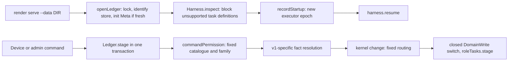
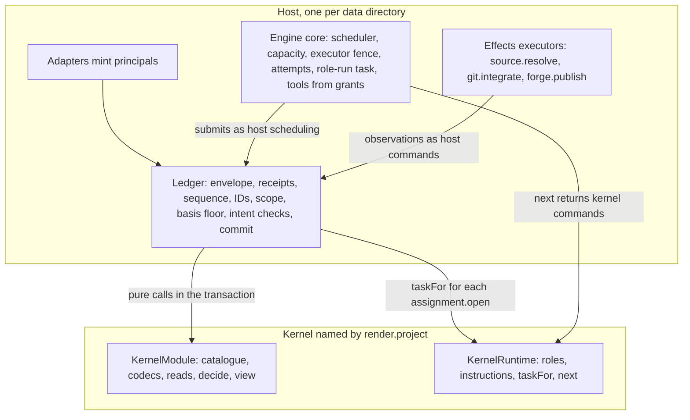
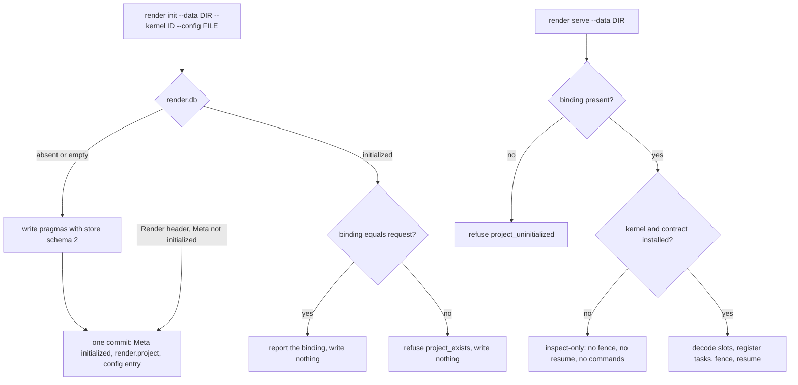
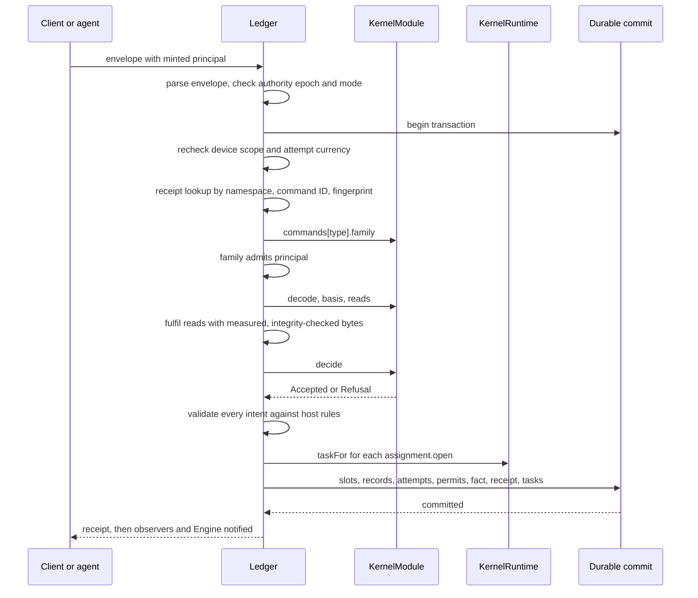
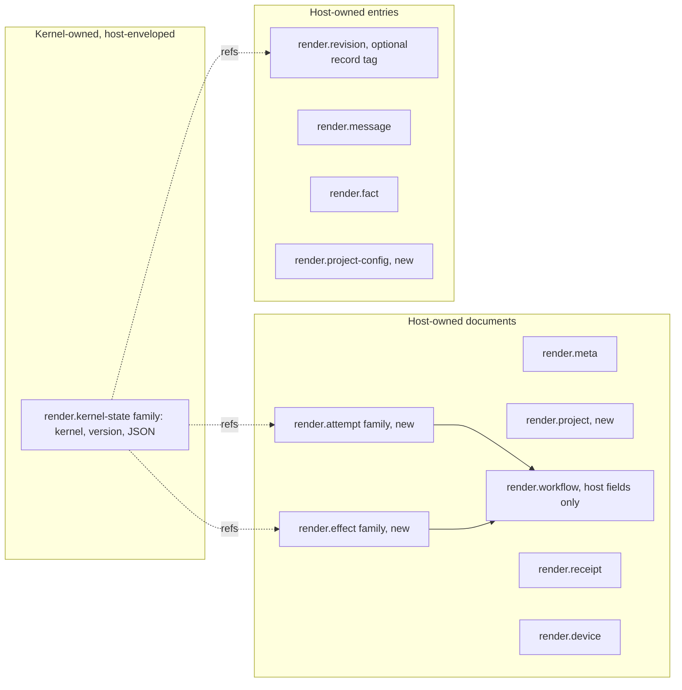
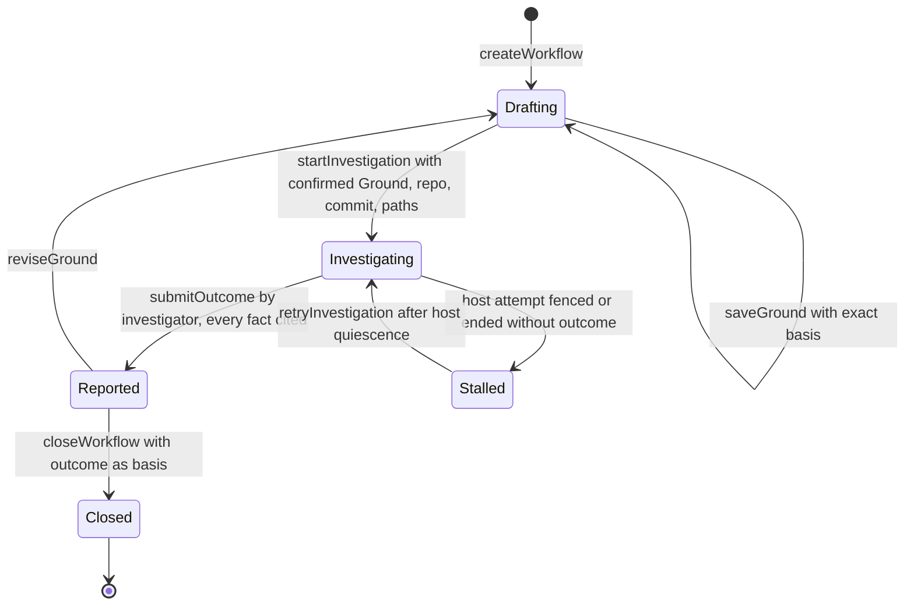
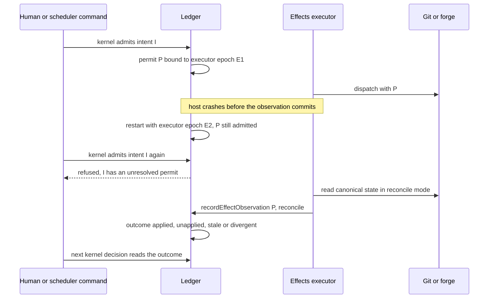

# Pluggable workflow kernels for new Render projects

Candidate `design-opus`. Design only. Nothing in this document is implemented.

**Goal.** Each new Render project picks one workflow kernel at creation and keeps it for life. Different kernels can run genuinely different workflows. Switching an existing project and hot swapping are out of scope. This document proposes the extension interface and ledger layout that allow this without weakening host authority.

**Verdict. ISSUES.** This is a reviewable pre-design. The recommendation is coherent and covers every item in the brief, but two feasibility gates are unverified. Gate G1 is a kernel-free Durable bootstrap. Gate G2 is a generic role-run task extracted from the v1 task. The operator must also choose the policy for existing schema-1 stores.

**Evidence labels.** `V` is PR #32 at `3983eacad1be8196d7d67263f03ecdecb9558329`. `E` is PR #79 at `994cbfbe9e97fd8443c01dc1d431bb9d0c81066d`. A sentence that cites a `V` or `E` path is observed source. Everything from "Recommendation" on is a proposal. "Unverified" marks an assumption that no source or run here confirms.

## Overview

Render runs one authority per data directory, with one Ledger and one fixed Engine (V `src/host/host.ts:22-33`). Each command runs in one Durable transaction that authorizes, deduplicates, calls the pure kernel, and commits documents, entries, the fact, the receipt and staged tasks together (V `src/ledger/ledger.ts:312-942`, `:1351`). The kernel encodes one workflow end to end. Its catalogue is closed (V `src/kernel/kernel.ts:207-275`), its view computes v1 milestones such as `reviewIntake` (V `src/kernel/kernel.ts:550-619`), and the Engine maps its role intents to fixed tasks (V `src/engine/runtime.ts:1038-1082`).

A pluggable kernel therefore needs a whole-workflow boundary, not a selector around `change`. The proposal keeps Ledger and Engine core as the only authority. A kernel supplies pure decisions, codecs, projections and runtime descriptions, and the host interprets them through a small closed set of intents.

## Key concepts

- **Principal.** A human device, the local admin, an assignment agent, or a host scope (V `src/kernel/kernel.ts:29-45`). Only trusted adapters mint one (V `src/ledger/principals.ts:1-20`).
- **Meta.** The store-wide document with authority epoch, executor epoch, sequence and workflow list. It has no project ID and no kernel identity (V `src/ledger/records.ts:19-51`).
- **Workflow.** A document family keyed by workflow ID that embeds v1 state such as `intakes` and `publication` (V `src/ledger/records.ts:67-90`).
- **RoleWork.** One document holding every assignment. The Ledger reads it to authorize agent commands (V `src/ledger/ledger.ts:327-334`), so execution authority lives inside v1 kernel state.
- **Effect admission.** v1 integration admits a one-use permit bound to an executor epoch and accepts a dispatch observation only from that epoch (V `src/kernel/integration.ts:289-375`). This is host-grade protection written as kernel code.

## How it works today



Project creation is implicit. On a fresh file, `openLedger` writes the store pragmas and then initializes `Meta` in a later commit (V `src/ledger/startup.ts:62`, `:126-135`, `:296-304`). `createWorkflow` is a later command that binds the current policy default to one workflow (V `src/kernel/kernel.ts:367-386`). It is not project creation.

Startup already fails closed. It refuses unknown store schemas and retained tasks without a definition (V `src/ledger/startup.ts:76-89`, `:238-273`). It refuses to replay orphaned tasks or unsafe interrupted tools (V `src/ledger/startup.ts:91-117`). Work resumes only after the executor fence commits (V `src/ledger/startup.ts:177-191`).

The Effect pilot changes how decisions are written, not how they are bound. `change` runs `changeEffect` through `Effect.runSync(Effect.result(...))`, with no service or Layer (E `src/kernel/kernel.ts:353`, `:523-529`).

## Where things live

| Concern | Today |
|---|---|
| Composition and startup | V `src/host/host.ts`, `src/ledger/startup.ts` |
| Transaction and records | V `src/ledger/ledger.ts:272-1060`, `src/ledger/records.ts` |
| v1 workflow rules | V `src/kernel/kernel.ts`, `roles.ts`, `intake.ts`, `checkpoints.ts`, `integration.ts` |
| Tasks and role rendering | V `src/engine/runtime.ts` |
| History and export | V `src/ledger/history.ts`, `src/client/read-export.ts` |

## Gotchas

- The `{ type: string }` member of `Command` (V `src/kernel/kernel.ts:80`) is not an extension point. `commandPermission` refuses unlisted types before routing (V `src/kernel/kernel.ts:298-312`).
- Abort is not quiescence. The Engine marks an aborted role task orphaned for that reason (V `src/engine/runtime.ts:861-868`).
- Render's `Effects` class is an async Git and forge executor, not an Effect-TS service (E `src/effects/source.ts:1-12`).
- v1 already has an investigation playbook, but it runs inside v1 with v1 roles (V `docs/investigation.md:1-40`). The second kernel below is a separate workflow that reuses its codecs.

## Recommendation

Adopt a **kernel module with host intents**. A kernel is two pure descriptions bound to one versioned identity. `KernelModule` owns the command catalogue, codecs, read requests, decision and projection. `KernelRuntime` owns the role table, instructions, task requests and scheduling suggestions. The host owns everything that grants authority or touches the world. A kernel returns only data from a closed `HostIntent` union, which the host validates and applies.



### Data shapes and ownership

1. **Kernel identity.** `KernelId` is a branded name such as `render.v1`. `Contract` is the meaning version. Code may change within a contract only if every retained record keeps its meaning, the rule task definitions already follow (V `src/engine/runtime.ts:870-871`).
2. **Project binding.** An immutable `render.project` document, written in the commit that initializes `Meta`. It records kernel, contract, initial configuration digest and the local-admin principal.
3. **Workflow instance and state.** The host keeps workflow identity, title, conversation, document pointers and message count. Kernel state lives in host-enveloped slots, one for the project and one per workflow.
4. **Host facts.** Principals, receipts, sequence, attempts, effect permits, observations and retained bytes. The kernel reads them and never writes them.

The project is the data directory. `authorityEpoch` already names it once per store (V `src/ledger/startup.ts:126-135`). A separate project ID earns its place only when one store holds several projects.

### Host guarantees and kernel policy

| Concern | Host guarantees | Kernel policy |
|---|---|---|
| Principals | Adapters mint context. Device scope and attempt currency are rechecked in the transaction. | Which roles exist. Which host family each command belongs to. |
| Commands | Strict envelope, fingerprint, receipt dedupe, family check before decode, sequence, minted IDs, required basis on human decisions. | Catalogue, payload codecs, decision, refusal reasons. |
| Evidence | Measures submitted bytes, verifies retained digests, resolves trusted source, stamps `AcceptedBy`. | Which evidence a decision needs and what it means. |
| Execution | Attempt records, capacity ceiling, executor fence, quiescence, startup blocking, task-definition presence. | Role table, packets, instructions, when to request work. |
| Effects | Permits bound to an executor epoch, one unresolved attempt per intent, dispatch versus reconcile. | Eligibility to stage and admit, meaning of an outcome. |
| Persistence | One atomic commit, slot envelope, records as exact bytes, history declarations. | Slot schemas, record codecs, projections. |

Capability issuance works by intersection. A role declares a grant ceiling, and `assignment.open` requests grants within it. The host intersects the request with what the deployment provides and refuses `capability_unavailable` when one is missing. The Engine core turns grants into tools when the task runs. A grant persists as a name, never as a handle.

Seams, Modules, Contracts, Audit and Watchdog stay `render.v1` policy. Their guarantees are accepted, but they are not universal. Human attribution, exact basis, source evidence and permissions are host rules that no payload can switch off.

## Project creation and reopen



- **Creation is explicit.** Only `render init` writes a binding. `serve` never initializes, so a crash between the pragmas and the init commit leaves a store that `serve` refuses and `init` completes.
- **The default resolves once.** Without `--kernel`, `init` records the release default's concrete ID and contract. Reopen never reads the default.
- **Configuration means initial kernel policy.** The kernel's config codec parses the file, and the host retains the canonical bytes. Later changes go through kernel commands. Model credentials, repositories and owned checks stay host deployment settings.
- **Missing code fails closed.** An uninstalled kernel or unsupported contract opens inspect-only. An unknown slot version blocks startup as `unsupported_schema`. The host never substitutes the default.
- **Old binaries refuse new stores.** Store schema 2 makes `identifyStore` in older releases refuse the file (V `src/ledger/startup.ts:265-270`).
- **Gate G1.** Today the runtime registry reaches `Harness.open` before `Meta` is read (V `src/ledger/startup.ts:72-75`, `:113`). The proposal opens Durable with only host task definitions, reads the binding, closes, and reopens with the kernel's definitions. Whether that first open writes nothing is unverified.

Existing schema-1 stores get no implicit binding. The default is inspect-only in the kernel release, while the prior release still runs them. An explicit `declare-legacy` command is open decision 1.

## Interface sketch

These sketches are unimplemented. They use Effect v4 names, as PR #79 pins `effect` 4.1.2 (E `package.json:80`).

```ts
import type * as Result from "effect/Result"

type KernelId = string & { readonly KernelId: unique symbol }
type Contract = number & { readonly Contract: unique symbol }

type ProjectBinding = {
	readonly schema: 1
	readonly kernel: KernelId
	readonly contract: Contract
	readonly config: { readonly entry: number; readonly digest: string; readonly byteLength: number }
	readonly boundBy: AcceptedBy
}

type InstalledKernel = {
	readonly id: KernelId
	readonly contracts: readonly Contract[]
	module(contract: Contract): KernelModule
	runtime(contract: Contract): KernelRuntime
}

type KernelModule<P = unknown, W = unknown, C = unknown> = {
	readonly config: { decode(raw: unknown): Result.Result<P, Invalid> }
	readonly slots: { readonly project: SlotCodec<P>; readonly workflow: SlotCodec<W> }
	readonly records: Readonly<Record<RecordName, { readonly version: number; decode(text: string): Result.Result<unknown, Invalid> }>>
	readonly commands: Readonly<Record<string, CommandSpec<C, P, W>>>
	decide(input: DecideInput<P, W, C>): Result.Result<Accepted, Refusal>
	view(input: { readonly workflow: W; readonly host: HostWorkflowFacts; readonly viewer: Viewer }): Projection
}

type SlotCodec<T> = {
	readonly version: number
	decode(stored: { readonly version: number; readonly value: unknown }): Result.Result<T, Unsupported>
	encode(value: T): Json
	initial(): T
}

type CommandSpec<C, P, W> = {
	readonly family: "human-decision" | "local-admin" | "role-work" | "scheduling"
	decode(payload: unknown): Result.Result<C, Invalid>
	basis(command: C): readonly BasisRef[]
	reads(command: C, state: { readonly project: P; readonly workflow: W | null }): readonly ReadRequest[]
}

type ReadRequest =
	| { readonly read: "revision"; readonly ref: RevisionId }
	| { readonly read: "document"; readonly workflow: WorkflowId; readonly document: string }
	| { readonly read: "slot"; readonly workflow: WorkflowId }
	| { readonly read: "attempt"; readonly assignment: AssignmentId }
	| { readonly read: "effect"; readonly intent: EffectId }
	| { readonly read: "source"; readonly ref: RetainedSourceRef }

type DecideInput<P, W, C> = {
	readonly command: C
	readonly state: { readonly project: P; readonly workflow: W | null }
	readonly facts: VerifiedFacts
	readonly mint: Mint
}

type Accepted = {
	readonly result: Readonly<Record<string, string | number | null>>
	readonly intents: readonly HostIntent[]
	readonly refs: Readonly<Record<string, string>>
}

type HostIntent =
	| { readonly type: "workflow.open"; readonly workflow: Minted<"workflow">; readonly title: string }
	| { readonly type: "state.put"; readonly slot: "project" | WorkflowId; readonly value: unknown }
	| { readonly type: "document.accept"; readonly workflow: WorkflowId; readonly document: string; readonly revision: Minted<"revision">; readonly parent: RevisionId | null }
	| { readonly type: "record.retain"; readonly workflow: WorkflowId; readonly revision: Minted<"revision">; readonly record: RecordName; readonly text: string }
	| { readonly type: "message.append"; readonly workflow: WorkflowId; readonly message: Minted<"message"> }
	| { readonly type: "assignment.open"; readonly assignment: Minted<"assignment">; readonly workflow: WorkflowId; readonly role: RoleName; readonly packet: RevisionId; readonly grants: readonly Capability[] }
	| { readonly type: "assignment.fence"; readonly assignment: AssignmentId }
	| { readonly type: "effect.stage"; readonly intent: Minted<"effect">; readonly workflow: WorkflowId; readonly kind: EffectKind; readonly text: string }
	| { readonly type: "effect.admit"; readonly intent: EffectId }

type KernelRuntime = {
	readonly roles: Readonly<Record<RoleName, { readonly grants: readonly Capability[]; readonly tools: readonly RoleTool[] }>>
	readonly tasks: readonly KernelTaskDefinition[]
	taskFor(attempt: AttemptView, packet: Packet): TaskRequest
	instructions(attempt: AttemptView, packet: Packet): string
	next(snapshot: SchedulerSnapshot): readonly KernelCommand[]
}

type Capability = "artifact.read" | "source.read" | "web.read" | "sandbox.write"
type EffectKind = "git.integrate" | "forge.publish"
type RoleTool = { readonly name: string; readonly submits: string }
type TaskRequest =
	| { readonly kind: "render.role-run"; readonly version: 1 }
	| { readonly kind: `${KernelId}/${string}`; readonly version: number; readonly input: Json }
```

**Ordering.** The host resolves each command in this fixed order. A later step never runs after an earlier refusal.



**Codecs and versions.** Slot and record codecs decode every version the kernel ever wrote and encode only the current one. The host refuses unknown versions of its own records, as `unsupportedRecordSchema` does today (V `src/ledger/ledger.ts:166-176`). Payload codecs follow the pilot's `Schema.decodeUnknownResult(schema, { errors: "all" })` (E `src/kernel/implementation.ts:417-424`).

**Failure modes.** A `Refusal` rolls back and writes no receipt. A thrown error in kernel code, or an intent that breaks a host rule, is a defect, which the pilot already separates from refusals (E `src/kernel/kernel.ts:523-533`). The host rolls back, replies `kernel_defect`, and stays up because the storage outcome is known. Storage failure keeps today's `outcome_unknown` path (V `src/ledger/ledger.ts:289-301`).

**Determinism.** `decide`, `view`, `taskFor`, `instructions` and `next` are pure and synchronous. The public type is `Result`, because `Effect<A, E, never>` still admits async work. The coordinating agent's probe on Effect 4.1.2 observed an asynchronous continuation running after `runSyncExit` had returned `Failure`. This candidate did not rerun it. A failed `runSync` therefore does not prove the work stopped, so async must be absent, not caught. Bodies may use `Effect.fnUntraced` with `Effect.runSync(Effect.result(...))`, as `change` does now. `facts.sequence` is the only clock and `mint` the only ID source. An import rule bars `node:` modules from kernel decision code, and a test compares two runs of each decision byte for byte. This discipline suits trusted in-repo kernels and is not a sandbox.

**Effect services.** If host composition moves to Effect, Layers hold the kernel registry, provider clients, Effects executors and the host clock. Nothing in a Layer reaches `decide`. A fiber, service, closure or tool handle never enters a slot, record or task input.

## Ledger ownership and record layout



Everything uses the existing `defineDoc`, `defineDocFamily` and `defineEntry` facilities (V `src/ledger/records.ts:3`). No application SQL tables appear.

- **Kernel-private state.** `render.kernel-state` is keyed by `project` or a workflow ID. Each value is `{ kernel, version, value, updatedAtSequence }`. The host owns the envelope, so it can read kernel and version without the kernel code.
- **Kernel records.** Immutable accepted definitions, such as v1 Contracts or an investigation finding, become `render.revision` entries tagged `record: { name, version }`. Export already carries revisions with exact bytes, so kernel records export without kernel code.
- **Host references.** Kernel state holds IDs of revisions, attempts and effect intents, never copies of their status. Execution status has one owner.
- **Atomic intents.** All intents of one decision commit with its fact and receipt, or nothing commits.
- **Unknown-code inspection.** Without the kernel, the host still reads the binding, workflows, documents, records, messages, facts, receipts, attempts and permits. Slot JSON shows as undecoded with its kernel and version. Unresolved permits stay visible before any repair.
- **History.** History is not a backup and already lists `attempt` and `effect` as unavailable kinds (V `src/ledger/history.ts:5-26`). Kernel records export as documents. Slots, attempts and effects stay declared omitted kinds until each has an export form that the independent reader checks. That reader accepts only version 1 today (V `src/client/read-export.ts:24-29`).

The shared nouns are workflow, document, record, message, assignment, attempt and effect. Each names a host guarantee. A workflow is the device visibility unit (V `src/ledger/records.ts:205-216`). Documents and records are exact bytes with author provenance. Attempts carry principal currency and fencing. Effects carry admission and uncertainty. A Slice carries none of these, so it stays inside `render.v1`.

## Engine, roles, effects and presentation

- **Tasks.** The host provides `render.role-run@1`, a generic model conversation for one attempt. A kernel may add deterministic tasks in its namespace. Their phases get the model, `submit`, their own checkpoint and the abort signal, never the raw Durable runtime. A release keeps every task version it ever staged (V `src/engine/runtime.ts:870-891`). Gate G2 applies here. Today's role task branches on Watchdog checks, experiments and writers (V `src/engine/runtime.ts:727-765`), and a kernel-free template is unverified.
- **Instructions and tools.** `instructions` replaces the role text the Engine builds today (V `src/engine/runtime.ts:1067`). A role tool can only submit a role-work command from its own kernel's catalogue, under the attempt's principal.
- **Scheduling.** The Engine core owns capacity, executor epoch and attempt lifecycle. v1's cap of four executing attempts (V `src/kernel/roles.ts:1350-1352`) becomes a host ceiling that a kernel may lower. `next` returns kernel commands that the Engine submits as host scheduling, through the full transaction.
- **External execution.** Effect kinds are host code. A kernel stages and admits. The host binds each permit to the current executor epoch and takes dispatch observations only from it, generalizing V `src/kernel/integration.ts:354-356`.
- **Presentation.** Snapshots carry `project: { kernel, contract }` and, per in-scope workflow, host fields plus the kernel `Projection`. A projection has a phase, blockers and action offers with command type, basis and input schema. A generic client can render any kernel.
- **First-release limits.** Kernels are in-repo and trusted. They cannot add principal families, capabilities, effect kinds or tool implementations. Reads run in one round. Nothing loads third-party code.

## Two kernels on one host

`render.investigate` is a separate kernel, not v1's playbook. Its whole state is one workflow slot.



`startInvestigation` emits `record.retain` for the packet and `assignment.open` for role `investigator`, whose grant ceiling is `artifact.read` and `source.read`. Its one tool submits `submitOutcome`. The decision reuses the existing citation rules, so every fact must cite retained inputs or selected paths (V `src/kernel/investigation.ts:59-100`). `Stalled` is derived from the host attempt record, not stored. The kernel stages no effects, opens no writer, and has no Slices, Contracts, Seams, Audit, Watchdog or publication.

| Host facility | `render.v1` | `render.investigate` |
|---|---|---|
| Workflow, documents, messages | Ground, intake texts, coordinator chat | Ground only |
| Kernel records | Contracts, checkpoint manifests, handoffs | Packet, outcome |
| Attempts and grants | Coordinator, challenger, implementer, auditors, Watchdog | One read-only investigator |
| Effect permits | `git.integrate`, `forge.publish` | None |
| Kernel tasks | Target preparation, drained v1 preparation | None, only `render.role-run` |
| `next` | Requests reviews, Watchdog, successor passes | Returns nothing |

The host code is identical for both. The investigation kernel never mentions an intake, and the host never mentions either kernel.

## Failure traces

| Failure | Host behavior | Kernel sees |
|---|---|---|
| Duplicate `init` | The same binding writes nothing. A different one refuses `project_exists`. | Nothing |
| Duplicate command | Same ID and fingerprint return the stored receipt. Otherwise `command_conflict` (V `src/ledger/ledger.ts:335-340`). | Nothing |
| Stale human command | Host checks basis presence and document pointers. | Refuses `stale_basis` for its own entities |
| Stale agent command | Generation, attempt or epoch mismatch refuses before decode. | Nothing |
| Unknown kernel or contract | Inspect-only. `serve` exits 2 with `kernel_unavailable`. | Not loaded |
| Unknown slot version | Startup blocks `unsupported_schema` before dispatch. | Its codec returns `Unsupported` |
| Crash after acceptance, before execution | The task was staged in the accepting commit. Restart fences a new epoch (V `src/ledger/startup.ts:177-191`). A queued attempt starts under it. A running one continues only after host rebind with quiescence evidence. | Attempt status through reads |
| Stale worker after restart | Its old epoch is refused `stale_executor`. An interrupted unsafe tool blocks startup (V `src/ledger/startup.ts:91-117`). | Nothing |
| Uncertain external effect | See below. | Outcome through reads |



## Alternatives

| Approach | Leverage | Locality | Interface burden |
|---|---|---|---|
| Kernel module with host intents (chosen) | One host serves any kernel. | Each kernel's rules sit in one module. | Catalogue, codecs, reads, decide, view, runtime, nine intents. |
| Effect-composed plugin bundle | The same intents are still needed. | Rules split across services. | Adds an environment and Layer wiring. |
| Declarative workflow graph | High for linear flows. | Guards move into an expression format. | A workflow language plus code for views and codecs. |
| Kernel-owned Ledger and Engine | Nothing shared. | Total. | Every kernel reimplements receipts, fences and permits. |

The Effect bundle invites I/O inside the transaction through environment services and removes no intent. The graph fails on v1 guards such as intake lint and integration eligibility, which are general code (V `src/kernel/intake.ts:310-428`, `src/kernel/integration.ts:226-283`). A kernel-owned Ledger forks the authority.

## Open decisions

1. **Schema-1 stores.** Default inspect-only. The alternative is an explicit local-admin `declare-legacy`, which needs v1 codecs for state embedded in `render.workflow` v1.
2. **Project identity.** Default reuses `authorityEpoch`. Add a project ID if epochs ever rotate.
3. **Kernel defects.** Default keeps the host up. The alternative stops it like a storage failure.
4. **Contract retirement.** A release keeps old contracts and task versions while any store needs them. The support window is unset.
5. **Generic action offers.** Default ships them. The alternative is kernel-specific clients only.

## Phased implementation and verification

All phases land behind unreleased store schema 2. No release ships before Phase 5, so no intermediate layout needs a reader. Each phase writes its failure cases as tests before code.

Two gates come first, as throwaway spikes with no merged code. G1 opens a copy of a populated store with host-only definitions and compares its bytes before and after. If it writes, the binding needs another read path before Phase 1. G2 runs the v1 role-run paths through a kernel-free task template with v1 branches moved behind `instructions` and kernel tasks. If Watchdog or writer recovery needs host-task hooks, the `KernelRuntime` interface grows before Phase 3.

1. **Binding.** Add `render.project`, `render init` and binding resolution, with `render.v1` as the only kernel. Cases 1.1 to 1.7 are a crash between pragmas and init commit that `serve` refuses and `init` completes, a repeat `init` that leaves `Meta.sequence` unchanged, a different kernel refusing `project_exists`, an uninstalled kernel opening inspect-only with no commit or resumed task, a changed default leaving a reopened store unchanged, the prior release refusing the store, and invalid config writing nothing.
2. **Command boundary.** Route catalogue, codecs, decide and view through `KernelModule`, move device and startup commands to the host, and delete Ledger imports of kernel modules. Cases are a malformed payload from a wrong principal refusing `forbidden_principal` rather than `invalid_content`, a foreign command type refusing `unknown_command`, byte-identical repeated decisions, a defect writing no receipt, and the existing v1 tests passing.
3. **Attempts and grants.** Move execution currency from `RoleWork` to `render.attempt`. Cases are stale generation, attempt or epoch refusing before decode, out-of-ceiling or undeployed grants refusing, and replacement before quiescence refusing.
4. **Effect permits.** Generalize integration and publication admission. Cases are a second admission while unresolved, a dispatch observation from another epoch, and a crash after admission that requires reconcile.
5. **Slots, records and history.** Move v1 state into `render.kernel-state`. Cases are a kernel-less export that carries kernel records byte-exact with declared omissions, and an unknown slot version blocking startup.
6. **Investigation kernel.** Cases are the full flow passing with `render.v1` absent from the registry, writer grants and effect intents refusing, and an uncited fact refusing.
7. **Legacy declaration.** Only if open decision 1 chooses it.

## Non-goals

Switching or hot swapping a kernel. Third-party or untrusted kernels, and any sandbox. A marketplace or dependency solver. A workflow language. A migration engine. Plugin SQL. Full event sourcing. Kernel-defined principal families, capabilities, effect kinds or tools. Several kernels or projects in one store.

## Rationale and risk

The design keeps one authority and moves only policy behind a pure boundary. It rejects the Effect bundle, the declarative graph and per-kernel Ledgers for the reasons under Alternatives.

The main risk is the Phase 3 split of `RoleWork`. v1 rebind mixes execution currency with pass, workspace and handoff checks (V `src/kernel/roles.ts:1381-1422`). If that split cannot keep v1's guarantees without a kernel hook into host attempt commands, the intent set grows and the boundary is wider than this document claims.
