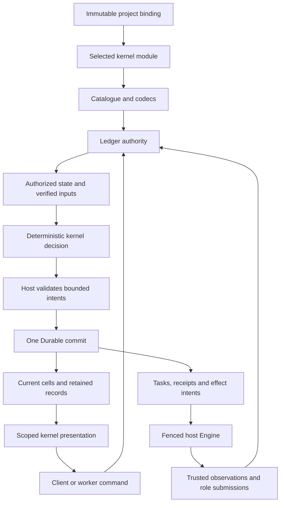
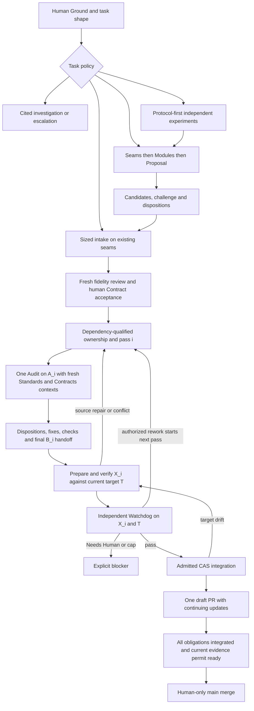
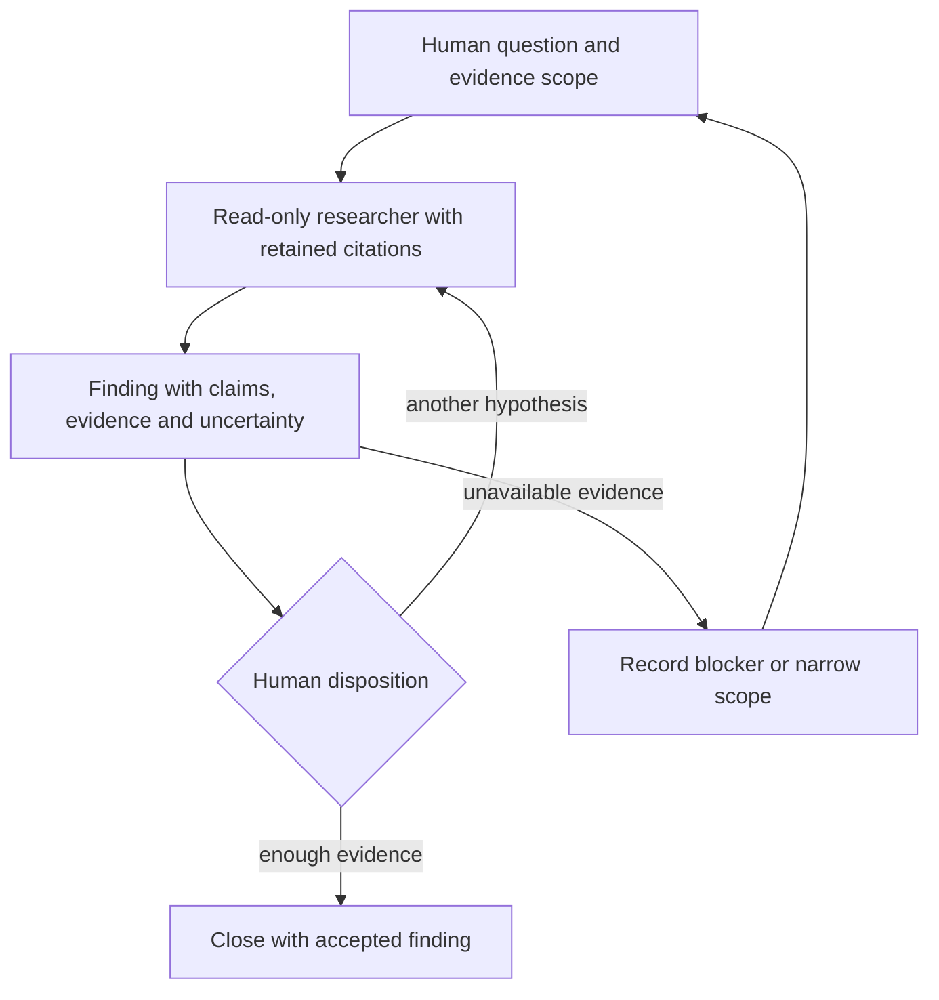

# Project-bound workflow kernels

The goal is to let each new Render project choose its workflow once. Users get different workflows without different authority rules. Maintainers get one kernel module instead of workflow branches across Ledger, Engine, and clients.

**Status. ISSUES.** This is a complete design candidate, not an implemented interface. Kernel-free Durable inspection remains an unverified assumption. No implementation, accepted specification, or live ledger changes are proposed here.

throughput checkpoint: n/a, read-only investigation

## Key concepts

These unimplemented sketches distinguish four data shapes. IDs are branded strings. Persisted values are bounded data, never closures, fibers, credentials, or capabilities.

```typescript
type KernelIdentity = {
	id: KernelId
	release: string
	artifactDigest: Sha256
}
type ProjectBinding = {
	kernel: KernelIdentity
	interfaceVersion: 1
	configSchema: number
	config: Json
	configDigest: Sha256
}
type Project = {
	id: ProjectId
	binding: ProjectBinding
	creation: { requestId: string; fingerprint: Sha256 }
}
type Workflow = {
	id: WorkflowId
	conversation: ConversationId
	createdAtSequence: number
}
type KernelCell = {
	scope: "project" | WorkflowId
	key: string
	schema: number
	revision: HostRevision
	data: Json
}
```

`KernelIdentity` identifies trusted code. Its digest covers the bundled implementation, codecs, and recipes. `ProjectBinding` resolves code and configuration immutably. `Workflow` identifies an instance. `KernelCell` holds policy state. Separate host records hold assignments, attempts, generations, executor epochs, grants, effects, and observations.

Recommendation. One data directory is one project and one authority. Put `Project` inside a new host `Meta` document version. Keep project identity separate from `authorityEpoch`, which addresses authority continuity. Do not select kernels per workflow.

## Overview

Observed baseline. Host composes one Ledger and Engine per directory. `Meta` has no project or kernel identity. `createWorkflow` creates an instance inside that authority [B `src/host/host.ts:22-33`; B `src/ledger/records.ts:19-84`; B `src/kernel/kernel.ts:367-386`].

Observed coupling includes command families, parsers, input resolution, write application, roles, and views. Engine also interprets concrete role intents and injects intake instructions [B `src/kernel/kernel.ts:98-145,200-215,287-330,501-615`; B `src/engine/runtime.ts:1039-1180`]. Replacing only `change` cannot select a coherent workflow.

Recommendation. Select a trusted, versioned kernel module from a small installed registry. Its interface covers decision rules and the codecs, runtime recipes, and presentation those rules need. Ledger and Engine remain host modules. There is no general plugin loader.



The seam is project composition plus Ledger's acceptance transaction. The module hides a workflow, giving callers leverage and maintainers locality. Interface burden includes compatibility and lifecycle rules, not method count.

## How it works

### Host guarantees do not become kernel policy

Recommendation. Ledger establishes principals through trusted adapters. It rechecks current device scope, assignment generation, attempt, cancellation, and executor authority. It owns IDs, sequences, receipts, visibility, atomic persistence, capability issuance, and effect admission. Kernels can restrict these rights, never enlarge them.

A role intent requests work. Ledger issues an attempt-scoped grant within the installed recipe, operator policy, principal's delegation ceiling, and current scope. Delegation rights differ from the delegator's own tool access. Engine enforces resource ownership and read-only profiles. Packet names confer no authority.

Host evidence resolvers establish exact retained bytes, digests, source identity, execution observations, and their provenance. Kernels decide which evidence satisfies their workflow. Text claiming `verified` or `humanApproved` establishes neither. Every acceptance receives a host-generated principal stamp and exact read basis. Human confirmations require a human-authenticated command and bind a retained subject and evidence. Ordinary kernel records cannot impersonate confirmations.

Observed foundations include trusted context checks, transaction-local device checks, receipt deduplication, and host-generated attribution [B `src/ledger/ledger.ts:272-345,942-960`]. Runtime fencing, quiescence, and unresolved external outcomes remain guarantees, not optional kernel extensions [B `src/ledger/startup.ts:76-120,140-190`; E `src/effects/source.ts:25-29,262-280`].

Seams, Modules, Contracts, pass accounting, Audit, Watchdog, and integration eligibility remain Render v1 policy. Preserve their accepted guarantees in that adapter. Do not impose their graph on every project.

### Creation is explicit and atomic

Recommendation. Introduce a local-owner fresh-project creation operation distinct from reopen and `createWorkflow`.

1. Hold the directory ownership lock. Check creation deduplication before rejecting an initialized store.
2. Resolve the explicit kernel selection, or the configured default, to one exact installed release and artifact digest. Validate configuration and required host capabilities.
3. Atomically commit initialized `Meta`, project ID, resolved binding, creation fingerprint, initial private state, and creation receipt. Initializers cannot perform external work.
4. Resolve runtime definitions, establish the executor fence, and only then resume work.

Creation retries reuse the request ID. After a lost reply, that request returns the committed project and binding. Its fingerprint covers the caller's selection request and configuration. An omitted selection remains an omission for deduplication, so a later default change cannot alter the result. Different parameters conflict. A different creation request against an initialized directory returns `already_created`.

Immutable creation configuration contains normalized workflow defaults, not secrets or code. Later revisioned policy commands cannot change the binding. Observed v1 already supports explicit policy changes [B `src/kernel/policy.ts:40-91`].

On reopen, read the committed binding before selecting codecs or scheduling. Ignore current defaults. Require exact identity, artifact, interface, state readers, and every retained task definition. Reject mismatches without modifying the project. A host upgrade may retain adapters for several exact releases. No automatic kernel upgrade or schema rewrite is included.

Existing unbound stores return `legacy_unbound`. They remain usable with their original compatible host. This proposal neither relabels them nor switches them.

### The extension interface is more than `decide`

`Codec` performs synchronous, versioned decoding and encoding. `Bounded<T>` means host-enforced limits, not a TypeScript proof.

```typescript
type Kernel<C, S> = {
	identity: KernelIdentity
	interfaceVersion: 1
	requires: readonly HostCapabilityName[]
	config: Codec<Json>
	commands: ReadonlyMap<string, CommandSpec<C>>
	state: VersionedCellCodecs<S>
	records: VersionedRecordCodecs
	initial(config: Json): S
	inputs(state: S, event: C | HostNotice): Bounded<RetainedRead>
	decide(input: DecisionInput<C, S>): Decision<S>
	roles: ReadonlyMap<RoleRecipeRef, RoleRecipe>
	present(input: VisibleInput<S>): Bounded<Presentation>
}
type DecisionInput<C, S> = {
	event: C | HostNotice
	state: S
	principal: EstablishedPrincipal
	verified: readonly VerifiedInput[]
	ids: ReservedIds
}
type Decision<S> =
	| { outcome: "refused"; code: string; reason: string }
	| {
		outcome: "accepted"
		cells: Bounded<CellReplacement<S>>
		records: Bounded<RecordDraft>
		intents: Bounded<HostIntent>
		result: Bounded<Json>
	}
type HostIntent =
	| { kind: "workflow.create"; id: ReservedWorkflowId; title: string }
	| { kind: "role.request"; id: ReservedTaskId; recipe: RoleRecipeRef; packet: Json }
	| { kind: "task.cancel"; task: TaskRef }
	| { kind: "operation.request"; operation: SupportedHostOperation }
	| { kind: "human.confirm"; subject: RetainedRef; evidence: NonEmpty<RetainedRef> }
```

`CommandSpec` declares payload schema, principal classes, scope, and required optimistic basis. Enrollment remains host-reserved. Kernel commands are namespaced. Clients cannot submit host notices. Notices use stable task-transition IDs for deduplication. `RetainedRead` names a typed host reference, never a path or URL. External evidence needs an admitted operation and subsequent observation.

Ordering is part of the interface. Authenticate and authorize the envelope before input-dependent reads. Deduplicate under current visibility. Decode with the bound catalogue. Load applicable cells. Call `inputs`, then authorize and resolve its bounded retained references in the same transaction snapshot. Call `decide` with decoded state, actual principal, immutable verified inputs, and reserved host IDs. Validate all outputs before committing anything.

Host-generated basis includes every consumed cell revision and retained input. Commands must carry expected revisions for mutable subjects. New records inherit host attribution and basis automatically. Kernels cannot supply these stamps. Cell replacements affect only declared, authorized scopes. IDs must come from the supplied reservation pool.

Proposed bounds are 32 cell replacements, 64 records, 32 intents, and 1 MiB of inline output per acceptance. Large sources use retained-source facilities. These unmeasured limits need v1 fixture validation. Unavailable capabilities refuse atomically.

Malformed payloads and unsupported schemas refuse. Older readers are explicit. Only declared writable schemas accept mutations. Kernel refusals roll back. A defect, Promise, oversized or invalid output aborts and stops dispatch. Storage uncertainty preserves same-command retries.

Decisions, input planning, codecs, and presentation must terminate synchronously and deterministically. They receive no clock, filesystem, network, randomness, or execution handles. Import restrictions and conformance checks apply to trusted code, not an untrusted-code sandbox.

Observed Effect pilot. Synchronous interpretation coexists with unmigrated families [E `src/kernel/kernel.ts:344-365,523-533`]. Effect is pinned to 4.1.2 [E `package.json:76-82`]. `Effect<A, E, never>` cannot guarantee synchrony. Keep decisions as plain data. Context may hold the selected kernel and host dependencies. Layer may construct Ledger, Engine, and external adapters. Async acquisition and execution stay outside decisions.

## Where things live

Recommendation. Use Durable's existing document and entry facilities, not application SQL tables.

| Host-owned storage | Meaning |
|---|---|
| `Meta` new version | Project binding, authority, sequence, creation receipt reference. |
| `Workflow` host envelope | Instance identity, conversation, creation sequence. No Seams fields. |
| `KernelState` document family | Namespaced project and workflow cells with explicit schema and revision. |
| `KernelRecord` immutable entry | Kernel type, schema, exact payload bytes, host scope, digest, attribution, basis, and evidence references. |
| Execution documents and entries | Grants, tasks, attempts, effect admission and observed outcomes. |
| Receipts and reference indexes | Deduplication, ownership, visibility, and exact-content lookup. |

Shared workflow containers, content, references, principals, and execution records have host responsibilities. There is no universal work item that renames Slice. Contracts and Slices remain v1 records. Questions and findings remain investigation records.

Commit cell replacements, immutable records, confirmation records, receipt, handoff references, and Durable task staging together. Notify observers only after commit. Observed v1 already stages tasks transactionally [B `src/ledger/ledger.ts:1346-1376`]. Current documents plus retained records remain authoritative. Facts are not assumed replay-complete [B `src/ledger/ledger.ts:218-235`; B `src/ledger/records.ts:1-4,165-198`].

A host-only inspector must read supported outer envelopes without loading kernel code or resuming tasks. It exposes identity, scopes, provenance, task versions, blockers, and authorized raw payload bytes. It labels unknown semantics. Project-private cells are owner-only. Remote presentation receives only caller-visible state and references, never unrestricted project aggregates.

Extend the bounded export protocol and its independent reader deliberately. Include kernel-record envelopes and exact bytes, plus unsupported-schema and omission declarations. Do not claim backup, replay, or complete execution history. Current export explicitly excludes temporary data and several execution kinds [B `src/ledger/history.ts:5-26,39-81`]. If even the host envelope is unknown, permit only local diagnostic inspection, not typed remote access.

### Engine and presentation follow the binding

Recommendation. First release supports trusted repository-owned kernels and a fixed host task catalogue. It covers model roles, source observation and retention, isolated experiments, checks, deterministic preparation, notifications, and existing Git and forge operations. Kernel authors cannot register arbitrary task code, tools, SQL, or external executors.

A role recipe declares its version, packet and result codecs, command allowlist, tool profile, independent-context requirement, and pure instruction renderer. Retain the exact packet, rendered instructions, recipe identity, and input references before execution. Engine owns continuation, capacity, isolation, and quiescence. Host lifecycle notices drive kernel decisions about subsequent work. Role submissions remain commands from their actual assignment principal.

Tasks pin both host task kind/version and kernel recipe release/version. Retain original meanings while any task needs them. Missing definitions block startup, as the current runtime already requires [B `src/ledger/startup.ts:76-89`; B `src/engine/runtime.ts:870-908`]. Never reinterpret an old checkpoint with a newer recipe.

Effects run only after committed admission. The trusted executor obtains an attempt-bound permit and records observations through Ledger. Integration qualification remains kernel policy over those observations. A returned plugin payload cannot mint a permit or prove an external outcome.

Snapshots and change frames use the same scoped presentation function. A generic client displays sections, evidence, blockers, and advertised command forms. Rich v1 views remain identity-bound adapters. Unknown presentation falls back to inspection, not a v1 next-action guess.

## Two workflows without a shared graph

Recommendation. The v1 kernel preserves the full accepted product workflow, including investigation, protocol experiments, shortened existing-seam intake, and design checkpoints. Its delivery path remains the accepted pass sequence [B `docs/spec.md:21-71,599-628`].



Checkpoint requests capture their technical-delegation settings. Final Contract acceptance remains human. Audit does not satisfy Watchdog or reset its counts. Deterministic retries preserve the pass. These rules live in v1 decisions and recipes, not Engine's scheduler.

The smaller investigation kernel instead has a question and evidence sufficiency model.



This kernel has no accepted implementation Contract, proposal, integration, Audit, Watchdog, or delivery owner. It cannot request writer or forge operations. It reuses authenticated decisions, immutable citations, read-only role execution, continuation, deduplication, scoped views, and export. It can close without a source change or build result. That is a different workflow, not renamed delivery stages.

## Gotchas and failure traces

These are proposed failure traces, not runtime proof.

| Failure | Required result |
|---|---|
| Duplicate create or command after lost reply | Same namespace, ID, and fingerprint return the committed receipt under current authorization. Changed parameters conflict. No second instance or task. |
| Stale command | Expected subject revision differs. Refuse before state, receipt, or intents commit. Refresh and submit a new decision. |
| Unknown kernel, artifact, or schema | Disable mutation and execution. Inspect supported host envelopes. Never run a default kernel. |
| Crash after acceptance before execution | Receipt and staged task survive together. Reopen resolves pinned definitions, fences, and resumes retained work. No new task from replaying the decision. |
| Stale worker after restart | Old executor epoch or attempt cannot submit or dispatch effects. Do not release its capacity until quiescence is established. |
| Uncertain external effect | Retain admitted intent and unresolved outcome. Reconcile the original attempt using trusted observation. No automatic duplicate dispatch or claimed success. |

## Alternatives, delivery, and open decisions

| Alternative | Judgment |
|---|---|
| Transition function alone | Reject. Low apparent interface burden moves codecs, evidence, writes, roles, and views into host branches. Poor locality. |
| Effect-composed kernel bundle | Viable with restricted services. Reject as the public contract because service provisioning, typed failures, and synchronous interpretation add author obligations without adding workflow variation. Keep Effect for host composition. |
| Declarative workflow graph | Reject. It describes stage order but needs another language for exact source provenance, independence, pass identity, uncertainty, and authorization. |
| Recommended deterministic module with host intents | Select. More explicit author obligations, but one coherent workflow implementation and one accepting authority. |

Implementation would follow these phases. Specify and write failure cases before production code in each phase.

1. Prove host-only Durable bootstrap and inspection on a scratch store with unknown kernel state and task definitions. Assert zero scheduling and no store mutation. Failure revisits the storage interface, not a second sidecar authority.
2. Establish project creation and binding. Test duplicate requests, changed defaults, partial initialization crashes, concurrent creators, missing releases, and explicit legacy refusal.
3. Extract the v1 adapter with fixtures and behavioral tests first. Preserve exact-basis decisions, permission refusals, pass and review accounting, task version recovery, and atomic handoff staging. Add investigation fixtures proving closure without delivery facilities.
4. Exercise real persistence and runtime seams. Kill after commit, restart with stale workers, interrupt external dispatch, and verify scoped inspection and export with kernel code absent. Reuse existing crash and authority checks, then run the required cumulative repository gate on the implementation candidate.

No runtime experiments ran. Source review and document checks are the evidence. Measure new test runtime during implementation. Keep broad crash checks at verification boundaries.

Open decisions include initial payload bounds, generic client form limits, and the maintenance period for exact kernel releases. Binding evolution, existing-store adoption, hot swapping, marketplaces, dependency solving, arbitrary plugin SQL, a workflow language, sandboxing untrusted code, and disaster recovery are non-goals.

Principles applied. Foundational Thinking separated binding, instance state, and execution authority. Model the Domain made the kernel a coherent module rather than scattered selectors. Boundary Discipline kept evidence and principals host-established. Make Operations Idempotent required atomic creation, receipt reuse, fencing, and explicit uncertainty. Laziness Protocol excluded a graph language and general loader. Prove It Works limits the verdict to design evidence, not an implementation claim.

## Source keys

B is PR #32 at SHA `3983eacad1be8196d7d67263f03ecdecb9558329`, read under `/tmp/render-kernel-design.d4hjii/v1`. E is PR #79 at SHA `994cbfbe9e97fd8443c01dc1d431bb9d0c81066d`, read under `/tmp/render-kernel-design.d4hjii/effect`. Citation line ranges refer to these snapshots. The three supplied explorer reports guided selective checks.

Observed accepted v1 scope excludes a generic workflow plugin framework [B `docs/spec.md:79-83`]. This candidate is a future proposal. PR #79 remains a vertical pilot, not a completed migration [E `src/kernel/kernel.ts:344-365,523-533`].

Rationale. Reject the thin transition selector, Effect-based public contract, and workflow language. Choose a deterministic kernel module with bounded host intents. Its biggest risk is the unverified ability to inspect supported Durable host envelopes without loading missing kernel definitions or changing retained runtime state.
