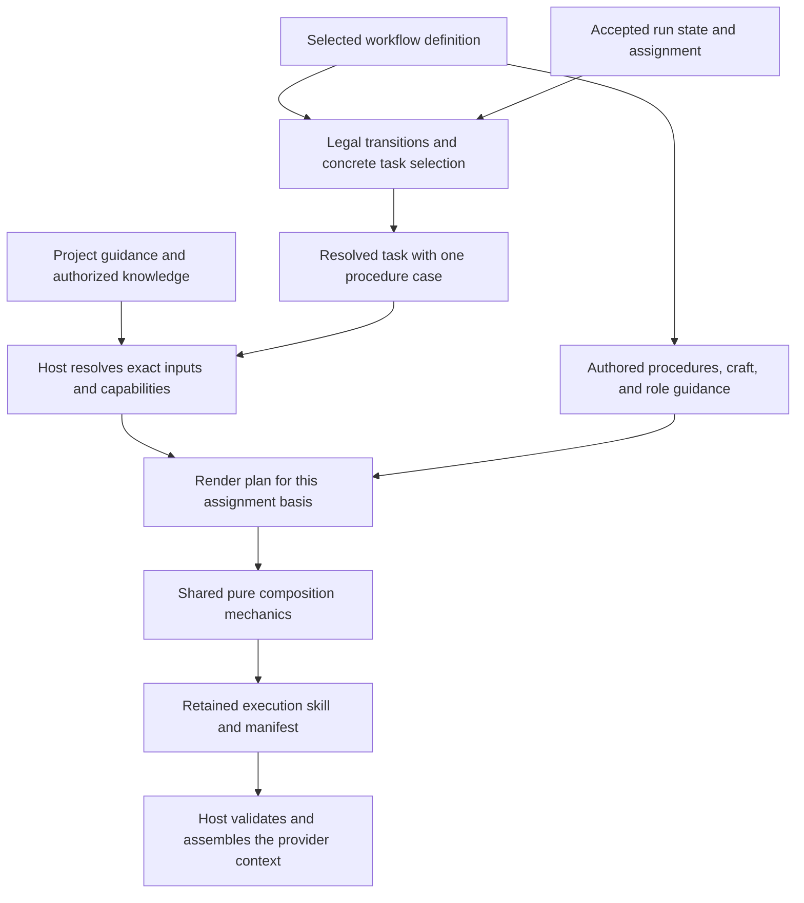
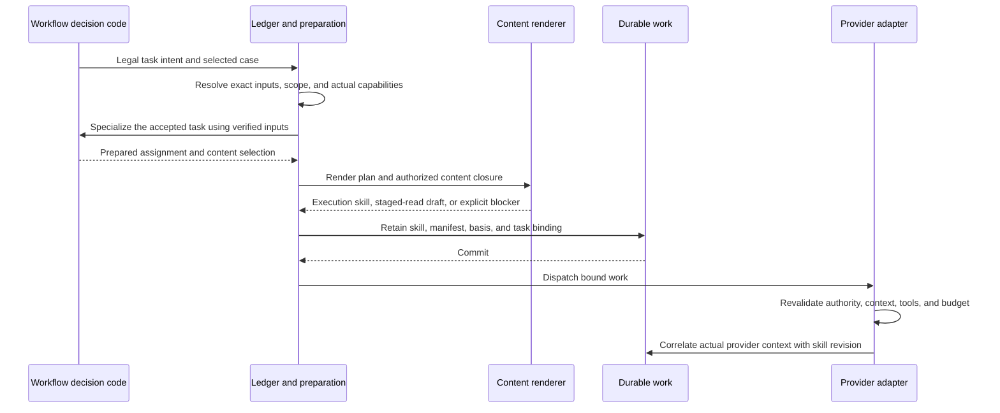
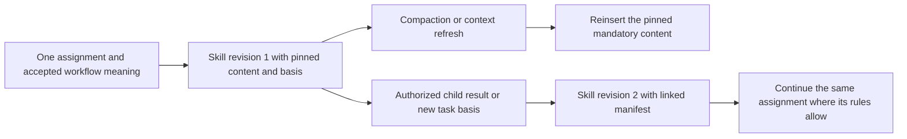

# Workflow-owned execution skills

The goal is to make a workflow own the instructions Render gives its agents. A workflow definition includes its roles, procedures, reusable craft, deterministic task selection, and result contracts. A project contributes its own adopted guidance and selected knowledge. Render binds the actual facts and capabilities, then retains the tailored execution skill before use.

This proposal responds to [issue #59](https://github.com/vicrdguez/render/issues/59). It is not an implementation or an accepted specification amendment. The [domain glossary](CONTEXT.md) defines the terms. [Current-source evidence](sources/revision-2.md) identifies what exists today.

## The unit of variation is the complete way of working

The built-in development workflow owns its Ground, checkpoint, implementation, Audit, and Watchdog procedures. A pstack-inspired definition owns its own procedures, role meanings, and composition. A financial-review definition can use analyst and reviewer roles without inventing Slices or source integration.

A common host renderer does not mean common workflow instructions. It means shared mechanics for resolving exact content, substituting bound facts, preserving mandatory material, retaining provenance, and exposing what the worker receives. The host must contain no default instruction saying to run Seams, Audit, or Watchdog.

The workflow owns the content and its selection. The host supplies facts, resolves access, enforces authority, and executes work. Authored prose is never a second transition or permission engine.

## One prepared assignment, several useful views

The organizing data shape is a prepared assignment with these fields.

| Part | Meaning |
| --- | --- |
| Binding | Project, workflow run, workflow meaning, assignment, generation, and attempt. |
| Resolved task | Role, selected procedure case, exact subject and evidence basis, completion conditions, and output contract. |
| Content selection | Exact instruction release, procedure and craft revisions, role guidance, and selected resources. |
| Knowledge selection | Project guidance revision, required principle statements and full principles, evidence references, and authorized shared-knowledge uses. |
| Execution facts | Actually granted tools, workspace and source identities, model configuration, and input budget. |
| Render plan | Ordered content sections and typed substitutions for the already selected task. |

Resolved task and render plan are views of that one prepared assignment. They do not need separate databases, authorities, or hand-maintained copies of the workflow state.

An **execution skill** is the immutable rendered output for one such basis. It includes procedure, applicable craft, bound facts, references, and the result contract. A **rendering manifest** identifies how that output was produced.

The manifest records workflow meaning, instruction release and asset digests, project guidance revision, knowledge-use records, procedure case, fact basis, actual tool schema identities, renderer version, output format, and rendered digest. It also distinguishes inline material from explicitly staged material.

## Task selection happens once

Workflow decision code determines which task and procedure case are legitimate. Preparation specializes that accepted task with resolved facts. Neither templates nor the renderer independently inspect workflow state to choose another branch.

For example, use a procedure case such as `implement.same-pass-fixes` or `implement.watchdog-return`. Do not hand the model an initial implementation guide containing both cases and ask it to determine which applies.

A render plan can select ordered sections from an instruction catalogue. It cannot execute arbitrary expressions, query workflow state, acquire capabilities, or decide that evidence is sufficient. A missing prerequisite creates explicit preparation work or a blocker. It does not become a guessed variable value.

New I/O happens through admitted host preparation and evidence work outside the pure decision and composition functions. Loading an authored library at installation or resolving a retained artifact is different from a template fetching a moving repository file during rendering.

The sequence describes logical ordering. The implementation must establish the exact transaction and runtime staging seam before claiming atomic dispatch. No provider call precedes retained binding and current authority checks.

## A deliberate module interface

Compare two materially different seams.

| Seam | What it hides | Burden and limitation |
| --- | --- | --- |
| Opaque per-workflow `render(task)` callback. | Any rendering strategy behind one method. | Every workflow must implement or correctly reuse required-content handling, knowledge access, manifests, preview, and overflow. The host cannot independently verify arbitrary prose composition from a returned string. |
| Workflow-owned content and task plans with shared composition mechanics. | Ordinary content loading, exact revision resolution, substitutions, ordered assembly, required-material checks, and retention metadata. | Needs a small common content contract. It must not grow into a second workflow language. |

Recommend the second seam. The workflow still owns all meaningful instruction content. It declares the procedure case and content use. The shared module does not know what a candidate, Audit, or financial analyst means.

Deleting the shared renderer would spread provenance, overflow, and material-selection checks into each workflow. It therefore earns a module. Deleting a pass-through wrapper around `Engine.render` would merely remove indirection and leave the authored prose mixed with runtime policy. That wrapper does not solve issue #59.

A custom serializer can be added only for a concrete unsupported worker format. It still receives an already resolved section plan and returns an inspectable result. It does not gain workflow, storage, or capability authority.

Outcome guidance and worker document templates are authored assets too. The host supplies typed outcomes and bound repair facts. The workflow selects its applicable next-step guidance. Result schema and document-writing instructions identify the same declared contract. Do not leave that prose in Engine because it arrives after the initial role prompt.

The composer distinguishes instruction and guidance blocks from facts and source evidence. Evidence is serialized as labeled data rather than expanded as authored instructions. Bindings use appropriate ordinary escaping and serialization. No content block can change the host's permission checks.

## Authoring, internal data, and worker format are different choices

Issue #59 explicitly leaves storage format open. These choices must not be conflated.

| Layer | Proposed contract |
| --- | --- |
| Authoring | Human-reviewable instruction assets plus an explicit composition catalogue. |
| Internal representation | Typed content references, selected procedure case, fact bindings, required-material closure, and a resolved section plan. |
| Worker format | A declared serialization of those instructions and data, integrated with the runtime's actual context. |

### Compare authoring alternatives

| Option | Strengths | Costs |
| --- | --- | --- |
| JSON instruction library. | Explicit IDs and structure. Existing schema tooling and ordinary code can validate and edit it. One or several files can be packaged. | String-heavy designs add escaping and coarse line diffs. Paragraph arrays improve diffs but add structure. JSON is not inherently difficult for an authoring agent. |
| Markdown bodies with an explicit typed catalogue. | Long-form procedure and craft changes read as prose diffs. Composition is discoverable through declared references. | Body and catalogue can drift unless missing assets, unknown substitutions, and unused composition references are checked. |
| Structured content blocks. | Fine-grained provenance, sections, and delivery metadata can be authored directly. | More syntax and editing overhead. Paragraph-sized assets and expression nodes can turn the format into a language without a current need. |

Recommend Markdown bodies plus a small explicit catalogue for the first implementation, based on prose locality and review ergonomics. This is not a claim of better model compliance. JSON remains a valid authoring alternative. Do not commit a compiler or template dependency before the concrete packaging and validation needs justify it.

Keep long instruction bodies out of Engine code. Keep the case selector in ordinary typed workflow code. The catalogue owns composition references and accepted substitution names. Body substitutions bind established facts; they do not contain `if new pass`, `if this is Watchdog`, or other workflow selectors.

File boundaries follow independent editing and reuse. A Testing craft body earns its own asset because several procedures consume it. A sentence used once does not need a file. The asset catalogue is the one composition source. Generated rendered output is retained evidence, not another authored source of truth.

### Do not claim a worker-format winner

The current Engine returns a JSON packet, while the effective provider context also includes configured instructions, system sections, tools, conversation history, and refresh behavior. JSON-authored prose could render to Markdown. Markdown-authored prose could appear inside a JSON packet. Identical worker inputs cannot differ because of an invisible source format.

Preserve current worker-facing structure during an extraction unless a separately authorized comparison supports a change. A later comparison can test JSON sections and Markdown sections using the same content, tools, task facts, and ordering. The proposed evaluation below has not run.

## Three concrete content examples

### Assignment-specific procedure

Consider two development cases.

| Case already determined by the workflow | Tailored instruction content |
| --- | --- |
| Same-pass fixes after the pass's Audit. | Identify that exact Audit and its findings. Repair or dispose them, recheck affected behavior, and prepare the final handoff. Do not request another Audit inside that pass. |
| Watchdog return opening a new implementation pass. | Name the retained Watchdog source and directions, opening base, and current pass. This pass needs its own Audit before its handoff. |

These have different instructions. Both keep the accepted development semantics. Copying `skl`'s old Implement order would be incorrect for Render's accepted Audit and preparation order.

An illustrative skill excerpt for the second case would say the following. The labels below are fixture names, not real evidence identities.

> You own implementation pass 2 for Contract C4. Start from opening source B2. Address findings W1 and W2 from retained review R7. The approved scope and verification catalogue are attached. Run the required checks, request this pass's Audit once, resolve its findings, and submit the handoff using the listed tools. Work only in the bound workspace.

The real skill includes exact references, applicable craft, full required guidance, concrete tool schemas, output fields, and stopping conditions. The excerpt is not a complete production prompt.

### Reusable Testing craft

A workflow declares which Testing asset it composes into implementation and which review criteria it composes into a reviewer. The craft gives judgment guidance. It does not contain the current workspace, command spelling, selected catalogue row, or assignment identity.

The procedure places the bound execution facts next to the craft where needed. The repository verification catalogue remains separate project data with exact source and row identities. Updating Testing prose is a content change. Editing the repository's checks is source work. Adding a new execution facility is a host change.

A pstack-inspired workflow may import a compatible Testing asset or supply its own. It does not automatically inherit the built-in development instructions merely because both workflows have an implementer.

### Consumer-project principles

A project configures its guidance sources through authorized project settings. A source identifies a repository and exact revision or another retained collection. Its index identifies principle statements and full bodies with stable citations. Repository discovery locates candidates; it does not automatically adopt arbitrary repository text as guidance.

Every packet must include the project's principle statements. Judgment roles receive relevant full principles, including principles cited by Forbidden decisions, as the accepted specification requires. Preserve all mandatory material or expose the specified blockage or staged read. Do not omit or summarize it to satisfy a budget.

Metadata can make named-citation resolution and declared role applicability deterministic. It cannot prove semantic relevance or completeness. The workflow maintainer owns the guidance-selection policy, and project administrators supply the adopted index and declared applicability. The workflow identifies the responsible preparation or judgment role for unresolved relevance. Do not claim that an `appliesTo` field solves judgment.

An unresolved required selection is not a ready plan. Use the workflow's bounded preparation task or permitted staged reading with access to the exact principle bodies, or block. The result is retained under existing assignment rules. It does not adopt new guidance, waive mandatory statements, or create a new approval checkpoint.

A missing or unresolved required principle blocks readiness. A stale source uses the pinned accepted revision or blocks; it never quietly follows a moving branch. A recognized conflict with workflow or project obligations is surfaced, not resolved by letting the last prose fragment win.

## Versions and future content changes

Separate the project's workflow choice from its instruction-content selection.

- The project chooses its workflow definition and meaning. Switching to another workflow or changing persisted meaning for an existing project remains outside this design.
- An instruction release targets that selected meaning and declares its supported procedure cases, inputs, roles, and output contracts.
- The host owner installs trusted releases. An authorized project administrator can select a compatible instruction release for future assignments through ordinary versioned project settings. This is a proposed permission rule, not an existing implemented route.
- Each prepared assignment pins exact asset, guidance, and content-selection revisions. It never follows `latest`.

A release that changes mandatory steps, accepted obligations, role semantics, or completion criteria is not a prose-only compatible fix merely because its JSON schema still validates. Compatibility needs review and representative behavioral evidence. This design adds no new approval checkpoint before every agent call.

This supersedes the first draft's idea that the initial project's entire executable artifact digest is a permanent admission gate. Exact implementation and content digests remain execution provenance. A supported compatible host repair cannot be ruled out solely because the artifact digest changed. State, task-definition, and instruction meaning must still be preserved; no automatic migration or replacement implementation is specified here.

The minimal adoption path covers independently versioned content under unchanged workflow meaning. A complete code-update and retirement policy is still required before production. Separating these identities makes that policy possible without silently selecting a different workflow.

### Who judges a release and what changes

The workflow maintainer makes a compatibility claim through the normal human-reviewed source and content release process, with affected renderings and behavioral evidence. The host owner installs trusted releases. A project administrator selects an installed compatible release for future work. Selecting a release is not certifying it. A change to accepted product obligations requires the existing human amendment path before it can be called compatible.

| Maintainer change | Required work |
| --- | --- |
| Improve an existing Testing body within the same obligations and content contract. | Publish a reviewed instruction release. No Engine implementation edit merely to change prose. |
| Add or refine a procedure presentation for an already supported task and inputs. | Update assets and catalogue. A workflow-owned selector edit may be necessary, but not an Engine edit. Classify compatibility by behavior, not by whether the patch contains TypeScript. |
| Add a genuinely new task, role meaning, required transition, input contract, or authority. | Review the workflow definition and meaning. Extend host facilities only if existing facilities do not support the work. Existing-project meaning adoption remains outside this proposal. |

A selected procedure case missing from the pinned instruction release is an explicit `missing-procedure-case` blocker. It cannot fall back to a generic procedure or another release. Adding a procedure using existing mechanics is therefore not automatically content-only, and it does not automatically require a new Engine or state migration either.

## Continuation and refresh preserve meaning, not stale facts

Retain immutable execution-skill revisions, not one mutable prompt per role.

A byte-identical refresh uses the retained rendition. A legitimate new basis, such as newly accepted child results, can require a newly retained skill revision within the same assignment. It does not silently select newer craft, reset a review count, or create a new implementation pass.

This corrects the tempting but wrong rule that every continuation must reuse the original rendered bytes forever. Current Render refreshes facts during continuation. Preserve that behavior while pinning the authored sources and captured policy.

Compaction, reset, and an authorized model change require mandatory constraints to be refreshed or explicitly staged, as the accepted lifecycle requires. Recheck the actual context budget and model-family requirements before the next provider call. An allowed model change gets a linked context and skill revision where needed; it does not select newer authored content. A disallowed change blocks or follows the existing authorized replacement path. This proposal grants no new right to switch models.

## Preview and effective provider context

A retained-skill preview shows the exact skill bytes, selected assets, fact and guidance references, granted tool descriptions, and manifest. A proposed preview of new settings is labeled prospective and grants no authority. Neither claims to be the full model request.

The host adapter assembles the actual provider context from that skill, its fixed host protocol, conversation history, compaction state, accepted results, and actual tool schemas. It checks relevant authority and input budget immediately before the call.

Correlate each call with the skill revision, actual serialized instruction section, tool identities, model configuration, and retained runtime-history references. Do not create a second secret-bearing request archive or log bearer credentials. Use existing retained execution facilities where they provide the required evidence.

The current provider check tests containment of the serialized packet in a system section, not equality of the full rendered result. Extraction must define and test an exact binding to the inserted instruction section, including any documented encoding. A standalone `render()` preview cannot establish that binding.

## Validation and behavioral evidence

Deterministic checks can establish the following.

- The selected procedure and asset references exist and target the selected workflow meaning.
- Declared substitutions, content kinds, role and tool references, and output schema agree with the prepared assignment. Semantic agreement of free-form prose still needs review.
- Required principle statements and selected full bodies are present or explicitly staged under accepted policy.
- Source revisions, sharing authorization, byte identities, and ordering match the manifest.
- Missing required material blocks before dispatch. Oversized material blocks unless accepted policy permits an explicit staged-read plan.
- Provider admission uses the intended skill revision and actual capability configuration.

A staged-read plan retains exact resource revisions and digests, the available bound retrieval tool, and required read steps. Initial dispatch may perform those reads. Consequential submission or transition requires the recorded mandatory retrievals, not only a model claim that it read them. Missing retrieval capability or forbidden staging blocks. Retrieval receipts show availability and delivery, not understanding or instruction-following quality.

They cannot establish clarity, semantic completeness, relevance, safety against every persuasive input, or instruction-following quality. Human review and behavioral evaluation remain necessary.

### Proposed focused evaluation, not run

Use existing task and provider seams. First write independent expected outcomes and failure triggers, then any evaluation implementation.

1. Compare authoring a shared Testing change and adding a procedure case in JSON, Markdown plus catalogue, and structured blocks. Review diffs, locating consumers, validation errors, and agent-assisted editing. Keep content equivalent.
2. Separately compare worker-facing JSON and Markdown with the same resolved content. Use representative target models, fixed tools and evidence, repeated cases, randomized order, and a recorded rubric. Do not mix source format with worker format.
3. Include same-pass Audit fixes, a Watchdog return, investigation escalation, required principle overflow, missing shared guidance, and stale or unavailable evidence. Check observable actions and correct results, not only the model's claim that it complied.
4. Inspect actual provider inputs, context refresh, and outputs. Record failures and uncertainty. Small results apply only to the tested tasks and models. Do not generalize a universal best prompt format.

Keep real-model comparisons outside the default test command, with explicit model, tool, and spend limits. Reuse the existing inexpensive provider and pure rendering seams for deterministic checks. Measure any added default-test cost during implementation and preserve the required cumulative gate.

These are evaluation requirements, not measured findings. No model task evaluation, authoring comparison, or runtime extraction prototype ran for this proposal.
