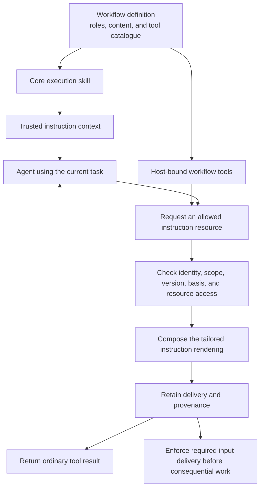

# Runtime instructions and workflow-defined tools

The goal is to deliver tailored workflow instructions during an agent run as well as at its start. A workflow can own instruction tools and meaningful wrappers around its checked operations. This is a proposed design amendment, not an implementation or permission to register unchecked callbacks.

The recommendation is **core instructions plus workflow-owned runtime tools**. The previous design only implied retrieval through staged reads. It did not make the tool catalogue and delivery contract explicit enough.

## Instruction requirement and transport are separate

Begin with three data shapes.

| Shape | Meaning |
| --- | --- |
| Instruction resource | A named, versioned resource in the current skill's allowed catalogue, with applicability and delivery requirements. |
| Workflow tool definition | A trusted definition of a tool's name, authored description, input and result schemas, handler, allowed callers, and required host facilities. |
| Instruction delivery | A retained rendering returned for a specific resource, skill revision, assignment basis, and tool call. It grants no action authority. |

An instruction resource is not necessarily a static document. The same composer can specialize it using the assignment's verified facts. It does not inspect a moving branch or ask the model to choose a workflow phase.

| Requirement | Proposed delivery |
| --- | --- |
| Core material required now. | Include it in the selected workflow's trusted instruction section. Do not require the agent to remember to request it. |
| Required material before a later action. | Use explicit staged retrieval when accepted policy permits it. Otherwise supply it in the trusted section at the appropriate point, or block if that cannot fit. The host checks delivery and current context. |
| Optional reference material. | Offer an instruction tool scoped to the assignment. The model may retrieve it when useful. |

Transport alone does not determine whether material is optional. Nor does calling a tool turn its output into a higher-priority instruction.

## The core skill is not necessarily the entire system prompt

The host adapter assembles the effective provider context. That includes host protocol, workflow instructions, conversation history, tools, results, and refresh material. The execution skill belongs in the appropriate trusted instruction context, not necessarily as a replacement for every system instruction.

Current Render uses a `role-packet` system section plus configured instructions and conversation input. Preserve that distinction while defining the new adapter contract. A preview of the core skill still does not prove the full provider request.

Tool-delivered guidance normally arrives as a tool result. If an approved workflow instruction must become a system section, trusted host logic must stage the corresponding retained skill revision and refresh that section. Never promote arbitrary tool text, repository evidence, or a caller's string into trusted instructions.

The graph is a proposed delivery flow. It is not executed evidence or a claim that every tool response has system-prompt priority.

## Workflows own their tools

Extend the definition with a tool catalogue. The host binds those trusted definitions to actual assignment identities and granted facilities when constructing the Pi integration.

The catalogue owns these authored and typed parts.

- Tool identity, name, version, and description asset.
- Input and result schemas.
- Handler or handler factory, under the installed workflow implementation.
- Applicable roles, task cases, caller kinds, and host-facility requirements.
- Any workflow-owned outcome-instruction assets selected from the actual result.

Descriptions are agent-facing prose too. They should be authored, versioned, rendered, and inspected alongside the procedure. Avoid moving instruction strings from Engine into another set of unreviewable host tool handlers.

Use Pi's existing tool mechanism through a small host adapter, not another general tool execution framework. The adapter establishes trusted identity and exposes checked ports. The model cannot provide its own project, role, generation, or grant. Do not hand a tool factory unrestricted Ledger transactions, host credentials, or task-spawning authority as its ordinary interface.

These remain trusted installed code modules, not a sandbox. A JavaScript type or restricted argument object cannot confine malicious code installed in the host process. The adapter contract prevents accidental bypass and checks external calls; it is not an untrusted-extension security claim.

### Instruction tools and action tools have different effects

An instruction tool is read-only with respect to workflow progression. It may retain an immutable delivery record, but it does not start a pass, approve work, change role, or grant tools.

A workflow action tool can map a meaningful operation into the checked workflow command path. For example, a pstack adaptation might expose a candidate request or result submission using its own vocabulary. Ledger and the workflow decision still determine whether that request is legal.

An external-action tool must use an existing admitted host facility. A new executor, source capability, or effect family still needs its own host contract. Naming a function does not make an irreversible operation authorized.

A checked action tool can return tailored outcome instructions as well as data when execution continues in that context. The workflow selects those instructions from the actual accepted result and receipt. It must not return an unresolved generic branch such as both the pass and failure procedures when the outcome is already known. A change to role or consequential task purpose requires the checked workflow transition and corresponding skill binding; returned prose cannot perform it.

### Native handoff is a context boundary

Durable 1.4.0 handles a native handoff by appending a reset with the handoff string as a user message and ending the run. The previous tool result is no longer an active-context delivery guarantee. Outcome guidance needed after that boundary must be retained and staged for the next legal turn through the checked skill binding.

The workflow owns the authored next-step guidance. The host adapter owns the native handoff wire text and constructs validated controls from the accepted result. It must not forward arbitrary workflow-handler text as `control.handoff` or assume that a returned tool body remains available after the reset. Handoff invokes the mandatory-material refresh rule.

Instruction-only tools do not request native handoff or termination. Action tools can request a permitted execution boundary after the matching checked transition. The host can independently stop unsafe work. Native termination does not establish domain completion.

## Prefer a small instruction entry point

The default can be one tool such as `workflow_instruction` taking an assignment-visible resource key. The core skill names the available resources and required retrievals. These are illustrative tool names, not existing implemented APIs.

The handler derives assignment identity from the host binding. It accepts no arbitrary path, URL, project selector, role selector, or source version. It resolves only resources permitted by the current prepared assignment and pinned content selection.

Do not create a separate tool for every paragraph. A workflow-specific tool name earns its place when it exposes a distinct operation or clearer interaction. A small resource catalogue avoids making the agent reconstruct the workflow by browsing many unrelated tools.

Examples include:

- A development implementer retrieves Testing craft plus facts relevant to its already selected implementation case.
- A reviewer retrieves the procedure for its exact retained source and role, without also receiving instructions for unrelated reviewer types.
- A financial analyst retrieves the already authorized policy revision for its assessment. Retrieval does not adopt another project's guidance or authorize a transaction.

A request for an instruction belonging to another role or task is unavailable or refused. It never means that the agent has switched roles. A current-instruction read can render the accepted task. A next-step tool that actually advances work is a checked command, not a read.

## Mandatory reads, authority, and context refresh

The workflow's prepared assignment declares which instruction resources are mandatory before which actions. The host records delivery and enforces those input prerequisites. A tool's description saying to read something is not enforcement.

Successful retrieval can satisfy an already declared input prerequisite. It cannot create an underlying permission. A writing operation still needs the actual writer grant, current authority, and legal workflow state.

A receipt from an earlier context is not proof that required content remains in the current context. Compaction, reset, and authorized model changes follow the existing refresh or exact staged-read policy. Reinsert the approved mandatory material or require its bound retrieval again where the policy permits. Do not rely on a lossy summary or on a once-ever `read` boolean.

Retrieval receipts establish what was delivered or made available. They do not establish that a model understood or followed the instruction. Behavioral evaluation is still required.

## Exact versions and retention

An instruction delivery binds the selected resource and source digests to the workflow meaning, content release, skill revision, project, assignment, generation, attempt, relevant facts, and actual tool call. Reuse the existing composer, retained artifacts, and provenance facilities. This does not require another instruction database.

Retain required rendered bytes and provenance before returning them for reliance. A native transcript entry alone is not the complete contract, especially for nested program results and later compaction.

The same tool invocation on recovery should resolve its recorded delivery rather than render a mutable latest version. Replay can return it as current guidance only while its accepted skill binding remains applicable. A stale binding fails explicitly. A genuinely new accepted task basis can produce a new retained delivery. Current authorization still applies. `replay: safe` is not an exactly-once guarantee.

Optional resource failure is explicit. Required missing, stale, forbidden, or oversized material blocks the affected action or follows its permitted staged-read plan. It does not silently fall back to a generic procedure.

## Pi integration evidence and limits

This narrow source check uses `proposal/render-v1` at `b31af81e69561e4a126e1ac7e87ecbe3c643ea2e`. It does not replace revision 2's separate storage investigation.

- The [tool helper](https://github.com/vicrdguez/render/blob/b31af81e69561e4a126e1ac7e87ecbe3c643ea2e/src/engine/runtime.ts#L321-L344) wraps `defineTool` and returns checked command results as text.
- [read_artifact](https://github.com/vicrdguez/render/blob/b31af81e69561e4a126e1ac7e87ecbe3c643ea2e/src/engine/runtime.ts#L427-L446) is a replay-safe, assignment-bound read precedent, not an instruction-specific implementation.
- [Extension registration](https://github.com/vicrdguez/render/blob/b31af81e69561e4a126e1ac7e87ecbe3c643ea2e/src/engine/runtime.ts#L713-L744) supplies tools and a `role-packet` section. [Configuration](https://github.com/vicrdguez/render/blob/b31af81e69561e4a126e1ac7e87ecbe3c643ea2e/src/engine/runtime.ts#L1229-L1245) separately chooses enabled tools, model-offered tools, and instructions.
- [Tool identity](https://github.com/vicrdguez/render/blob/b31af81e69561e4a126e1ac7e87ecbe3c643ea2e/src/engine/runtime.ts#L3117-L3188) is derived from the runtime call, not from arguments. Current checks require model-origin calls. This amendment does not silently permit nested callers.

The inspected product dependency is `@earendil-works/pi-durable` 1.4.0. Its installed `dist/harness/types.d.ts:107-146` separates model-visible output, program output, and UI details. There is no returned system-section replacement field. `types.d.ts:242-294` separately defines tool registration and prompt sections that render before requests.

The API supports deferred offering and `control.addTools`. In installed `dist/harness/agent.js:67-94`, `addTools` updates both the enabled `tools` set and `modelTools` offering. Neither native change establishes Render authorization. The adapter must validate requested names against the already admitted tool set before constructing native controls. It does not blindly forward a handler's raw `control` object.

The adapter sets `callers: ["model"]` by default and applies the host-origin and current-authority checks to every workflow tool. Durable's own default permits both model and nested callers; Render's existing identity guard is narrower. Enabling nested calls later requires explicit identity, scope, and retention support, not a visibility-setting change.

Installed `dist/harness/generation.js:546-562` shows the handoff reset and user-message behavior described above. Native controls must not be interpreted as domain completion, a new role, or new permission without the checked workflow transition.

Installed `dist/harness/tool.js:99-110` describes safe replay; `tool.js:725-749` records model tool results. Native compaction can omit or truncate active-context material even while committed history remains. Required instructions therefore need the declared refresh protocol, not an assumption that a tool result stays visible forever.

These are source observations from the pinned product library, not the current Pi coding-harness extension API and not a live execution experiment.

## Alternatives and verification

| Delivery approach | Judgment |
| --- | --- |
| Everything in the initial instruction context. | Valid for small skills, but includes reference material before it is needed and does not by itself model later task facts. |
| Tools only. | Reject as the default. The model may not call them, and tool text alone cannot supply host authority or guaranteed high-priority constraints. |
| Core instructions with scoped runtime tools. | Recommend. It keeps the current task explicit and supports optional guidance, required staged reads, and tailored outcomes. It adds retrieval and lifecycle obligations that need testing. |

No instruction-quality or latency advantage is established. Before implementation, specify cases for missing or wrong-role resources, another project's key, stale basis, cancellation, duplicate delivery, interrupted replay, compaction, mandatory-read enforcement, deferred discovery, and nested-call refusal. Compare the same content delivered inline and through tools on representative tasks and target models. Inspect actual provider inputs and observable actions, not only claimed compliance.

## Investigation record

- [x] Route through the **how** skill. For motivation questions, also route through the **why** skill.
- [x] Throughput checkpoint stays one line: `throughput checkpoint: n/a, read-only investigation`.
- [x] Produce the `how`-shaped output (Overview / Key Concepts / How It Works / Where Things Live / Gotchas), or a recommendation with a tradeoffs table if the request is a decision between alternatives.
- [x] Apply the **unslop** skill to the reply.

throughput checkpoint: n/a, read-only investigation

skip: the conditional why route was not needed for this delivery-seam recommendation. A source reader used `gpt-6.1-terra` with high reasoning. The parent inspected the result-channel and prompt-section types directly. No code, live workflow, provider call, model comparison, or performance measurement ran.

Model the Domain separates requirement, transport, resource, and delivery. Boundary Discipline keeps reads and returned prose apart from action authority. Laziness Protocol reuses existing Pi tools, rendering, and retained content. Prove It Works limits the recommendation to checked source and document evidence.

A fresh `claude-opus-5-5` [reviewer](reviews/runtime-instruction-tools.md) checked the contract and this task's trail. The parent confirmed its native handoff, enabled-tool, and caller-default findings directly against the pinned package before applying the corrections. The added interface and Mermaid snippets contain no comments. The reviewer reached its turn limit after writing the report. No exhaustive or runtime review is claimed. Final artifact checks and publication are recorded in the decision trail.
