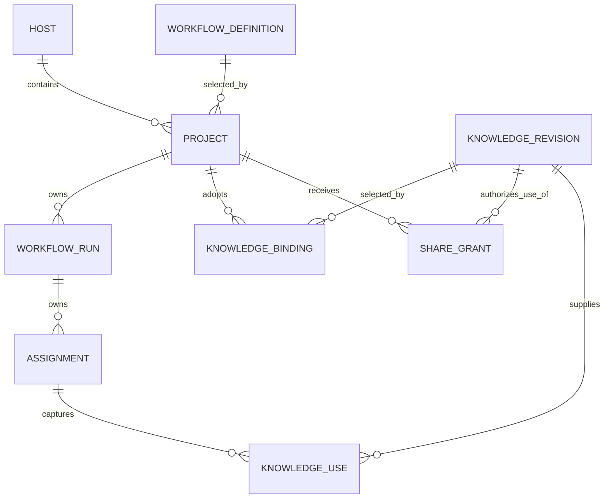
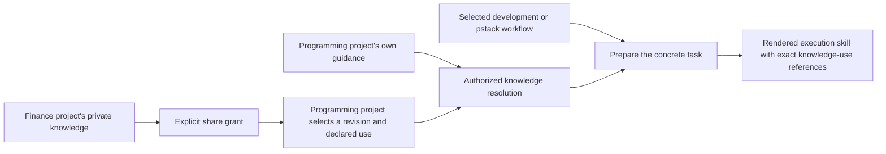

# Host storage, project isolation, and shared knowledge

The goal is one authoritative Render host containing several projects. Each project selects a workflow and keeps its knowledge isolated by default. Projects can reuse selected knowledge through explicit, attributable sharing.

**Recommendation. Use one SQLite database per host, with project ownership and authorization in the logical model.** The earlier one-project-per-database recommendation is superseded. It simplified today's implicit store boundary but did not establish a product need for physical project databases.

This is a design recommendation, not an implemented tenancy or sharing system. The [current source register](sources/revision-2.md) distinguishes merged code from unmerged project work.

## Database count does not define the source of truth

The source of truth is the host's accepting authority and its committed records. One authority could own several database files. Conversely, putting everything in one file does not establish a trustworthy authority or project isolation.

One database is a good fit here because Render is a centrally hosted application. It keeps project records, knowledge provenance, receipts, and runtime work in one transaction space. Git source objects and execution workspaces remain separate facilities. A host-wide SQLite database does not put all source files inside SQLite.

| Choice | Benefits | Costs and limits |
| --- | --- | --- |
| One host database. | One authoritative ledger, shared transaction space, consistent reference lookup, and straightforward storage of explicitly shared knowledge. | Every relevant access path needs project scope. Storage failure, schema incompatibility, or a fatal host error can affect all projects. |
| One database per project. | Coarser file-level separation, separate storage maintenance and restore units, and smaller per-file failure domains. | Shared knowledge needs a cross-store mechanism. Cross-project atomic changes and consistent receipts need additional coordination. The host still needs a project catalogue and authorization. |

Neither option is a measured performance winner. [SQLite's WAL documentation](https://sqlite.org/wal.html) describes a single writer at a time per database and the lack of whole-group atomicity across attached WAL databases. SQLite writer contention and the actual workload need evaluation if they become limiting. More database files do not prove better performance. Separate files also do not create process or credential isolation when the same privileged host can open them.

Per-project files would earn their cost if independent storage lifecycle, different retention rules, or stronger physical separation became concrete requirements. They are not requirements established by this task. This design does not add backup or restore features to retained v1 scope.

## Logical ownership belongs on every consequential record

A host owns many projects. A project owns many workflow runs. A project selects one workflow definition. A run is an instance of that selected workflow, not another project or database.

This is a conceptual ownership diagram, not a SQL schema. Knowledge can be project-owned or part of an explicitly managed shared collection. A grant also records its source owner. The diagram abbreviates that source relationship rather than imply that destination membership alone grants access.

Use existing Durable document families and immutable entries where they fit. The inspected source does not define a separate application SQL table for every domain concept. A logical `Project` can be a keyed document without becoming a separate database or Durable instance.

| Host-wide responsibility | Project-owned responsibility |
| --- | --- |
| Store schema, authority epoch, process executor epoch, ownership lock, and transaction sequence. | Project identity, repository configuration, selected workflow, and project defaults. |
| Authentication and registration of trusted workflow implementations. | Workflow state, instruction-content selection, project guidance, and knowledge bindings. |
| Generic durable execution and record protocols. | Assignment scope, retained artifacts, workspaces, execution permits, and domain operations. |
| Explicitly managed shared collections and grant records. | Knowledge originating in the project and each authorized use of shared knowledge. |

A globally unique ID is a location, not a permission. Every retained artifact has an owner and an allowed use. Project ID is distinct from repository remote, authority epoch, execution epoch, Durable session, and conversation ID.

## One host, several workflow definitions

Each registered definition supplies its own decisions, roles, procedures, craft composition, render plans, authored content, and result contracts. The host registers generic execution facilities independently of a selected workflow. Project A can use the existing development workflow while Project B uses a pstack-inspired workflow.

A project creation command creates a logical project inside an existing host database. It does not initialize another SQLite file or rotate the host authority epoch. Host creation and project creation are separate lifecycle events.

Duplicate creation means the same established principal, host namespace, command ID, and canonical request fingerprint. It returns the first accepted project and originally resolved defaults before resolving today's defaults. Changed request bytes conflict. An omitted selection stays an omission for fingerprinting, even if the configured default later changes.

Existing unclassified stores need a separately approved adoption path. This proposal does not relabel their workflows, reinterpret existing scope, or silently migrate live data.

Missing workflow code for Project A must not be mistaken for an unknown host storage schema. The target is to block A's unsafe work while compatible work in B can continue. That target is not established by current startup code. Current startup inspects retained definitions before resuming the shared runtime.

Before implementation, prove that host-owned task definitions and project-scoped dispatch guards can provide that behavior on the pinned Durable runtime. An unsupported host schema or host task definition can still require a host-wide stop. Do not hide that distinction with a claim of perfect project fault isolation.

## Scope follows the operation, not the selected UI tab

Project scope must reach all of these interfaces.

- Commands, expected bases, receipts, and deduplication namespaces.
- Workflow state, assignment identity, role requests, source lookup, and effect admission.
- Artifact reads, messages, source evidence, and instruction-content resolution.
- Snapshots, incremental observations, search, historical cursors, exports, and previews.
- Durable task input, provider admission, context refresh, continuation, and recovery.

The current device scope is expressed through workflows. The proposed model adds project scope without treating a workflow list or a repository name as a substitute. Host-owner access and project-bound agent access remain different. An owner who can administer both projects does not give an agent in one project that same access.

For a project command, the receipt namespace includes established principal identity, project ID, and command ID. The host computes a fingerprint containing target scope, expected basis, and command bytes. Host administration and project creation use a distinct host namespace. Authorization precedes receipt disclosure. A global ledger sequence remains valid; project-scoped streams may contain gaps and must not infer missing project events from them.

Opaque kernel or knowledge payloads cannot override their host-owned scope. Cross-project references need explicit permission even when both projects select the same workflow. History cursors retain their checked project and workflow scope, and each page rechecks current access. Exports declare redactions, missing content, and omissions honestly.

## Shared knowledge is explicit reuse, not shared visibility

Separate the authoritative knowledge item from the exact revision used by an assignment.

- A **knowledge item** has an owner and a declared kind.
- A **knowledge revision** identifies immutable content and its source provenance.
- A **knowledge binding** selects a revision for a project and declares its use.
- A **share grant** authorizes a destination project to acquire a particular revision or a defined collection of revisions.
- A **knowledge use** records the exact authorized revision captured for an assignment.

A binding cannot grant access by itself. A grant does not automatically adopt content as project guidance. Both the source owner's sharing decision and the consuming project's authorized selection are required. New revisions do not flow into existing assignments because a library's latest pointer moved.

The selected workflow remains unchanged. A programming workflow can use accounting terminology, risk rules, or another project's explicitly shared guidance without inheriting that project's workflow, permissions, or private history.

The first version needs ordinary explicit references and bindings. It does not need embeddings, global semantic search, inferred grants, or automatic synchronization of project knowledge.

### Meaning and authority stay separate

Project principles are adopted judgment guidance. Repository observations are evidence about source. A verification catalogue describes repository checks and expected evidence. Reusable Testing craft explains how to design and assess tests. These may share retained-content infrastructure, but they have different selection and authority rules.

An arbitrary repository file does not become accepted project guidance because it is retrieved. A model's claim does not become a trusted execution observation. Shared financial advice cannot approve a Contract, expand a tool profile, authorize a source change, or change another project's workflow.

### Proposed sharing and revocation policy

The proposed default is prospective revocation. Revocation stops new acquisitions and new assignment uses under the grant. It does not promise to erase already disclosed content, retained execution skills, or provider contexts. Cancelling ongoing work uses existing assignment fencing rather than pretending the agent can forget material it already received.

Acquisition means authorized host capture into the assignment's retained input set, including staged material already captured. Reading that capture is not new permission to read the source collection. Existing assignment use remains bound to its captured revision and authorization; stopping it requires cancellation or fencing.

An assignment's captured knowledge use retains the grant and source revision that authorized the disclosure. Historical capture is not a mutable fork of the source knowledge item. The host may deduplicate identical bytes, but that physical choice does not authorize another project to read them.

Historical inspection and adoption of old material into a new assignment are separate uses. An old `KnowledgeUse` is bound to its assignment and does not by itself authorize a new assignment's adoption of the source guidance. Product policy must decide which retained reports and exports can become new inputs after revocation. No automatic derivative-record reuse or content-level tracking machinery is assumed.

This default and the derivative-reuse question need product review before implementation. Stronger retrospective access restrictions would also need an explicit policy for retained skills, context refresh, and historical exports. Do not add that machinery silently or promise retroactive confidentiality.

## Concrete isolation and sharing cases

| Case | Required result |
| --- | --- |
| Project B guesses the ID of A's private artifact. | Refuse the read. Existence and same-database locality confer no permission. |
| Two projects use the same workflow definition. | Keep their facts, principles, runtime work, and private histories separate. |
| Finance guidance is shared with a programming project. | Resolve only the granted revision and permitted use. Record it in the assignment manifest. |
| A library publishes a new revision. | Existing execution skills retain old exact bytes. New use requires the consuming project's defined revision selection. |
| A share grant is revoked. | Block new acquisition and new assignment use. Preserve honest records of prior disclosure under the declared policy. |
| A project operation references another project's repository. | Refuse unless a separate source-operation authority permits it. A knowledge grant does not permit writes or checks in that repository. |
| A workflow implementation is unavailable. | Block affected project dispatch before model or external execution. Do not substitute another workflow. Prove unrelated-project continuation separately. |

These are proposed verification cases. No database isolation, sharing, or performance experiment ran for this document.
