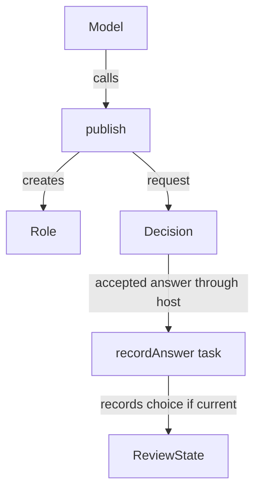
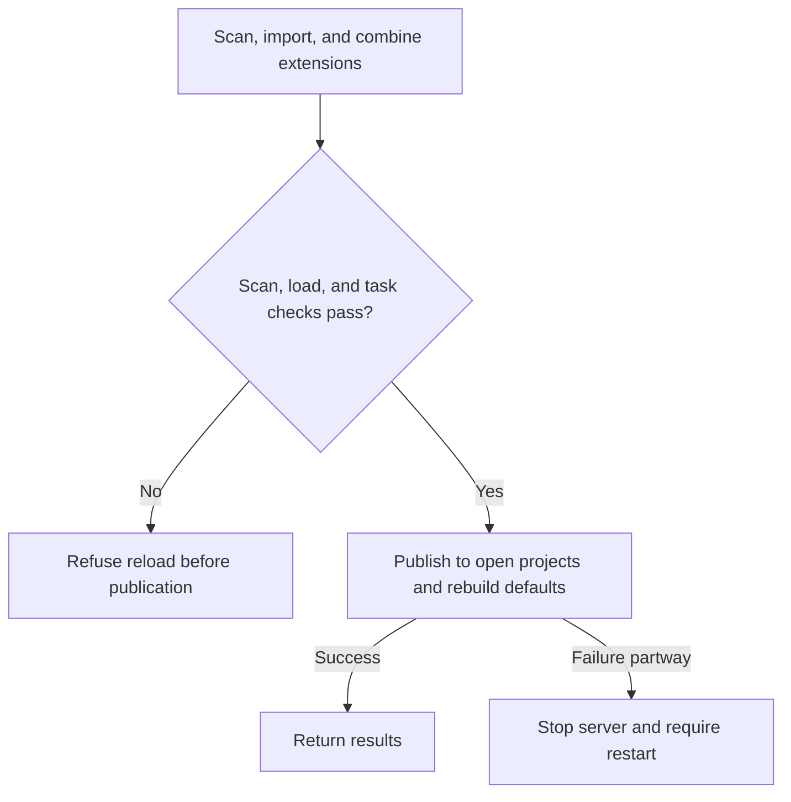

# Extensions

An extension is a folder whose `index.ts` exports a pi-durable `extension`. Its tools, tasks, hooks, and other pi-durable extension members give agents work to do. A module with an `entry` export is a workflow that a client can use to create a conversation. `entry` supplies the new conversation's settings.

The extension name must match its folder. The [host reference](host.md#options) describes the module type and options, and its [calls table](host.md#calls) lists project calls.

## Imports and helpers

Import Tau's extension author API from `tau`, `tau/durable`, `tau/schema`, and `tau/chord`. Tests can also import `tau/testing`. The [core package export tables](../core/README.md) list each name and its origin. Some names re-export pi packages so extensions share the same imports and dependency versions. Changes in pi-durable behavior still affect those re-exports.

```ts
function options<T extends JsonObject>(
	extension: string,
	schema: Schema<T>,
): {
	readonly schema: Schema<T>;
	get(tx: Tx): Promise<Partial<T>>;
	set(tx: Tx, value: Partial<T>): Promise<void>;
	read(tx: Tx): Promise<T>;
};
function modelRef(value: string): ModelRef;
function prose<const S extends readonly string[]>(
	directory: string,
	file: string,
	slots: S,
): (facts: { [K in S[number]]: string }) => string;
function role(
	tx: Tx,
	settings: RoleSettings,
	ownership: ConversationOwnership,
): Promise<ConversationId>;
```

`options` defines a project session document named `<extension>.options`. Its `get` returns the set values, `set` replaces them, and `read` merges defaults and validates the result. `read` throws if values are invalid or incomplete. Export the returned object as `options` for clients. Use a closed object schema with flat properties. Mark a model string with `format: "model"`. `modelRef` splits a value at the first slash and does not validate it.

Call `prose` at module scope to read and check a template before rendering a section. The declared slots must match the `{{name}}` placeholders in the file. The returned function substitutes each placeholder once without escaping or interpreting the inserted text.

`role` creates and configures a conversation in the caller's transaction. Its settings require a model and an extension selection. Supplied settings do not clear inherited settings in task-owned conversations.

Mark a secret string with `format: "secret"`. The host returns `true` for a set top-level secret instead of its value. The extension's `set` owns storage. The `options` helper stores secrets in the project store, not a separate vault, so the store and its backups contain secrets in plain text. Read secrets when needed and keep them out of tool results, entries, events, sections, errors, and logs.

## Agent selection

The project default contains `coding-tools` and available project extensions without `entry`. A workflow is not part of the default.

| Agent selection | Extensions received |
| --- | --- |
| No selection | Project default |
| Open role with `{ add, remove }` | Project default adjusted by the role |
| Closed role with an exact list | Exactly the listed extensions |

An open role follows changes to the default on its next model request. An in-flight request keeps its selection. A closed role does not acquire extensions added to the project.

If a role must exclude particular tools, select both its extensions and tools exactly. An open role must remove the other roles' tools from its own extension by name. A prompt section must check its intended audience because a tool filter does not hide sections.

## Author rules

### Keep module loading free of side effects

Use TypeScript with erasable syntax that needs no build, and end relative imports with `.ts`. The server loads the source files. Keep top-level code free of durable writes and external side effects. The server runs top-level code on load and reload, even when it later refuses the reload.

### Make publishing tools safe to replay

Declare `callers: ["model"]`, `executionMode: "sequential"`, and `replay: "safe"` on a tool that publishes external state. Nested tool calls do not obey the sequential setting. A restart can replay the tool, so read a receipt keyed by `api.taskId`, write it atomically with the publication, and return the saved result on replay.

Validate workflow state inside tools because prompts and role tool lists are not a sandbox. Read external state inside the publishing tool because the model can name stale state. Persist a plan before an external effect, inspect the state, and stop on mismatch. A rerun must neither repeat an effect nor destroy work it cannot prove is its own. Review published immutable state rather than working files so the review covers what will be handed over.

### Make decisions and tasks recoverable

Offer an ending choice on every decision because stopping a conversation leaves its open decisions in place. Deduplicate continuation effects by decision ID and check that the workflow still expects that decision. A replacement `then` task has a new task ID. Commit cancellation before stopping agents because a crash between stops can leave work partly cancelled.

Commit a changed checkpoint before waiting in memory. Repeated interruptions without durable progress can fault a task. For work that waits beyond an agent run, call `tx.createTask` in a commit with the task and input. Pass an options object containing `ownership: { kind: "conversation" }`, `conversationId`, and `background: true`. The task survives a stop, and the conversation can become idle while the work waits.

### Keep options valid across phases

Read options at use and persist the values that external effects depend on because options can change between phases. Give added options defaults so existing tasks do not fault when `read` finds an incomplete options document. Reconfigure existing roles from current options before submitting to them. Changing options does not update their stored settings.

### Create and submit to conversations in order

Build submissions from stored causes and use the cause ID as `requestId`. A rerun must not submit different or duplicate input. Name a newly dispatched conversation in its event so clients have its ID to join the agent.

Create and configure a conversation in one commit, then submit its first input in a later commit. Submission cannot follow the conversation table write in the same commit. To submit to an existing role, obtain its handle before the commit, then configure it before submitting:

```ts
const handle = await runtime.conversation(conversationId, context);
await runtime.commit(async tx => {
	await configure(tx, conversationId, { model: modelRef(model) });
	await handle?.submit(tx, { type: "input", content, requestId: causeId });
}, context);
```

## Write a workflow

Create a folder named `example` and add the files below. The model calls the `publish` tool, which requests a decision and creates a role. A human answers through a client and the host. The store creates the `recordAnswer` task, which records the choice in the `ReviewState` conversation document if the decision is still current.

The diagram shows how the example moves from the model's call to a recorded answer.



1. Create `package.json` with the package metadata below.
2. Create `agent.md` with the agent's instructions.
3. Create `index.ts` with the extension, its options, and its workflow entry.

`package.json`:

```json
{
	"name": "tau-example",
	"private": true,
	"type": "module"
}
```

`agent.md`:

```md
Use the publish tool when asked to request a review.
```

`index.ts`:

```ts
import {
	decision,
	emit,
	modelRef,
	options as defineOptions,
	prose,
	request,
	role,
	type DecisionId,
	type DecisionInput,
	type EventData,
} from "tau";
import {
	defineDoc,
	defineEntry,
	defineExtension,
	defineTask,
	defineTool,
	type EntryId,
	type Tx,
} from "tau/durable";
import { obj, str } from "tau/schema";

type Choice = "approve" | "cancel";
export const ReviewState = defineDoc<{
	receipts: Record<string, EntryId>;
	open?: DecisionId;
	answers: Record<string, Choice>;
}>({
	kind: "example.review-state",
	version: 1,
	scope: "conversation",
	history: "latest",
	fork: "current",
	initial: () => ({ receipts: {}, answers: {} }),
	checkpointWhen: () => false,
});
const Basis = defineEntry<{ text: string }>("example.basis");
const Published = defineEntry<EventData>("example.published");

const publish = defineTool({
	name: "publish",
	description: "Ask the human to review text.",
	parameters: obj({ text: str() }),
	callers: ["model"],
	executionMode: "sequential",
	replay: "safe",
	execute: async (args, api, context) => {
		const basisId = await api.commit(async tx => {
			const reviewState = await tx.doc(ReviewState, api.conversationId);
			const receipt = reviewState.receipts[api.taskId];
			if (receipt !== undefined) return receipt;

			const settings = await options.read(tx);
			const roleId = await role(
				tx,
				{
					model: modelRef(settings.model),
					extensions: [extension],
					tools: [publish],
					instructions,
				},
				{ kind: "ownerless" },
			);
			const basis = await tx.appendEntry(Basis, api.conversationId, {
				data: { text: args.text },
			});
			const reviewDecision = await request(tx, {
				subject: `example:${api.conversationId}`,
				title: "Review",
				basis,
				choices: ["approve", "cancel"],
				conversation: api.conversationId,
				then: recordAnswer,
				requestedAt: api.now(),
			});
			reviewState.open = reviewDecision.id;
			reviewState.receipts[api.taskId] = basis.id;
			await emit(tx, Published, {
				text: `Review requested. Agent ${roleId} created.`,
				at: api.now(),
				conversation: roleId,
			});
			return basis.id;
		}, context);
		return { output: [{ type: "text", text: `Published ${basisId}.` }] };
	},
});

const recordAnswer = defineTask<DecisionInput<Choice>, { phase: "record" }, null>({
	name: "example.record-answer",
	version: 1,
	initial: () => ({ phase: "record" }),
	phases: {
		record: (task, runtime, context) => runtime.commit(async tx => {
			const reviewDecision = await decision(tx, task.input.decision);
			const reviewState = await tx.doc(ReviewState, runtime.conversationId);
			if (
				reviewDecision?.status === "answered" &&
				reviewDecision.choice === task.input.choice &&
				reviewState.open === reviewDecision.id &&
				!reviewState.answers[reviewDecision.id]
			) {
				reviewState.answers[reviewDecision.id] = task.input.choice;
				delete reviewState.open;
			}
			return {
				status: "terminal",
				outcome: { status: "completed", result: null },
			};
		}, context),
	},
	abort: (_task, runtime, context) => runtime.commit(() => ({
		status: "terminal",
		outcome: { status: "aborted" },
	}), context),
});

export const extension = defineExtension({
	name: "example",
	tools: [publish],
	tasks: [recordAnswer],
});
export const options = defineOptions("example", obj({
	model: str({ format: "model" }),
}));
const instructions = prose(import.meta.dirname, "agent.md", [])({});

export async function entry(tx: Tx) {
	const settings = await options.read(tx);
	return {
		model: modelRef(settings.model),
		extensions: [extension],
		tools: [publish],
		instructions,
	};
}
```

For an open role and separate closed roles, see [W1](../extensions/w1/README.md). [W2](../extensions/w2/README.md) uses a background timer and scoring.

A timer phase calls `runtime.sleepUntil(deadline, nextCheckpoint, context)` and returns immediately. A versioned task can provide `migrate(input, checkpoint, fromVersion)` returning `{ input, checkpoint }`.

## Test without a server

Add the files below to the `example` folder, then run the test:

1. Build Tau with `nix build` from the repository. The build supplies `tau` and its dependencies.
2. Link the build's `result/lib/tau/node_modules` into the example folder as `node_modules`.
3. With Node 24, run `./node_modules/.bin/tsc -p .` in the example folder.
4. Run `node --test example.test.ts` in the same folder.

The test resumes the scheduler and uses `fauxAnswer` to supply the human answer.

`tsconfig.json`:

```json
{
	"compilerOptions": {
		"target": "ES2023",
		"module": "NodeNext",
		"moduleResolution": "NodeNext",
		"strict": true,
		"noEmit": true,
		"allowImportingTsExtensions": true,
		"erasableSyntaxOnly": true,
		"skipLibCheck": true,
		"types": ["node"]
	},
	"include": ["*.ts"]
}
```

`example.test.ts`:

```ts
import assert from "node:assert/strict";
import { test } from "node:test";
import { decision } from "tau";
import { BACKGROUND_CONTEXT as context } from "tau/chord";
import { configure, createRegistry, MemoryStorage } from "tau/durable";
import {
	createModels,
	fauxAnswer,
	fauxAssistantMessage,
	fauxProvider,
	fauxToolCall,
	openStore,
} from "tau/testing";
import { ReviewState, entry, extension, options } from "./index.ts";

test("publish and answer", async () => {
	const registry = createRegistry();
	registry.install(extension);
	const provider = fauxProvider();
	const models = createModels();
	models.setProvider(provider.provider);
	const store = await openStore(new MemoryStorage(), { registry, models }, context);
	const harness = store.harness;

	await harness.commit(tx => options.set(tx, { model: "faux/faux-1" }), context);
	const root = await harness.root(context);
	await harness.commit(async tx => configure(tx, root.id, await entry(tx)), context);
	harness.resume();

	provider.setResponses([
		fauxAssistantMessage(
			[fauxToolCall("publish", { text: "Review this" })],
			{ stopReason: "toolUse" },
		),
		fauxAssistantMessage("done"),
	]);
	const submission = await root.submit({ type: "input", content: "publish" }, context);
	await submission.wait(context);
	await root.waitForIdle(context);

	const decisionId = await harness.commit(
		async tx => (await tx.doc(ReviewState, root.id)).open,
		context,
	);
	assert.ok(decisionId);
	const reviewDecision = await harness.commit(tx => decision(tx, decisionId), context);
	assert.ok(reviewDecision);
	const answer = await fauxAnswer(
		store,
		reviewDecision.id,
		{
			basis: reviewDecision.basis,
			choice: "approve",
			annotations: [],
		},
		context,
	);
	assert.ok(answer.kind === "answered");

	await harness.waitForTask(answer.decision.continuation, context);
	const recordedAnswer = await harness.commit(
		async tx => (await tx.doc(ReviewState, root.id)).answers[reviewDecision.id],
		context,
	);
	assert.equal(recordedAnswer, "approve");
});
```

## Load and reload

The server scans `~/.tau/extensions/` at startup. Each visible entry other than `node_modules` must resolve to a distinct folder with `index.ts`. The loader rejects JavaScript files outside `node_modules`, bad imports, invalid module shapes, mismatched names, invalid options, and conflicting tasks. An extension supplies its own npm dependencies. The loader aliases Tau imports to the server's package.

The server reports each failure on standard error as `tau: extension NAME [STAGE]: MESSAGE`, with an optional path after the name. A failed extension does not prevent the server or other extensions from starting. An extension is [trusted code](design.md#limits).

After an extension changes, `tau extension reload` reloads extensions on a running server in this order:

1. The server scans and imports the folders, then combines them with the loaded extensions. A missing folder keeps its loaded extension.
2. It checks the proposed extensions in a scratch registry and checks task compatibility.
3. If a scan, load, or compatibility check fails, it refuses the entire reload before publishing the proposed extensions.
4. Otherwise, it publishes the extensions to open projects, rebuilds their defaults, and returns extensions, task warnings, and skipped projects.

Reload refuses duplicate task names, dropped task kinds, lower task versions, and phases removed without a version increase. An in-flight tool call or task phase finishes with its old code. A waiting task uses new code when it wakes. An existing conversation keeps its stored instructions. New conversations use the new instructions.

A task with a higher installed version uses `migrate` when next reserved. Without a migration, the task blocks. Task warnings name the project, task, kind, conversation, stored and installed versions, and blocked or migration-needed status. Reservation failures print `migration_failed` or `task_outdated`. Missing task definitions do not appear in migration warnings. The project's `missing` list names absent extensions. If publication fails partway, the server stops and requires a restart rather than rolling back.

The command prints `added`, `replaced`, or `kept` for each extension, task warnings, skipped projects, and totals. Exit status 0 means applied without kept extensions, task warnings, or skipped projects. Exit status 3 means applied with at least one of those. Status 1 means a refusal, a restart requirement, or another error. Status 2 means invalid usage. Changes to the server itself require a restart.

The diagram shows how the scan, scratch registry, and task checks lead to publication or refusal, including a publication failure.



## Install an extension

To install an extension from another repository:

1. Choose a name that matches `^[a-z0-9][a-z0-9-]{0,62}$` and is not `coding-tools`.
2. Place or symlink the extension folder at `~/.tau/extensions/<name>/`, with `index.ts` and its dependencies at the folder root.

To install a sample from this repository:

1. From the development shell, run the command below to list the samples.
2. Add new extension files to Git before installation. The flake sees only tracked files.
3. Pass a sample name to the same command and use the home that the server uses. Omit `--home` to use `~/.tau`.

```sh
install-extension --home /tmp/tau-example/.tau
```

The installer builds a source snapshot and links it at `<home>/extensions/<name>`. The link is a Nix garbage-collection root. The snapshot prevents unfinished source edits from reaching a running server.

If a server runs on that home, the installer requests a reload. If the server refuses, the installer restores the previous link or removes the new link. Without a server, the extension loads at the next start.
