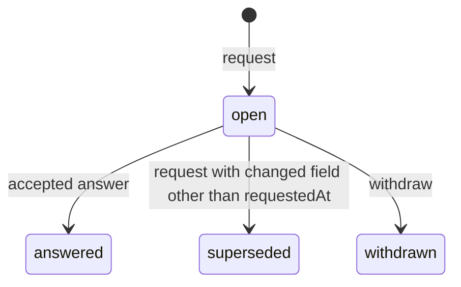

# Decisions and events

A decision is a durable request for a human answer. An event is an entry that a client can show in a timeline without knowing which extension wrote it. Extensions create these records in their own commits.

## Decision

The store defines these types in `core/src/store/types.ts`:

```ts
export type DecisionId = `${string}#${number}`;
export type DeviceId = string;
export type Annotation = {
	text: string;
	range?: { start: number; end: number };
};
export type Decision<C extends string = string> = {
	id: DecisionId;
	subject: string;
	title: string;
	basis: EntryId;
	choices: readonly [C, ...C[]];
	conversation: ConversationId;
	then: { task: string };
	requestedAt: number;
} & (
	| { status: "open" }
	| {
			status: "answered";
			choice: C;
			annotations: readonly Annotation[];
			by: DeviceId;
			at: number;
			continuation: TaskId;
	  }
	| { status: "superseded" }
	| { status: "withdrawn" }
);
```

A decision ID is local to its store. The subject identifies the work under review. A subject should combine an extension name and key, such as `w2:forecast`. Each new decision for a subject gets an ID of the form `${subject}#${n}`. A subject has at most one open decision.

The basis is an entry whose data includes the `text` for human review. An annotation without a range applies to the whole basis. A range uses UTF-16 code units, as in `text.slice(start, end)`. Its endpoints must be integers with `0 <= start <= end <= text.length`.

The store keeps decisions in documents and indexes the open list by subject. Each open list item holds the decision ID, title, request time, and conversation.

## Request, withdraw, and read

`request(tx, draft)` takes the following draft, defined in `core/src/store/decisions.ts`:

```ts
export type DecisionInput<C extends string> = {
	decision: DecisionId;
	choice: C;
};
export type RequestDraft<
	C extends string,
	S extends { phase: string },
	R,
	H extends object,
> = {
	subject: string;
	title: string;
	basis: TypedEntry<{ text: string }>;
	choices: readonly [C, ...C[]];
	conversation: Decision["conversation"];
	then: Task<DecisionInput<NoInfer<C>>, S, R, H>;
	requestedAt: number;
};
```

The caller supplies the time and a typed basis from an entry read or append. `request` stores the basis ID rather than its text. An empty subject makes `request` throw `TypeError` before it changes any documents.

| Open decision for the subject | Result |
| --- | --- |
| None | Opens a decision with a new ID. |
| All draft fields except `requestedAt` match | Returns the open decision with its original time and writes nothing. |
| Any other draft field differs | Marks the open decision superseded and opens a new decision. |

For comparison, `then` means the task's name and `basis` means the entry ID. A newly appended basis has a new ID even if its text matches. An identical request after an answer opens another decision.

`request` reads and writes only documents, so it can run before or after table operations in a commit. `withdraw(tx, subject)` marks the open decision withdrawn and clears its slot without creating a task. If the subject has no open decision, `withdraw` does nothing. `decision(tx, id)` returns the decision, or `undefined` if the ID does not exist.

## Answer

The host calls `answer` for a client with a decision ID, the basis ID, a choice, annotations, and the authenticated device ID. The host supplies the answer time. Refusals are returned values. A storage failure rejects the call and leaves its outcome unknown, so the client can resend the same fields.

The store checks the rows in this order:

| Decision state | Condition | Result |
| --- | --- | --- |
| Missing | Any input | Refuses with `unknown_decision`. |
| Superseded or withdrawn | Any input | Refuses with `not_open` and includes the subject's open decision if one exists. |
| Answered | Basis, choice, or annotations differ | Refuses with `conflict` and includes the answered decision. |
| Answered | Fields match and the continuation is not terminal with a `faulted` outcome | Returns the decision with `repeated: true` and writes nothing. |
| Answered | Fields match, the continuation faulted, and its task is available | Creates a replacement task, stores its ID, and returns the decision with `repeated: true`. |
| Answered | Fields match, the continuation faulted, and its task is unavailable | Refuses with `extension_not_loaded` and writes nothing. |
| Open | Basis differs | Refuses with `stale_basis`. |
| Open | Choice is not offered | Refuses with `unknown_choice`. |
| Open | An annotation range does not fit the basis text | Refuses with `bad_annotation`. |
| Open | The task is unavailable | Refuses with `extension_not_loaded`. The decision stays open. |
| Open | All checks pass | Records the answer, creates the task, clears the open slot, and returns `repeated: false`. |

A resend matches only if its annotations have the same text and ranges in the same order. The stored answer keeps the original device and time. A replacement is created only for a `faulted` continuation and starts the task again with the same input.

The store commits the answer and its continuation task together. It stores the task name in the decision and looks up the installed task when the answer arrives. The task belongs to the decision's conversation and runs in the background, so stopping that conversation's agent does not abort it. The task input is `{ decision, choice }`. The `request` type checks the task against the decision's choice type.

The diagram shows how an open decision changes state.



## Who can answer

The host invokes `answer` through an authenticated client call, not through an extension function or an agent tool. No package entry exports the real `answer`. A device is a paired client identity whose token authenticates calls. The [protocol reference](protocol.md) describes pairing and tokens.

The answer interface prevents an extension from answering by mistake, but it is not a sandbox. An agent with access to the server's account, store, or device tokens can act outside the extension interface.

## Event

The store defines the event data in `core/src/store/types.ts`:

```ts
export type EventData = {
	text: string;
	at: number;
	conversation?: ConversationId;
};
```

An extension defines an entry kind and calls `emit(tx, kind, data)`. The data includes displayable text and a caller-supplied time. It can also include extension-specific fields. The kind should use the extension's name as a prefix.

`emit` appends the event in the caller's commit, together with the change it describes. Each store has an ownerless conversation for its event log, created when the store opens. `eventLog(tx)` returns the conversation ID. Extensions use pi-durable entry reads to read that conversation.

The core does not emit events for decisions. An extension can emit its own event in the same commit.

## Commit order

Within a commit, table reads come first, followed by at most one `submit(tx, draft)` and then table writes. `emit`, entry appends, task creation, and conversation creation are table writes. Document reads and writes can occur anywhere in that order. For example, a commit can submit first, append the basis entry, and then call `request`.

## Tests

`fauxAnswer` uses the real answer logic with the fixed device ID `!test`. See [extension tests](extensions.md#test-without-a-server).
