# Render: trustworthy delegated development

**Status: revised design for human review.** Incorporates A001–A023 and D001–D006, source-backed runtime research, independently evaluated probes, and the fresh Fable challenge with parent dispositions. Engineering recommendations and unrun implementation gates remain explicit; no overall acceptance, product implementation or live grants are implied. See the [revision record](spec-review-disposition.md) and [ambition](ambition.md).

## 1. Outcome, scope, and decision status

Render lets a human take an uncertain idea through design, explicit commitments, implementation, verification and independent review; leave or switch clients; and resume without reconstructing state or wondering what was authorized.

**One authoritative personal macOS host, reached only over the private tailnet.** The current host is a battery-backed laptop; this lowers one power-loss exposure but does not eliminate storage failure. This is not a public or enterprise service. Clients and conversations hold no workflow authority. Pi Durable supplies execution; Kernel computes legitimate state changes; Ledger accepts authorized commands and retains outcomes.

The full design journey remains **Ground → Seams → Modules → Proposal → Record → implementation → source preparation/required Audit → independent Watchdog → guarded proposal integration → human final merge**. Source-changing Record work uses that same delivery path before affected implementation starts. Record is a workflow phase, not the Ledger module. Task-specific shorter paths are defined in §8.1; they remove irrelevant ceremony, not accepted obligations, authority checks or independent delivery review.

<!-- render-figure: 01 -->
**Figure 1 — Journeys and decision gates.** Proposed state/protocol flow, not executed evidence. D001 permits configured technical Seams/Modules decisions within agreed scope; final Proposal/Contract acceptance remains human, including shortened paths. All gates use exact retained revisions and current authority; all-human initial settings are a conservative proposal, not a live grant. X is the exact prepared source. Only a recorded qualifying integration clears eligible dependencies or schedules the first draft proposal PR; later integrations update that same PR.

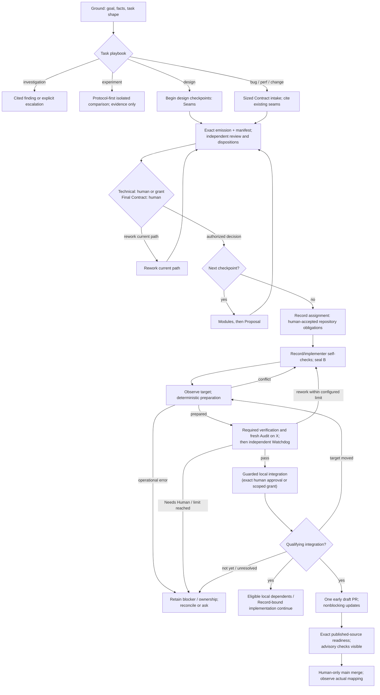
<!-- /render-figure -->

**Settled changes, not requests for reapproval:**

- Kernel is the pure state-machine module; Ledger is the accepting/persistence module; Engine owns scheduling, packet rendering and runtime supervision (§4).
- **D001:** configuration may delegate technical **Seams and Modules** decisions within agreed scope. Final **Proposal/Contract acceptance remains human**, as do new product choices outside delegation and final main merge. Proposed initial settings route all checkpoints to the human. The completed-review automatic rework limit is configurable; **default 2 is accepted**. **D004:** new config applies to future work; an explicit action adopts a selected revision for selected active work, with immediate authority revocation and no history/count reset (§6.4).
- **D002:** normal public-internet access supports dependency downloads and documentation research. Host/private/tailnet targets require an explicit project/profile grant; verification services inside the worker environment remain available. The recommended address-filtered public-egress profile is specified in §7; actual enforcement remains a future V5 gate.
- **D003:** asynchronous off-host backups target **≤5 minutes of exposed acknowledged work while healthy**, with prompt important-decision backup, visible actual protected cutoff and continued local work with warnings during outages. Manual best-effort recovery has no numeric time guarantee; destination/tool are not selected (§10).
- **D006:** store immutable acknowledged text/document revisions in SQLite alongside transactional history/authority, receipts and task handoff; canonical source remains Git. Retain all acknowledged document history initially, provide versioned nonauthoritative text/JSONL export and complete consistent recovery packages. Optional later Git archive is not required; full-text growth is an acknowledged trade-off (§5.4).
- Known target drift is handled before Watchdog: deterministic preparation or conflict directly to implementation; final expected-old integration guard remains (§9.4).
- **D005:** create **one draft proposal PR after first qualifying local integration**, then update its source/summary; no Slice issues. Publication failure/uncertainty never blocks eligible local work, but readiness requires exact current published mapping. The provider-neutral forge adapter is an Effects submodule (§9.2).
- Human usability/verification suggestions are visible but **not formal-attestation readiness or merge-validity gates**. Automated project-specific interaction checks remain required where committed (§8.2).
- Device enrollment does not expire and remains revocable. No recurring manual re-enrollment. Protocol/auth details are recommendations, not a browser mandate (§5).
- This is a **server and stack-independent wire-protocol design**. GPUI/TUI clients are separate work; no web client layout or implementation.
- Physical second-machine trials are optional, low-priority future work; local multi-client protocol checks remain required.

**Research complete for this revision; implementation gates remain:** D006's selected document representation has bounded history/package evidence. Pinned source inspection now supports assignment-scoped continuity, fresh independent roles and the four planned capability adapters (§6.5–6.6). Recommend Linux-container execution on the macOS host with enforced public TCP/UDP/DNS egress (§7), minimal private-tailnet bearer authentication (§5), and stronger local persistence (§10). Native macOS builds/interaction remain unsupported until a separately verified profile exists; there is no ambient host-shell fallback. None of these proposals has a compatibility, enforcement or model-quality pass. Actual schema, authenticated restore, reconciliation and adapter/profile checks belong to implementation, not another broad research round. D003 remains a conditional loss-window target; an operator-provisioned off-host destination is a deployment prerequisite, not a design blocker.

**Q-01 — OPEN RELEASE-SCOPE QUESTION FOR HUMAN REVIEW:** is Linux-container execution sufficient for the first release, or must Render verify the planned GPUI client's native macOS build/interaction from its first version? Linux-only v1 is **not accepted by implication**. If first-version native verification is required, its verified native profile must move earlier, before that project's use (§14). Until then native execution is truthfully unsupported, never an ambient host-shell fallback. This question is surfaced for annotations; it does not block publication or start another research loop.

Carry-forward **recommended defaults for review** are four executing attempts with quiescence before slot release, read-only Watchdog, exact independently reviewed immutable emissions, canonical local proposal refs and retained decisive raw experiment evidence. They are not newly selected human policy. After capability verification, `localIntegration: human` is the conservative operational default: exact operation-specific human approval or, in `scoped-grant` mode, a current proposal-scoped grant is required (§9.3). `disabled` is an intentional policy pause, separate from unavailable/unverified capability. Design review grants neither integration authority nor main-merge authority.

**Non-goals:** generic workflow framework/DSL; multi-host authority; independent offline writers; enterprise/public deployment; automatic final merge; Slice issue mirroring; client implementation; automatic principle generation or an eval harness. Existing workflows/configuration remain untouched. This designer implemented or reran no prototype; parent-owned experiments remain disposable evidence, not Render implementation.

## 2. Start from histories, not a module diagram

The following representative histories define what the design must explain. They are designed scenarios, not claims of replaying production sessions.

| History | Required outcome | Failure to defeat |
|---|---|---|
| H1: uncertain idea to delivery | Challenger reveals an incidental choice; an experiment disproves the favorite; revised commitments are explicitly accepted; independently reviewed work reaches human merge. | A persuasive coordinator turns evidence or silence into commitment. |
| H2: annotated checkpoint, abandoned client | Human saves arbitrary Markdown edits, requests rework, leaves; another client and fresh coordinator recover every saved concern. | Lost annotations, overwritten bytes, or dependence on old chat. |
| H3: lost handoff response | One report, assignment closure, receipt and next task survive a crash before reply. | Retrying increments a review round or releases a newer assignment. |
| H4: concurrent clients | An approval and an annotation save against the same basis have one explicit ordering. | An obsolete approval silently authorizes new content. |
| H5: uncertain external creation | A successful remote create with a lost response is reconciled or explicitly blocked. | Negative listing causes a duplicate create. |
| H6: source changes after review | A pass on X remains historical evidence, never permission to integrate Y. | A ready label, source name or old verdict substitutes for exact evidence. |
| H7: canceled worker still alive | Authority is fenced immediately; workspace reuse waits for confirmed quiescence. | A surviving child or old generation writes into replacement work. |
| H8: runtime upgrade | Unsupported persisted work is visible and blocked, with a supported recovery path. | A new handler silently reinterprets an old checkpoint. |
| H9: hostile worker output | Shell, Git metadata, attributes, symlinks and rendered documents cannot acquire host or human authority. | Hidden tools or a different working directory are mistaken for isolation. |

The assurance goal is **safe continuation or a precise actionable blockage at every named failure point**, without manual ledger repair or inferred authorization. Process-crash recovery aims to preserve acknowledged edits; host-loss restoration exposes the actual verified off-host cutoff. D003 targets ≤5 minutes of exposed acknowledged work while healthy, not a hard bound during outages or an implied zero-loss promise. Blockage is a successful safety outcome where safe continuation cannot be established; it is never reported as completion.

## 3. Source-backed behavior and intentional changes

### 3.1 Source register and precedence

**Evidence-path convention:** `LAB` means `/Users/vr-osxs/infra/pi-durable-design`; `LAB_REV` means `LAB/revision-a001-a023`. These external lab files contain reproduction evidence, not additional hidden product requirements. The design and annotation dispositions are self-contained in this document and its [revision record](spec-review-disposition.md).

References below are local, inspectable sources, not claims that the source system already implements Render.

- **U — current intent:** this task, [continuation decisions](spec-review-disposition.md#human-decisions) D001–D006, `docs/spec-review-notes.md` A001–A023 (later statements supersede earlier), `docs/ambition.md`, and `AGENTS.md`. D001 changes historical checkpoint delegation; D002 selects network policy, not enforcement; D003 selects proportionate backup policy, not a backend; D004 selects active-config semantics; D005 selects draft PR timing; D006 selects SQLite immutable acknowledged documents/history and portable export/package semantics. Repository rules require tests/failure cases before implementation here.
- **T — transcript:** `skl_conversation_transcript.md`, recorded as completely read by the baseline designer; not independently reread in this revision. Later user clarification makes central hosting the only mode and requires pure transformations independent of orchestration topology. Earlier assistant suggestions of distributed writers, a DSL, or putting mandatory independent review solely in the loop are not requirements.
- **D — design method:** `skl skill design`, its `DEEPENING.md` and `DESIGN-IT-TWICE.md` resources; testing and domain guidance. Interfaces include ordering, authority, errors and required configuration, not just method signatures. Depth means leverage; locality means reasons to change concentrate in one place.
- **C — source domain:** `/Users/vr-osxs/dev/skills/CONTEXT.md`, inspected at source revision `480179ce60db591a62562a94b27bf35a32b7505f`. Relevant production claim/handoff source was read to distinguish mechanics from intent, not copied as architecture.
- **A5/A6/A7/A13/A14:** skl ADRs 0005 (contract verification/fidelity), 0006 (private records/ownership/recovery), 0007 (latest-view publication), 0013 (proposal integration versus human main merge), 0014 (amendment and Contract freeze).
- **A18–A22:** skl ADRs 0018–0022: decision classes and lint, repository verification, principles, task shapes, annotated design checkpoints and experiments.
- **L0 — original accepted proposal:** `projects/skills/proposals/design-workflow/proposal.md` at ledger revision `8d4b7651431a2c09ffde521dff1221dfb7abd482`, accepted 2026-10-19.
- **L1 — recorded status and Contracts:** read-only `skl browse` at revision `9a02a327dd6c2e4ac40a985bdbf5d8b5434405d7`. Contract references below use `projects/skills/proposals/design-workflow/<slice>/{intent,behavior,plan}.md`; `B<n>` identifies a behavior obligation, not a test.
- **P — runtime:** pinned Pi Durable 1.4.0 package and commit-specific specification; exact provenance, results, limits and rerun commands are in §12.
- **NEW-INC / NEW-HISTORY — evaluated lab evidence:** `LAB_REV/evaluation-incorporation.md` and `LAB_REV/evaluation-history.md`, read fully. Parent independently inspected/reran correctness and unsafe controls; history benchmark timing is the subagent's run inspected by the parent, not independently timing-rerun. These evaluations are bounded evidence, not product implementation or a human backend selection.
- **NEW-RUNTIME — source-established capabilities and engineering synthesis:** complete `LAB_REV/runtime/findings.md`, `LAB_REV/runtime/probe-requests.md` and `LAB_REV/evaluation-runtime.md`. Parent independently checked key pinned runtime/installed-extension claims, Docker internal-network limitations and Tailscale Serve capability. R1–R5 are engineering recommendations, not D007+ human decisions. The parent synthesis supersedes the researcher's HTTP-first and conditional-compaction recommendations: normal public TCP/UDP/DNS and the planned OpenAI-oriented opaque adapter remain in scope. No proposed runtime probe was launched. `LAB_REV/parent-revision-review.md` records consistency checks and Figure 1/11 corrections, not the fresh challenge.

**Revision source recheck:** Read ADRs 0019/0021/0022 and accepted proposal/behavior Contracts through read-only `skl browse document`. The supplied `/Users/vr-osxs/dev/dev-skl-ledger` checkout is currently a different demo ledger at `10abea5`, without the design-workflow objects; do not present its contents as that proposal. The configured read-only browse returned L0/L1 at the exact revisions above. [research and recommendations](spec-review-disposition.md#research-and-design-recommendations) gives reproducible references and the primary pstack repository found in the original `workflow-redesign-notes.md`, rather than a guessed project. Current pstack guidance is comparison evidence, not authority over accepted skl/Render intent.

**Delivered versus intended:** L1 records `contract-lint`, `verification-skill`, and `principles-tier` integrated into `proposal/design-workflow`, not delivered to main. The proposal remains open and not fully delivered. `checkpoint-engine` and `design-playbook` are dependency-blocked, without reports. `work-router` is now Ready for Implementation with an active decision and an unsatisfied added integration dependency, superseding earlier Needs Human reconnaissance. A seventh integration-only slice exists; its test-related content is not used here. Glossary terms and ADRs marked accepted/pending do not independently establish delivery.

**Accepted future scope:** L0, A22 and L1 require Ground/Seams/Modules/Proposal/Record, editable checkpoints, annotation responses, challengers, candidates, isolated experiments with protocols, product decisions, fidelity review, and resumption from durable records. These remain first-class Render requirements despite partial skl delivery.

**Explicitly deferred in skl:** reflect/principle-writing automation, promotion tooling, role dispatch-with-wait, and repository design documents by default. Render retains the first two deferrals, makes durable role execution core scope, and treats repository design documents as an explicit product choice. This user specifically requested `docs/spec.md`.

### 3.2 Catalogue: invariants versus policy

A **Contract revision** is an immutable accepted set of obligations. An **Assignment** reserves work for a role and generation with exact inputs; an **Attempt** executes it. An **Artifact** is retained immutable content with provenance, not a temporary path. An **Approval** is an authenticated human decision over an exact basis. A **delegated technical decision** is a machine-attributed Seams/Modules transition citing an explicit human grant, its agreed scope/version and exact reviewed emission; it is never a human approval or Contract acceptance. An **Operation** is an intent/attempt to cause an effect outside Ledger's transaction (local Git or forge), distinct from an observation of its outcome.

| ID | Rule or target behavior | Source and owner | Verification |
|---|---|---|---|
| I1 | One host accepts authority. Clients, chats, exports and forge projections cannot mutate domain state independently. | T late, C, U; Ledger | V2, V4 |
| I2 | Approval identifies exact request, content/intake, annotation and applicable policy revisions. D004 changes defaults for future work, adopts selected revisions for selected active work explicitly, and revokes authority immediately; it never rewrites historical decisions. Defaults, silence, prose and edited metadata are not consent. | C Human Decision, A6, U; Kernel/Ledger | V1, V4 |
| I3 | Every accepted entry path enforces domain integrity and mandatory review and authorized delegation scope. Changing the loop cannot bypass them. | U; Kernel | V1, V2 |
| I4 | One active assignment generation per exclusive work scope. Old generations cannot submit, release newer ownership, or obtain new effect permits. Timeout is not proof of death. | C Claim, A6; Kernel/Sandboxes | V1, V3, V5 |
| I5 | Accepted state, fact, receipt, report references, assignment handoff and next task commit atomically. | C Phase Handoff, A6, U; Ledger | V2, V3 |
| I6 | Same command ID and payload returns the same authorized receipt, never another execution. Changed payload conflicts. Authentication/scope precedes receipt disclosure. | A6, U; Ledger | V2–V4 |
| I7 | Contract obligations cannot drift. Consumed Contracts stay frozen even after assignment release. Human direction within a Contract is not a waiver. | A5/A14, strengthened; Kernel | V1 |
| I8 | Evidence binds exact Contract, source, target observation, verifier inputs and role. A pass on X cannot authorize Y. | C, A5/A18/A19; Kernel/Effects | V1, V5, V6 |
| I9 | Dependencies clear only on qualifying observed integration, never a pass/PR-ready flag. Human-approved or delegated local integration can clear same-proposal edges independently of publication; cross-proposal/main edges require their separate qualifying observations (§9.3). | C Dependency, A13, proposed local authority; Kernel | V1, V6 |
| I10 | Human alone performs final merge into main. Human-approved and delegated proposal integration must preserve exact reviewed content and guarded target identity. | C Merge Authority, A13, U; Kernel/Effects | V6 |
| I11 | Saved document revisions, annotations, objections and dispositions are attributable and resumable. No annotation is silently dropped. | A22, checkpoint-engine B2–4, design-playbook B2; Ledger/Kernel | V4, V8 |
| I12 | Common checkpoint validation enforces exact emission, annotations, evidence and scoped policy. Config may delegate technical Seams and Modules decisions only within agreed scope. Final Proposal/Contract acceptance, new product choices outside delegation and final main merge remain human-owned; no alternate entry path or config can delegate them. | U D001 supersedes A22/checkpoint-engine historical scope; Kernel/Ledger | V1, V4, V8 |
| I13 | Coordinator cannot substitute for challenger/candidate/experiment roles or independent Watchdog. Distinct contexts and capabilities are enforced. | A22, design-playbook B3, C; Engine/Kernel | V5, V8 |
| I14 | Experiments record criteria before execution, isolate writers, compare sealed inputs, retain negative results, and never create commitments by themselves. | design-playbook B4, checkpoint-engine B5; Kernel/Sandboxes | V1, V5, V8 |
| I15 | Structural lint checks coverage/references/provenance; agents judge merit. Forbidden or unplanned consequential choices are surfaced. | A18–20, design-playbook B5; Kernel/Engine | V1, V8 |
| I16 | Local results survive forge failure. Unknown effects remain unknown until justified reconciliation; no blind non-idempotent retry. | A6/A7, T, strengthened; Effects/Ledger | V3, V6 |
| I17 | Disconnect is not cancellation. Cancellation fences new authority but cannot retract already admitted effects or erase evidence. | U, P; Ledger/Engine/Effects | V3–V6 |
| I18 | Unknown schema/task versions block visibly; upgrades preserve historical meaning and ownership. | A6 schema, U; Ledger/Engine | V7 |
| I19 | Checks, Audit, Watchdog and advisory human verification are distinct. Completed reviews count once, survive policy changes/replacement and never reset by config; configurable limit defaults to 2 and never rejects a valid pass. Actual post-pass drift re-reviews count; pre-review conflicts/errors and interruptions do not. Human attestations do not gate merge validity/readiness. | C, A5/A6; Kernel/Engine | V1, V8 |
| I20 | Actual handlers and execution profiles enforce capabilities; tool visibility and role prompts alone do not. Untrusted content stays inert. | U, P; all effectful modules | V4, V5 |

Mandatory integrity/authorization rules belong in pure Kernel transformations, enforced by Ledger on every command. Filesystem/process/credential restrictions additionally require actual enforcement outside the core.

Scheduling policy chooses among legal actions: eligible Slice order, WIP limits, model choice within required separation, extra candidates, bounded retry/backoff, and attended waiting. Policy changes are versioned; they cannot waive obligations, manufacture consent, or substitute missing evidence. The configurable automatic rework budget has the accepted default of two completed reviews, counting Needs Human and excluding interruptions/duplicate recording and pre-review preparation conflicts. Further automatic rework at the limit requires human direction; a valid pass remains admissible. D004 selects future-work defaults, explicit selected-revision adoption for selected active work and immediate authority revocation without resetting history/counts. Exact scope/schema representation is proposed in §6.4.

A007 counts **every actual completed Watchdog review**, including a review of newly prepared source after a prior pass and target drift. Repeated passing drift rounds can reach the cap before a later non-pass; that later result may need human direction sooner. Show prior passes and drift reasons; D004 permits explicit cap adoption for active work without resetting history. Never reject a valid pass or silently exempt these rounds.

<!-- render-figure: 02 -->
**Figure 2 — Evidence and decision relationships.** Proposed conceptual data model, not a database schema. Every link is a DATA reference, not a call, lifecycle transition, or permission. Approvals record authenticated human exact-basis decisions; delegated technical decisions instead cite the human scope/grant and machine actor. Neither artifacts, review verdicts nor technical advancement grant final Contract acceptance. Multiple evidence records can support multiple obligations.

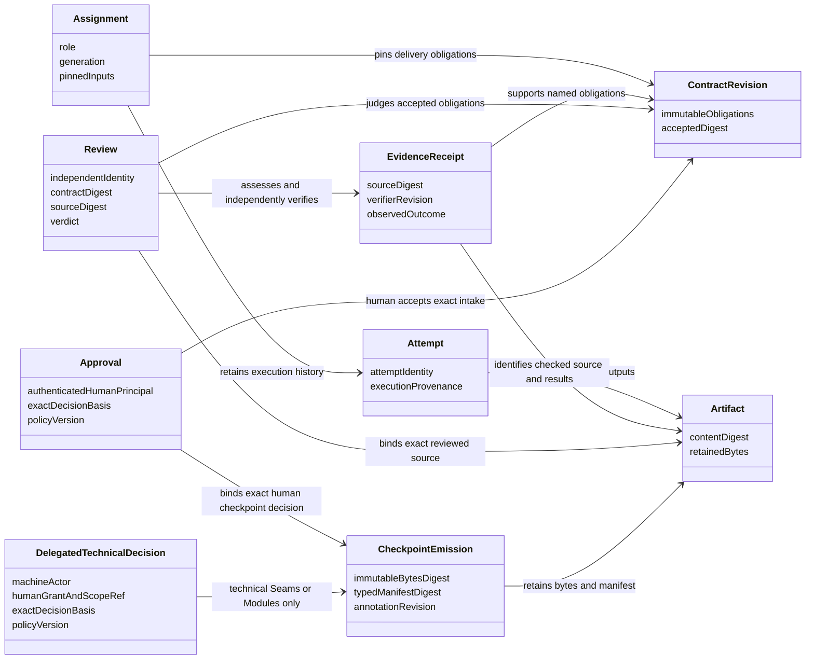
<!-- /render-figure -->

### 3.3 Deliberate redesigns

| Historical choice | Render choice and consequence |
|---|---|
| Git-ledger files/CLI conventions and supervisor choreography | One accepting host and ordinary durable task code. After A020's comparison, D006 selects SQLite immutable acknowledged documents/history; source remains Git. Versioned text/JSONL export is nonauthoritative; optional later Git archive is not a second writer or required store. |
| Suggested event-sourced replay | Recover explicit current authority and retain immutable SQLite history without rerunning obsolete scheduling policy. Separate current/accepted pointers do not erase old revisions; no generic event framework is justified. |
| Freeze inferred from current Claim/report state | Persist `everAssigned`; release never makes a consumed Contract editable. Amendments create a new accepted revision only before assignment; later changes use supersession/replacement. |
| Body-opaque checkpoints and file-existence-only provenance | Editable Markdown plus a small typed manifest of nodes, reference digests, annotation responses and dispositions. Enforce structure, not prose merit; no DSL. |
| Only experiment report retained | Retain protocol, selected source/fixture snapshots and raw decisive evidence as well. Nothing automatically copies experimental code into consumer source. |
| Watchdog may edit Debt Markers | Read-only Watchdog; implementation applies any change and obtains evidence for the resulting source. Removes a special evidence exception at the cost of a possible extra round. |
| Historical invocation Auto Mode / Modules and Proposal delegation, Seams human-only | D001 deliberately changes the maximum: technical Seams and Modules decisions are configurable within agreed scope; Proposal/Contract acceptance stays human. Initial all-human defaults are proposed, not live grants. New out-of-scope product choices and final main merge also remain human. |
| Slice issue/status publication | Removed. D005 creates one draft proposal PR after first qualifying local integration, then updates its supporting source and summary. Publication remains nonblocking for eligible local work. Consequential operations retain durable identity and uncertainty handling. |
| Worktree/cwd isolation and ordinary host Git | Restricted execution and literal source materialization/collection. Added containment is justified by observed exploits, not by speculative infrastructure. |

## 4. Compared decompositions and recommendation

The relevant dependencies are pure computation, local authority/document persistence (D006 SQLite; bounded Durable composition demonstrated), owned client transport, pinned Durable/model execution, and true external OS/Git/forge effects. Use adapters only where behavior genuinely varies: direct versus Durable execution for verification, scripted versus real provider, controlled versus actual external effects. Do not create future-backend registries.

### Alternative A: phase-owned vertical modules

Design, Delivery and Review each expose `start/advance/observe`, own their persistence, instructions, tasks and recovery, and exchange immutable handoff packages. Host authenticates and routes.

**Depth:** strong phase-local leverage. **Locality:** changing phase instructions is easy, but ownership, cancellation, approval and provenance changes cut across all phases. Atomic handoffs demand shared transaction/identity machinery anyway. H3 and H8 expose the burden: several histories must advance or migrate consistently. Deleting a phase spreads useful behavior, but deleting the shared handoff framework removes indirection. This decomposition favors independent organizational deployments, not this one host.

### Alternative B: Durable task tree as authority

One Workflow Run module exposes `start/signal/watch`. Task checkpoints, child lifecycles and transcript documents represent workflow state; tools signal the parent.

**Depth:** smallest initial interface, strong runtime leverage. **Locality:** graph edits become persistence/meaning edits; parent cancellation and handler migration can alter accepted obligations. H2/H7/H8 require an independent record of approvals, artifacts and ownership anyway. Watch is not an event ledger. Once that record exists, the task tree should be execution, not a second authority.

### Recommended: five deep modules with local reasons to change

| Module and interface | Hidden behavior | Locality and deletion test |
|---|---|---|
| **Kernel**: `change(state, command, verifiedFacts) → decision`; `view(state, scope) → domainView` | Named pure transformations for designs, obligations, approvals, assignments, dependencies, evidence and integration eligibility. Returns next state, facts and concrete work/effect intents or refusal. | Domain meaning changes here. Deleting it spreads rules across clients, tools and recovery. No I/O, clock reads, IDs minted internally, Pi imports or task graph knowledge. |
| **Ledger**: `command(envelope, authenticatedContext) → receipt`; `observe(scope, cursor?) → snapshot/updates`; `artifact(read/upload) → content/ref` | Private principal establishment; transaction-time authorization/scoping, revision checks, atomic commits, receipts, immutable facts/artifacts, annotations, projections, schema readers and recovery views. | Authority/persistence/client protocol changes here. Deleting it spreads transaction and stale-command logic. Context comes only from trusted adapters; no arbitrary caller-provided database writes. |
| **Engine**: `reconcile(workflow) → progress/blockage`; `render(assignment) → packet` | Fixed workflow policy, bounded budgets, role instructions, provider calls, Durable definitions, explicit child configuration, task associations and recovery. Selection/rendering are pure internal seams. | Practice/scheduling/runtime changes stay here. Deleting it makes callers supervisors. |
| **Sandboxes**: `prepare(assignment, profile, inputs) → handle`; `execute(handle, authorizedToolCall) → result`; `seal(handle) → sourceWitness`; `stop(handle) → quiescence` | Per-assignment environment, literal input materialization, tool/process execution, resource limits, frozen capture and termination. | OS/tool execution changes stay here. Four methods describe actual ownership better than hiding execution behind a cosmetic three-method interface. |
| **Effects**: `perform(operation) → observation`; `reconcile(operation) → observation` | Host-private proposal-ref integration and credentialed source/proposal-PR publication through its provider-neutral Forge submodule, exact identities/heads, admission permits, operation reconciliation, bounded latest-view updates and refusal of unauthorized integration. | Git/provider effect semantics change here. Deleting it spreads unsafe retries. It owns private refs and credentials that Sandboxes must never receive. |

Initially these are five modules in one application, not separately deployed processes/packages. **Principal establishment is an internal seam of Ledger**, with three principal classes: **human**, **assignment-agent**, and **host**. Device credentials and restrictive local-OS-owner CLI/socket authentication establish human context; the server-bound Durable adapter establishes assignment-agent context. Ledger's private composition-root constructor alone supplies unforgeable in-process host context, scoped to Engine scheduling, Effects observation/admission, or recovery maintenance. No client/model/tool argument can construct or select these contexts. Ledger rechecks current scope, revocation and authorization in its transaction before dedup disclosure or mutation; Kernel independently checks the closed command-family × principal matrix below. Pure/core and transaction checks need not pass through HTTP. These internal mechanisms add no sixth module. Sandboxes stays separate from Effects to keep shell execution away from credentials.

A small method count must not conceal a generic interface. `command` is a closed union of actual Render operations, classified below. Every concrete command belongs to an explicit family; unknown variants and unlisted principal/family combinations refuse. The matrix is not blanket trust in in-process callers. Commands accept no scripts, user-defined reducers, arbitrary task types, SQL or caller-selected paths; ordinary named pure domain functions implement their legality.

| Closed command family / examples | Required established principal and scope |
|---|---|
| Human decisions: create design, save human annotations, `approveCheckpoint`, `acceptIntake`, amend/supersede Contract, policy/default/adoption changes, issue/revoke grants or operation approvals, product/recovery decisions, `cancelWork`, `approveIntegration` | **Human** with current resource authority and exact required basis. Local-admin-only enrollment/restore repair additionally requires the trusted OS-owner route. |
| Role work: save own drafts, emit/rework checkpoint, request roles or own stop, submit role results, `advanceDelegatedCheckpoint` | **Assignment-agent**, bound to its own current assignment/generation/Attempt, role and input scope. Technical advancement additionally requires the current D001 grant and all common checkpoint evidence; no human acceptance/grants. |
| Scheduling/cleanup: assign/stage tasks, fence/rebind attempts, record blockers, stop/quiescence/quarantine and owned-workspace cleanup | **Host / scheduling** (or explicitly scoped recovery maintenance during recovery), constrained to the checked legal work. Host records execution facts, not fabricated agent reports or human decisions. |
| Source/effect work: stage exact operation/preparation intent, `admitEffect`, record verified source/runner/forge observations | **Host / effects**, constrained to the operation and current authorization/evidence basis. It cannot supply the human integration approval or a model verdict. |
| Recovery maintenance: rotate/fence epochs, retain diagnostics, reconcile and record recovery state | **Host / recovery**, restricted to recovery-safe transitions; the human-only validation/repair decision cannot be manufactured here. |

Human cancellation and agent own-stop requests are distinct typed inputs from host fencing/termination/cleanup observations. Cleanup remains possible without impersonating the human; no generic host override grants acceptance, policy/grant issuance or agent-report authority.

<!-- render-figure: 03 -->
**Figure 3 — Modules and authority.** Proposed logical module view—not a deployment or task graph. Solid arrows labeled CALL are invocations; dotted arrows labeled DATA carry values; thick AUTH arrows represent checked permits, not general trust. Ledger is the accepting authority; Kernel defines domain legality without I/O. Durable executes work but does not define its legitimacy. Transaction-local task staging is detailed in §5.4, not another scheduler here.

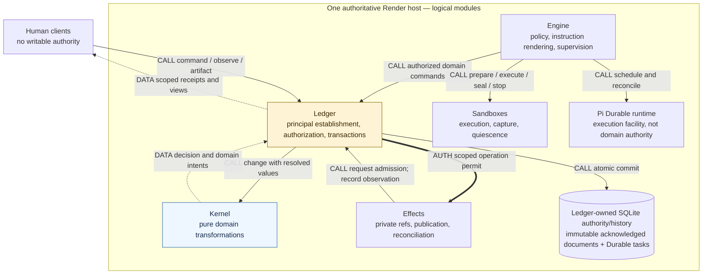
<!-- /render-figure -->

## 5. Host, client, authentication and records

### 5.1 Personal deployment and authentication

One process takes an OS-lifetime exclusive store-owner lock before `Harness.open`, through shutdown. A second process refuses before runtime initialization. SQLite locking alone is not a host-owner protocol; the historical runtime probe admitted a second open. Retain the real two-process check.

**Settled deployment:** personal macOS home server, private-tailnet access only, one human with separately identifiable devices. **Engineering recommendation (C7/R4):** private Tailscale Serve HTTPS proxies a loopback-only Render listener; no Funnel or public listener. Use versioned UTF-8 JSON commands/reads and an authenticated NDJSON observation stream, with scoped snapshot/poll fallback. This uses an existing private HTTPS facility, not a browser framework or public identity system. Source establishes facility capability, not a deployed or verified Render endpoint.

**Recommended minimal authentication:** generate one random **256-bit non-expiring opaque bearer** per device through trusted local-admin enrollment; send it only in the Authorization header, never query strings, logs or model context. Store its verifier/hash with device/principal/scope and revocation metadata, not bearer bytes. The setup channel delivers the secret once; client secret storage belongs to the separate client design. No access/refresh-token rotation subsystem: it adds a second credential and renewal/recovery semantics without a demonstrated need here. Theft permits scoped access until revocation, a disclosed trade-off. Ordinary restart preserves enrollment. Exceptionally, supported-package restore invalidates backed-up credentials and rotates `authorityEpoch`, starts local-admin-only with a fresh process `executorEpoch` and requires one-time re-pairing (§5.3.1); that operational cost is proposed, not routine enrollment expiry or a new human selection.

Ledger establishes human, assignment-agent and scoped host contexts as specified in §4. **Local admin** means the trusted host OS owner authenticated through a restrictive local CLI/socket unavailable to coding workers and research/provider helpers. Ledger establishes that human operator; agent-supplied `human` metadata, a local network route or proxy header is not authentication. The owner uses this route for enrollment and validated restore repair. Clients/models cannot choose `principal`, `by: human`, capabilities or agent command IDs. Ledger rechecks current scope/revocation before receipt disclosure or mutation and on reads; device revocation rejects requests and closes its observation streams. Tailnet membership alone confers no Render authority.

Agent coding processes receive neither human credentials nor a general-purpose authority endpoint credential. Network-enabled workers must still fail unauthorized host/control access. Public deployment, browser-specific Origin/CSRF/cookie policies and enterprise identity systems need separate future design if requested.

### 5.2 Client-facing capabilities, not client design

Ledger serves enough data for any stateless client to present **accepted commitment, active owner, latest evidence, blocker and next human action**. Required views include proposal/Slice status, exact Contracts, design revisions, pending decisions, annotations/dispositions, evidence, publication lag and historical outcomes. Commands support coordinator messages, complete-byte document saves, rework, exact-basis decisions, cancellation and scoped configuration changes. A client never edits authoritative storage.

The protocol distinguishes acknowledged saves from client-local unsaved bytes; only the former are recoverable elsewhere. Saved artifact bytes and provenance are retrievable without reconstructing chat. Optional notifications are pointers to next actions, never authorization, and must not block workflow progress.

Agent-authored bytes remain untrusted data. Server artifact responses label media type, digest, length and provenance; attachment reads cannot execute commands or grant permissions. Client rendering guidance is a separate design concern: no server guarantee depends on a future browser CSP or GPUI implementation. No mutable document body or frontmatter can select a trusted principal or approve itself.

**A013 capability scope:** §6.6 specifies planned adapters for the four exact inspected installed packages against Pi Durable/Pi AI/Chord 1.4.0 at `4a080252f06caf63a525d7873c5d94d3c23887e0`. None is load-as-is compatible by assumption. Source-established seams, proposed adaptation and unrun acceptance gates are distinct; native text compaction does not fulfill the requested OpenAI-oriented better-compaction capability.

<!-- render-figure: 04 -->
**Figure 4 — Reattachment protocol data.** Not a wireframe or client layout. A fresh authenticated snapshot references retained records; commands are sent separately. This view must be available without the old conversation.

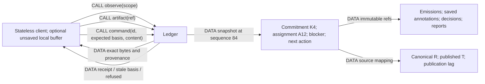
<!-- /render-figure -->

### 5.2.1 Proposed protocol surface

Use one versioned command envelope (§5.3), not a separate semantic interface per client. Recommended HTTPS JSON binding: command submission; command receipt lookup by original ID; scoped snapshot/NDJSON observation with polling fallback; immutable artifact reads/uploads; paginated history and scoped coordinator-message views. Exact route names are implementation details; the semantic envelope is shared by all clients. Uploads return immutable refs, not writable paths. A stateless client may keep an outbox of unresolved command IDs/envelopes; it is not a workflow authority.

An observation frame declares protocol version, scope, authority epoch and sequence and is either a complete snapshot or a change with its base sequence. Unknown frame versions refuse with an upgrade instruction. On a gap or reconnect, get a fresh snapshot. A snapshot includes exact available actions and required decision bases as conveniences; the server revalidates every command. It includes the resolved policy revision, task shape path, evidence/verification-skill revision, advisory human checks, document lineage, and canonical/published source mapping. Historical pages have stable IDs/cursors, access scope and explicit completeness; no raw database access is needed for clients or later eval export.

Transport cancellation is not domain cancellation. An accepted receipt is returned only after the accepted state/receipt commit; uncertain requests are queried/retried with their original ID. Semantic refusals include a machine-readable code, affected refs, reason and permitted repair, never client-side state repair instructions.

### 5.3 Command, receipt and snapshot contract

**Normative identity vocabulary:** `authorityEpoch` is the restore credential/command namespace; a supported restore rotates it before remote authority is re-established, while ordinary restart preserves it. `executorEpoch` changes on **every process start** and fences dispatch permits. Assignment **generation** fences work ownership; **Attempt** identifies an execution within that ownership. Provider-session IDs support conversation continuity, never authority. Historical probe terminology does not add more epoch types.

Illustrative **proposed wire shapes**, not an implemented Render endpoint:

```json
{
  "version": 1,
  "authorityEpoch": "authority-7",
  "commandId": "device-A:01...",
  "workflow": "design-17",
  "expected": {"checkpoint": 4, "annotations": 3, "policy": 2, "policyBinding": 1},
  "command": {
    "type": "approveCheckpoint",
    "checkpoint": "seams",
    "artifact": "sha256:...",
    "intake": null,
    "decisionBasis": "sha256:..."
  }
}
```

The host calculates a canonical payload fingerprint covering type, scope, expected basis and command content. Authenticated context is not in this JSON. Human command IDs are namespaced by authorized principal; a second authorized device of the same human may retry the original command and retrieve that human's prior scoped receipt. The accepting device remains immutable provenance, not part of retry identity; receipt-access scope is checked before lookup/disclosure. **Cross-device command recovery remains unverified:** E-CLIENT fingerprints the device too and rejects this retry; fresh-snapshot attachment from another device was demonstrated separately.

**Agent command identity and replay:** the trusted Durable adapter derives a stable namespaced ID from the durable workflow/conversation, assignment/generation/attempt, **`api.taskId` and `api.callId`**. Provider call IDs are not globally unique; model content never selects the ID. Stored arguments and the durable binding reconstruct the same envelope on replay. Any non-pure envelope inputs (such as minted IDs, time or a selected basis) are captured durably under that identity before the first Ledger command, not regenerated during retry; current authorization is still rechecked, never frozen by this capture.

Ledger-only mutation tools declare **`replay: "safe"`** because their entire execution commits deduplicated intents and returns receipts; they never launch shell/network effects inline. Accepted work/effects run separately under their own authority. A safe child under an unsafe ancestor is not restart-safe: the initial server-side policy rejects mutations through unverified or unsafe wrappers, including programmatic nesting. Only explicitly verified replay-safe wrappers with stable nested keys and effective identity may be added later. The commit-before-tool-result crash and nested-replay cases remain required, **unrun** gates (§13). Stable IDs deduplicate replay, not semantic intent: a new model call has a new ID and must independently satisfy domain eligibility, including role-request/emission rules.

```json
{
  "commandId": "device-A:01...",
  "status": "accepted",
  "sequence": 83,
  "result": {"checkpoint": 5, "phase": "modules", "state": "drafting"},
  "facts": ["fact:83"],
  "work": ["assignment:12"],
  "receipt": "receipt:01..."
}
```

A duplicate returns the original result/sequence with a duplicate indicator, not a new transition. A changed payload returns `command_conflict`. A stale request returns `stale_basis`, current relevant references, a readable difference and permitted next actions. It is never automatically rebased. Unauthorized requests disclose no receipt/content. A timeout or canceled request means **outcome unknown**: an admitted commit can complete despite cancellation; the client queries/retries its original ID.

Authorization to read a historical receipt is distinct from permission to execute a new command. An authenticated human may retrieve their accepted receipt after state advances. A revoked worker cannot use deduplication to recover sensitive content; trusted Engine performs recovery. For a genuinely new command, current assignment/role/basis checks still apply.

```json
{
  "version": 1,
  "sequence": 84,
  "workflow": "design-17",
  "phase": "modules",
  "authorityEpoch": "authority-7",
  "hostMode": "active",
  "backup": {
    "targetExposedWorkSeconds": 300,
    "verifiedOffHostCutoffSequence": 80,
    "cutoffRecordedAt": "2026-10-27T12:00:00Z",
    "verifiedOffHostAt": "2026-10-27T12:00:20Z",
    "health": "healthy",
    "restoreStatus": "not-yet-verified"
  },
  "history": {"head": "history:84", "completeThroughSequence": 84},
  "policy": {
    "revision": 2,
    "bindingRevision": 1,
    "technicalGrantRef": null,
    "checkpointModes": {"seams": "human", "modules": "human", "proposal": "human"},
    "completedReviewLimit": 2,
    "localIntegration": "human"
  },
  "commitment": {"acceptedIntake": null, "approvedSeams": "sha256:..."},
  "assignments": [{"id": "assignment:12", "generation": 1, "state": "running"}],
  "pendingDecisions": [],
  "annotations": {"revision": 3, "open": []},
  "effects": [],
  "blockages": [],
  "nextHumanAction": null
}
```

Observation begins with an authoritative snapshot and Render sequence. Within an authority epoch, clients discard repeated/older sequence values and obtain a fresh authenticated snapshot on a gap or reconnection; coalesced snapshots replace state at their declared sequence. A restored host advertises a new epoch: clients discard cached sequence comparisons and pending mutation authority, resnapshot, and surface any old uncertain commands rather than reject the restored snapshot as numerically older. Postcommit broadcast alone is not an ordered-server contract. Scope and session revocation remain enforced throughout observation. Immutable facts/artifacts are separately retrievable and paginated. Durable `watch` coalesces after 100 undelivered frames and reconnects from current state, so it is diagnostic transport, not Render's historical event log. Slow clients cannot block authoritative commits indefinitely; disconnect cancels only observation.

Use relevant resource revisions rather than one global workflow version. Saving unrelated evidence should not stale an approval. Its basis must include the checkpoint artifact/manifest, annotation-set revision, explicit decisions, intake digest where applicable, and policy/delegation plus workflow-policy-binding revision. Adopting away and later back to the same policy does not revive an old pending decision. Changes to any of these require current-basis review.

### 5.3.1 Historical reads, export and recovery status

Recommended wire contracts, storage-independent:

```json
{
  "artifact": "artifact:revision-23",
  "digest": "sha256:...",
  "mediaType": "text/markdown",
  "byteLength": 4321,
  "kind": "contract",
  "schema": 1,
  "parents": ["artifact:revision-19"],
  "supersedes": ["artifact:revision-19"],
  "source": {"commit": "git:..."},
  "createdBy": {"assignment": "assignment:12", "attempt": "attempt:2"},
  "recordedAtSequence": 83,
  "decisionRefs": ["decision:7"],
  "outcomeRefs": ["review:9"]
}
```

Content identity differs from revision identity: identical bytes can have different roles/lineage; a changed status does not rewrite content. Scoped reads by immutable ref return exact bytes/metadata or a named `missing_content | unsupported_schema | unauthorized` outcome. Current views do not hide rejected/abandoned predecessors.

**New bounded witness:** P-HISTORY-1 retrieves exact historical bytes/provenance and reconstructs accepted/superseded work plus rejected/negative evidence in a fresh process on all three candidates. Its independent Node-builtins reader checks versioned JSONL/content/links against literal expectations without importing the prototype or fixture. This supports the history/export contract, not authenticated reads, full semantic validation or a production wire endpoint.

A history request selects workflow/proposal/assignment and optional kind/outcome filters. A page returns stable record refs, an opaque next cursor, its fixed history cutoff and explicit completeness. Export chooses a fixed cutoff and returns a versioned manifest plus included document/artifact bytes and normalized facts/relationships/outcomes with digests. It declares omitted/redacted kinds, missing data and scope. Preserve classified unknown outcomes: abandonment is not an inferred failure/success, model claims are not runner receipts, and chronological adjacency is not causality. Retain exact role input packets for later reuse; exclude unsent buffers, uncommitted provider streams and unsnapshotted worker files explicitly. It is not a backup claim unless runtime/source/authority restore requirements are also met. Workers and future eval tools need no SQLite/Git internals.

Every snapshot exposes `hostMode: active | admission-disabled | recovery-reconciling | blocked`, authority epoch, last verified off-host backup identity/cutoff/time and health/lag. D003's ≤300-second exposed-work target is displayed as a target, separately from achieved protection. Only a completed, integrity-checked off-host generation advances the protected cutoff; a scheduled job or local copy does not. Show unprotected acknowledged work and warn when protection is absent, delayed beyond the target or unavailable; an idle workflow need not imply newly exposed work just because the last save is old. Continue local operation with that warning. “Configured,” “copy observed” and “restore verified” are different states; a bounded restore exercise is not a guarantee of host recovery time.

**Supported-package restore is self-identifying, not an operator guess.** Ledger writes `restoreRequired` package-origin metadata (package identity, snapshot cutoff and prior `authorityEpoch`) into the **offline package database copy only**, before the final database/package checksums (§10). It never marks the live DB for backup creation. Startup checks this marker and durable recovery mode **before remote authentication, receipt disclosure or any dispatch**, even when the package DB is copied directly into the data directory without the restore command. A marked copy starts local-admin-only; every backed-up bearer and old outbox is refused. A backup can predate revocation, so restoring old verifiers as live would resurrect a revoked device.

Only a **local-admin-validated repair** may clear `restoreRequired`: after package/schema/content validation, one Ledger transaction invalidates all backed-up device credentials, rotates `authorityEpoch` and records durable `recovery-reconciling` mode together with marker clearance. Partial/interrupted repair fails closed: either the marker remains, or the committed recovery mode and rotated namespace remain; neither path enables unchecked writes. A fresh `executorEpoch` on every process start independently fences old permits. One-time local-admin re-pairing and scoped reattachment follow; remote admission remains disabled until the relevant recovery checks permit it. An unmarked DB already in durable recovery mode resumes that restricted recovery without repeating the committed authority rotation or one-time enrollment repair. Ordinary restart of an unmarked live DB outside recovery preserves enrollment and `authorityEpoch`.

Expose `authority_epoch_mismatch` and `recovery_required` distinctly. Receipts present at the cutoff remain readable after current authorization is re-established; a missing pre-restore receipt is `outcome_unknown_after_restore`, not proof the action was unsent. Old client/tool outboxes cannot become new commands because dedup rows were lost. Reconcile newer external outcomes, including wholly lost post-cutoff admissions, before affected writes; reissue needs an explicit recovery decision. Fence/rebind assignments only after workspace/effect reconciliation and current checks. No external high-water marker or second revocation store is introduced. An **unmarked arbitrary old live-file/filesystem rollback is unsupported and not guaranteed detectable**; these guarantees apply to supported packages/restore, not all possible file replacement.

These are **production requirements, not all demonstrated by P-HISTORY-1**: H09 retains the operation admission in the cutoff and refuses automatic replay into a newer world. It does not exercise wholly lost post-cutoff admissions/receipts, later revocations, authority-epoch rotation, package-origin detection/repair or eventual safe reconciliation; the prototype has no exit from recovery-required.

### 5.4 Authority, atomic work and retained history — SQLite documents selected

**A019 ownership answer:** Ledger owns accepted Contracts, designs/proposals, saved human edits, annotations, decisions, reports, receipts and history access. Kernel computes lawful changes; Engine consumes immutable inputs; Effects owns source Git/ref/forge operations. The workflow's Record phase writes approved repository knowledge; it is neither the storage module nor a second ledger writer.

**D006 selects A after the A020 comparison:** immutable acknowledged text/document revisions in SQLite, alongside transactional history/authority, receipts and task handoff; canonical source Git remains separate. **B: SQLite plus file CAS** and **C: SQLite plus Git documents** are evaluated feasible alternatives, not selected implementations. `LAB_REV/evaluation-history.md` supports all three through actual pinned Durable transactions, historical reuse/export and clean-directory package restoration; §12 gives measured results and limits.

| Candidate | Leverage and additional burden | Design status |
|---|---|---|
| A — immutable text in SQLite | Document bytes/revision/facts/receipt/task share the existing transaction; no second ordinary-document publication protocol. Full-text growth is real; no compression subsystem was tested. Portable JSONL/text export supplies inspection outside SQL, not native Git history. | **Selected by D006** |
| B — SQL + file CAS | Content precedes SQL reference; adds orphan/publish/package rules. Removes bytes from SQL but adds no Git delta/history/inspection facility. Corpus had no exact duplicates, so it establishes no deduplication benefit. | Evaluated alternative, not selected |
| C — SQL + Git documents | Native inspection/transport and delta-packed history; smallest measured package. Adds rooted objects, SQL-derived parent/head rules, serialized refs, orphans and snapshot-rooted bundling; SQL still owns authority. | Evaluated alternative, not selected; retain its genuine Git-history trade-off |

Canonical **source** Git is required by every candidate. An optional later archival Git projection is neither another authority nor a required service. Ordinary text does not need an external store solely because it is text-heavy; actual large/binary execution artifacts require a concrete size/streaming need before adding a separate mechanism. Neither the selected representation nor its export format migrates the existing skl ledger.

The retained **semantic contract**, independent of backend, is:

- Acknowledged state, fact, command receipt, assignment handoff and next-task identity are atomic. Required document refs refer to already-retained immutable bytes, never a mutable path. Failure publishes no accepted receipt.
- History includes submitted originals, revisions, rejected/abandoned drafts, accepted/superseded Contracts, annotation submissions/dispositions, decision provenance, experiment protocols/negative results, reports, execution/effect observations and lineage. This Ledger document/evidence history is separate from raw Durable transcripts and transient task/live state (§6.5). Unsaved client buffers are outside this promise.
- Each revision has stable identity, content digest/media type, kind/schema, creator/assignment provenance, parent/supersedes relationships, relevant source/policy refs and outcome links. Old versions remain retrievable to authorized workers/design sessions independently of current state.
- Scoped chronological/relationship views and a portable historical export expose these same identities, complete bytes and outcomes for future eval use. Building an eval harness is out of scope. D006 retains all acknowledged document history initially, with no automatic pruning; append-only outcome/decision facts and separate current/accepted pointers preserve it. Secret redaction, authorized export and eventual deliberate deletion require explicit semantics, not silent storage GC. Unsaved buffers, uncommitted provider tokens and unsnapshotted worker files are excluded; no promise covers all raw provider bytes forever.
- Missing/corrupt referenced content blocks affected work with an exact restoration request; it cannot be replaced with a plausible newer version. Cleanup never removes active assignment inputs.

**Demonstrated composition, not product authority:** all three P-HISTORY-1 candidates use actual pinned Durable 1.4.0 transactions to atomically commit revision/fact/pointer, immutable lookup, command receipt and a dormant conversation-owned task. A stores document bytes there; B/C publish immutable content first and may leave reported harmless precommit orphans. Postcommit retries return exact acknowledged work without duplicating the task. The fixtures demonstrate process-crash and clean-directory history/package feasibility, not authentication, current revocation, Kernel legality, tool-replay identity or a full recovery protocol.

In the selected SQLite composition, Ledger resolves immutable facts/document bytes to values, rechecks authority/basis, invokes pure Kernel, and stages next state, facts, receipt, assignment closure/creation, predefined next task and effect intent. No asynchronous lookup, storage handle, model, shell or network call crosses Kernel's interface. Execution begins only after commit. The host composition root supplies private transaction-local task staging from Engine's fixed intent-to-definition mapping; Ledger does not import an arbitrary scheduler or expose transaction callbacks. Kernel knows domain intents, not Durable graph names.

Keep receipt identities/fingerprints and accepted facts individually addressable, not an ever-growing aggregate. Any future compaction must preserve deduplication tombstones or explicitly retire `authorityEpoch` command namespaces. The evaluated alternatives establish content-before-reference and snapshot-rooted packaging feasibility; no orphan collector or production semantic validator was tested. D006 fixes ordinary acknowledged document content in SQLite; exact production schema and any justified large/binary artifact mechanism remain implementation details. Implement the selected protocol directly behind Ledger's existing interface, not a configurable three-backend framework. Scoped authorization, complete semantic validation, owner lock and recovery/`authorityEpoch` rotation/reconciliation remain production gates.

<!-- render-figure: 05 -->
**Figure 5 — Atomic handoff and a lost reply.** Proposed command sequence. CALL invokes behavior, AUTH denotes checked authority, and DATA carries values/results. The shaded region is one Ledger transaction; the later tool-result commit is not part of it. Runtime atomic handoff and all three document compositions have bounded witnesses; D006 selects SQLite document bytes in this transaction. Stable agent-tool replay, authenticated authority and same-human cross-device command recovery remain unrun product gates. Replays return receipts only if current receipt-access authorization permits.

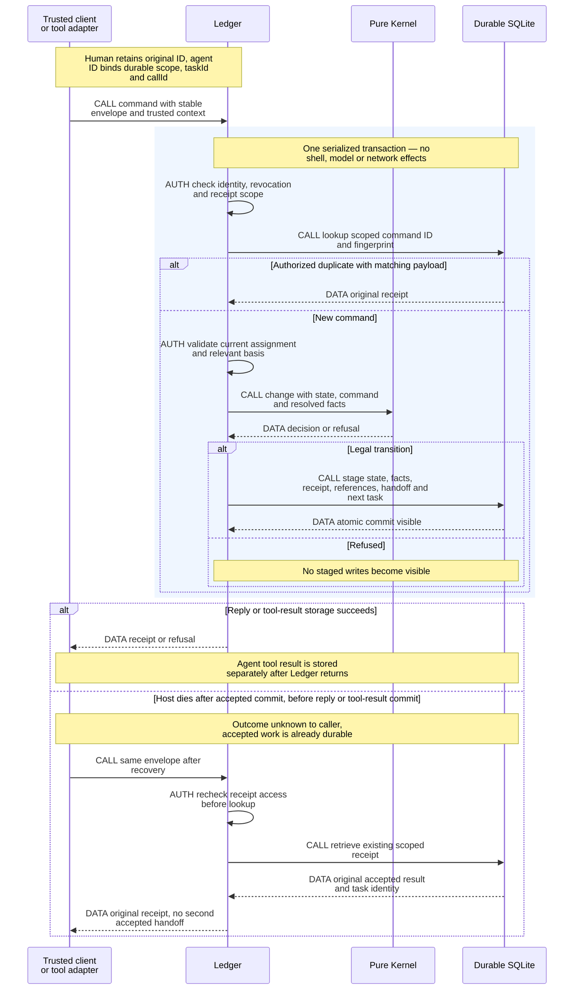
<!-- /render-figure -->

## 6. Engine execution, roles and lifecycle

### 6.1 Domain ownership is not task parentage

Accepted work is rooted in a **separate workflow-owned conversation/task**, not the human chat or submitting tool. The lab demonstrated a tool-owned child being canceled by turn abort; that topology is inappropriate. Tools never use `api.createTask` for accepted work: Ledger's same commit creates the actual workflow-owned task (§5.4), not an abandon-on-restart tool child. Ledger maps Assignment → generation → Attempt → task identity. Closing a client, ending a coordinator turn, or compacting a conversation does not release the Assignment.

Assignment execution facts include planned, starting, running, submitted, blocked and recovering; cancellation progresses through cancel-requested, quiescing and canceled. Slice lifecycle states remain separate. Candidates/challengers belong to checkpoint revisions; experiment workers belong to protocol/candidate identities, not necessarily Slices.

Engine is a bounded ordinary-code scheduler. It selects legal work, renders a packet, starts/reconciles a task, and suspends on durable waits. Proposed policy permits one active delivery assignment per Slice, one writer per workspace and **four executing attempts** across roles. A human-blocked assignment retains ownership, basis and evidence; its execution slot releases only after processes are stopped/quiescent (or none are demonstrably running), never merely on a `blocked` label. Retained workspace count/bytes have separate limits; a released execution slot does not imply free storage. Resumption fences the prior attempt and authorizes a current attempt on the accepted basis after quiescence. Other eligible Slices/candidates may proceed. This is scheduling policy, not weaker ownership/cancellation; no generic DAG engine is needed.

Packets pin input artifact/Contract/source references, assignment/generation, instruction and policy versions, model/provider/thinking choice, capabilities, budget, expected output and submission method. Every packet includes the project's principle statements; judgment roles receive the relevant full principles, including any cited by Forbidden decisions. Accepted obligations, relevant annotations and required evidence cannot be silently dropped to meet a token budget; inability to fit them is visible blockage or explicit staged reading.

`modelTools` controls presentation, not all programmatic capability. Child configurations are constructed explicitly because pinned Durable inherits parent agent choices. No broad parent tools/credentials/extensions are copied and then merely hidden. Each tool handler validates effective identity, role, generation and current authority. Nested structured outputs are copied into retained artifacts before being used as evidence; they are not permanent evidence by themselves.

### 6.2 Role contracts

Common provenance for every role: exact input refs, instruction/policy/profile versions, model configuration, assignment/generation/attempt, output refs and captured execution receipts. Distinguish model assertions, runner-captured results, host observations and optional human observations. Attribution does not establish truth; independent expected outcomes and judgment remain necessary.

Operational telemetry correlates redacted workflow/assignment/Attempt/revision/task/operation/evidence IDs. Never log bearer/provider secrets or dump model context by default. These diagnostic logs are not authoritative receipts, decisions or retained model/runner evidence.

| Role | Authority, inputs and rendered instructions | Outputs / capabilities / lifecycle |
|---|---|---|
| **Coordinator** | Reads prompt, domain/ADRs/principles, source observations, checkpoints, annotations and evidence. Synthesizes and classifies observable/judgment/product questions; must compare alternatives, answer annotations and disclose incidental decisions. May request in-scope delegated technical advancement; Ledger/Kernel validate the grant and exact evidence. Cannot do its own challenger/candidate/experiment work, grant itself authority or accept Contracts. | Draft artifacts, contested list, product requests and intake. Read-only source; draft writes and role requests through Ledger, no coding shell/forge credentials. Recommend workflow conversation continuity with refreshed immutable phase packets; fresh replacement is available on incompatible basis or contamination because ownership is durable. |
| **Challenger** | Reads a pinned draft and relevant full principles. Fixed questions: why this, alternatives/trade-offs, scale, usage, interactions, incidental choices, and what the implementer might copy from a nearby example. | Stable objections linked to nodes/evidence. Read-only source/draft, append-only own report. New non-fork context for each independent challenge round; interruption of that same review may resume its own context. Different deliberately configured model family from coordinator by default. No editing/approval authority. |
| **Candidate** | Independently answers a bounded judgment question under different constraints. Receives common question/constraints, not automatically the favored answer. | Competing interfaces/answer, assumptions, consequences and incidental decisions; own draft only. Separate assignment/context; no winner or acceptance authority. Required candidates finish before synthesis/challenge. |
| **Experiment-candidate** | Receives prewritten protocol digest, controls, fixtures, budget and assigned candidate. May implement only that experiment; cannot revise criteria after seeing results. | Isolated source snapshot, measurements, failures and limits. Own container shell/files/local Git; no other candidate or host credentials; ordinary internet capability under the recorded profile. One writer; seal before comparison. Material deviation creates a new protocol/round. |
| **Experiment-parent** | Reads protocol and sealed read-only candidates; independently applies the decision rule. Cannot silently repair candidates to make the preferred one win. | Comparison report, rerun receipts, numbers and limits, including inconclusive/negative results. Read-only candidate mounts plus separate writable scratch. Corrections request another round; report/evidence retained before cleanup. |
| **Implementer** | Exact accepted Contract, design provenance, principles, verifier requirements, findings/directions and source/target inputs. Owns in-scope code and explicit implementer-owned choices; consequential unresolved choices go to the human. | Self-checks, sealed B, completion/evidence table and handoff; writable own container, disjoint bounded helper workspaces. Effects alone publishes source. Atomic handoff schedules deterministic preparation, not mandatory pre-preparation Audit. |
| **Audit** | Required Standards and Contracts reviews inspect exact prepared X in fresh independent read-only contexts, including integration effects and approved obligations. Not a new workflow Claim or a substitute for Watchdog. | Exact-X findings/dispositions and evidence before Watchdog; reuse only an already valid exact-X independent Audit under §9.4. Optional implementer self-audit is not this independent review. |
| **Watchdog** | New non-fork independent identity/context for each review round (same-review interruption may resume), exact submitted source, complete obligations/advisory human checks, implementation/Audit evidence and prior findings/directions. No new obligations, self-review or scope waiver. | Pass/rework/Needs Human with stable findings and source-scoped evidence. Read-only reviewed source plus scratch for checks; no source edits, including Debt Markers. Completed review counts once. Missing prior source means full review, not reset count. |
| **Human** | Final Proposal/Contract acceptance on every delivery path, new product choices outside delegation, scoped technical Seams/Modules grants, human-routed checkpoint decisions, exact `approveIntegration` or scoped integration grants, amendments, advisory usability/verification, cancellation/recovery decisions and final main merge. Interface shows exact basis and consequence. | Authenticated decisions and saved annotations; no ledger filesystem needed. Final merge uses human forge identity outside worker credentials. May detach at any point; conversation recommendations never become authorization. |

Different-model-family metadata is explicitly configured, not guessed from name substrings. An unavailable required family blocks or requires a recorded human policy change, never a silent fallback. Diversity reduces shared bias; distinct contexts, identities and capabilities remain required even if the human permits the same model family.

### 6.3 Cancellation

Cancellation commits a generation fence and prohibits new effect admissions/tool starts. Engine then cancels provider activity and calls Sandboxes.stop for the **whole assignment execution environment** (the entire container in the candidate profile), not merely an exec process. Cooperative stop has a short grace period followed by forced termination. Ledger `canceled/quiescent` only after runtime confirmation and outstanding-effect reconciliation; retain the intervening state visibly.

No new writer reuses the workspace until quiescence is established. A surviving/uninspectable process quarantines it. An explicitly authorized replacement uses a new generation/workspace and does not inherit permission to repeat uncertain effects. Heartbeat expiry is diagnostic only. Runtime `orphaned` after aborting a blocked/missing definition means unresolved cleanup/effect risk, not clean cancellation. Late worker output can be retained as quarantined evidence; only trusted reconciliation records observations of already admitted effects.

<!-- render-figure: 06 -->
**Figure 6 — Authority is fenced before execution is known to have stopped.** Proposed lifecycle sequence, separating durable ownership from physical execution. CALL requests behavior, AUTH changes legal authority, DATA reports observations. Cancellation is not instant process death; a blocked label is not quiescence. The two branches are alternatives, not consecutive phases. The four-executing-attempt default remains a policy proposal.

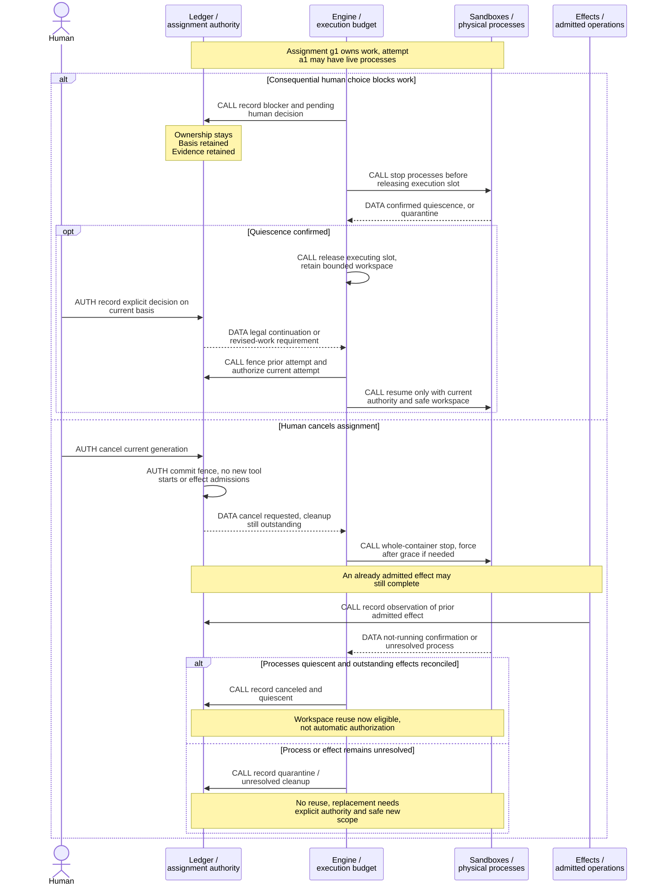
<!-- /render-figure -->

### 6.4 Configuration and execution-policy choices

**Selected maximum (D001):** config may delegate technical Seams **and** Modules decisions within agreed scope. Final Proposal/Contract acceptance is **always human** in this design, including compact bug/performance/change intake. New product choices outside delegation and final main merge also remain human. This intentionally differs from the original skl policy (Modules/Proposal delegable, Seams human). No configuration value or alternate tool route may restore that historical maximum.

**Recommended representation, not a live configuration:** a project default points to one immutable policy revision. Each workflow binds one selected revision from Ground onward, including its proposal, Slices and child assignments. Compact bug/change/investigation workflows use the same binding; resumption and new children inherit that workflow's selection, not the latest project default. Explicit active adoption replaces the workflow binding. No per-assignment override registry, arbitrary selectors or generic policy DSL is needed. Avoid an opaque trust score or generic rules language. Initial all-human settings are a conservative proposal; D001 authorizes the capability, not a grant to any running work.

| Proposed field | Allowed values / constraints | Proposed initial value |
|---|---|---|
| `checkpointModes.seams` | `human \| delegated`; delegated covers technical nodes only within the referenced agreed scope | `human` |
| `checkpointModes.modules` | `human \| delegated`; same technical-scope restriction | `human` |
| `checkpointModes.proposal` | `human` only; includes final Contract/intake acceptance | `human` |
| `technicalGrantRef` | Immutable typed grant reference; required for either delegated stage, otherwise null. Contains project/workflow scope, allowed technical stages, agreed-scope ref and human issuance provenance as defined below. | null |
| `minimumEvidenceRank` | A valid rank in the pinned project ladder (or fallback), selected by project policy; never an arbitrary number or a waiver of required checks | Explicit project choice |
| `reviewerDiversity` | `different-family \| same-family-explicitly-permitted`; the latter requires recorded human policy direction and still preserves independent contexts/roles | `different-family` |
| `localIntegration` | `human \| scoped-grant \| disabled`; exact operation-specific human approval or separate proposal/repository/ref/effect grant (§9.3). `disabled` is intentional no-integration policy, not the capability's unavailable/unverified status. No main authority. | `human` after capability verification |
| `completedReviewLimit` | Nonnegative integer proposed; **2 accepted as default**. No invented upper bound. | 2 |

**Small typed scope/grant records (recommended):** `PolicyRevision {ref, projectId, settings, createdByHumanDecisionRef}` and `WorkflowPolicyBinding {workflowId, policyRef, revision, adoptedByDecisionRef}`. One ordinary human `adoptPolicy` command names the workflow, selected policy ref and expected binding revision. A client selecting several workflows submits one command/receipt per workflow; no hidden all-or-nothing batch semantics. Project/workflow identity is server-resolved, not caller-supplied authority.

`TechnicalGrant {ref, scope, stages, agreedScopeRef, issuedByHumanDecisionRef}` has only two scope variants: `project(projectId)` or `workflow(projectId, workflowId)`; `stages` is a nonempty subset of `seams, modules`. A project grant can cover future workflows within its same retained agreed scope without a fresh grant per task; a workflow grant narrows it. Neither is an implicit wildcard beyond that scope. Grants and their human issuance decisions are immutable; revocation is a separate attributable fact checked on every new use. A replacement needs its own human-authorized grant ref—editing a default cannot revive a revoked grant. Proposal/Contract acceptance and main merge are absent from this type.

Three concepts remain separate: a **technical checkpoint grant** authorizes D001 Seams/Modules advancement; **implementer-owned choices** are freedoms already bounded by a human-accepted Contract, not checkpoint acceptance; **integration authority** is an exact human operation approval or a proposal-scoped grant to update the canonical proposal ref (§9.3). None implies either of the others or main-merge authority.

A delegated decision stores `{emissionRef, workflowPolicyBindingRevision, policyRef, technicalGrantRef, agreedScopeRef, actor, reviewRefs}`. Kernel checks the closed stage/class, scope identities, current grant status and exact evidence. Independent challenge assesses whether the technical choice actually fits the agreed scope; matching an author's class label or prose reference alone does not establish merit or scope compliance. A new/out-of-scope product choice stops for the human. This is a typed authority record plus existing review, not an executable scope language.

The acceptance interface distinguishes human `approveCheckpoint` / `acceptIntake` from `advanceDelegatedCheckpoint`. Both checkpoint routes share emission/manifest, annotation/disposition and independent-review validation; only the latter can use a current scoped grant, only for technical Seams/Modules. Its record carries machine actor, exact emission/decision basis, resolved policy revision and grant reference with human provenance—not a fabricated human signature. The coordinator assignment-agent may request this transition through Engine; a host scheduling context cannot impersonate it. Kernel checks its legality on every entry path and Ledger enforces current authority. Final `acceptIntake`, amendments and changed Contract obligations require the authenticated human route; frozen/consumed Contracts retain their normal supersession rules.

A configured stage does not delegate every question that appears there. Unresolved product decisions, newly incidental out-of-scope choices, inadequate evidence or unanswered annotations block advancement and go to the human as appropriate. Structural classification alone cannot prove a choice is technical: required independent review must examine scope/merit. If the grant does not cover the decision, stop rather than infer permission. Technical checkpoint revision may use current scoped delegation, but cannot itself modify an accepted Contract or grant new product scope.

At review limit 0, no automatic rework follows a completed non-pass; the initial review still occurs. Needs Human counts and stops immediately. Interruptions, duplicate recordings and preparation conflicts do not count. Raising a limit does not reset count/findings; a valid pass remains admissible at/above the limit. Actual completed post-pass drift re-reviews count, even without implementer rework; a later non-pass may therefore reach the human sooner. Show those passes/drift reasons and permit explicit D004 cap adoption, never a silent counting carve-out.

**D004 selected application semantics:** new config creates a revision for future work by default. An explicit authenticated human action adopts a **selected revision for selected active work**, identifying the old policy basis and affected scope; no global live-read replacement occurs merely because a default changed. Adoption records provenance and makes pending decisions using the replaced basis stale, without rewriting accepted decisions or resetting review counts. The workflow binding above is the initial adoption granularity: child tasks inherit it, not a fresh default at dispatch/resumption. Engine refreshes packets before new authorized starts; existing packet/report provenance is not rewritten. In-flight admitted execution can finish under normal cancellation/quiescence rules, but its old report is only retained evidence until current policy/evidence eligibility is checked. Unchanged evidence can be reused when it still meets current requirements; a changed reviewer requirement cannot be satisfied by relabeling an old review.

Authority revocation takes effect immediately, independently of future-default or active-adoption timing. Every new tool/effect/decision admission checks current authority, even if an attempt's packet cites an older policy. Revocation cannot retract already admitted effects or erase accepted historical decisions. Applying/revoking authority is never a waiver of immutable obligations, required evidence or Contract freeze. Engine schedules only legal work; no config waives independent review, human final acceptance or human main merge.

### 6.5 Durable assignment continuity, fresh independent roles

**Engineering recommendation R1, not a new human selection or model-quality result:** create a new explicitly configured durable conversation for each assignment. Resume that assignment's own conversation after interruption when its role, accepted basis, current policy/authority and workspace remain valid. Reconcile provider/tool/effect uncertainty, establish prior-attempt quiescence where needed and reacquire execution capacity before continuing. A compatible continuation may use a new Attempt under the same Assignment; it does not reset ownership, obligations or review counts. A fenced replacement gets a fresh conversation with predecessor links and a retained current packet, not an implicit fork or inherited workspace.

| Compared strategy | Leverage / burden | Recommended use |
|---|---|---|
| Fresh packet-only context after every interruption | Simple input provenance, but discards useful same-assignment reasoning and repeats reconstruction despite durable state | Replacement/reconstruction path, not mandatory implementer restart policy |
| Durable conversation per assignment | Preserves committed progress and context while authority stays in Ledger; requires current-basis and workspace checks | Ordinary same-assignment continuation |
| Perpetual Watchdog or coordinator model-dispatch lane | Can summarize a queue, but duplicates Engine scheduling and adds a model transcript to reconcile; accumulated reviewer context risks independence | Do not introduce initially |
| Workflow coordinator continuity plus independent assignment conversations | Sustained design synthesis without shared reviewer context; phase packet refresh prevents reliance on summary alone | Recommended combination |

Engine remains an ordinary-code scheduler, not a model dispatch lane. Coordinator role requests are inputs to checked scheduling, never dispatch authority. Recommend coordinator conversation continuity within one design workflow, refreshing immutable phase-specific packets at every checkpoint/phase and policy adoption; replace on incompatible basis or contamination. Idle retained conversations/durable waits consume storage, not one of the four executing slots. Active generation, compaction and verification consume capacity; a blocked execution releases capacity only after physical quiescence.

**Independent roles:** challengers, candidates, Audit and Watchdog start each new assignment/review round in **new non-fork conversations** with explicit tools, model, scope and inputs. A fork copies transcript/configuration and is not independent merely because its instructions changed. Interruption of the same review can resume its own conversation; a genuinely new round is fresh. Candidate blindness includes artifact reads, source mounts, FFF indexes/caches, web-result IDs and provider-session mappings, not just prompt text. Required model-family diversity stays explicit; absence blocks rather than silently changing family.

**Compaction and authority:** pinned Durable already offers durable select/summarize/place compaction and rejects stale cuts; an always-running model lane is unnecessary. Compaction changes active model context, not authority. Refresh mandatory packet constraints or require staged exact-artifact reads after compaction/reset/model changes. Accepted obligations, annotations and grant checks never depend on a summary remembering them. Record compaction policy and retained source/tail/entry references if needed for historical provenance. A failed blocking compaction can fail generation; expose that failure rather than claiming continuation.

#### Runtime history is not Ledger document history

Source inspection establishes immutable committed transcript entries survive context reset/compaction and can be paged with `Conversation.entries`; historical context is derived with `context({at})`. Native compaction retains a summary and tail, but its default summarizer omits system/thinking and truncates serialized tool-result text to **2,000 characters**. Raw stored entries are not thereby deleted. This is lossy model input, not a completeness or OpenAI-quality guarantee.

| Material | Retention and required treatment |
|---|---|
| Acknowledged Render documents, packets, decisions and decisive evidence | Immutable Ledger revisions/links under D006, independent of the active conversation or summary |
| Committed runtime transcript and terminal task receipts | Retain and expose supported scoped historical records with conversation/assignment/replacement provenance; transcript assertions are not verified evidence |
| Active task checkpoint/memos | Durable during execution, but disappear from terminal representation; retain important execution facts explicitly before settlement |
| Nested results / tool `structuredOutput` | Not a permanent transcript archive; promote required content into Ledger before the caller settles |
| Latest-only live partials, generation/tools/nestedTools state | Coalesced/current-state material cleared on settlement, not every-token history |
| Unsaved buffers, uncommitted provider tokens, unsnapshotted files | Explicitly outside acknowledged retention |

Export reads stored records at a declared consistent cutoff, not watch delivery. Supported transcript/task reads can contribute to the versioned export; no universal `session.log()` or complete runtime-event archive was established. Export labels absent transient material and sensitive/opaque provider fields truthfully. D006 does not require preserving all raw model bytes forever, nor expose hidden model reasoning. Runtime retention/independence cases are future V3/V7/V8 gates, not additional completed experiments.

### 6.6 Named capability adapters — planned, not load-as-is extensions

**Engineering recommendation R2:** include all four named capabilities at Engine's runtime/tool seams, using the exact inspected installed versions below. No arbitrary ordinary-Pi extension loader and no inherited extension set. Pinned Durable/Pi AI 1.4.0 does not invoke coding-agent extension/session hooks automatically. Real adapters plus narrow scripted provider/helper substitutes verify actual seams; do not build a general compatibility framework. Compatibility and semantic quality remain unproven.

| Installed package | Source-established seam / limitation | Planned adaptation and completion gate |
|---|---|---|
| `pi-web-access 0.45.0` | Reusable headless core / existing standalone MCP supplies search, fetch, source-check and retrieval. No matching built-in Durable web suite established. Standalone omits Kimi/Pi-login auth, requires an OpenAI API key instead of Pi login, rejects answer mode/direct-image cases, and has no curator/summaries; result store is bounded and in-memory. | Scoped Durable adapter and isolated credentialed helper for these four public-research operations. Disclose reduced capability, not package parity. Verify mapping/errors/cancel/restart/eviction and capture cited content in Ledger before relying on it; response/cache IDs alone are not evidence. |
| `@ff-labs/pi-fff 0.11.0` (`fff-node/fff-bun 0.11.0`) | Underlying `FileFinder` library is reusable; ordinary extension auxiliary finders can open home, absolute and parent roots. Cwd is not confinement; Linux native binary support is unverified. | Root-scoped index/cache per assignment or explicitly permitted immutable source set, inside its constrained mounts. No home discovery or foreign candidate roots. Verify native loading, scope/symlink/escape, freshness, pagination/cancel/restart. Unsupported platform blocks the promised FFF capability; generic grep is not proof of equivalence. |
| `@lll9p/pi-better-compaction 0.7.4` | Coding-agent session/request hooks are not Durable hooks. OpenAI checkpoints are opaque and provider/API/model-specific; an incompatible model may see only placeholder plus kept tail. Durable's `beforeCompact` result is `{summary:string}`; Pi AI custom providers/payload hooks suggest a separate adaptation seam, not working replay. | Native Durable text compaction is a baseline/fallback only. Keep the **requested OpenAI-oriented opaque-provider adapter** as a planned capability with persisted identity/window and lifecycle/replay handling. It must pass the explicit acceptance gate below before A013 compaction is called fulfilled. No opaque-as-summary cast or quality-equivalence claim. |
| `pi-claude-bridge 0.9.3` | Ordinary provider registration and session hooks differ from Pi AI `Provider` / `Models.setProvider`. Provider path uses empty native tools, but broad inherited env/settings and `bypassPermissions` are not containment. SDK dependency `^0.3.293` is a range, not an independently pinned transitive resolution. | Explicit Pi AI Provider **plus Durable lifecycle/session adapter**, isolated allowlisted environment/config/home and provider-session mapping per conversation. Only Render-mediated tool handlers; no AskClaude/native tool bypass. Verify concurrent sessions, restart, reset/compaction rebuild, cancellation and tool/result crash uncertainty before promising Claude role availability. |

Web helpers accept only the scoped public operations/inputs: no ambient browser-cookie profiles, local-video/file reads, custom endpoint/proxy bypass or broad credential/provider fallback. FFF results/cursors and web cache IDs are reconstructible aids; pin actual bytes/source refs in evidence. Helpers cannot reveal another candidate's state. Provider/research helpers run in separate constrained helper containers in the **same filtered network class** as workers (§7), with only required secrets/config/mounts, never coding-worker credentials or ambient host state. Engine logically owns provider requests; the adapter dispatches through that controlled helper route, not an unfiltered host SDK fallback. A missing required capability is visible blockage, not an undisclosed alternate model/tool.

**Opaque compaction gate:** persist adapter/version, provider/API/model identity, opaque window, retained tail and conversation/compaction provenance; deliberately reconstruct the request on compatible resume. Preserve tail tool-call/result pairing exactly once across repeated compaction and crashes before/after checkpoint commit or during replay. On incompatible model/provider/API switch, **refuse or explicitly reconstruct from retained raw history under the new model's limits**; do not silently send a placeholder-only history. Preserve the old context, record reconstruction and refresh the current authoritative packet; inability to fit/reconstruct blocks. Export labels opaque data/identity and any authorized omission rather than presenting it as readable reasoning. No opaque data is stuffed into a string summary. Synthetic lifecycle checks and a separately authorized capped real-endpoint check establish protocol compatibility only; OpenAI quality needs separate task-based evaluation. Native text compaction can support partial operation while this adapter is unfinished, but does not close the named requirement.

## 7. Sandboxes and trustworthy source identity

### 7.1 Proposed initial execution and public-egress profile

**Engineering recommendation R3:** Linux containers on the personal macOS host are the initial execution profile, informed by the historical lab, not a human-selected OrbStack mandate. Use existing Linux isolation/network/firewall machinery in the container VM. Native macOS/GPUI builds and interaction are **unsupported until a separately verified native profile exists**; stop with that limitation, never fall back to ambient host shell. Container-role examples below refer to this proposed profile. **Q-01 remains open:** this is not acceptance of Linux-only v1. First-version GPUI native verification, if required, moves the verified native profile before that project's use (§1/§14).

Engine logically owns model calls and scoped provider configuration; network execution uses the constrained credentialed helper containers below, never an unfiltered host SDK path. Sandboxes.prepare materializes exact inputs and records assignment/profile identity; Sandboxes.execute accepts only current-authority coding requests and runs them in that assignment environment, never host `bash/read/write`. Model output cannot select host mounts, runtime flags or network rules. Keep no host home/keychain/SSH-agent/credential mounts, shared host Git metadata or container-control socket; scoped writable workspace, read-only evidence inputs, literal capture and whole-environment quiescence are justified by observed hazards. Resource limits are proportionate operator settings; historical 2 CPU/2 GiB/128 PID values were not human choices.

**D002 selects public internet, not HTTP-only access.** Recommend the researcher's **address-filtered gateway/router alternative** for normal public TCP/UDP and DNS, without per-domain/package permission or TLS interception:

1. Each assignment has an isolated worker network namespace; own loopback and declared verification peers remain usable. No implicit cross-assignment reachability.
2. A trusted controller installs namespace and gateway rules **before repository code**. Public egress has one controlled routed path; direct bridge/gateway/host bypass is denied. Workers have no network-admin capability, host-network mode, control sockets or permission to change routes/firewall.
3. Existing firewall/router rules deny non-public/private, loopback, link-local, tailnet/CGNAT, ULA, multicast and known host interface/translated addresses, including other assignment networks. Scope rules to actual destination addresses for IPv4/IPv6, not URL spelling. Controlled DNS must not become private forwarding or a bypass; verify resolution changes, mapped IPv6 and host/VPN translations.
4. A project/profile grant names exact private endpoint/address, port and protocol exceptions. It grants neither host credentials nor Render authority. Apply current grants before new admissions; revocation prevents new admitted connections/requests. Already admitted requests retain the explicit cancellation limits, and long-lived connections must not carry new unauthorized operations after revocation.
5. Trusted research/provider helpers run in **separate constrained helper containers using the same filtered network class** as workers. Each receives only required secrets/config/mounts, with isolated home/session scope. Engine owns logical provider requests; no host SDK, native helper, endpoint/proxy option, `NO_PROXY`, nested tool or subprocess may bypass the filtered route. An unsupported SDK/profile is an explicit capability blocker, not permission to fall back to the host.

An HTTP(S) forward proxy is a simpler **explicitly limited HTTP(S)-only profile alternative**, not the definition of D002 or an implicit restriction on normal public protocols. Docker `--internal` alone still permits gateway/appropriately configured host services; proxy environment variables alone are likewise not enforcement. If the chosen runtime cannot enforce the required profile, block it; **no fallback to unrestricted OrbStack networking**. The router/profile is proposed, not configured or demonstrated. V5 must exercise actual shell, nested, DNS, research/provider-helper and verification paths, with public TCP/UDP/DNS positive controls and private-route bypass attempts.

A010 interaction checks may drive own in-environment services or a narrowly granted private target, never borrow the user's live service implicitly. Public egress is **not source-exfiltration prevention**: permitted endpoints/providers can receive accessible source or research terms, and granted private services can relay it. Do not add enterprise DLP or a custom security DSL to conceal that trade-off.

Historical facts remain narrow: `node:24-alpine` by digest was a lab image, not a production build image. OrbStack default networking reached host loopback; container UID did not prevent writes through writable mounts. Host OS/runtime/operator remain trusted. No kernel/VM-escape or native desktop coverage is claimed. Future platform-specific capability checks are required, not another broad design research round.

### 7.2 Literal ingress, execution and sealed egress

Source identity is host-produced, never accepted from a worker's branch name or report alone.

1. **Resolve:** Effects reads repository identity and exact commit/tree/object format into host-private bare storage using trusted configuration. No host command executes in a worker-owned repository.
2. **Materialize:** Sandboxes walks the Git tree and writes literal blob bytes, symlink text and allowed modes under path/name/size constraints, verifying a manifest against the resolved tree. Do not assume `git archive` is byte-true: export-ignore/export-subst may alter it. Submodule/gitlink expansion is unsupported initially and produces an actionable input request, never an implicit network fetch. `.gitattributes` and `.gitmodules` are inert data.
3. **Execute:** workers may initialize/use an independent container-only local Git repository. Its config, history, refs and hooks never become host authority. Linked host worktrees either break when mounted alone or expose shared refs/hooks if metadata is added; they are rejected as isolation.
4. **Freeze:** seal prevents new execute calls, stops the whole container, waits for confirmed not-running state, and records the generation/runtime identity. Failed quiescence blocks collection. Only trusted collection then accesses the frozen filesystem; no writer is restarted during capture.
5. **Collect literally:** bounded directory traversal without symlink following; regular files opened no-follow and rechecked; symlink targets retained as data; only Git-representable file modes. Exclude `.git` metadata and record exclusions; reject reserved/invalid names, collisions, special files, traversal and excess size/count. Reject unsupported filename representations rather than silently normalize them.
6. **Construct:** write literal blobs with `hash-object --no-filters --stdin`, trees with `mktree`, and commits with `commit-tree` in trusted bare metadata and empty host cwd. No host `git add`, checkout, status, worker-configured filter or textconv. Validate objects/names and record base/result commit/tree, parent, manifest, exclusions, byte/entry counts and freeze receipt. Before accepted Ledger references, publish and root required objects in trusted Git under the durability contract (§10); precommit orphans convey no authority. Render diffs inertly with external diff/textconv disabled.

The literal collector demonstrated byte equality, bypassed clean filters (none executed), CRLF preservation, symlink-as-data and FIFO/size rejection for narrow fixtures. Unusual filenames, collision/fsck constraints, hardlink/sparse behavior, quotas and subsequent consumers remain production acceptance checks. Initial collection defaults can start at the tested 64 MiB/10,000 entries; larger repositories require an explicit profile, not truncation.

Review materialization uses the same literal ingress. Build/install/merge working-tree interpretation occurs only in a sandbox. Publication transports validated objects without host checkout. Attribute/module changes are surfaced prominently to reviewers and the human; the host never activates them as configuration. Human final checkout/merge remains an explicitly separate operation, not covered by the collector's assurance.

<!-- render-figure: 07 -->
**Figure 7 — Containment, credentials and literal source flow.** Proposed deployment/data-flow view, distinct from the logical modules in Figure 3. Solid CALL edges invoke trusted handlers; dotted DATA edges transport bytes; thick AUTH edges denote scoped permission. Crossed DENIED edges are forbidden access, not usable paths; the denial box lists absent access, not mounted resources. Narrow containment/egress witnesses exist; production profiles and byte-true ingress remain gates. Host OS, VM/daemon and operator are trusted.

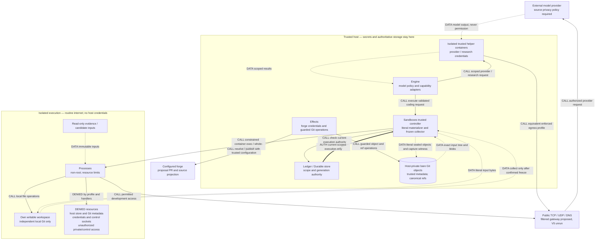
<!-- /render-figure -->

## 8. The full design journey

### 8.1 Task playbooks and legal shortened paths

Use a fixed table of ordinary playbooks, not a workflow DSL. Source: accepted `work-router/behavior.md` B1–B4 and `design-playbook/behavior.md` B1–B5. The source's temporary refusal of design/experiment was a rollout dependency, not Render target behavior. Likewise early brainstorm text saying investigation makes a Slice was superseded by the accepted finding-or-escalation rule.

| Shape | Required path and output | Ceremony omitted; escalation trigger |
|---|---|---|
| Investigation | Ground → cited finding/recommendation, or recorded escalation carrying facts. Read-only consumer source. | No Contract/Slice, implementation, Audit, Watchdog or publication for a finding alone. A code change or new design choice routes to the appropriate shape first. |
| Experiment | Ground → prewritten protocol → isolated candidates → independent comparison → retained evidence/limits. | No implementation commitment/acceptance or delivery PR for throwaway work. Production adoption requires a Contract; evidence does not authorize itself. |
| Bug | Ground/reproduce → one-slice intake whose behavioral rule is the reproduction and expected corrected result → human Contract acceptance → implementation/self-checks → preparation → required Audit/Watchdog. | No breakdown quiz or Seams/Modules checkpoints when existing seams suffice. Discovery that changes architecture or product behavior escalates; cannot use “bug” to waive a consequential choice. |
| Performance | Ground/baseline → one-slice measured scenario with method, controls and target → human Contract acceptance → implementation/self-checks → preparation → required Audit/Watchdog. | Same ceremony reduction as bug; no unsupported “faster” success. New seams or changed behavior escalate. |
| Change | Ground → existing-seam references → bounded breakdown/Contracts → fidelity/human Contract acceptance → required Record outputs → implementation/self-checks → preparation → required Audit/Watchdog. | No new Seams/Modules round merely because code changes. New/changed seams route to design. Amend only never-assigned commitments under normal rules. |
| Design | Ground → Seams → Modules → human Proposal/Contract acceptance → Record, with exact-revision challenge, decisions and evidence, then delivery. | Scoped technical Seams/Modules delegation can remove those human waits, never final acceptance or the checks that make an emission legitimate. |
| Verify-create / verify-maintain | Repository evidence lifecycle in §8.2, invoked directly or as bounded work under an accepted change. | Not new delivery shapes. No product fixes under a read-only maintenance pass; surface them as separate findings/work. |

A bug/perf Contract can be compact prose plus its one behavior and verification mapping; it still identifies obligations, forbidden/delegated choices and source. Do not import the old mandatory four-file layout as ceremony. D006 retains acknowledged Contract text/revisions in SQLite; repository verification/Record files remain separately reviewed source artifacts, not a mandatory four-file Contract layout. Every path has an observable terminal check and a retained outcome. Full Gate, Audit and independent Watchdog remain distinct for delivered source; no pstack shortcut silently overrides that accepted target.

### 8.2 Project verification skill: ladder, channels and ownership

**Recovered original contract, not a newly invented universal ladder:** accepted `contract-lint/plan.md` A3 defines fallback **tests → build → inspection** (strongest first). `verification-skill/behavior.md` B1–B7 defines a project-named ordered ladder that **replaces**, not merges with, that fallback. There is no single “live is always best” order for every project.

| Rank in fallback | What it can substantiate | What it cannot imply |
|---|---|---|
| tests | Passed executable checks with independent expected outcomes at the relevant seam. | A green unrelated suite does not prove a UI journey, throughput claim or obligation it never exercises. |
| build | Build/type/static compatibility claimed by the actual command. | Runtime behavior, recovery or user interaction. |
| inspection | Cited source/design inspection, useful for architectural commitments. | Executed behavior or a check that was never run. |

Examples of **project-owned** ladders: numerical library `corpus → tests → build`; interactive service `live-introspected → driven-endpoint → tests → build`. These are examples from the original design notes, not imposed ranks for Render or proof that introspection dominates every surface. Each project explains which channel/check proves which obligation. A channel is not a rank; the same tool can observe weak or strong evidence.

Seven original channels, with reusable Render-owned procedural guidance:

| Channel | Concrete checks and limits |
|---|---|
| Executable oracle | Independent corpus/reference/golden/property cases. Independence of expected results matters more than count. |
| Process | Invoke real CLI/process; assert status, output and side effects. |
| Live runtime introspection | Inspect a running BEAM/node/service through project-supported interfaces; prove the relevant state transition, not merely set internal state to the expected answer. |
| Driven surface | HTTP/UI/TUI/desktop interaction via real handlers, stable selectors or supported automation hooks. Capture action and resulting state/side effects. |
| Tests | Existing project suites at their documented seams; state substitutes and scope. |
| Static | Build, types, lint and structural inspection with truthful limits. |
| Human-observed | Suggested usability/accessibility/experience observations. Advisory under A010, never counted as an automated behavioral pass or required attestation. |

The thin repo-owned asset contains ordered `ranks`, then **Launch, Doctor, Channels, Catalog, Cleanup, Extend, Traps**. Catalog columns: **Name, Channel, Kind, Run, Expectations, Rank**. Row kinds are `generated` (discovery/index, no proof rank), `executed` (runnable repository check), `journey` (retained steps with independent sanity predicate) and `human` (advisory only). Recommend `.render/verify.md` and `.render/journeys/` as simple repo-owned defaults, with explicit path configuration for legacy `.skl/verify.md` / `.skl/journeys/` compatibility. Use one selected asset, not parallel discovery registries or copies; this is an engineering recommendation, not a new permission question. Do not require a prose feature inventory that drifts independently of executable checks.

**Lifecycle responsibilities (recommendation grounded in accepted B7):**

1. **Create:** a bounded verification-author assignment interviews the repository, detects tooling/channels, reuses existing commands/harnesses, binds real prerequisites/expectations, and proves one executed row/journey end-to-end including cleanup and surviving evidence. Unknown observation channels are reported, not supplied with fictitious guidance. Greenfield Seams decides verification strategy; the first eligible Slice creates/bootstraps the usable skill. Minimal build/tests rows are honest scaffolding, not proof of unimplemented behavior.
2. **Use:** Engine renders exact cited rows and their revision into packets; Sandboxes runs authorized commands and returns provenance; Ledger retains receipts; Kernel checks structural coverage, rank membership/bounds and evidence/source identity. Models judge sufficiency. Engine does not choose truth from a process exit alone.
3. **Update with product changes:** the implementer adds or changes affected checks/journeys as part of the accepted Slice and reports verifier changes separately from product changes. A `new <row>` commitment must name that deliverable. No lowering expectations to make the product pass; changed required semantics goes through the appropriate decision/amendment path.
4. **Independently review:** Audit/Watchdog inspect the oracle and changed verification definitions as well as run required checks. Watchdog uses the skill from the reviewed source and records its exact digest. A verifier edited by its implementer is not independent expected evidence merely because it is executable.
5. **Maintain:** a bounded verify-maintain assignment runs every executed row and each journey's sanity predicate; checks referenced commands/paths; runs generated discovery and compares dependent rows; records `clean | changed | blocked` **per row before editing**. Proven skill/harness drift can be corrected in its own scope, product regressions are reported without being papered over. Re-execute corrected rows before claiming changed. Recommend on-demand plus change-triggered maintenance initially, not an unasked daily daemon.
6. **Human:** chooses product expectations, acceptable minimum rank and any changed scope; may opt into a maintenance cadence. Does not routinely author commands, reproduce what automation can drive, or attest every merge. Render owns reusable craft/playbooks; the repository owns concrete commands, checks and journeys.

Behavioral obligations cite executed/journey checks, not generated discovery or human observations. Architectural obligations may additionally cite justified inspection. Coverage is many-to-many. Passing rank cannot exceed the weakest required cited behavioral evidence, and a below-minimum or missing check is blocked/non-pass, not automatically demoted to success. Project full suite/typecheck/lint and required cited checks run independently for implementer/Watchdog on their respective exact snapshots; unsupported platform prerequisites are reported as unrun rather than fabricated.

**A010 interaction automation:** source should expose natural production seams and project-supported driving/introspection handles, not Render-specific test backdoors. For a BEAM service, a named local node/remote shell may observe process and domain effects; for JS, an actual route/driver/debug interface may exercise the path. Pin instance identity/config, prerequisites and ownership; isolate fixtures and never borrow the user's live instance implicitly. Do not prescribe Playwright, BEAM, a UI framework or a new automation abstraction for every repository.

The pstack creation skill supports interview-the-repo, end-to-end proof, retained evidence and own-instance cleanup; its maintenance skill reinforces real driving and distinguishing harness drift from product bugs. Its feature-map layout and current autonomy/merge defaults are not imported: accepted skl explicitly chose runnable catalog rows, independent Watchdog and human main merge. [research and recommendations](spec-review-disposition.md#research-and-design-recommendations) records immutable comparison URLs and the recommended defaults.

### Ground

Persist prompt and proposed task shape; human confirms a classifier-proposed shape, while a shape the human explicitly supplied needs no redundant confirmation. Escalation retains facts and exposes any new decision requirement. Read context, ADRs, full relevant principles, verifier instructions and affected source. Record the goal, independent done predicate, facts, uncertainty and constraints. No implementation commitment is created. Investigation may finish with a finding; standalone experiment produces evidence; bug/performance/change work can use smaller commitments rather than unnecessary design ceremony.

### Seams

Compare genuinely different module/interface decompositions, dependency categories and verification seams using depth, locality and the deletion test. Stable node IDs identify decision, rationale, alternatives, evidence, class (`observable`, `judgment`, `product`) and recommended default. Required competing candidates run before synthesis; challenger runs before emission. The contested list answers every objection and discloses **what the chosen candidate decided that the question did not ask**. D001 allows technical Seams decisions under an explicit current grant covering the agreed scope. Without that grant, the human decides. Required candidates/challenge/evidence/dispositions still precede advancement; any new out-of-scope product choice stops for a human. A delegated decision records machine execution and exact human-grant provenance, not a human approval.

### Modules

Refine shapes within approved seams. Observable uncertainty gets a prewritten experiment protocol: question, hypothesis, falsifier/decision rule, controls, fixtures, failure cases, resource budget and retained outputs. Judgment uncertainty gets competing candidates when required/requested. New product questions outside delegation stop with options and a recommendation. Technical Modules decisions may advance under D001's scoped configuration after required evidence/challenge. A discovery changing an accepted seam requests a revised checkpoint under the current human-or-delegated technical authority and blocks affected dependent execution while raising any needed pending human decision. It cannot rewrite, amend, erase or supersede historical human Contract acceptance. Changes to product scope or accepted Contracts still require human decisions, and consumed Contracts remain frozen.

### Proposal

Materialize bounded Slices and dependency edges; behavior/architecture/manual obligations; delegated/forbidden decisions; and many-to-many evidence requirements. Each architectural commitment cites an actual approved node or experiment artifact. Structural lint checks identifiers, references, coverage, valid evidence ranks/catalog rows and provenance, not semantic merit.

Fresh fidelity review compares approved Seams/Modules/evidence with the intake for omitted, weakened, strengthened, contradictory or invented obligations. Transcription fixes are distinct from technical design changes requiring renewed scoped checkpoint decisions and product/Contract changes requiring human direction. Final Proposal/Contract acceptance is always an authenticated human command binding the displayed immutable intake and all required decisions. Scoped Seams/Modules delegation cannot call that route as the human or supply acceptance by implication; the same rule applies to shortened-path intake. No Slice issues are published; the proposal PR is a lower-resolution summary, separately published without blocking local work.

Project-tailored verification is a first-class repository asset with concrete ranks, runnable checks and lifecycle responsibilities (§8.2). Each commitment cites the checks that can actually prove it, with required evidence and independent expectations. Implementer and Watchdog run their respective checks on their exact source; deterministic target preparation cannot reuse stale receipts. Usability suggestions remain visible and honestly unperformed unless observed, but no human completion attestation gates readiness or merge validity (A010).

Contract revisions are immutable. Before any assignment, an authenticated human amendment can replace an unstarted Slice's accepted revision. Once `everAssigned`, changed obligations need supersession/replacement, even after release. Dependencies are explicit human direction; validated amendments may alter unclaimed/unmerged edges without cycles or silently abandoning dependents. No report/checklist edit changes a Contract.

### Record

Prepare ADRs, approved principle changes and any explicitly requested design document through a bounded **Record assignment bound to human-accepted Record obligations**. ADRs carry concise evidence summaries and repository-local rationale; private raw logs need not be copied into source. Fidelity review checks the output against approved decisions. Source-changing Record output follows the common sealed-source preparation, required verification, fresh independent Standards/Contracts Audit and Watchdog, then guarded human-approved or delegated local integration (§9); exact still-valid independent evidence reuse follows the same rules. There is no direct-ref write or unreviewed baseline bypass. Acceptance may create planned Slices, but affected implementation waits for the **recorded qualifying integration** of its required Record baseline, not mere document existence or a pass. Archival/retirement preserves partial delivery and evidence; it never reports superseded work as completed.

### Editable checkpoints and annotations

An emission is immutable bytes plus typed manifest. An editor session is based on that exact artifact. Clients may edit ordinary Markdown without special comment syntax, then upload complete bytes plus base reference. Ledger retains both byte versions and the diff; hunks/concerns get stable IDs within that submission. Editable frontmatter cannot change workflow identity/state or grant authority.

**Save is not approval. Only immutable emitted artifacts are eligible for a human approval or an in-scope delegated technical decision.** Human-edited bytes require a new emission with a regenerated manifest, structural lint, and all required independent exact-revision reviews and dispositions before approval; lint alone cannot authorize semantic changes. Changed behavior/architecture also requires the revised decision and dependent invalidation, not interpreting edits as a new accepted Contract. Approve-with-notes approves the **original emitted bytes**, carrying every saved note forward as explicitly nonbinding; it never approves the edited draft. Rework needs an explicit concern, either edited bytes or a separately saved human reason.

The next emission must map every annotation to acted on, considered, or dismissed with a reason and resulting reference. Ledger can enforce completeness; required independent review assesses adequacy, with the human deciding at human-routed checkpoints and final acceptance. A “why not X” can trigger challenge, “prototype this” an experiment, and “decide X” a product request, but the coordinator's classification is not human authorization.

Concurrent edits retain both submissions and produce an explicit conflict; no last-writer-wins loss. Approval binds the annotation-set revision. If edits win the race, the old approval is refused; if approval wins, later edits become retained change requests, not edits to accepted bytes. Unsaved editor buffers are not durable; clients say so. Reattachment promises all acknowledged records, not unsubmitted keystrokes.

<!-- render-figure: 08 -->
**Figure 8 — Two orderings, no lost acknowledged edits.** Proposed checkpoint protocol; both race orderings have bounded E-CLIENT witnesses. CALL saves data; AUTH requests approval over an exact basis; DATA returns receipts/views. The final note is stricter product policy, not the fixture's direct-draft approval. The alternative branches start from the same initial state.

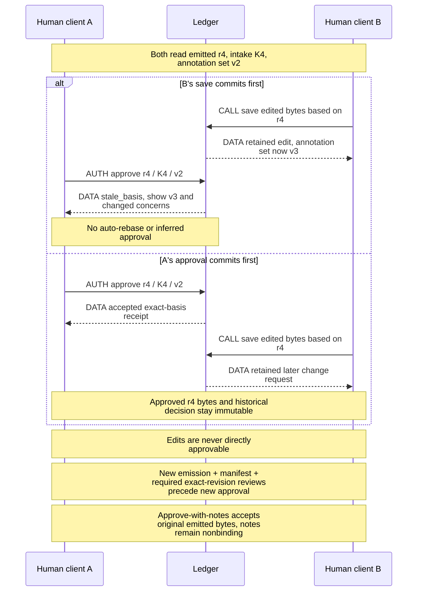
<!-- /render-figure -->

Experiments retain their original protocol, candidate identity, sealed inputs, decisive raw measurements, report and limitations before cleanup. The comparison parent cannot rewrite candidate originals. Negative/inconclusive evidence remains available, and result selection never itself accepts a product choice.

<!-- render-figure: 09 -->
**Figure 9 — What a change invalidates—and what it does not erase.** Proposed impact map. Arrows mean CONSEQUENCE or REQUIRED GATE, never calls or automatic edits. Each row is a separate change scenario. New authority requires the corresponding explicit decision/review; old artifacts, verdicts and approvals remain historical evidence. A consumed Contract is superseded/replaced, not silently amended.

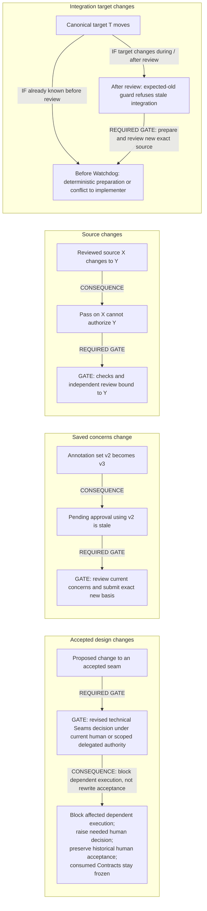
<!-- /render-figure -->

## 9. Git/forge effects and reconciliation

### 9.1 Admission and cancellation have one ordering

Each Operation records kind, exact payload/source/target, authorization basis, stable ID, attempts and observations. **Intent is not permission to send.** Effects requests an admission through Ledger's same serialized transaction line as cancellation/revocation:

1. `planned`: accepted intent, not yet allowed to mutate a canonical ref or contact the remote for mutation.
2. `admitted`: current scope/generation, exact human approval or scoped grant, policy and source/evidence checks pass; Ledger commits a unique attempt ID, `executorEpoch` and permit. This is the linearization point. It means “may already be applied/sent,” not proof of a ref update or network packet.
3. The trusted single executor consumes that permit once to dispatch. The permit is internal, never returned to models/clients. Duplicate receipts do not grant another dispatch.
4. Observation and task/domain completion commit atomically, or the attempt remains uncertain.

If cancellation commits first, admission fails. If admission commits first, that attempt **may dispatch or complete after cancellation**; the cancellation view lists it as in flight. The guarantee is no new admissions after the fence, not an impossible guarantee about packet arrival. No check-then-await window grants authority outside this ordering.

If the host dies between admission and dispatch, it cannot prove the request was unsent: recovered admitted attempts are uncertain, not replayed from a fresh permit. A current `executorEpoch` cannot adopt a prior epoch's dispatch permission. Reconcile or block. A lost admission response also follows stable-ID/unknown-outcome handling; it is not permission to allocate another attempt. Verified provider idempotency may justify a specific replay policy; reliable local lookup does not justify blind remote-create retry. Local canonical-ref recovery has the narrower, exclusive-writer reconciliation rule in §9.3.

### 9.2 Forge submodule and concrete operation rules

**Settled placement:** Forge is an internal Effects submodule, not a sixth top-level module, deployed service or workflow-visible provider. Keep one actual forge adapter plus a controlled observation/fault adapter for verification; do not build a provider registry or implement a second real forge just to justify the seam.

**Proposed interface (C5; unverified):**

- `capabilities(repository) → {draftProposalPR, guardedSourceUpdate, createIdempotency, stableObjectIdentity, mergeObservation, observationCompleteness}`
- `observe(query) → observations` for immutable repository/object identities, proposal PR state, published heads and actual main merge mapping. Results carry observed refs, timestamp/cutoff, completeness and uncertainty; negative/incomplete visibility is never absence proof.
- `apply(admittedRequest) → applied | rejected | unknown`, with a closed request union: publish exact source with expected old head, create draft proposal PR, update its owned summary. Effects owns admissions, payload identity, retries and reconciliation; the adapter translates provider transport/errors, pagination and capability facts.

Requests use provider-neutral repository/source/target/object references, not labels, CLI commands, GitHub URLs or provider-specific workflow status. External IDs can be opaque tagged values retained by Effects; domain code neither parses them nor chooses GitHub/GitLab branches. Supporting source transport may use Git inside Effects; callers do not need to know if provider ref updates use Git transport or an HTTP operation.

If a provider lacks guarded source updates or verifiable source-to-main mapping, refuse that automated capability and explain the supported manual publication/observation path. Do not silently weaken expected-old or report a human merge from a renamed PR state. Adapter “idempotent” support must be substantiated for the specific operation, not inferred from a generic retry claim.

**D005 selected timing:** the first qualifying local integration schedules **one draft proposal PR**, with supporting source publication supplying its valid head; subsequent progress updates that PR's source and lower-resolution summary. Local work never waits for these operations. One logical create intent/association belongs to the proposal; new source heads do not create new PRs. Unknown create outcomes reconcile under the rules below, never automatic recreation. If the adapter cannot create a draft PR, expose a nonblocking unsupported-publication condition rather than silently create a non-draft PR. The summary names intended outcome, integrated scope, canonical/published mapping, evidence summary, remaining blocking findings and advisory human checks; details stay in Ledger views. Never publish private raw artifacts by default. Readiness still requires exact current published mapping; only the human merges main. D005 authorizes draft creation/source-summary updates, **not an automatic draft-to-ready operation**. The human marks the PR ready on the forge; no such machine request exists in this interface unless an explicit future effect is selected. Internal evidence readiness can be true while `forgeDraft` remains true. Serve the observed draft/mergeability state separately and show the human action; do not claim that evidence-ready means the forge currently permits merging.

#### Operation rules

| Kind | Required behavior |
|---|---|
| One draft proposal PR create (no Slice issues) | Schedule after first qualifying local integration, with one proposal-scoped create identity; persist/admit before send. Include unique correlation marker and exact payload/source identity. Reconcile complete paginated candidate observations, verify repository/actor/type/content and preserve conflicting observations. Negative listing is not absence proof. A unique verified match may establish association only without unresolved prior-attempt/duplicate-risk history. |
| Proposal PR summary update | Publish current lower-resolution proposal summary, not Slice issues or a backlog of obsolete narratives. Use a clearly host-owned section or explicit overwrite permission. Superseded prose attempts do not block local work; mutable public content never authorizes state. |
| Source publication | Project host-sealed canonical proposal objects to the authorized forge-hosted source ref using expected-old guarded, non-overwriting updates. Record canonical versus observed published head; divergence blocks publication/final readiness, never silently imports remote content. Same-proposal local work need not wait on publication. No worker remote URL/config is trusted. |
| Local proposal integration | Requires an exact operation-specific human approval or a current proposal-scoped integration grant, exact passing source including target T, satisfied evidence, no unresolved canonical-ref/authority risk, and expected-old local CAS. Unrelated proposal-PR/publication uncertainty is not a local-integration blocker. Journal intent and reconcile the ref/Ledger gap before qualifying dependency clearance (§9.3). |
| Human main merge observation | Read-only association/target observation establishes integration. It does not fabricate human observations. Suggested human checks remain advisory, and missing attestations are not evidence gaps or merge-invalidity reasons. No machine operation is permitted to merge main. |
| Cleanup | Delete only quiescent owned workspaces whose required source/evidence is retained. Missing cleanup is visible pending maintenance, not lost completion. Dirty/unknown/unowned state is preserved. |

Markers/hashes are **correlation, not signatures**. Body/label edits, copied markers, compromised accounts, pagination, normalization, transfer/deletion and visibility lag limit the inference. Once associated, use the immutable external object identity and audit changes; labels/prose remain projections. The production adapter must paginate fully or explicitly report incomplete observation; it cannot treat truncation or label filtering as complete absence.

If a human explicitly authorizes another attempt while an earlier create is unknown, record **sticky duplicate risk** across all attempts. A transient unique listing cannot discharge it or authorize association-dependent external publication/readiness. This uncertainty does not block otherwise eligible local design, implementation, review or integration. Explicit resolution must account for initiated attempts, identify/close duplicates where applicable, or accept a stated remaining risk with narrowly bounded reversible authority. Another poll is not universal proof of absence. No resolution can waive a Contract or manufacture review.

All otherwise eligible local work, including canonical integration and dependent implementation, proceeds while unrelated PR/publication outcomes are uncertain. The blockage names operation, attempts, last observations, affected dependent actions, and safe choices: inspect, recheck, associate verified object, or explicit risk resolution. No direct store edits are required.

<!-- render-figure: 10 -->
**Figure 10 — Unknown external creation is a real state.** Proposed operation state machine for non-idempotent remote creates, not local-ref recovery. Transition labels distinguish AUTH admission from CALL dispatch and DATA observation; arrows are state transitions. The effects probe supports bounded reconciliation and exposes listing lag, not exactly-once delivery. Negative lookup has deliberately no retry edge; sticky-risk resolution follows §9.2.


<!-- /render-figure -->

### 9.3 Proposal integration versus final merge

**Engineering recommendation, unverified:** the host-private proposal ref is canonical; the configured forge's proposal branch is a publication projection. Local integration capability is **unavailable until its targeted checks/V6 pass**, independently of policy. Once available, `localIntegration: human` is the conservative operational default, `scoped-grant` enables bounded autonomous integration, and `disabled` intentionally pauses all integration. The latter is not a synonym for unverified/unsupported capability. The human route makes conservative operation usable without a standing grant; the grant route avoids making human/forge availability the scheduler for every same-proposal dependency. Neither is live authority conferred by this design.

In human mode, authenticated `approveIntegration` binds the **exact operation ID, proposal/repository/canonical ref, sealed source B and prepared X, observed target T, prepared R commit/tree/parent and fixed commit metadata, required Contract/evidence refs and policy/workflow-binding revision**. Effects prepares this immutable basis without mutating the canonical ref; Ledger presents it for human decision. Approval creates an operation-specific authority record, **not a standing proposal grant**, evidence waiver or immediate ref update. New X/T/R, changed metadata/evidence/obligations/policy basis or a different operation stales it and requires a new approval. In `scoped-grant` mode, a versioned human grant instead names proposal, repository ID, canonical ref, permitted effects and validity. No project-wide integration grant is added. Current revocation/cancellation participates in the same admission ordering for both routes; neither permits main merge or branch/fork substitution.

Effects constructs a host-private squash commit R whose **tree is exactly the reviewed source tree** and whose parent is expected canonical head T; the reviewed source must already include T. Pin B/X, T, R, tree, fixed commit metadata, evidence/Contract/policy basis and the exact human approval or scoped grant in the Operation before admission. Both routes use the same Ledger admission, journal, CAS and recovery path; approval is not a dispatch permit. Under the host's exclusive writer ownership, update the canonical ref with **atomic expected-old-OID comparison** (`git update-ref <canonical-ref> R T`). No content recomputation, conflict resolution or unguarded target merge occurs after review. Verify the resulting ref/commit and required durable object/ref publication (§10) before recording qualifying integration. Target movement leaves the historical pass intact but requires fresh integration/review; the owner lock does not replace the CAS.

**Source Git ref and Ledger authority commits are not atomic together.** Persist intent/admission before the ref update, then commit the verified observation/domain outcome in Ledger. Block subsequent integration of that proposal until this operation is resolved. After a crash and old-executor quiescence, compare the ref with recorded T/R: R with the exact expected tree/parent permits recording the observed result once; T means no integration currently qualifies, and any retry needs current authority and fresh admission; anything else is divergence requiring explicit reconciliation. Never infer success from intent, repeat a dispatch from a receipt, or roll back an unexplained ref. This journal/recovery path is an unrun V6 gate.

Only recorded qualifying local integration clears **same-proposal** dependencies without publication. A cross-proposal edge requires verified integration into main or separately authorized/reviewed inclusion into the dependent's own canonical proposal; an update to the prerequisite's private ref alone cannot clear it. A main-delivery dependency requires the corresponding observed human main merge. No pass, PR label or mere publication substitutes for these observations.

Publication is an independent operation with expected-old remote protection, canonical-versus-published head status and uncertainty handling. Unexpected remote movement is divergence, never silently imported into canonical authority. Credentials, main protection excluding the machine principal, and the verified remote guarded update gate machine publication in stage 6, not local integration in stage 5. Publication lag can leave eligible same-proposal work running, but **internal evidence readiness for human merge requires an exact verified published-source mapping to the current canonical head**, required automated evidence and no blocking divergence/uncertainty; an unpublished head is not evidence-ready. This does not clear the forge's draft flag or claim forge mergeability: the human performs draft-to-ready and final merge.

Human alone performs final main merge and resolves any later conflicts. The final package maps commitments to canonical and published source/evidence, remaining findings, deviations, advisory human checks and uncertainties. Human merge is an observed external fact; if it used older/different source, Render records the actual mapping and relevant automated-evidence gap. Missing advisory human observations are not a validity/readiness gap. A bad automated result remains a real issue; advice does not waive it.

<!-- render-figure: 11 -->
**Figure 11 — Local progress is separate from publication and final merge.** Proposed, unverified local-integration mechanism. CALL invokes an operation, DATA reports identities/observations, AUTH is exact operation-specific human approval, scoped integration grant or a checked permit. Each authority commit and source Git ref update is separate; no cross-store transaction is implied. Only same-proposal dependency clearance is shown. Cross-proposal and main-delivery requirements remain as specified above.

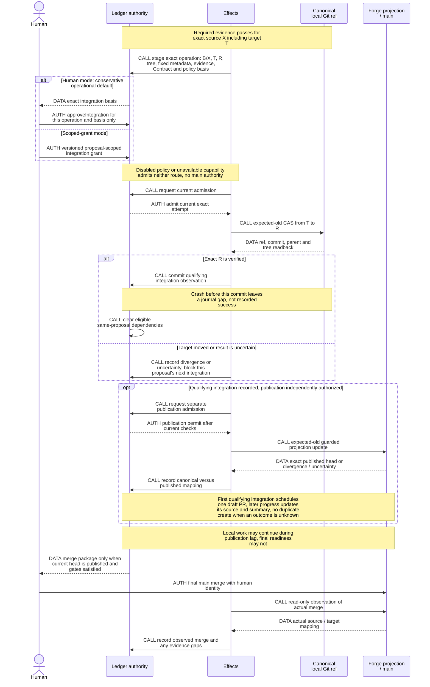
<!-- /render-figure -->

### 9.4 Pre-Watchdog target preparation

**Required by A008; parent adopted semantic design and bounded feasibility in `LAB_REV/evaluation-incorporation.md`, not prototype code or a recovery proof.** §12 separates real Git from simulated orchestration and reports remaining gaps. The earlier designer recorded reading the full evaluation/report; this continuation read the complete parent evaluation and preserved its results without a rerun. No extra incorporation probe round is requested now. Original skl semantics are confirmed in `CONTEXT.md` Integration Merge, `prose/procedures/watchdog.md`, and `workflow/integration_merge.go` at `480179ce...`: prepare proposal-target source before review; if target is absent, make a clean ordinary merge, never rebase/reset; abort conflicts to the pre-merge head and return them to the implementer. The code disables rerere. Unrelated inherited target code is not newly reviewed scope, but integration effects are. Historical worktree/remote layout is not an isolation design to copy.

**Recommend a deterministic source-preparation task, not a reasoning-agent conflict detector:**

1. Ledger accepts sealed implementation source B/base T0 and schedules preparation, not Watchdog directly. Engine asks Effects for the current canonical proposal head T1 and immutable objects. After the same recorded-base/object/lineage validation required below, if T1 is already included in B, retain B. The ancestry fast path does not skip validation. A late result cannot pick its own target observation.
2. Effects owns preparation identity `(B,T1,profile/algorithm)` and trusted Git inputs/configuration. **Recommend `merge-tree --write-tree -z` in Effects' host-private bare metadata**, using a fixed supported Git version, minimal explicit environment, host-owned empty HOME and no inherited XDG/config/attribute sources. This avoids ordinary merge's writable worktree/index and abort cleanup; it does not run project code or invoke worker-owned Git metadata. Sandboxes still owns executable project verification. Validate the recorded assignment base as an ancestor of both B and current canonical T1; unexpected rewritten/unrelated lineage blocks rather than accepting a forged base. Retain prepared objects under host-owned preparation roots before accepted Ledger refs; a precommit crash may leave reported orphans, never accepted authority. The bounded prototype supports mechanics, not this complete production protocol. HOME/XDG individual regression sensitivity remains a future gate; no additional design probe is requested.
3. Classify **validated inputs and complete results**, not exit status alone. Resolve both inputs as supported commit objects; verify the documented result framing/object types and preserve stderr/signal information. A valid clean result with exit 0 can yield **new source X**, binding B, T1, result tree, algorithm/profile and receipt. For `merge-tree --write-tree -z`, exit 1 counts as a conflict only with a well-formed conflict result beginning with a valid tree object; an empty path list is not a clean oracle. AM-1 demonstrated that a missing object or blob input can also exit 1 with **empty stdout**: invalid inputs, malformed/missing results, other failures and signals are operational errors that block preparation, not conflict rework. A returned tree alone never establishes cleanliness. A classified conflict preserves sealed B and its original base T0 plus exact conflict detail. Host-authorized rework creates/rebinds a **new current Attempt with T1 pinned as its base**, retaining read-only B/T0/T1 and the conflict report as scoped inputs. Prepare a **fresh writable workspace from T1**, never overwrite the retained B workspace or imply resolution. The implementer reapplies/resolves the actual code; host sealing records B′ with parent/base T1 in the new Attempt's provenance, not mutable original history or a worker-chosen parent. Return directly to implementation with no Watchdog call or completed-review increment. Render never guesses a conflict resolution; verify the resulting combined source and repeat preparation if the target moves again. AM-2's bare `merge.renormalize=true` SIGABRT reinforces that an abort is an operational failure, not a conflict.
4. Run required project verification against X in a preparation/verification attempt before independent Watchdog; a failing check returns to implementer without a wasted model review. This execution reuses the already-defined verification skill/runner, not a sixth module. **Economical recommended order: implementer self-checks and seal B → prepare X → required fresh independent Standards/Contracts Audit on X → Watchdog.** No mandatory duplicate Audit on both B and X. If an independent exact-X Audit already exists, reuse it only while source/target, Contract, verifier, policy, role/independence and required coverage remain valid; when X = B this can include valid B evidence. A B-only report on a different tree stays historical, never relabeled X evidence. Optional implementer self-audit cannot satisfy the independent obligation; required Audit is never waived. Watchdog independently inspects preparation/integration effects on X. Source repairs repeat implementation/sealing, preparation, required exact-X Audit and Watchdog. P-INCORPORATE-1 exercises source-binding/order with simulated checks/Audit/Watchdog, not actual project verification or authenticated/durable admission. Its prototype is not Render implementation.
5. Immediately before launching Watchdog, re-observe target. If it changed since T1, prepare again rather than knowingly launch a stale review. Do not hold a long-lived target lock across model review. Preparation attempts are visible separately from completed reviews; churn handling is a liveness choice (recommend one preparation in flight per Slice and coalescing to newest observed target, then a visible pause if repeated changes prevent review).
6. Watchdog reviews exact X/T1 and independently runs required checks. Changes after launch are handled by final expected-old CAS: no recomputation under an old pass. Preserve historical pass, prepare the new source and obtain its required review. Every actual completed drift re-review counts under A007; prior passes are not exemptions. A later non-pass may therefore need human direction sooner; D004 permits explicit cap adoption, and a valid pass is never rejected.

**Rejected simpler-but-wrong alternatives:** reviewing B then merely retrying integration wastes a known-invalid round; passing after a clean merge without checking X misattributes evidence; leaving clean merge/conflict detection to an LLM adds judgment where Git already has a deterministic result. Holding all proposal integrations until every concurrent review finishes avoids some retries but serializes unrelated local progress. No new global coordinator lane or merge framework is needed.

**Future production gates, not extra design probes:** inherited HOME/XDG default-attribute sensitivity; validated sealed import and supported object/path representations; submitted-source/base/target lineage and rewritten-history handling; retained object roots/durable preparation records; actual check identities/Contract/verifier binding, Audit/Watchdog dispatch and authenticated admissions; interruption/dedup and SQL/ref crash reconciliation. Process work must remain outside the accepting transaction. Real clean/conflict/object/error/attribute/CAS fixtures provide bounded mechanics evidence, not these missing guarantees. Operational errors stay blocked; no review/dependency clearance follows parent identity alone. See V1/V5/V6 and C4.

## 10. Recovery, persistence guarantees and evolution

### Recovery sequence

Acquire the exclusive store lock; verify supported schemas/definitions, effective persistence settings and storage health; open storage/runtime without remote authentication or dispatching unchecked work; check Ledger's package-origin `restoreRequired` marker and durable recovery mode **before remote authentication or dispatch**, including direct package-DB copies; a marked copy requires local-admin validation/atomic repair (§5.3.1), not the ordinary-restart enrollment path; inspect assignments/containers/operations; mint the process's fresh `executorEpoch`, fence old permits and establish OS quiescence or quarantine. Before explicit `resume()`, use **reads and safe commits only** (fences, epoch rotation, quarantine marks), never scheduling-enabling submit, abort, wait or compact calls. Containment/termination can be established without those runtime calls. Once unchecked work is fenced, explicitly resume compatible handlers; then abort/wait as needed and reconcile uncertain effects, including §9.3's canonical-ref/Ledger gap, before admitting dependent work. Evidence and receipt views remain available where the understood schema permits. Pinned 1.4.0 has no documented read-only Harness option: do not invent one to bypass startup compatibility or ownership.

Interrupted work resumes only with compatible task meaning and current assignment authority. Missing required source is retrieved from retained objects or blocked with a precise input request. Missing workspace does not reset ownership, review count or decisions. Unsupported/corrupt content is preserved and quarantined, not silently normalized. Supported recovery commands record their reason/basis; manual ledger repair is not the tested recovery procedure.

<!-- render-figure: 12 -->
**Figure 12 — Recovery enables work in guarded stages.** Proposed production recovery activity diagram. P-HISTORY-1 demonstrates bounded clean-directory restoration and refusal of automatic replay, not this complete package-detection/admission/epoch/reconciliation sequence. Arrows mean control order, not data transfer. CALL steps operate the runtime/OS; AUTH gates constrain what may run; DATA steps inspect observations. Blockages are scoped where safe: an uncertain operation need not halt unrelated work. Before explicit resume, no submit, abort, wait or compact call may enable scheduling.

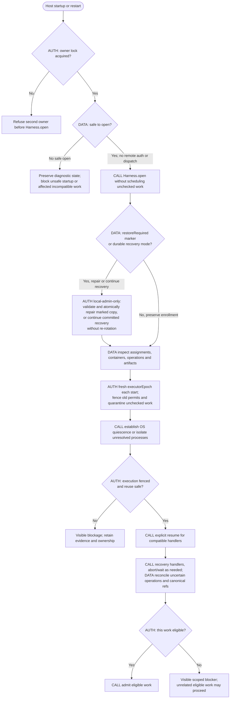
<!-- /render-figure -->

**Failure models and preservation priority (A020/A022, policy selected by D003):**

- **Process crash:** historical atomic commits plus P-HISTORY-1's 24 SIGKILLs support the named transaction/content-publication cases across three actual Durable compositions, not full Render recovery. Interrupted computation repeats only under current assignment/operation rules.
- **Power/host failure:** pinned default SQLite WAL `synchronous=NORMAL`, `fullfsync=0` cannot justify zero-loss acknowledged work. Parent reports the pinned public `NodeSqliteDatabase.exec` before `SqliteStorage.open` permits evaluating `FULL/fullfsync` without patching runtime; P-HISTORY-1 read back WAL / synchronous=2 / fullfsync=1 / checkpoint_fullfsync=1 through the public adapter. Its small follow-up is not a physical-durability or general overhead measurement. No setting alone proves lossless hardware behavior. The battery-backed host reduces one exposure, not all failures.
- **Disk loss/corruption:** preserving work takes priority over fast restore. A consistent off-host copy covers authority/runtime state, all retained referenced content and canonical source Git at a declared cutoff. Git bundle/clone copies reachable objects/refs, not runtime state or unsaved buffers. Git itself is not inherently zero-loss: parent primary research of Git 2.54 `core.fsync` / `core.fsyncMethod` notes default object-hardening exclusions and possible macOS writeout-only behavior (https://git-scm.com/docs/git-config/2.54.0). Stronger SQLite settings alone do not make referenced canonical Git objects durable; the chosen package needs an explicit, proportionate consistency/hardening contract. SQLite WAL is persistent state; a naked live database-file copy is not a backup procedure.
- **Older-cutoff restore:** supported package-origin detection forces local-admin-only startup, validated credential invalidation/`authorityEpoch` rotation and durable recovery mode and exposes cutoff/possibly lost progress. One-time re-pairing repairs remote enrollment; ordinary restart never requires it. For supported packages, a lost revocation cannot resurrect a credential, and missing post-cutoff dedup cannot make an old command new or prove it unsent. Reconcile PR/source operations and canonical refs potentially newer than backup before affected writes; retain scoped uncertainty and historical receipts under new authorization.
- **Disk full/missing content:** failed commit emits no success. Preserve diagnostic/corrupt bytes where possible; restore exact refs or block. Never fabricate approvals or substitute a current draft for a missing historical artifact.

**New adopted evidence:** P-HISTORY-1 uses queued public `VACUUM INTO` and packages the completed snapshot's references/cutoff with required documents/source Git. H06 always cuts at sequence 10 while nine later writes complete before packaging finishes; it does not test arbitrary cut positions. H07 renames original stores away and restores solely from the package into a clean directory. Enumerated incomplete/corrupt packages refuse without replacing a prior valid generation. These results establish bounded local history/package feasibility, not off-host availability, production authority restore or physical power-loss survival.

H09 demonstrates why restored tasks must not auto-resume: the unsafe control with an attached executor applies the same operation twice. But its admission already exists at the restored cutoff. Wholly lost post-cutoff receipts/admissions, later revocations, incarnation rotation and eventual safe reconciliation remain **unrun production gates**; recovery-required has no exit in the prototype. Import paths are trusted generated fixtures, not a hardened arbitrary-archive importer. Semantic validation checks revision content/source presence, not every fact/index/pointer/receipt/task relationship or complete source-tree integrity. Backup files are not fsynced; no remote transfer or healthy five-minute-target witness exists.

The parent's source-backed comparison is retained in `LAB_REV/parent-storage-research.md`; its results are now evaluated in `LAB_REV/evaluation-history.md`. Its A recommendation was subsequently selected by the human in D006; prototype code and production guarantees were not. Earlier statements that loss target/outage behavior are unselected predate D003 and are superseded by that decision, not revived here. A backup's cutoff comes from the completed snapshot, not wall-clock start. Its canonical source/artifact root map comes from that snapshot's accepted state and admitted-operation records, not a later mutable Git HEAD. D006's acknowledged document bytes/history are in the SQLite snapshot itself. Pin required objects during collection and rebuild restored refs from the validated map with trusted configuration. Incomplete generations never replace the previous good backup. Raw device/provider/forge secrets and unsafe worker Git configuration are excluded; any backed-up device verifiers are invalidated on older-cutoff restore before remote access. A local clean-directory restore does not establish off-host availability.

**Package origin and safe restore (Ledger-owned):** after taking the consistent snapshot, write `restoreRequired` with package identity, cutoff and prior `authorityEpoch` to the **offline package DB copy**, never the live DB; then finish DB/package integrity checksums and durable package publication. The metadata is a restore-origin marker, not an authority fact added to the live history. Validate it as part of the package. The supported restore command stops writers/admission and establishes durable `admission-disabled` recovery state in the managed destination **before importing**, even if input is malformed; malformed/incomplete input never enables admission or replaces a known-good generation. Every successfully installed package remains marked until local-admin validation and the atomic §5.3.1 repair. Direct DB-copy startup follows the same marker check; interrupted repair cannot fall into ordinary startup. No external high-water marker is needed or promised. Unmarked arbitrary old filesystem/live-file rollback is unsupported and not guaranteed detectable.

**D003 selected backup contract:** asynchronous off-host protection targets **at most five minutes of exposed acknowledged work while backups are healthy**. Back up promptly after important design decisions as well as periodically; exact cadence/coalescing must account for snapshot and transfer time, not claim success merely from a five-minute timer. A conservative implementation should trigger on accepted design/Contract/product decisions and delegation changes; those trigger details are an engineering proposal, not synchronous acknowledgement or a new human wait. Acknowledge local commits normally and show which later cutoff is actually protected.

On backup failure or target overrun, retain the last verified generation/cutoff, show a warning and **continue local operation**. The exposed window can exceed five minutes during outage; no finite outage loss guarantee was selected. Recovery is **manual, best effort**: document stop-writers, obtain/validate package, restore cleanly, inspect cutoff/missing material, reconcile uncertain effects and resume safely. Report measured bounded restore duration and operator prerequisites; it is not an RTO guarantee. No numeric RTO, backup tool or destination was selected by D003. The following local persistence profile is an engineering recommendation, not a new human decision.

Keep this proportionate to personal self-hosting: no replication, failover, synchronous remote acknowledgement or all-failures claim. The operator may provision an off-host destination as a deployment prerequisite; choosing a vendor/location is not architecture research blockage. The bounded history/package study is sufficient evidence for the selected representation; remaining checks belong to actual production schema/restore implementation, not another broad research round or enterprise availability program.

### Recommended local persistence profile

**R5:** use SQLite **WAL / synchronous=FULL / fullfsync=1 / checkpoint_fullfsync=1**, configured through pinned public `NodeSqliteDatabase.exec` before `SqliteStorage.open`, and read back the effective values before admitting work. The parent history evaluation observed WAL / 2 / 1 / 1 through that seam. Unexpected settings block admission with an actionable operator error rather than silently weakening the declared profile. This accepts a potential local write cost to favor preservation; the small measured corpus is not a general overhead guarantee. V9 must measure the shared database under **four concurrent Durable transcript/tool-result streams** plus ordinary command/snapshot traffic at FULL/fullfsync; the document-save benchmark is not that workload's performance proof.

Effects separately owns **durable, rooted source publication**: validate required objects, use supported-version trusted-repository fsync settings covering objects/packs and refs (not a writeout-only assumption), complete required synchronization and establish retention roots before accepting Ledger source references. Final ref mutation likewise satisfies the source durability profile before qualifying integration. Git and SQL are still separate commits; preserve the intent/readback journal and harmless precommit-orphan accounting. Backup enumeration uses the snapshot's roots, never a later HEAD; complete package files/transfer must be integrity-checked and durably published before advancing the off-host cutoff. Settings/readback, source hardening, package publication and restore are distinct V6/V7 gates. No SQLite/Git setting or process-crash probe proves zero physical loss.

These measures reuse existing storage facilities, not replication/failover or an enterprise availability layer. D003's asynchronous healthy five-minute target, visible cutoff, outage warnings/continued operation and manual best-effort recovery remain unchanged. The operator supplies a proportionate off-host destination/tool at deployment.

### Version policy

Version separately: command format, domain record/artifact schema, instruction bundle, policy/delegation, sandbox profile, and Durable task definition/checkpoint format.

Initial policy retains a task definition's exact meaning while it has live work. For a semantically incompatible change, register a **new distinct task name** and keep the old handler installed to drain old work; new assignments use the new name. This is Render's policy, not a claim that a name like `assignment-v1` is a built-in interface.

Durable also supports a numeric version on the **same task name**, with `migrate` applied at reservation. Use that only for an explicitly reviewed, tested migration preserving the assignment's authority and checkpoint meaning. Missing migration, throwing migration or older definitions can block; abort of blocked work can yield orphaned state. A deployment must inspect/resolve these states, not reset them. Historical entries are not rewritten by runtime migration; application facts/artifacts carry explicit schema versions/readers and unknown versions refuse.

An operator migration runs at a quiescent seam: backup, confirm writers stopped, reconcile admitted effects, transform supported records, validate invariants, record provenance, and resume compatible work or create a fenced new attempt. Uncertain effects cannot be migrated away. Rollback uses a compatible executable/store pair with a declared cutoff and reconciliation, not old code over a newer schema. No generic migration engine is needed for the first explicit v1→v2 transition.

## 11. Traces and failure-mode acceptance

### Success with a disproved favorite

Ground records D without Slices. Candidate B offers a different seam; challenger C identifies shared metadata risk. The human saves two annotations and requests an experiment, then leaves. A fresh client sees the exact saved basis and protocol-needed blocker. Protocol p1 precedes candidate execution; sealed comparison disproves favored A and retains negative evidence. Revised Seams answers both concerns and exposes B's cost. Human approves Seams, Modules, then exact intake K after fidelity review. Ledger commits Contracts and human-accepted Record obligations; required Record output passes the common preparation/verification/Audit/Watchdog/integration path before affected implementation starts. The implementer self-checks and submits sealed B atomically with a preparation task; §9.4 prepares current-target source X and obtains the required X-bound checks/Audit before scheduling Watchdog. Independent Watchdog passes X. In default human mode, `approveIntegration` binds the exact operation/X/T/R tree and fixed metadata/evidence/policy basis; current admission then uses expected-old canonical-ref update and a recorded observation. A scoped-grant mode follows the same path without per-operation human waiting; same-proposal dependents may proceed while publication waits. The first qualifying local integration schedules one draft proposal PR; later integrations update the same PR's source/summary. Exact current source publication, required automated evidence and resolved blocking uncertainty establish final merge readiness; advisory usability checks remain visible but ungated. Human performs final main merge; the host observes it.

### Known target drift and subsequent movement

B starts at T0 while A is active. A integrates locally to T1 before B submits; publication is still offline. B's sealed submission schedules preparation. A classified conflict preserves B/T0 and the conflict report, creates/rebinds a current rework Attempt with host-attested base T1, and provides a fresh writable T1 workspace plus exact read-only B/T0/T1/conflict inputs. The implementer resolves/reapplies actual code; host-sealed B′ has parent/base T1 without clobbering prior history/workspace. This is not a Watchdog review and adds no count. Clean preparation instead yields X incorporating B+T1. Required checks and fresh independent Standards/Contracts Audit bind X, with only exact still-valid reuse and no mandatory double B/X Audit. Re-observe before independent Watchdog on X/T1. If C advances target to T2 during review, a pass remains history but CAS T1→R refuses; prepare/reverify/review against T2, including another rework Attempt if needed. An old operation-specific integration approval cannot authorize the new basis. No post-review merge borrows X's pass. Completed reviews after each drift still count: passes on the first two rounds followed by a later non-pass may require earlier human direction at the default cap; explicit D004 cap adoption is available, and no valid pass is rejected.

### Shortened work and delegated checkpoint

A human selects bug shape, so no repeated classifier-confirmation question is asked. Reproduction plus expected correction forms one compact Slice accepted by the human; no new seams means no Seams/Modules checkpoints. Verification still drives the actual promised surface, Audit and independent Watchdog still run, and main merge remains human-only. An investigation that ends with a finding creates no delivery Slice or PR. In a full design, an explicit current grant may advance technical Seams and then Modules within agreed scope, each on its exact challenged emission with all dispositions. A newly discovered out-of-scope product choice stops for the human. Final Proposal/intake acceptance stops for the human even with both stages delegated; an agent `acceptIntake` is refused. A later technical seam revision can use the same still-applicable scoped route, blocks affected dependent execution and raises any needed human decision without rewriting historical human acceptance; it cannot amend a consumed Contract. No machine receipt is labeled human approval.

### Config defaults, explicit active adoption and immediate revocation

Work W uses policy p2 and has one completed review. The human saves p3 as the future-work default: W remains on p2, with its count and accepted decisions unchanged. The human then explicitly adopts p3 for W using its current policy basis. Ledger records the adoption; pending decisions on p2 become stale and current packets/permissions reflect p3 without resetting the count or rewriting history. Work not selected by the action keeps its applicable policy. Revoking W's technical-decision or effect grant immediately blocks new uses even if an old attempt still carries p2. An already admitted effect may complete and is reconciled; revocation does not erase historical acceptance.

### Early draft PR without publication scheduling local work

After capability verification, the conservative human route approves exact operation X/T/R and metadata/evidence/policy, then uses the same guarded admission/journal/CAS as a scoped grant. `disabled` is an intentional pause, and unavailable capability is a separate blocker. Neither authorizes main. The first qualifying local integration R1 schedules one proposal-scoped draft-create intent and its required source publication. The forge is unavailable: local dependents continue, publication shows lag, and no PR is falsely reported created. After recovery, verified publication and create/reconciliation associate the one draft PR. R2 updates its source/summary, not a second PR. Unknown create response follows reconciliation without automatic resend. Final merge readiness waits for exact current canonical-to-published mapping; only the human merges main.

### Advice is not a missing attestation

Current canonical source is published exactly, required automated checks/review pass and no relevant uncertainty blocks readiness. Suggested usability checks remain “not observed.” Render can report internally evidence-ready without a completion attestation, while separately showing the observed forge draft state. The human marks the PR ready and merges; record actual source mapping; do not invent an observation or flag absence of advisory notes as an invalid merge.

### Backup delay and older-cutoff restore

A human accepts intake K at sequence 83. The local receipt returns without waiting for the remote backup; a prompt backup is scheduled. Off-host transfer fails: sequence 80 remains the visible protected cutoff, sequence 83 is exposed, and the host warns while eligible local work continues. The selected five-minute healthy target is not presented as met during the outage. If the disk is lost, the operator restores the validated sequence-80 package manually; K and later work may be unrecoverable. The offline package copy was marked `restoreRequired` before final checksums. Even if copied directly into the data directory, startup checks that marker before auth/dispatch and enters local-admin-only mode. Validated repair atomically invalidates backed-up credentials, rotates `authorityEpoch`, retains durable recovery mode and clears the marker; every process start fences old permits with a new `executorEpoch`. A crash during repair stays closed. One-time device re-pairing is then required. A revocation lost after cutoff cannot revive access. A missing receipt is not proof a post-cutoff action never happened; affected writes remain disabled pending reconciliation. No transcript invents K's human acceptance. A later successful backup instead advances the cutoff only after complete transfer/integrity checks.

### Lost response at handoff

`submit/g1/c17` commits report H, assignment closure and next task T, then the host dies before reply. Restart/retry returns the same H/T receipt; no new review count or assignment release. Before-commit death leaves none of them. A canceled HTTP wait does not tell the client which case occurred; the original ID resolves it.

On the agent route, kill after Ledger's commit but before the tool-result commit. The replay-safe Ledger tool must recover the stored envelope and host-derived assignment/attempt + `api.taskId` + `api.callId` identity, returning the authorized original receipt without another accepted command/task. An unsafe ancestor cannot provide this recovery and is refused for mutations. A newly generated model call is not this retry and must pass current domain eligibility. This required crash trace is **not demonstrated by E-CLIENT**.

### Concurrent edit and stale approval

A and B see r4/intake K4/annotations v2. B saves v3 first; A's v2 approval is refused with the changed basis. If A commits first, B's edit is retained as a later change request and cannot alter approved bytes. Retrying A's original command returns its authorized receipt, not approval of r5.

### Unknown create and risky reissue

Proposal-PR operation op9 is admitted and the forge creates #12; response is lost. A listing initially omits it, so op9 remains uncertain with no resend. Exact later readback may associate #12 for the single attempt. If another attempt was explicitly authorized during uncertainty, even one visible object stays provisional with sticky duplicate risk; association-dependent external publication/readiness waits for explicit resolution, while otherwise eligible local work/integration continues.

### Cancellation and upgrade

Cancel fences g1 before requesting runtime stop. An earlier effect permit may complete and is reconciled; new permits fail. Entire-container termination establishes quiescence or the workspace is quarantined. If a task definition is missing, runtime abort yielding orphaned is shown as unresolved, not clean cancellation. Restore the compatible handler or perform an explicit quiescent migration; never discard the assignment to make the queue empty.

| Failure point | Detection and safe outcome | Check |
|---|---|---|
| Missing/revoked identity or receipt probe | Auth/scope before command and dedup; refuse and disclose no content | V4 |
| Second host / concurrent ownership | OS lock before runtime; exact assignment generation; second owner refuses | V2, V3 |
| Crash around commit/task handoff or before tool-result commit | Atomic receipt/state/task visibility; stable host tool identity and safe replay; unverified nested wrappers refused | V2, V3 |
| Missing/corrupt artifact | Hash/size and retained manifest; re-upload/restore exact bytes or block | V3, V7 |
| Stale approval / conflicting edits / active policy adoption | Relevant basis checks; retain drafts/history; explicit selected-scope adoption, no implicit rebase/count reset; immediate revoked-authority refusal | V1, V4, V8 |
| Dead provider / worker interruption | Compatible attempt recovery or fenced replacement after quiescence | V3, V5 |
| Shell/nested tool/content injection | Actual capability handler, restricted profile, untrusted artifact bytes never granting authority | V4, V5 |
| Host Git configuration/attributes attack | Literal ingress/egress, no host worker metadata/porcelain | V5 |
| Effect response lost / readback incomplete | Retain admitted/uncertain state; reconcile, never infer absence | V6 |
| Source/target changes or crash after local ref update | Exact source/tree/T binding, expected-old CAS and journal reconciliation; no premature dependency clearance; historical pass retained | V1, V6 |
| Cancel between admit and send | Serialized ordering; show prior admitted attempts, prohibit new admissions | V3, V6 |
| Missing definition / version mismatch | Inspect and report blocked/orphaned; compatible handler or recorded migration | V7 |
| Disk failure / restored older authority | No false success; cutoff/epoch/reconciliation before admitting dependent work | V7 |
| Cleanup fails / human disappears | Preserve evidence and pending actions; disconnect does not cancel | V4, V8 |

## 12. Evidence, limits and reproducibility

**The old four-probe evidence and the exact P-INCORPORATE-1 / P-HISTORY-1 results and disclosed amendments are retained below. The prior continuing designer read the complete parent evaluations and runtime sources' reports, but implemented/reran no prototype. This final bounded correction applies the fresh challenge's independently adjudicated disposition without repeating research or probes. Parent independently inspected/reran incorporation/history correctness and unsafe controls; history benchmark timings are subagent measurements inspected by the parent, not independently timing-rerun. NEW-RUNTIME is source inspection with independently checked key claims, not another executed probe. D006 selects document representation; R1–R5 are engineering recommendations. No extra probe round was launched; none of these results proves revised product behavior.**

All probes were disposable and separate from Render implementation. Initial protocols/failure cases and tests preceded implementations; initial missing-module failures show ordering, not regression sensitivity. **E-CLIENT was not unchanged preregistration:** its retained A1–A6 amendments disclose, in particular, A3's postimplementation refinement of negative `annotationSet` counters from expected 409 to malformed-input 400; both refuse the command. The substantive literal tests retain their preimplementation hashes. Targeted mutants and unsafe controls provide the relevant negative evidence. The independent evaluator inspected meaningful code/tests and reran the adopted suites. Source-linked reports alone were not treated as proof.

**Pin:** `@earendil-works/pi-durable`, `@earendil-works/pi-ai`, `@earendil-works/chord` **1.4.0**; Node **v24.21.0**; Pi CLI **1.4.0**. Upstream tag commit `4a080252f06caf63a525d7873c5d94d3c23887e0`. Sandbox root **`/Users/vr-osxs/infra/pi-durable-design`** contains exact `package-lock.json`, `reference/runtime-provenance.md`, packaged README and `reference/pi-durable-1.4.0-spec.md`. Current upstream main is not the reference. Relevant pinned spec sections include commit cancellation (lines 1723–1726), ownership (2126), blocked definitions/abort (2181–2229), document migration (1599–1624), and tool-created child restart behavior (3177–3180).

| Evidence | Observed result and adopted conclusion | Limits / rejected conclusion |
|---|---|---|
| Durable, independent rerun `results/parent-review` | **45/45**, ~**2.23 s**; **9/9 mutants detected**. Atomic state/fact/task commits, revision race, targeted real SIGKILL, ownership/cancel distinctions, migration and 11-command direct/Durable equivalence. | Toy workflow, faux model, no authenticated approval/full journey/random schedules. Local complete lookup cannot justify GitHub resend. Second owner was two Harnesses in one process plus documented missing cross-process lock, not a tested Render owner lock. No torn SQLite/power-loss/restore proof. |
| Effects, independent offline rerun | **18/18**, **56.9 ms**; **12/12 mutants detected**. Two real sandbox issues (#1/#2) each created once and closed, dropped reply injected after real 201, association recovered without second POST. REST label-filtered listing lagged **5–10 s**. | Live restart was normal process exit, not SIGKILL or real network loss. Caller-provided human metadata and JSON rename store prove neither authentication nor durability. **T6 falsified safe adoption after uncertain reissue**: transient duplicate association is rejected; sticky risk is required. Pagination/label edits/normalization/account compromise remain limitations. |
| Isolation, follow-up independent rerun `results/20261023T153631Z` | **17/17**, ~**29.39 s**. Restricted profiles versus unsafe cwd; default network reached host loopback; shared `.git` rewrote refs/hooks; host status ran planted fsmonitor; `git add` ran a host clean filter and altered CRLF. Literal collector preserved six checked blobs, symlink data and base parent; refused live writer/FIFO/oversize. Whole-container stop halted tested exec-launched detached child. | Narrow OrbStack profile, synthetic secrets/faux provider. Two-second post-stop observation, not arbitrary-runtime proof. No kernel/VM escape protection, production quotas, complete filename/filesystem handling or byte-true ingress demonstration. Original add-based collector is rejected. |
| Client/control, independent rerun `experiments/client/results/parent-review` | **17/17**, **10.55 s**; **128 fixed seeds × 32 = 4,096 scheduled actions**, **4,220 HTTP commands**, **416 concurrent pairs**, **292 reattachments**, **0 monitor violations**; **8/8 mutants detected**. Both annotation/approval race orderings passed **20× each**. SIGKILL of separate client, scripted coordinator and host preserved exact saved bytes and two concerns through restart/fresh B attachment. Actual Durable `render_command`, with a faux provider and server-bound conversation identity, refused forged human approval; an allowed intake positive control passed and an unbound conversation failed. | One terminal checkpoint, not full manifest/annotation/final-acceptance machinery or E-JOURNEY. Actual Durable tool invocation is demonstrated, not arbitrary nested-tool composition. No live-model quality, human comprehension, production private TLS/enrollment/revocation or physical second-machine proof. Reattachment timing excludes host startup. Specific architectural deltas below remain open. |
| New P-INCORPORATE-1, parent independent rerun | **24 behavioral bodies + 3 telemetry-only bounds reporters** (27/27 node:test entries), **4.2588 s**. **14/17 mutants detected**. Real Git 2.54 bare `merge-tree`, fixed-metadata commits, literal blob checks, guarded ref update/readback and attribute/driver cases; AM-1 disproves exit-only conflict classification. | Admission/generation, checks, Audit, Watchdog and ledger are simulated; no SQL/ref crash recovery, worker import/sealing or real role verification. HOME-only/XDG-only mutant survivors expose a default-attributes test gap; GIT_DIR-only survivor is equivalent under explicit `--git-dir`. Parent evaluation adopted bounded feasibility; future production gaps remain, no extra probe now, not Render code. |
| New P-HISTORY-1, parent independent correctness rerun | **50/50 tests, 18 suites, 37.620944 s**, **24 SIGKILLs**, all **6 unsafe controls detected**. Actual Durable transactions for all A/B/C compositions; exact historical reuse/independent export; snapshot-cutoff package and clean-directory restore. **20 preimplementation files: 17 current matches + 3 retained-original matches**, with disclosed amendments. | Not authenticated authority, full semantic validation or hardened import. H09 admission is retained at cutoff: lost post-cutoff admissions/receipts, later revocation, incarnation rotation and safe reconciliation remain unrun. No off-host transport, healthy five-minute target or physical power-loss proof. Benchmark timings below are inspected subagent runs, not parent timing reruns. |
| NEW-RUNTIME, parent source-checked synthesis | Exact installed package manifests and key Durable compaction/history, web/FFF/bridge, Docker internal-network and Tailscale Serve claims independently checked; informs §5–7/§10 recommendations. | No adapter/profile/auth/opaque-compaction or model-quality probe executed. Source availability is not compatibility, enforcement or quality evidence. Future cases folded into V3–V8. |
| Full product acceptance | Proposed tests in §13, not executed Render behavior; the distinct baseline challenge is retained below; fresh independent challenge and parent disposition are complete, with bounded corrections applied, not human acceptance or implementation proof. | Full design-to-delivery journey, tool replay, local integration/recovery, native-client enrollment/revocation/private transport, live-model quality, production restore/incarnation/reconciliation, physical power loss and optional actual second-device validation remain unrun. Passing independent probes cannot be added into an end-to-end proof. |

<!-- render-figure: 13 -->
**Figure 13 — Historical four-probe coverage, not a product-completion score.** New incorporation/history rows are reported separately in the table above. Observed-evidence matrix; cells are DATA classifications, not calls or authority. **D** means a direct bounded witness for the named narrow claim; **P** means partial support only; **—** means no adopted evidence from that probe for that row. D does not mean production acceptance. Full journey, new tool replay, local integration/recovery, enrollment/revocation/private transport, production restore/incarnation/reconciliation, physical power loss and optional physical second-device validation remain unrun. The detailed table and V1–V9 remain authoritative about scope.

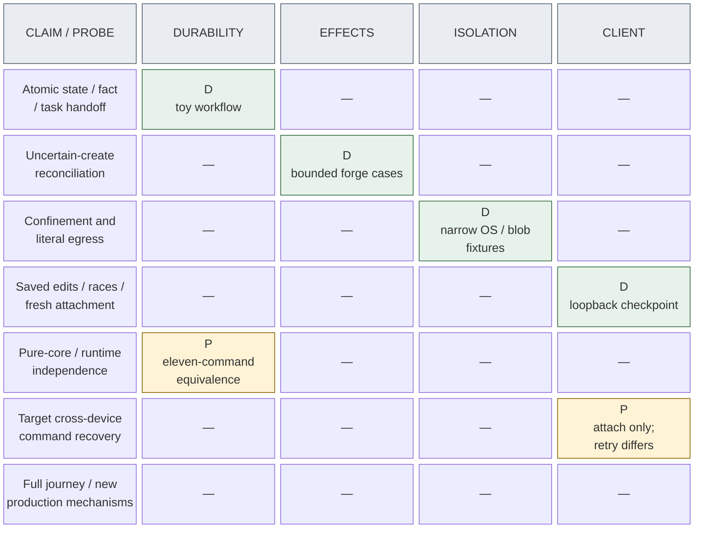
<!-- /render-figure -->

### Runtime source findings and recommendation status

`LAB_REV/evaluation-runtime.md` adopts bounded source facts from the complete `LAB_REV/runtime/findings.md`, with exact installed versions in §6.6. Parent checked native compaction's select/summarize/place implementation and 2,000-character tool-result summarization truncation, terminal checkpoint/memo loss and live/nested cleanup; these establish why Ledger evidence must be retained separately. Parent checked standalone web omissions/cache limits, FFF auxiliary-root behavior, better-compaction's opaque model guard and bridge's inherited environment/settings despite its empty native tools. Primary Docker documentation confirms internal networking does not by itself deny gateway/host access; Tailscale documentation supports private HTTPS/loopback proxy capability. These are **source-established**, not exercised adapters.

R1–R5 recommend assignment continuity/fresh independent rounds, scoped capability adapters including the still-required OpenAI-oriented compaction adapter, address-filtered public TCP/UDP/DNS, minimal bearer/private transport with exceptional restore re-pairing, and proportionate storage/defaults. The researcher initially favored HTTP-first networking and treated opaque adaptation as conditional; the parent synthesis deliberately recommends the router alternative and retains the named compaction capability. This is explicit engineering disposition, not a new human decision. The researcher's six proposed protocols remain **unrun** and now supply distinct future cases in §13; no additional research cycle is required before challenge.

### New history/package feasibility and its limits

Adopted evaluation: `LAB_REV/evaluation-history.md`; protocol and disclosed amendments live under `LAB_REV/storage-protocol.md` and `LAB_REV/experiments/history/`. Parent reviewed the complete implementation/tests/fixtures/export reader/control runner and reran correctness/unsafe controls without another correction. The 20-file hash accounting is **17 current matches and 3 matches to retained originals**, not 20 unchanged current files. Changes were the H04 task-count correction, H06 interleaving diagnostic and added executor-attached unsafe control. Missing-import red evidence establishes ordering only; unsafe controls establish meaningful regression sensitivity.

The six controls detect latest-only history, reference-before-content, missing package content, copying only the live SQLite main file, and automatic restored-task resumption both without and with an executor. Parent inspected the behavioral assertions; incidental fixture failures are not the basis for adoption. The executor-attached control produced two applications versus expected one on every backend. Review tasks are dormant atomic-handoff witnesses, not actual independent reviews.

**Benchmark provenance:** the following is the subagent's measured corpus run inspected by the parent, **not independently timing-rerun**. The corpus is 100 documents × 10 revisions, 36,557,586 total text bytes, approximately 8 KiB–1 MiB each (largest 1,051,161 bytes), with deterministic edits and no exact duplicate revisions. It calibrates these implementations, not future production growth or intrinsic SQL/Git performance.

| Measure | A — SQLite text | B — SQL + file CAS | C — SQL + Git documents |
|---|---:|---:|---:|
| Save p50 / p95 (ms) | 0.409 / 3.491 | 0.687 / 5.414 | 56.886 / 76.552 |
| Old-read p50 / p95 (ms) | 0.048 / 0.542 | 0.047 / 0.640 | 8.546 / 10.086 |
| Complete package (MiB) | 38.0 | 37.5 | 4.2 |
| Restore (seconds) | 0.601 | 2.255 | 8.862 |

All 100 old reads and 20 restored reads per backend matched expected content; independent export readers enumerated 1,000 revisions. C's document bundle is approximately 1.7 MiB and its delta/inspection benefits are real, but its CLI-spawn overhead and extra document consistency protocol are also real in this implementation. A's full-text growth remains; an observed gzip ratio is not a tested compressed SQLite design. No compression subsystem is proposed from these results.

Retain the failed-run history: the initial benchmark had a relative-alternates-path bug for A/B and an **unexplained C timeout at ten minutes, around 95 saves**. The later 99.8-second C success does not explain away that stall. Correctness/control data occupied 943,556 KiB after parent rerun, below the 1 GiB bound; no additional corpus run is requested just to reproduce approximate timings.

**Adopted scope:** exact Unicode/CRLF and immutable revision/content identities; original/revised/rejected/abandoned/accepted/superseded history; acknowledged in-flight checkpoint; preserved fixture human/model/runner provenance; source/verifier links; atomic receipt/dormant task; fresh-process reuse; versioned nonauthoritative JSONL/text export; and enumerated package/corruption/clean-directory restoration cases. C's Git-only export recovers old document text, not status facts, authenticated approvals, receipts or task authority.

**Not established:** product authentication/current revocation/Kernel legality/owner lock, real role execution or tool-replay identity; complete semantic/source-tree validation; hostile-package import safety; orphan GC/multiwriter behavior; missing-post-cutoff admission/receipt recovery, later revocations, incarnation rotation or reconciliation completion; off-host transport/backup file fsync, five-minute protection or physical power loss. SQLite structural integrity and successful Git `cat-file` do not replace retained document digest/length checks. C's prefix-colliding document-ref mapping and untested consistently-manifested tampered bundle must not become production conventions. The prototype's 763 lines are evidence machinery, not Render implementation.

### New incorporation evidence and its limits

Report: `LAB_REV/experiments/incorporation/report.md`; adopted evaluation: `LAB_REV/evaluation-incorporation.md`. Parent independently read all source/tests/fixtures and reran original suite/mutants, verifying all 15 retained preimplementation-file hashes. The earlier designer recorded reading both complete documents, not the test code. This continuation read the complete parent evaluation and did not duplicate source inspection or reruns. Keep the three telemetry-only bounds reporters separate from 24 behavioral bodies; they do not add behavioral coverage. The report discloses 25 fixture histories and at least 215 helper Git processes, so a ≤100-process interpretation of the experimental bound was exceeded.

Adopt AM-1's validated input/result classification (§9.4), not the manual's exit-only shorthand. AM-2's `merge.renormalize=true` SIGABRT in bare metadata is operational failure. Environment-sensitive attribute paths are real: hostile global/default attributes can select built-in `merge=union` without a driver process. HOME-only and XDG-only mutants survived because existing canaries depended on inherited driver configuration; the prototype's environment isolation is not thereby shown broken, but regression sensitivity for those independent leaks is missing. The actual full-env sanitizer uses a host-owned empty HOME and omits XDG_CONFIG_HOME; do not call the unmodified prototype exposed. Retain explicit HOME/XDG conflict-outcome regression checks for production V5/V6. The parent adopted bounded feasibility without another probe round; no exhaustive Git certification or universal mutation score is needed. Explicit `--git-dir` makes the GIT_DIR-only survivor equivalent for the tested invocation.

Real Git output/CAS evidence supports mechanics only. Simulated admission/check/Audit/Watchdog ordering illustrates the proposed protocol but does not establish trusted authority, actual verification, production concurrency or SQL/ref crash recovery. Sealing/import, rewritten-target lineage and some filename/conflict forms remain outside the report. The recommended production placement is Effects' sanitized bare merge-tree seam (§9.4), informed by the adopted evaluation; prepared-object retention roots, source/base ancestry and actual durable evidence/admission/journal semantics must not be inferred from the simulator. Figure 13 retains only the four historical probes; it does not silently incorporate this new partial evidence into a product-completion score.

**E-CLIENT evidence does not replace the target design:**

- Device-bound fingerprints reject same-human cross-device retries. Keep principal-scoped command recovery with original-device provenance (§5.3); it remains unverified despite successful fresh-snapshot attachment.
- Fixture worker W can GET all receipts/artifacts. Rejected command replay is not read-resource confidentiality evidence; production must enforce scoped reads and candidate blindness on every path.
- The PID file/stale-PID cleanup is not an OS-lifetime owner lock and does not verify §5.1. The asynchronous `bytesOf` storage callback in `checkpoint.decide` likewise makes this a host/control witness, **not a core-purity proof**; production passes resolved values to Kernel.
- The fixture's direct terminal approval of edited draft bytes is **not adopted product policy**. Human edits require a new immutable emission, regenerated manifest and required independent exact-revision review/dispositions (§8); complete annotation handling, downstream invalidation and final Contract acceptance remain gates.
- The fixture Ledger tool defaults to unsafe replay and accepts model-supplied command IDs. Its allowed/refused invocation proves neither the new stable host-envelope/replay protocol nor safe nested recovery; the commit-before-tool-result crash check remains unrun.
- Postcommit asynchronous broadcasts may repeat/reorder sequences. Monotonic discard/gap-resnapshot behavior (§5.3), or an explicit ordered-server contract, still needs verification; no Durable frame-coalescing result is claimed.

Parent-authored assessments: `parent-evaluation-criteria.md`, `evaluation-durability.md`, `evaluation-effects.md`, `evaluation-isolation.md`, `evaluation-client.md` and `parent-synthesis-review.md`; detailed protocols/reports under the corresponding experiment directories, including `experiments/client/report.md` and its retained amendment diffs/results. These paths provide reproduction, not hidden product requirements.

### Fresh independent challenge: completed and adjudicated

Fresh Fable xhigh read the completed 1,468-line revision and found **no architecture-blocking gap** (`LAB_REV/challenge.md`). The parent independently adjudicated it against A001–A023/D001–D006 (`LAB_REV/challenge-disposition.md`); that disposition, not blind acceptance of the challenger, governs these final corrections. No new research/probe or human D007 decision was introduced.

| Finding | Final disposition |
|---|---|
| F-01 restore detection | Accept package-origin `restoreRequired` in the offline DB before checksums, startup-before-auth/dispatch detection including direct copies, and local-admin atomic credential/epoch/recovery repair. No external high-water store; unmarked arbitrary filesystem rollback is unsupported/not guaranteed detectable. |
| F-02 missing human integration rung | Accept exact operation-specific `approveIntegration`; recommend `human` operational default, retain scoped grants and intentional disabled policy separately from capability status. Same evidence/admission/CAS/journal/recovery, never main authority. |
| F-03 exempt passed/drift reviews from cap | **Reject proposed semantics.** A007 preserves all completed-review counting, including actual drift re-reviews; a later non-pass may need human direction sooner. D004 cap adoption remains available and valid passes are never rejected. |
| F-04 host principal | Accept closed human/assignment-agent/scoped-host matrix enforced by Kernel plus Ledger authorization. Private composition-root host context cannot fabricate human decisions or model evidence; typed cleanup remains possible. |
| F-05 conflict rework | Accept retained B/T0/T1/conflicts, a new T1-based Attempt/fresh writable workspace, implementer resolution and host-sealed B′ parent T1; verify/review and repeat on later drift. |
| F-06 undefined panel | Delete the undefined policy dial; existing candidates/challenger and checkpoint modes suffice. Historical source panel references remain historical. |

Accepted optional clarifications: N-01 separates technical grants, implementer-owned choices and integration authority; N-02 standardizes epochs/generation/Attempt; N-03 puts required exact-X independent Audit after preparation without mandatory duplicate B/X Audit; N-06 fixes constrained helper placement/no host SDK fallback; N-07 adds four-stream FULL/fullfsync load to V9 without claiming benchmark proof; N-08 defines trusted OS-owner local admin; N-09 preserves historical human acceptance on seam revision; N-10 binds Record to accepted obligations and reviewed qualifying integration; N-11 adds redacted nonauthoritative correlation logs. **N-04/N-05 declined:** retain Ground shape confirmation and do not expand integration grants project-wide.

**Q-01 remains OPEN for human review:** Linux-only v1 has not been selected. If the planned GPUI client requires native verification from first use, move a verified native macOS profile earlier; unsupported work never falls back to ambient host execution. Publish this question for annotations rather than reopen research or hold the spec. Fresh challenge completion is not overall human acceptance or evidence that any revised mechanism is implemented.

### Historical independent challenge: baseline disposition, distinct from the fresh review

Fable's completed `challenge.md` and the parent's independently checked `challenge-disposition.md` are retained at the sandbox root. Their historical disposition is retained for provenance, separately from the completed fresh challenge above. A001–A023 supersede affected recommendations below; none is human authorization. This table records the baseline review, not a second acceptance of its old policy:

| Finding | Disposition in this design |
|---|---|
| F1 — agent replay gap | Corrected with host identity including task/call IDs and durable scope/envelope, Ledger-only replay-safe intent commits, server-side rejection of unsafe/unverified wrappers, and workflow-owned tasks. Tool-result crash recovery remains unrun; new model calls still need eligibility. |
| F2/S1 — human schedules every dependency | Revise default to canonical host-private proposal refs and independently journaled local integration/publication. Same-proposal clearance can precede publication; cross-proposal/main and final readiness retain explicit gates. Recommended design, unverified; the fresh F-02 correction now allows exact human approval or a scoped integration grant after capability verification. |
| F3 — daily re-pairing | Historical expiring-enrollment recommendation is superseded by A011: non-expiring revocable enrollment. Native-client protocol authentication recommendation is §5.1; session machinery is not assumed. |
| F4 — principal establishment | Baseline named the two-adapter internal Ledger seam; fresh F-04 adds scoped host context and the closed principal matrix, preserving transaction-time authorization without a sixth module. |
| F5 — schedule budget | Put 10,000 cheap schedules in pure V1, a few hundred in SQLite V2 and a larger opt-in soak. HTTP prototype timings do not prove an optimized SQLite budget impossible. Targets remain unachieved. |
| F6 — blocked work occupies WIP | Recommend four executing attempts, releasing slots only after quiescence while retaining ownership and independently limited storage. Recommended default for design review, not a live configuration. |
| F7 — edited-draft approval | Strengthen the repair: immutable new emission plus required exact-revision independent review, not structural lint alone; notes approve original bytes only. Fixture direct-draft approval is rejected. |
| F8/F9 — evidence/recovery precision | Filters were bypassed, not refused. Pre-resume recovery uses reads/safe commits, not scheduling-enabling calls. |
| S2 — later task materialization | Not adopted: demonstrated same-commit assignment/task creation avoids an extra materialization window/recovery trigger; private concrete wiring is sufficient. |

The four probes retain their narrow evidentiary value. No new mechanism became demonstrated through this review; implementation gates and human acceptance remain outstanding.

**Existing lab reruns** — these commands are real; they do not invoke an implemented Render CLI:

```sh
cd /Users/vr-osxs/infra/pi-durable-design/experiments/durability
./run.sh design-recheck
tools/mutants.sh results/design-recheck

cd /Users/vr-osxs/infra/pi-durable-design/experiments/effects
node --test test/effects.test.mjs
node mutants.mjs

/Users/vr-osxs/infra/pi-durable-design/experiments/isolation/run.sh

cd /Users/vr-osxs/infra/pi-durable-design/experiments/client
./run.sh design-recheck
node tools/mutants.js results/design-recheck-mutants
RACE_REPEATS=20 node --test test/races.test.js
```

Isolation checks its image digest before running: `docker.io/library/node@sha256:06d7adf3e0ef61a13f1d28682726366f97a15aa1888c934d3ecec86c33918b53`, linux/arm64, OrbStack Docker 29.8.2, Apple Git 2.54.0. Reruns write sandbox results and use only labeled disposable containers/synthetic secrets.

Read existing GitHub evidence without mutation:

```sh
gh issue list -R vicrdguez/render-design --label render-design-experiment \
  --state all --json number,state,stateReason,title,author
```

An optional **mutating sandbox-only** rerun is `RENDER_EFFECTS_LIVE=1 node live-run.mjs` from `experiments/effects`; it creates and closes another issue. It is not needed to inspect existing evidence and must never be redirected at a production repository.

## 13. Lean verification strategy and acceptance targets

Tests are redesigned from the catalogue and histories, not skl structure. Test public module interfaces with literal independent expected outcomes. Use real SQLite and real containment at their seams; substitute only models, clocks and external variability where needed. Keep one check per distinct meaningful regression, not mirrored helper/transport/golden layers. Semantic instruction quality needs independent judgment; prompt snapshots alone cannot establish it.

| ID | Seam and independent oracle | Future acceptance target |
|---|---|---|
| V1 | Pure Kernel with cheap deterministic in-memory driver, literal expected obligations/ownership/refusals and input immutability | **10,000 seeded schedules**, zero invariant violations, replayable/shrunk failures; pure I-rule histories and changed-loop/direct-call bypasses; forged human/assignment-agent/host combinations against the closed command-family matrix, including host attempts to human-approve or fabricate reports; exact `approveIntegration` basis/staleness and no main authority; exact-emission review, scoped technical Seams/Modules delegation and refusal of delegated Proposal/Contract acceptance (including shortened paths), new product escalation, Contract freeze, eligibility and same-/cross-proposal dependency semantics; completed drift re-reviews count, valid passes stay admissible, later non-pass cap stops and D004 adoption preserve counts. Record/seam changes cannot bypass accepted obligations or qualifying integration. |
| V2 | Ledger with real SQLite and direct/Durable drivers; both checked against independent literal expected outcomes | A few hundred targeted schedules (initial **256**), zero invariant violations and same accepted outcomes across drivers; real two-process owner refusal; four executing attempts, blocked ownership/slot retention until quiescence. Larger storage soak is separate/opt-in. |
| V3 | Subprocess fault injection at commit, reply, preparation, admission, dispatch and result barriers, including Ledger-commit-before-tool-result | **100 repetitions per named critical point** in the extended crash run; no partial handoff/duplicate accepted work/manual repair. Tool replay must return the original receipt with stable task/call identity and envelope; unsafe/unverified nested mutations refuse. Include same-assignment continuation, compaction/provider lifecycle and cancellation fault cases below; all revised runtime cases remain unrun. |
| V4 | Two local protocol clients/handlers; saved-byte oracle and scoped credentials/artifacts | Acknowledged edits retained; edits require new emission/review; same-human cross-device receipt recovery and scoped history/export; non-expiring 256-bit device enrollment survives ordinary restart; private HTTPS/JSON/NDJSON works with scoped polling fallback; revocation closes access/streams; forged/stale authority refuses before dedup; direct/tool attempts to mint host context or cross the human/agent/host matrix refuse, and the local-admin CLI/socket is unavailable to coding/helper roles; monotonic observation/gap resnapshot; untrusted bytes never authorize commands; local reattachment **≤5 s**. No browser implementation or physical second device required. |
| V5 | Real execution profile/collector with host canaries, independent manifests and unsafe controls | All named shell/credential/Git/nested-call attacks denied; Linux-profile public TCP/UDP/DNS and package/research positives work through the controlled gateway; in-environment verification works locally. Actual helper egress, destination/bypass and scoped-adapter cases below pass; unsupported native macOS work blocks, never host-shell fallback. Host/private/tailnet access requires a scoped grant on every actual tool path; granted network access does not confer credentials/Render authority. Ingress/egress exact bytes; running writer/special-file/limit cases refuse; no premature quiescence. Public egress is not an exfiltration-prevention claim. |
| V6 | Controlled provider-neutral forge adapter, real host-private Git refs/Ledger crash barriers and bounded remote sandbox cases | No blind uncertain create; sticky reissue risk; admission/cancel ordering; exact reviewed tree including T, local CAS and ref/Ledger crash reconciliation for both exact human-approved and proposal-granted integration, including changed X/T/R/metadata/evidence/policy, revocation and pending-approval refusal. Disabled policy and unverified capability remain distinct; neither route merges main. Separate publication CAS/divergence and canonical-versus-published readiness checks; no cross-proposal/main clearance by an unrelated local update. Pre-Watchdog preparation, conflict routing without review count, preserved B/T0/T1/conflicts and fresh writable T1-based rework Attempt with host-sealed B′ parent T1, no workspace clobber, required exact-X checks/Audit without mandatory duplicate B/X Audit, repeated drift and actual completed-review counting, provider capability refusal, one draft PR after first qualifying local integration with updates to that association, and PR-only/nonblocking publication also required. P-INCORPORATE-1 supplies bounded real Git mechanics and simulated ordering only; actual authority/checks/review and ref/Ledger crash recovery remain unrun. |
| V7 | Persisted definitions/schemas; history reads/export; backup cutoff and corrupt/missing inputs | P-HISTORY-1 already establishes bounded A/B/C history/export/package/clean-directory feasibility, not product acceptance. Verify the production Ledger schema for D006's selected SQLite documents, actual scoped reads, full required semantic/content validation and safe package handling. Production restore must rotate `authorityEpoch`, fence stale envelopes and reconcile newer effects, **wholly lost post-cutoff admissions/receipts and later revocations**; H09 does not cover these. Verify offline-copy-only `restoreRequired` before final checksums, direct package-DB-copy startup before auth/dispatch, malformed restore input and crashes before/after atomic repair: no backed-up credential/outbox access, no partial-clear admission. Test exceptional credential invalidation/local-admin recovery and one-time re-pairing, separately from ordinary restart; effective WAL/FULL/fullfsync readback, source/package hardening and runtime-versus-Ledger history cases below. Verify D003 prompt/periodic asynchronous off-host behavior, actual protected cutoff, measured ≤5-minute healthy target and warning/continued operation in outages. Report manual steps/time/prerequisites, not numeric RTO or outage loss guarantee. No extra broad prototype round. |
| V8 | Full scripted journey then capped real-model/human trials; seeded omission/incidental-choice cases | Full design and shortened paths; verification-skill lifecycle; delegated technical Seams and Modules with required review and agreed scope, human final Proposal/Contract acceptance and product escalation; D004 future defaults/explicit active adoption/immediate revocation without history or count reset, D005 one early draft PR and nonblocking updates; advisory checks not gating readiness; negative experiment retained, fresh non-fork independent rounds with same-assignment continuity and exact evidence; planned web/FFF/Claude/opaque-compaction capabilities must pass their named gates before reported complete, with native text fallback explicitly partial; human answers five handover questions correctly in **≤2 min without chat**. Real model quality reported separately. |
| V9 | Measured command/snapshot load, excluding model/forge latency | At 100 active Slices/two clients/four executing attempts, including **four concurrent Durable transcript/tool-result streams on the shared WAL/FULL/fullfsync database**: local p95 command acknowledgement **<250 ms**, snapshot **<1 s**. Document-save timings are not proof of this concurrent persistence workload. Default deterministic V1 plus sampled V2 suite **<60 s**; bounded subprocess smoke **<5 min**. Extended V3 repetitions, storage soak and real containment/network runs are separate measured jobs, not hidden in these budgets. |

These are targets, not achieved measurements. Ten thousand schedules means cheap pure-driver evidence, not ten thousand SQLite/HTTP runs, containers or GitHub mutations. The V2 sample and larger opt-in soak retain independent expected outcomes; measure budgets rather than extrapolating SQLite impossibility from prototype HTTP timings. Maintain targeted mutation controls—for example, skip fencing, accept old approval, resend unknown create, inherit a host shell—and require the corresponding check to fail on the behavior, not setup. No universal mutation percentage or bloated test platform is required. Missed performance budgets trigger measurement/simplification, not weakened integrity.

### Runtime-specific future cases — no probes launched

The six protocols in `LAB_REV/runtime/probe-requests.md` contribute the following **future implementation gates**, revised by parent R1–R5. They are not a new design-research assignment or completed evidence. Define independent literal fixture expectations/failure cases before adapter/profile implementation; use scripted providers and controlled endpoints for mechanics, and separately authorized capped real-provider checks for compatibility. Semantic model quality needs distinct task-based judgment, never a canary score.

| Case / gates / stage | Distinct failure cases and required observable result |
|---|---|
| **P1 context/history** — V3/V7/V8, S2–4 | Interrupt/reopen the same assignment before/after result commit; retain exact acknowledged drafts (including rejected and in-progress) and current basis, and show idle retention requires no model/sandbox. Compact twice, reset, replace with explicit predecessor links; page raw entries and historical context against literal canaries. Long tool output beyond character 2,000 remains in raw history although summary input truncates/omits pinned fields. A new non-fork reviewer/candidate gets no parent/favorite canary; deliberate fork is the negative control. Settle nested results, terminal checkpoints/memos and latest-only live docs, contrasting rewindable history: absent transient data is labeled absent unless captured in Ledger first. Queue compaction while busy, reject stale competing placement, expose blocking failure; provider/model change cannot discard current packet constraints. |
| **P2 enforced network** — V5, S3 | Public package metadata/tiny package, Git HTTPS/docs, ordinary public TCP/UDP, controlled DNS, own verification server and declared sidecar succeed without per-package permission. Attempt alternate/direct gateway routes, host.docker.internal, macOS relay, LAN/host addresses, private/tailnet/link-local/ULA and mapped IPv6, cross-assignment service, private redirects, DNS answer/rebinding changes, raw subprocess/nested bypass and proxy/NO_PROXY overrides. Exercise actual adapted search/fetch/provider-helper paths, not curl alone. Controller rules precede code; worker cannot alter them. Narrow grant allows only named endpoint/port/protocol/project; revoke denies new admissions and demonstrates active-connection handling. Gateway/helper failure closes access, no unrestricted network fallback. Use controlled fixtures, not unrelated private services; no exfiltration-prevention claim. |
| **P3 Claude provider/lifecycle** — V3/V5/V8, S3 | Two concurrent conversations have separate canaries, tools and provider sessions; reopen/replay, abort, tool-call crash before/after result commit, reset/compaction rebuild, model/credential mismatch and delayed helper shutdown all preserve exact scoped behavior or visible blockage/quarantine. Reject inherited project settings/hooks, filesystem/cloud MCP and credential/tool environment. Only Render handlers execute tools; uncertain effects never resend blindly. Record replacement of ordinary Pi hooks and actual dependency versions. A separately authorized tiny Claude request checks endpoint compatibility, not quality; one successful answer alone is insufficient. |
| **P4 web/FFF** — V5/V7/V8, S3 | Web schema/error/cancellation/content mapping, long page, redirect, provider error, invalid mode, direct-image/answer rejection, helper restart after response ID and eviction must yield retained exact evidence or explicit unavailability, never new bytes under an old ref. Foreign cache IDs and ungranted local/browser-auth/endpoint routes refuse; expose standalone losses. FFF uses the selected Linux architecture/image, no host indexes: known/ignored paths, symlink/parent/absolute escapes, two-assignment canaries, pagination/cancel/restart and stale cursors have literal expected results. Unsupported binary is a capability blocker, not grep-equivalence success. |
| **P5 opaque compaction** — V3/V7/V8, S3 | First-class planned-capability gate, not optional closure of A013 by text fallback. Synthetic provider captures pre/post payloads; compact twice and interrupt before state commit, after commit before generation and during replay. Compatible provider/API/model restores the explicit opaque window and current tail exactly once with intact tool-call/result pairing. Incompatible switch refuses or records deliberate raw-history reconstruction; no placeholder-only or opaque-as-summary shortcut. Export exposes identity/version/opaque presence or declared authorized omission. Failure preserves history/actionable state. Separately authorized capped real endpoint/auth/replay check establishes compatibility; actual OpenAI-oriented quality evaluation is separate. |
| **P6 auth/restore** — V3/V4/V7, S2/S7 | Two local clients: same-human cross-device receipt recovery, stale/conflicting commands, lost reply, disconnect without cancellation, scoped receipt/artifact/stream refusal, revocation while streaming and new-`authorityEpoch` reconnect. Copy a supported marked package DB directly into the data directory without the restore command; startup must detect it before auth/dispatch. Exercise malformed restore input and crash before/after atomic marker-clear/credential/epoch/recovery commit: partial repair fails closed. Older backup predates both revocation and receipt/admission: local-admin-only startup rejects every old bearer and outbox, requires one-time re-pairing and reconciles unknown newer effects before affected writes. Missing receipts prove nothing unsent. Ordinary restart preserves enrollment. Verify private loopback/Serve exposure, no Funnel, NDJSON/poll equivalence; physical second machine remains optional. |

These gates also exercise actual evidence capture before transient settlement, scope across search/cache/session helpers, and truthful capability status. Source-established methods do not count as passes. No broad extension-compatibility harness, arbitrary home scan, second deployment or extra live-model trial is required merely to complete this design.

### Optional physical second-machine lab — deferred, low priority and nonblocking

**Not run on a second machine.** The existing `experiments/client/tools/demo-host.js` is a loopback-only fixture host, not production enrollment/TLS/UI. Its local smoke is reported in `experiments/client/results/demo-smoke/transcript.txt`. These are available lab commands, not Render product commands:

1. On the authorized host, optionally set `TMPDIR` to an **existing private sandbox temp directory**, then run:

   ```sh
   cd /Users/vr-osxs/infra/pi-durable-design/experiments/client
   node tools/demo-host.js 8787
   ```

   The launcher binds `127.0.0.1`, creates a 0700 private directory with 0600 fixture header files, and prints its path. Keep `A.header`, `W.header`, `O.header` and `credentials.json` host-side. Copy only `B.header` over an existing secure channel into a private directory on the second machine; `chmod 600 B.header` there. Copying this fixture is not enrollment.
2. On the second machine, substitute the user's existing SSH user/host and run the tunnel in its own terminal; no SSH or network configuration is changed by this design:

   ```sh
   ssh -N -L 127.0.0.1:8787:127.0.0.1:8787 <user>@<host>
   ```

   From the directory containing `B.header`, in another terminal:

   ```sh
   curl -sS -H @B.header http://127.0.0.1:8787/snapshot
   curl -sSN -H @B.header http://127.0.0.1:8787/observe
   ```
3. In another host terminal, set `DEMO_DIR` to the launcher's printed private directory, then revoke B with the actual fixture command:

   ```sh
   curl -sS -H "@$DEMO_DIR/O.header" -H 'content-type: application/json' \
     --data '{"commandId":"demo-3","type":"revoke_device","device":"B"}' \
     http://127.0.0.1:8787/commands
   ```

   B's stream should end; repeating its snapshot request should return 401. Header **contents** stay out of argv/shell history; curl reads the private files. Afterwards stop the host and tunnel, then remove the copied header and disposable fixture directory.

**Optional future product trial**, not an initial release gate, once implemented and explicitly provisioned: enroll a second device at the private HTTPS origin; attach to the same workflow without its chat; disconnect the first; answer the five handover questions; intentionally submit a stale approval and observe refusal; revoke that device and verify command and stream loss. These remain optional future steps, distinct from the fixture commands, two-loopback-client results and unperformed physical second-machine trial.

## 14. Staged implementation and recommendation status

This is an ordered **future** plan, not authorization to implement, migrate, configure production or merge. Research and the fresh independent challenge/parent disposition are complete; bounded corrections are applied. Next is human design review/annotations, with parent publication validation, not another challenge or probe cycle.

1. **Completed challenge; ready for human design review:** Fable found no architecture-blocking gap; apply the parent's bounded disposition as summarized in §12, including rejection of F-03's counting change. These corrections are now applied. Parent verifies actual edits and revalidates diagrams/links/terminology for publication; the human reviews/annotates the specification. D001–D006 and exact bounded evidence remain unchanged; R1–R5 are engineering recommendations, not D007+ decisions or product proof. **Q-01 is open release scope:** if first-version GPUI native verification is required, schedule its verified native macOS profile before that use; Linux-only v1 is not implicitly accepted. Launch no new design probes.
2. **Persistent server/protocol slice:** Kernel/Ledger, actual owner lock, supported schemas/definitions, WAL/FULL/fullfsync readback, minimal private HTTPS/JSON/NDJSON/poll protocol and scoped human/assignment-agent/host identity with the closed Kernel matrix. Implement D006 immutable documents/history/export/package, stable replay-safe tool envelopes, exact saves/decisions and D004 policy adoption/revocation. Local two-client checks include cross-device receipts, ordinary-restart enrollment and exceptional supported-package marker detection before auth/dispatch, atomic restore credential/`authorityEpoch` repair/re-pairing, wholly lost receipts/admissions/revocations and reconciliation. Establish D003 cutoff/backup behavior early; no prototype importer/code adoption.
3. **Safe role execution and named capabilities:** assignment-scoped continuity and coordinator phase-packet refresh; fresh non-fork independent rounds, actual scope/candidate-blindness, cancellation/quiescence, Linux profile and literal capture. Verify routed public TCP/UDP/DNS plus narrow private grants across shell/nested/research/provider paths, with no unrestricted fallback. Implement scoped web/FFF and Claude provider/lifecycle adapters; native text compaction is only the baseline while the OpenAI-oriented opaque adapter completes its explicit gate. P1–P5 / V3/V5/V7/V8 cover lifecycle, capture, isolation and compatibility; live quality remains separate. Unsupported native macOS work blocks until its own profile is verified; Q-01 determines whether that verification must be brought into this stage before first-version GPUI use. Start with design candidates/challengers/experiments.
4. **Verification and full/shortened design paths:** repo-owned verification asset using simple configurable Render-native defaults, on-demand/change-triggered maintenance, greenfield bootstrap and task-playbook terminal checks. Ground through Record, exact independent emissions/dispositions, technical Seams/Modules delegation within scope, human final Proposal/Contract acceptance, fidelity, protocols/negative evidence and product escalation. Validate both semantic instruction quality and deterministic integrity without conflating them.
5. **Delivery and local progress:** implementer self-check/seal, preparation, required independent exact-X Audit then read-only Watchdog; pre-Watchdog preparation/conflict routing; accepted configurable review limit; advisory human checks. Validate source hardening/rooting and exact-tree/CAS/ref-to-Ledger crash reconciliation. Integration capability remains unavailable until V6 passes; then exact operation-specific human approval (conservative default) or a proposal-scoped grant authorizes the same guarded path. `disabled` remains a deliberate policy pause, not unverified capability. Forge availability cannot schedule eligible local dependents.
6. **Proposal-only publication:** Effects/Forge submodule with one actual adapter and controlled fault adapter; repository-scoped credentials/main exclusion; guarded publication and one draft proposal PR after first qualifying integration, then source/summary updates. Reconcile uncertain create/update and observe real merge mapping. Serve internal readiness separately from forge draft/mergeability; the human marks ready and merges. No Slice issues or automatic draft-to-ready.
7. **Personal-tool unattended readiness:** validate complete source-rooted off-host packages, D003 healthy ≤5-minute exposed-work target/prompt important-decision protection, visible cutoff/warnings and continued local operation in outages. Exercise manual best-effort restore including one-time credential repair and newer-world reconciliation, quotas/retention and supported upgrade/rollback. Destination/tool are operator provisioning, not a new availability architecture or numeric RTO gate. Baseline isolation/auth/owner-lock/crash checks are not deferred to this stage. Physical second-machine validation remains optional and low priority.

### Design recommendations are not repeated permission questions

| ID | Status and recommendation for review |
|---|---|
| C1 — verification asset | Source-backed fallback tests/build/inspection with project replacement ladders, runnable catalog and create/maintain ownership. Recommend on-demand/change-triggered maintenance, `.render/verify.md` / `.render/journeys/` with explicit legacy-path configuration. No extra cadence/path choice blocks the design; human still owns product expectations/minimum evidence. |
| C2 — delegation, **D001 selected** | Technical Seams/Modules within agreed scope; final Proposal/Contract and main merge remain human. Typed scope/provenance and initial all-human defaults are engineering recommendations, not live grants. No maximum-scope re-vote. |
| C3 — config/review cap, **D004 selected** | Future defaults, explicit selected-revision adoption for selected active workflows, immediate revocation and unchanged history/counts; default 2 accepted. Recommend one immutable policy binding per workflow and ordinary single-workflow adoption receipts, no DSL. |
| C4 — preparation/local integration | Parent adopted bounded preparation feasibility, not production recovery. Recommend sanitized bare merge-tree, exact combined-source evidence and canonical private proposal refs with durable rooted objects and CAS/journal. Actual integration requires V6 and exact human operation approval or a proposal-scoped grant; human mode is the conservative operational default, not main authority; design recommendation is not authority to execute. |
| C5 — publication, **D005 selected** | One early draft PR and nonblocking source/summary updates. Exact published mapping gates internal readiness; human draft-to-ready/main merge. No repeated timing question or new automatic promotion. |
| C6 — history/preservation, **D006/D003 selected** | SQLite immutable acknowledged documents/all history, text/JSONL export and complete package; source Git separate. Recommend WAL/FULL/macOS fullfsync readback and separately durable rooted Git. Async healthy five-minute target and continue-warning outage behavior unchanged; operator destination, manual best-effort restore, no physical zero-loss/RTO claim. |
| C7 — protocol/auth, **R4 recommendation** | Private Tailscale Serve/loopback/no Funnel; versioned JSON + authenticated NDJSON/poll; 256-bit non-expiring revocable device bearer/verifier, no refresh tokens. Ordinary restart preserves enrollment; marked supported restore requires local-admin validation and atomic credential/`authorityEpoch` repair in durable recovery mode and requires one-time local-admin re-pairing. Visible cost, not a new human-selected policy. |
| C8 — runtime/profile, **R1–R3 recommendations** | Durable same-assignment continuity, phase-refreshed coordinator, fresh non-fork independent rounds; Engine schedules. Four named planned adapters with explicit losses and gates, including opaque OpenAI-oriented compaction. Initial Linux profile with address-filtered public TCP/UDP/DNS; native macOS work unsupported until verified. No compatibility/enforcement/quality claim and no pending research dependency. |

Read-only Watchdog, four executing attempts with separate retained-storage budget, exact independently reviewed immutable emissions and retained decisive raw evidence are **recommended defaults for review**, not live settings or additional human decisions. They trade possible extra review work and retained bytes for simpler exact-source authority and reproducible evidence. The user can challenge these in the resulting spec; ordinary engineering recommendations need not hold the design in a permission deadlock.

**Ready for human review and annotations.** Fresh independent challenge and parent disposition are complete; there is no architecture-blocking finding. **Q-01 remains an open release-scope question**, not a new human decision or acceptance of Linux-only v1: first-version native GPUI verification requires a verified native profile earlier. Publication need not wait for the answer. Runtime compatibility, quality, enforcement and restoration remain future implementation gates, not a request for another design-research pass.

**Conclusion:** five deep modules and one authoritative personal host remain sufficient. Kernel computes pure lawful changes; Ledger accepts and retains them; Engine schedules/refreshes role execution; Sandboxes controls execution/capture; Effects owns source operations and provider-neutral publication. D001–D006 and evaluated evidence are preserved, source-backed runtime findings now inform explicit reviewable recommendations, and remaining unrun checks are named. This is a completed, independently challenged design revision ready for human review, **not overall acceptance, implementation or permission to execute effects**.
