# Render: trustworthy delegated development

**Status: Accepted design — R3 annotation revision.** Applies [R3-A001–R3-A003](spec-r3-review-notes.md) over affected [R2 decisions](spec-r2-review-notes.md), preserving unaffected A001–A023/D001–D006 requirements and bounded historical evidence. See the [current R3 disposition](spec-r3-review-disposition.md), explicitly historical [R2 disposition](spec-r2-review-disposition.md) and [A001–A023/D001–D006 record](spec-review-disposition.md), and [ambition](ambition.md). **R3 independent parent evaluation and fresh Fable challenge are complete:** no blocking fidelity or feasibility finding; four bounded clarifications adjudicated and applied. Prior challenges remain historical. **The human explicitly accepted this specification: “Great, then mark the spec as accepeted”.** Acceptance covers the design as documented, including its stated trade-offs, evidence limits and remaining implementation details. It does not establish product correctness, make unrun verification pass, or authorize implementation, deployment, live changes or merge.

## Retained v1 scope amendment: disaster recovery deferred

The human-approved `render-v1/defer-disaster-recovery` amendment qualifies this accepted design (basis `768f43c13b0675fae553f4ad09ec754f799a19fb`). Packages/import/restore/repair, migration through packages, off-host backups/targets/protection bookkeeping, older-backup reconciliation and disaster-specific startup are deferred until a separate post-v1 design. They are removed from active implementation and verification, not disabled or prerequisites for ordinary startup. There is no legacy disaster-store/package compatibility or live-data upgrade promise.

Normal restart, pause and agent-failure continuation retain assignments, tasks, committed context/results, Ground, citations, provenance and source/effect records. Atomic acceptance/replay, current authority, execution fencing/quiescence, compatible task meaning, uncertain-effect safety, scoped history/export and exact missing-content blockers remain required. Runtime state is not constrained by package representability. The five modules and pinned dependencies are unchanged.

This amendment supersedes disaster-specific duties wherever older text or historical probe/challenge records mention them, especially §§5.3.1, 10, 13 and D003/package portions of D006. Historical studies in §12 are evidence of prior investigations, not future-design approval or v1 gates. Retained V1–V9 obligations and source-specific delivery verification remain; deferred capabilities do not count as remaining v1 completion work.

Development scratch is not product evidence: keep raw logs and run narratives outside source, with exact source/commands/results/limits in existing implementation/review reports. Both active source and the separately preserved pre-removal reference branch omit `evidence/`; ordinary ancestor history is unchanged. The reference branch is not a future recovery design.

## Usable-host amendment

The operator-settled [usable-host design](design/usable-host.md) amends this accepted design so that the operator can use Render from the desktop app in place of pi. The host transport, not Ledger, owns HTTP and the client protocol. Engine gains a read-only coordinator watch, a playbook launcher and chat delivery. Ledger gains projects and revisioned Engine settings. Models authenticate with the operator's existing pi logins. The changed text is in §1 (R2-A003), §4, §5.2, §5.2.1, §6.4 and §6.6. The design document holds the decisions, interfaces, behavior rules, verification and build order. It authorizes no implementation, deployment or live change by itself.

## 1. Outcome, scope, and decision status

Render lets a human take an uncertain idea through design, explicit commitments, implementation, verification and independent review; leave or switch clients; and resume without reconstructing state or wondering what was authorized.

**One authoritative personal macOS host, accessed remotely only through the private tailnet.** Clients and conversations hold no workflow authority. Pi Durable supplies execution; Kernel computes legitimate changes; Ledger accepts authorized commands and retains outcomes. The battery-backed laptop lowers one power-loss exposure, not storage/host failure. Comfort and useful development take priority over elaborate confinement; the remaining authority, credential, mount, source-identity and cancellation safeguards have concrete purposes.

**Selected delivery order, per implementation pass i (R3-A001):** implementation/checks → **one logical Audit i with fresh Standards and Contracts contexts on A_i** → implementer fixes/disposes findings and rechecks → final seal B_i/submission → deterministic current-target preparation X_i and required verification → independent Watchdog → **autonomous qualifying proposal integration** → one early draft PR, updated as work proceeds → **automatic ready promotion once all proposal Slices have qualifying integration and current publication/evidence** → **human-only main merge**. Source-changing Record work follows this same path.

<!-- render-figure: 01 -->
**Figure 1 — Journeys and decision gates.** Proposed flow, not executed evidence. Each implementation pass has its own Audit on retained pre-fix A_i; Watchdog inspects prepared post-fix X_i. Implementation rework after handoff starts the next pass; deterministic preparation/check retries without implementation do not. Neither a temporary Audit snapshot nor its report is final submission. Integration is autonomous without grant setup; readiness is observed, not inferred from intent.

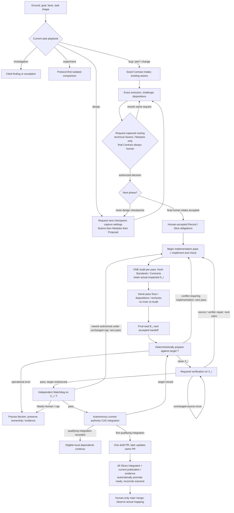
<!-- /render-figure -->

### Settled decisions

- **Checkpoint trust dial (D001, R2-A001):** persistent per-checkpoint settings, initially human review recommended. A checkpoint captures settings **when requested**; pending requests keep them. New requests, including later checkpoints of an existing workflow, use current settings without workflow adoption or scoped TechnicalGrant records. Only technical Seams/Modules approval is delegable; independent work/evidence remains. Final Proposal/Contract acceptance, out-of-scope product choices and main merge remain human. Per-request natural-language overrides are deferred.
- **Other configuration (D004):** future-work defaults and explicit selected-revision adoption for selected active work remain unchanged, including the review cap. Default **two completed Watchdog reviews** is accepted; no history/count reset and no valid-pass rejection.
- **Runtime (R2-A003):** keep Pi Durable / Pi AI / Chord **1.4.0**, commit **4a080252f06caf63a525d7873c5d94d3c23887e0**. Native Durable compaction, bash grep/rg and Pi's native Claude provider replace the three dropped adaptations. No FFF, better-compaction, Claude-bridge, ordinary Pi runner or extension-compatibility framework requirement. Under the usable-host amendment, the native Claude provider authenticates with the operator's existing pi OAuth login, and Pi AI's native `openai` provider serves the ChatGPT family with the same login mechanism.
- **Web (R3-A002/A003):** **Webfox 4.8.0 supported root library, Exa primary and Tavily fallback**, with human-provisioned API keys, are selected for useful discovery/page access. Also selected: bounded assignment-scoped expiring working data, native committed output/history, and exact relevant evidence explicitly retained in Ledger before reliance. §6.6 defines the small sequential fallback and preserves the historical comparison. No paid plan, numeric spending limit, cache lifetime/quota or privacy-deletion schedule is selected; live provider quality/integration remain unverified.
- **Execution/network (R2-A005/R2-A011):** Linux-container workers in v1, same CPU architecture as the Macs where applicable; native macOS workers/desktop automation deferred. Best-effort normal development networking, not exhaustive private-route confinement. No bespoke gateway, endpoint-grant system or mandatory provider/web helper topology. Network reachability never confers Render authority or host credentials.
- **Audit/integration/readiness (R2-A006–008, clarified by R3-A001):** one Audit **per implementation pass**, including each pass entered after Watchdog rework; not one across the Slice or Assignment lifetime. No same-pass Audit/fix/re-Audit loop or post-preparation exact-X Audit. Proposal integration and draft-to-ready are autonomous by default, without routine human permission. Main merge remains human.
- **History (D006/R2-A009):** immutable acknowledged text/document history in SQLite, canonical source Git separate; versioned nonauthoritative text/JSONL export (disaster-recovery packages are deferred). Retain all acknowledged document history initially; no latest-only or new compression subsystem.
- **Incorporation (A008/R2-A010):** deterministic preparation before Watchdog is selected with bounded evidence/limits; real conflicts return directly to implementation without a Watchdog count, operational errors block honestly.
- **Disaster recovery:** D003 off-host protection and package duties are deferred after v1 by the scope amendment above.
- **Human verification and clients (A010–012/R2-A011):** usability/macOS/UI checks are advisory. A copyable exact-source local-verification prompt is client-facing data (§5.2.2), not a laptop executor or completion gate. GPUI/TUI client implementation remains separate. Non-expiring revocable enrollment; optional physical second-machine trial is low-priority future work, local protocol checks remain required.

**Q-01 CLOSED:** native macOS worker execution is deferred; Linux same-CPU evidence does not prove macOS framework/runtime/packaging/UI behavior or binary portability. Server-on-macOS and a future GPUI client do not change this worker scope.

### Recommendations and non-goals

Five deep modules remain sufficient (§4). Recommended defaults include four executing attempts with quiescence before slot release, same-assignment durable continuity with fresh independent review contexts, read-only Watchdog, exact immutable emissions, canonical private proposal refs and retained decisive raw experiment evidence. Existing runtime container facilities, host-native trusted provider/web libraries, private-tailnet bearer protocol and stronger local persistence are engineering recommendations, not new human selections or live configuration.

Historical probes establish bounded mechanics, not Render implementation. Ordinary production checks remain in §13. The completed, independently evaluated P-WEBFOX-1 probe establishes bounded direct-adapter result loss on the pinned runtime and supports root-library consumption (§12); the **human**, not the probe, selects backend/provider order and retention in R3-A002/A003. No further design probe or storage, incorporation or network research round is needed.

**Non-goals:** generic workflow DSL/plugin framework; multi-host authority/offline writers; enterprise/public deployment; automatic main merge; Slice issues; client implementation; native macOS workers; laptop enrollment/remote computer use/distributed verification; automatic external-result import; principle-writing/eval harness; extension parity/forks. Current playbooks may grow in later versions without a v1 loader or DSL. No implementation, migration, live configuration, forge operation, commit or merge is authorized by this design.

## 2. Start from histories, not a module diagram

The following representative histories define what the design must explain. They are designed scenarios, not claims of replaying production sessions.

| History | Required outcome | Failure to defeat |
|---|---|---|
| H1: uncertain idea to delivery | Challenger reveals an incidental choice; an experiment disproves the favorite; revised commitments are explicitly accepted; independently reviewed work reaches human merge. | A persuasive coordinator turns evidence or silence into commitment. |
| H2: annotated checkpoint, abandoned client | Human saves arbitrary Markdown edits, requests rework, leaves; another client and fresh coordinator recover every saved concern. | Lost annotations, overwritten bytes, or dependence on old chat. |
| H3: lost handoff response | One report, assignment closure, receipt and next task survive a crash before reply. | Retrying increments a review round or releases a newer assignment. |
| H4: concurrent clients | An approval and an annotation save against the same basis have one explicit ordering. | An obsolete approval silently authorizes new content. |
| H5: uncertain external creation | A successful remote create with a lost response is reconciled or explicitly blocked. | Negative listing causes a duplicate create. |
| H6: source changes after review | A pass on X remains historical evidence, never permission to integrate Y. | A ready label, source name or old verdict substitutes for exact evidence. |
| H7: canceled worker still alive | Authority is fenced immediately; workspace reuse waits for confirmed quiescence. | A surviving child or old generation writes into replacement work. |
| H8: runtime upgrade | Unsupported persisted work is visible and blocked, with a supported recovery path. | A new handler silently reinterprets an old checkpoint. |
| H9: hostile worker output | Shell, Git metadata, attributes, symlinks and rendered documents cannot acquire host or human authority. | Hidden tools or a different working directory are mistaken for isolation. |

The assurance goal is **safe continuation or a precise actionable blockage at every named retained-v1 failure point**, without manual ledger repair or inferred authorization. Process-crash continuation preserves acknowledged edits under current authority. Blockage is a successful safety outcome where safe continuation cannot be established; it is never reported as completion. Host-loss recovery is outside v1.

## 3. Source-backed behavior and intentional changes

### 3.1 Source register and precedence

**Evidence-path convention:** `LAB` means `/Users/vr-osxs/infra/pi-durable-design`; `LAB_REV` means `LAB/revision-a001-a023`; `LAB_R2` means `LAB/revision-r2`; `LAB_R3` means `LAB/revision-r3`. These external lab files contain reproduction evidence, not additional hidden product requirements. Current annotation dispositions are in the [R3 revision record](spec-r3-review-disposition.md); the [R2 record](spec-r2-review-disposition.md) and [earlier record](spec-review-disposition.md) are historical.

References below are local, inspectable sources, not claims that the source system already implements Render.

- **U — current intent:** [R3 review notes](spec-r3-review-notes.md) clarify Audit as once **per implementation pass** and select Webfox/Exa-primary/Tavily-fallback plus selective three-layer retention. They supersede affected [R2 notes](spec-r2-review-notes.md) and their prior applications; unaffected [original annotations](spec-review-notes.md) A001–A023 and [historical human decisions](spec-review-disposition.md#human-decisions) D001–D006 remain. [Ambition](ambition.md) and AGENTS.md guide scope/engineering. R2's captured checkpoint settings, reduced adapter/network scope, autonomous integration/ready, SQLite/incorporation and native-worker deferral/advisory handoff remain. None implies overall acceptance.
- **T — transcript:** `skl_conversation_transcript.md`, recorded as completely read by the baseline designer; not independently reread in this revision. Later user clarification makes central hosting the only mode and requires pure transformations independent of orchestration topology. Earlier assistant suggestions of distributed writers, a DSL, or putting mandatory independent review solely in the loop are not requirements.
- **D — design method:** `skl skill design`, its `DEEPENING.md` and `DESIGN-IT-TWICE.md` resources; testing and domain guidance. Interfaces include ordering, authority, errors and required configuration, not just method signatures. Depth means leverage; locality means reasons to change concentrate in one place.
- **C — source domain:** `/Users/vr-osxs/dev/skills/CONTEXT.md`, inspected at source revision `480179ce60db591a62562a94b27bf35a32b7505f`. Relevant production claim/handoff source was read to distinguish mechanics from intent, not copied as architecture.
- **A5/A6/A7/A13/A14:** skl ADRs 0005 (contract verification/fidelity), 0006 (private records/ownership/recovery), 0007 (latest-view publication), 0013 (proposal integration versus human main merge), 0014 (amendment and Contract freeze).
- **A18–A22:** skl ADRs 0018–0022: decision classes and lint, repository verification, principles, task shapes, annotated design checkpoints and experiments.
- **L0 — original accepted proposal:** `projects/skills/proposals/design-workflow/proposal.md` at ledger revision `8d4b7651431a2c09ffde521dff1221dfb7abd482`, accepted 2026-10-19.
- **L1 — recorded status and Contracts:** read-only `skl browse` at revision `9a02a327dd6c2e4ac40a985bdbf5d8b5434405d7`. Contract references below use `projects/skills/proposals/design-workflow/<slice>/{intent,behavior,plan}.md`; `B<n>` identifies a behavior obligation, not a test.
- **P — runtime:** pinned Pi Durable 1.4.0 package and commit-specific specification; exact provenance, results, limits and rerun commands are in §12.
- **NEW-INC / NEW-HISTORY — evaluated lab evidence:** `LAB_REV/evaluation-incorporation.md` and `LAB_REV/evaluation-history.md`, read fully by earlier designers. Parent independently inspected/reran correctness and unsafe controls; history benchmark timing is the subagent's run inspected by the parent, not independently timing-rerun. These evaluations are bounded evidence, not product implementation or prototype-code adoption. D006/R2-A009 selects SQLite text; R2-A010 selects deterministic incorporation with their limits.
- **NEW-RUNTIME — historical source evidence:** `LAB_REV/evaluation-runtime.md` and its earlier reports support pinned compaction/history and installed-package facts, not executed compatibility or quality. R2-A003 supersedes the three-adapter program; R2-A004 corrects the overbroad OpenAI-key claim; R2-A005 supersedes filtered-gateway/helper recommendations. Historical findings remain evidence, never current requirements by inertia. The R2 designer read all four parent runtime/history/incorporation/challenge evaluations without rerunning them; R3 preserves that history without repeating the research. Initial bounded web source assessment is retained in `LAB_R2/designer/web-evaluation.md`; later independent parent evaluation is `LAB_R2/evaluation-web.md`, with actual P-WEBFOX-1 results and narrowed scoping claims (§12). Parent network assessment is `LAB_R2/evaluation-network.md`. No current-upstream runtime was substituted.

**Historical source recheck (earlier revision):** Read ADRs 0019/0021/0022 and accepted proposal/behavior Contracts through read-only `skl browse document`. At that inspection, the supplied `/Users/vr-osxs/dev/dev-skl-ledger` checkout was a different demo ledger at `10abea5`, without the design-workflow objects; do not present its contents as that proposal. The configured read-only browse returned L0/L1 at the exact revisions above. [historical R2 research and recommendations](spec-r2-review-disposition.md#research-and-design-recommendations) gives reproducible references and the primary pstack repository found in the original `workflow-redesign-notes.md`, rather than a guessed project. Current pstack guidance is comparison evidence, not authority over accepted skl/Render intent.

**Delivered versus intended:** L1 records `contract-lint`, `verification-skill`, and `principles-tier` integrated into `proposal/design-workflow`, not delivered to main. The proposal remains open and not fully delivered. `checkpoint-engine` and `design-playbook` are dependency-blocked, without reports. `work-router` is now Ready for Implementation with an active decision and an unsatisfied added integration dependency, superseding earlier Needs Human reconnaissance. A seventh integration-only slice exists; its test-related content is not used here. Glossary terms and ADRs marked accepted/pending do not independently establish delivery.

**Accepted future scope:** L0, A22 and L1 require Ground/Seams/Modules/Proposal/Record, editable checkpoints, annotation responses, challengers, candidates, isolated experiments with protocols, product decisions, fidelity review, and resumption from durable records. These remain first-class Render requirements despite partial skl delivery.

**Explicitly deferred in skl:** reflect/principle-writing automation, promotion tooling, role dispatch-with-wait, and repository design documents by default. Render retains the first two deferrals, makes durable role execution core scope, and treats repository design documents as an explicit product choice. This user specifically requested `docs/spec.md`.

### 3.2 Catalogue: invariants versus policy

A **Contract revision** is an immutable accepted set of obligations. An **Assignment** reserves work for a role and generation with exact inputs; an **Attempt** executes it. An **implementation pass** is one implementation interval ending at its accepted sealed-source handoff; host-recorded pass identity is independent of Assignment/conversation/Attempt identity (§6.2.1). An **Artifact** is retained immutable content with provenance, not a temporary path. An **Approval** is an authenticated human decision over an exact basis. A **delegated technical decision** is a machine-attributed technical Seams/Modules transition citing the checkpoint request's captured persistent settings, agreed scope and exact reviewed emission; it is never a human approval or Contract acceptance. An **Operation** is an intent/attempt to cause an effect outside Ledger's transaction (local Git or forge), distinct from an observation of its outcome.

| ID | Rule or target behavior | Source and owner | Verification |
|---|---|---|---|
| I1 | One host accepts authority. Clients, chats, exports and forge projections cannot mutate domain state independently. | T late, C, U; Ledger | V2, V4 |
| I2 | Approval binds the exact request/content/annotation and applicable policy basis. Checkpoint routing settings are captured per request; Kernel allows at most one pending request per workflow/stage for all principals. Emission/rework/retry retains that capture; a new same-stage request requires prior resolution or explicit checked human cancellation/replacement. New requests read current settings. D004 future defaults/explicit active adoption remain for unrelated policy. Cancellation/revocation of current authority is immediate; no historical decision/count reset. Silence/prose/edit metadata are not consent. | C, A6, D004, R2-A001; Kernel/Ledger | V1, V4 |
| I3 | Every accepted entry path enforces domain integrity and mandatory review and authorized delegation scope. Changing the loop cannot bypass them. | U; Kernel | V1, V2 |
| I4 | One active assignment generation per exclusive work scope. Old generations cannot submit, release newer ownership, or obtain new effect permits. Timeout is not proof of death. | C Claim, A6; Kernel/Sandboxes | V1, V3, V5 |
| I5 | Accepted state, fact, receipt, report references, assignment handoff and next task commit atomically. | C Phase Handoff, A6, U; Ledger | V2, V3 |
| I6 | Same command ID and payload returns the same authorized receipt, never another execution. Changed payload conflicts. Authentication/scope precedes receipt disclosure. | A6, U; Ledger | V2–V4 |
| I7 | Contract obligations cannot drift. Consumed Contracts stay frozen even after assignment release. Human direction within a Contract is not a waiver. | A5/A14, strengthened; Kernel | V1 |
| I8 | Evidence identifies the implementation pass, source actually examined, Contract, target where relevant, verifier and role. Audit i records pre-fix A_i and dispositions, not final B_i or prepared X_i. A completed old-pass Audit cannot satisfy a new pass, even with identical bytes. Required preparation checks/Watchdog bind actual X_i/T; a pass on X cannot authorize Y. Provenance is preserved, never relabeled to force equal-source Audit. | C, A5/A18/A19, R2-A006/A010, R3-A001; Kernel/Effects | V1, V5, V6 |
| I9 | Dependencies clear only on recorded qualifying integration, never a pass/PR-ready flag. Eligible proposal integration is autonomous without grants/approvals; same-proposal edges clear independently of publication. Cross-proposal/main edges need their separate qualifying observations. | C, A13, R2-A007; Kernel | V1, V6 |
| I10 | Human alone merges main. Autonomous proposal integration preserves exact reviewed source and expected-old target. One early draft PR is updated, then automatically promoted ready only with all proposal Slices integrated and current publication/evidence; actual forge state is observed/reconciled separately. | C, A13, D005, R2-A007/A008; Kernel/Effects | V6 |
| I11 | Saved document revisions, annotations, objections and dispositions are attributable and resumable. No annotation is silently dropped. | A22, checkpoint-engine B2–4, design-playbook B2; Ledger/Kernel | V4, V8 |
| I12 | Common exact-emission/annotation/evidence validation applies to human and delegated checkpoint decisions. Only technical Seams/Modules can use captured delegated settings; one pending request per workflow/stage applies to every principal. Scope references human-authored Ground/clarifications and task shape, not unaccepted assistant proposals. Required exact-emission challenge/dispositions surface unresolved new product decisions or changed human scope; already human-decided product constraints may be carried forward. Final Proposal/Contract acceptance and new product/scope decisions remain human; no new Ground approval gate, scoped grant or delegated main merge. | D001, R2-A001; Kernel/Ledger | V1, V4, V8 |
| I13 | Coordinator cannot substitute for challenger/candidate/experiment roles or independent Watchdog. Distinct contexts and capabilities are enforced. | A22, design-playbook B3, C; Engine/Kernel | V5, V8 |
| I14 | Experiments record criteria before execution, isolate writers, compare sealed inputs, retain negative results, and never create commitments by themselves. | design-playbook B4, checkpoint-engine B5; Kernel/Sandboxes | V1, V5, V8 |
| I15 | Structural lint checks coverage/references/provenance; agents judge merit. Forbidden or unplanned consequential choices are surfaced. | A18–20, design-playbook B5; Kernel/Engine | V1, V8 |
| I16 | Local results survive forge failure. Unknown effects remain unknown until justified reconciliation; no blind non-idempotent retry. | A6/A7, T, strengthened; Effects/Ledger | V3, V6 |
| I17 | Disconnect is not cancellation. Cancellation fences new authority but cannot retract already admitted effects or erase evidence. | U, P; Ledger/Engine/Effects | V3–V6 |
| I18 | Unknown schema/task versions block visibly; upgrades preserve historical meaning and ownership. | A6 schema, U; Ledger/Engine | V7 |
| I19 | Each implementation pass: checks → one fresh-context Standards/Contracts Audit → same-pass fixes/dispositions/rechecks → final B_i/handoff → preparation/verification X_i → Watchdog. Watchdog rework or post-handoff source/verifier repair starts a fresh pass/Audit; recovery and deterministic retries without implementation do not. Kernel/Ledger bind handoff to its current pass (§6.2.1); no inner re-Audit or exact-X Audit. Every completed Watchdog review counts once, including drift passes and Needs Human; interruptions/duplicates/pre-review failures/Audits do not. Default cap 2, valid Watchdog passes never rejected; implementation-pass transitions never reset counts/history. Human/macOS advisory checks never gate readiness. | C, A007/A010, R2-A006/A011, R3-A001; Kernel/Ledger/Engine | V1, V8 |
| I20 | Handlers, current identity and execution profile enforce authority, credential/mount separation, literal source and cancellation—not prompts/tool visibility alone. Untrusted content stays inert. Network is best-effort: reachable private services/exfiltration are residual exposures, not comprehensively denied. | U, P, R2-A005; effectful modules | V4, V5 |

Mandatory integrity/authorization rules belong in pure Kernel transformations, enforced by Ledger on every command. Filesystem/process/credential restrictions additionally require actual enforcement outside the core.

Scheduling policy chooses among legal actions: eligible Slice order, WIP limits, model choice within required separation, extra candidates, bounded retry/backoff, and attended waiting. Policy changes are versioned; they cannot waive obligations, manufacture consent, or substitute missing evidence. The configurable automatic rework budget has the accepted default of two completed reviews, counting Needs Human and excluding interruptions/duplicate recording and pre-review preparation conflicts. Further automatic rework at the limit requires human direction; a valid pass remains admissible. D004 selects future-work defaults, explicit selected-revision adoption for selected active work and immediate current-authority revocation without resetting history/counts. R2-A001's per-request capture is the specific exception for checkpoint routing, not the review cap. Exact representation is in §6.4.

A007 counts **every actual completed Watchdog review**, including a review of newly prepared source after a prior pass and target drift. Repeated passing drift rounds can reach the cap before a later non-pass; that later result may need human direction sooner. Show prior passes and drift reasons; D004 permits explicit cap adoption for active work without resetting history. Never reject a valid pass or silently exempt these rounds.

<!-- render-figure: 02 -->
**Figure 2 — Evidence and decision relationships.** Proposed conceptual data model, not a database schema. Every link is a DATA reference, not a call, lifecycle transition, or permission. Approvals record authenticated human exact-basis decisions; delegated technical decisions instead cite captured checkpoint settings, agreed scope and machine actor. Neither artifacts, review verdicts nor technical advancement grant final Contract acceptance. Multiple evidence records can support multiple obligations.

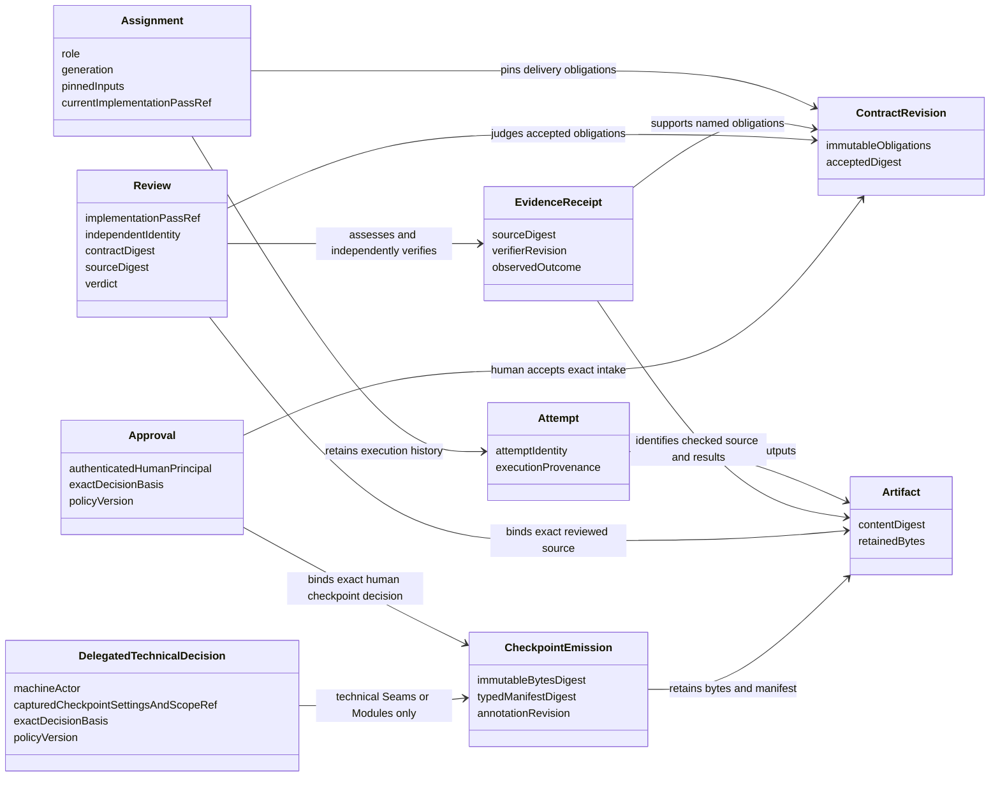
<!-- /render-figure -->

### 3.3 Deliberate redesigns

| Historical choice | Render choice and consequence |
|---|---|
| Git-ledger files/CLI conventions and supervisor choreography | One accepting host and ordinary durable task code. After A020's comparison, D006 selects SQLite immutable acknowledged documents/history; source remains Git. Versioned text/JSONL export is nonauthoritative; optional later Git archive is not a second writer or required store. |
| Suggested event-sourced replay | Recover explicit current authority and retain immutable SQLite history without rerunning obsolete scheduling policy. Separate current/accepted pointers do not erase old revisions; no generic event framework is justified. |
| Freeze inferred from current Claim/report state | Persist `everAssigned`; release never makes a consumed Contract editable. Amendments create a new accepted revision only before assignment; later changes use supersession/replacement. |
| Body-opaque checkpoints and file-existence-only provenance | Editable Markdown plus a small typed manifest of nodes, reference digests, annotation responses and dispositions. Enforce structure, not prose merit; no DSL. |
| Only experiment report retained | Retain protocol, selected source/fixture snapshots and raw decisive evidence as well. Nothing automatically copies experimental code into consumer source. |
| Watchdog may edit Debt Markers | Read-only Watchdog; implementation applies any change and obtains evidence for the resulting source. Removes a special evidence exception at the cost of a possible extra round. |
| Historical invocation Auto Mode / Modules and Proposal delegation, Seams human-only | D001 deliberately changes the maximum: technical Seams and Modules decisions are configurable within agreed scope; Proposal/Contract acceptance stays human. Initial all-human defaults are proposed, not live grants. New out-of-scope product choices and final main merge also remain human. |
| Slice issue/status publication | Removed. D005 creates one draft proposal PR after first qualifying local integration, then updates its supporting source and summary. Publication remains nonblocking for eligible local work. Consequential operations retain durable identity and uncertainty handling. |
| Worktree/cwd isolation and ordinary host Git | Restricted execution and literal source materialization/collection. Added containment is justified by observed exploits, not by speculative infrastructure. |

## 4. Compared decompositions and recommendation

The relevant dependencies are pure computation, local authority/document persistence (D006 SQLite; bounded Durable composition demonstrated), owned client transport, pinned Durable/model execution, and true external OS/Git/forge effects. Use adapters only where behavior genuinely varies: direct versus Durable execution for verification, scripted versus real provider, controlled versus actual external effects. Do not create future-backend registries.

### Alternative A: phase-owned vertical modules

Design, Delivery and Review each expose `start/advance/observe`, own their persistence, instructions, tasks and recovery, and exchange immutable handoff packages. Host authenticates and routes.

**Depth:** strong phase-local leverage. **Locality:** changing phase instructions is easy, but ownership, cancellation, approval and provenance changes cut across all phases. Atomic handoffs demand shared transaction/identity machinery anyway. H3 and H8 expose the burden: several histories must advance or migrate consistently. Deleting a phase spreads useful behavior, but deleting the shared handoff framework removes indirection. This decomposition favors independent organizational deployments, not this one host.

### Alternative B: Durable task tree as authority

One Workflow Run module exposes `start/signal/watch`. Task checkpoints, child lifecycles and transcript documents represent workflow state; tools signal the parent.

**Depth:** smallest initial interface, strong runtime leverage. **Locality:** graph edits become persistence/meaning edits; parent cancellation and handler migration can alter accepted obligations. H2/H7/H8 require an independent record of approvals, artifacts and ownership anyway. Watch is not an event ledger. Once that record exists, the task tree should be execution, not a second authority.

### Recommended: five deep modules with local reasons to change

| Module and interface | Hidden behavior | Locality and deletion test |
|---|---|---|
| **Kernel**: `change(state, command, verifiedFacts) → Effect<accepted decision, refusal>`; `view(state, scope) → domainView` | Named pure transformations for designs, obligations, approvals, assignments, dependencies, evidence and integration eligibility. Returns next state, facts and concrete work/effect intents or refusal. | Domain meaning changes here. Deleting it spreads rules across clients, tools and recovery. No I/O, clock reads, IDs minted internally, Pi imports or task graph knowledge. |
| **Ledger**: `command(envelope, authenticatedContext) → receipt`; `observe(scope, cursor?) → snapshot/updates`; `artifact(read/upload) → content/ref`, plus receipt, message, history and export reads. This domain API is all a client reaches, through the host transport. | Private principal establishment; transaction-time authorization/scoping, revision checks, atomic commits, receipts, immutable facts/artifacts, annotations, projections, schema readers and recovery views. | Authority and persistence changes here. Client protocol changes stay in the host transport. Deleting it spreads transaction and stale-command logic. Context comes only from trusted adapters; no arbitrary caller-provided database writes. |
| **Engine**: `reconcile(workflow) → progress/blockage`; `render(assignment) → packet`; `watch(context, workflow) → live coordinator events` (read-only, for a scope Ledger authorizes) | Playbook launcher, the only production issuer of `assignTask`. Chat delivery to the coordinator conversation. Fixed workflow policy, bounded budgets, role instructions, provider calls, Durable definitions, explicit child configuration, task associations and recovery. Selection/rendering are pure internal seams. | Practice/scheduling/runtime changes stay here. Deleting it makes callers supervisors. |
| **Sandboxes**: `prepare(assignment, profile, inputs) → handle`; `execute(handle, authorizedToolCall) → result`; `seal(handle) → sourceWitness`; `stop(handle) → quiescence` | Per-assignment environment, literal input materialization, tool/process execution, resource limits, frozen capture and termination. | OS/tool execution changes stay here. Four methods describe actual ownership better than hiding execution behind a cosmetic three-method interface. |
| **Effects**: `perform(operation) → observation`; `reconcile(operation) → observation` | Host-private proposal-ref integration and credentialed source/proposal-PR publication through its provider-neutral Forge submodule, exact identities/heads, admission permits, operation reconciliation, bounded latest-view updates and refusal of unauthorized integration. | Git/provider effect semantics change here. Deleting it spreads unsafe retries. It owns private refs and credentials that Sandboxes must never receive. |

Kernel `change` and every command family return synchronous Effect programs with typed refusal failures; there is no plain-decision façade. Ledger composes the decision directly inside its existing transaction. Application and I/O operations likewise expose one domain-named Effect API, interpreted only at Node/Durable and consumer boundaries. Small pure transforms and the standalone export reader remain ordinary TypeScript. See `docs/effect.md` for error, resource-lifetime and recovery rules. Effect Schema defines and decodes implementation-source/catalog evidence, but does not establish provenance, authority or linear ownership; Ledger retains the original bytes and continues those checks. A historical source with malformed nested evidence that the former partial checker admitted is no longer usable for a dependent command; its retained bytes and export are not rewritten. Full compatibility with every historical store has not been established.

Initially these are five modules in one application, not separately deployed processes/packages. **Principal establishment is an internal seam of Ledger**, with three principal classes: **human**, **assignment-agent**, and **host**. Device credentials and restrictive local-OS-owner CLI/socket authentication establish human context; the server-bound Durable adapter establishes assignment-agent context. Ledger's private composition-root constructor alone supplies unforgeable in-process host context, scoped to Engine scheduling, Effects observation/admission, or recovery maintenance. No client/model/tool argument can construct or select these contexts. Ledger rechecks current scope, revocation and authorization in its transaction before dedup disclosure or mutation; Kernel independently checks the closed command-family × principal matrix below. Pure/core and transaction checks need not pass through HTTP. These internal mechanisms add no sixth module. Sandboxes stays separate from Effects to keep shell execution away from credentials.

**The host transport owns the client protocol.** The composition root in `src/host` serves the device listener and the admin socket, maps wire frames and routes each request to Ledger's domain API or to Engine's `watch`. It asks Ledger's principal-establishment seam to authenticate each request and receives an unforgeable context. It holds no authority and is an adapter, not a sixth module. Ledger and Engine import no HTTP or socket code, so the client protocol and the internal modules change independently.

A small method count must not conceal a generic interface. `command` is a closed union of actual Render operations, classified below. Every concrete command belongs to an explicit family; unknown variants and unlisted principal/family combinations refuse. The matrix is not blanket trust in in-process callers. Commands accept no scripts, user-defined reducers, arbitrary task types, SQL or caller-selected paths; ordinary named pure domain functions implement their legality.

| Closed command family / examples | Required established principal and scope |
|---|---|
| Human decisions and advisory artifact requests: create design, save human annotations, `approveCheckpoint`, `acceptIntake`, amend/supersede Contract, policy/default/adoption changes, persistent checkpoint settings, product/recovery decisions, `cancelWork`, `requestLocalVerificationPrompt` | **Human** with current resource authority and exact required basis. `requestLocalVerificationPrompt` checks source/read scope and exact retained basis; it requests text generation/retention, not verification execution or approval. Local-admin-only enrollment and explicit settings-file import/reload additionally require the trusted OS-owner route. |
| Role work: save own drafts, emit/rework checkpoint, request roles or own stop, submit role results, `advanceDelegatedCheckpoint` | **Assignment-agent**, bound to its own current assignment/generation/Attempt, role and input scope. Technical advancement additionally requires captured delegated settings within D001 scope and all common checkpoint evidence; no human acceptance or self-issued settings. |
| Scheduling/cleanup: assign/stage tasks, fence/rebind attempts, record blockers, stop/quiescence/quarantine and owned-workspace cleanup | **Host / scheduling** (or explicitly scoped recovery maintenance during recovery), constrained to the checked legal work. Host records execution facts, not fabricated agent reports or human decisions. |
| Source/effect work: stage exact operation/preparation intent, `admitEffect`, record verified source/runner/forge observations | **Host / effects**, constrained to the operation and current authorization/evidence basis. It cannot fabricate a human decision or a model verdict; eligible proposal integration needs no human approval/grant. |
| Recovery maintenance: rotate/fence epochs, retain diagnostics, reconcile and record recovery state | **Host / recovery**, restricted to recovery-safe transitions; the human-only validation/repair decision cannot be manufactured here. |

Human cancellation and agent own-stop requests are distinct typed inputs from host fencing/termination/cleanup observations. Cleanup remains possible without impersonating the human; no generic host override grants acceptance, policy/setting changes or agent-report authority.

<!-- render-figure: 03 -->
**Figure 3 — Modules and authority.** Proposed logical module view—not a deployment or task graph. Solid arrows labeled CALL are invocations; dotted arrows labeled DATA carry values; thick AUTH arrows represent checked permits, not general trust. Ledger is the accepting authority; Kernel defines domain legality without I/O. Durable executes work but does not define its legitimacy. Transaction-local task staging is detailed in §5.4, not another scheduler here.

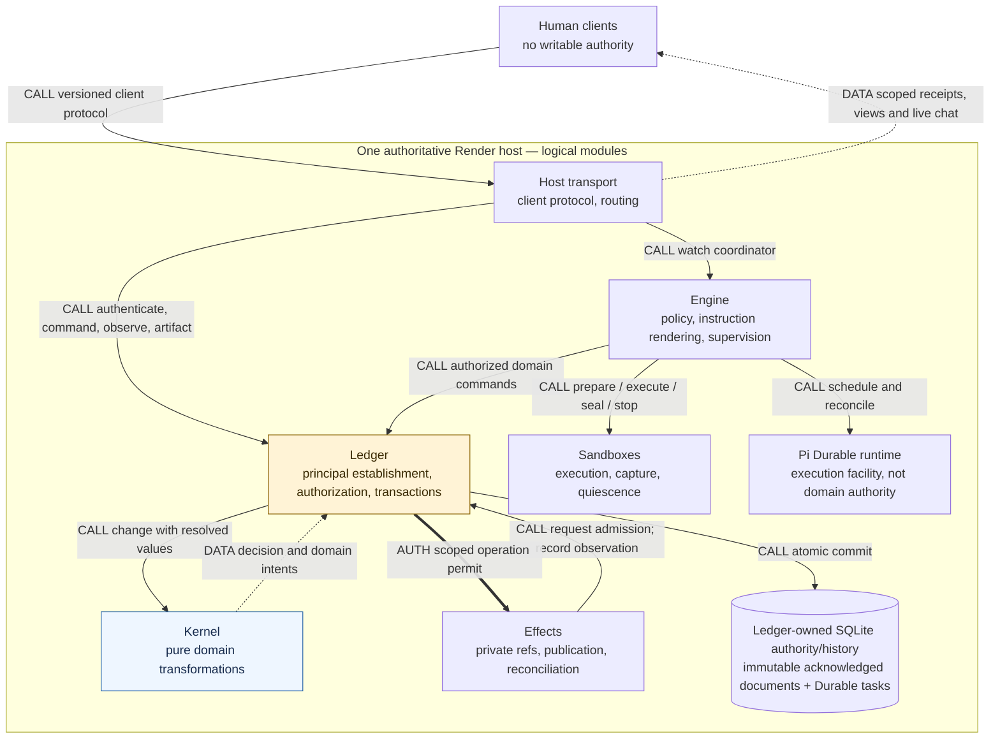
<!-- /render-figure -->

## 5. Host, client, authentication and records

### 5.1 Personal deployment and authentication

One process takes an OS-lifetime exclusive store-owner lock before `Harness.open`, through shutdown. A second process refuses before runtime initialization. SQLite locking alone is not a host-owner protocol; the historical runtime probe admitted a second open. Retain the real two-process check.

**Settled deployment:** personal macOS home server, private-tailnet access only, one human with separately identifiable devices. **Engineering recommendation (retained R4):** private Tailscale Serve HTTPS proxies a loopback-only Render listener; no Funnel or public listener. Use versioned UTF-8 JSON commands/reads and an authenticated NDJSON observation stream, with scoped snapshot/poll fallback. This uses an existing private HTTPS facility, not a browser framework or public identity system. Source establishes facility capability, not a deployed or verified Render endpoint.

**Recommended minimal authentication:** generate one random **256-bit non-expiring opaque bearer** per device through trusted local-admin enrollment; send it only in the Authorization header, never query strings, logs or model context. Store its verifier/hash with device/principal/scope and revocation metadata, not bearer bytes. The setup channel delivers the secret once; client secret storage belongs to the separate client design. No access/refresh-token rotation subsystem: it adds a second credential and renewal/recovery semantics without a demonstrated need here. Theft permits scoped access until revocation, a disclosed trade-off. Ordinary restart preserves enrollment.

Ledger establishes human, assignment-agent and scoped host contexts as specified in §4. **Local admin** means the trusted host OS owner authenticated through a restrictive local CLI/socket unavailable to coding workers and untrusted tool callers. Ledger establishes that human operator; agent-supplied `human` metadata, a local network route or proxy header is not authentication. The owner uses this route for enrollment. Clients/models cannot choose `principal`, `by: human`, capabilities or agent command IDs. Ledger rechecks current scope/revocation before receipt disclosure or mutation and on reads; device revocation rejects requests and closes its observation streams. Tailnet membership alone confers no Render authority.

Agent coding processes receive neither human credentials nor a general-purpose authority endpoint credential. Reachable Render control endpoints must refuse unauthenticated/unauthorized requests even on loopback; no comprehensive denial of unrelated host/private services is claimed. Public deployment, browser-specific Origin/CSRF/cookie policies and enterprise identity systems need separate future design if requested.

### 5.2 Client-facing capabilities, not client design

Ledger supplies, and the host transport serves, enough data for any stateless client to present **accepted commitment, active owner, latest evidence, blocker and next human action**. Required views include proposal/Slice status, exact Contracts, design revisions, pending decisions, annotations/dispositions, evidence, publication lag and historical outcomes. Delivery views expose current pass/Audit status and A_i/B_i/prepared X_i lineage separately from the unchanged completed-Watchdog count; a previous pass's completed Audit is historical, not current completion. Commands support coordinator messages, complete-byte document saves, rework, exact-basis decisions, cancellation and scoped configuration changes. A client never edits authoritative storage.

The protocol distinguishes acknowledged saves from client-local unsaved bytes; only the former are recoverable elsewhere. Saved artifact bytes and provenance are retrievable without reconstructing chat. Optional notifications are pointers to next actions, never authorization, and must not block workflow progress.

Agent-authored bytes remain untrusted data. Server artifact responses label media type, digest, length and provenance; attachment reads cannot execute commands or grant permissions. Client rendering guidance is a separate design concern: no server guarantee depends on a future browser CSP or GPUI implementation. No mutable document body or frontmatter can select a trusted principal or approve itself.

**Current runtime scope:** native Durable compaction, container bash grep/rg and native Pi Claude provider satisfy R2-A003's chosen capability direction; no extension-parity requirement. §6.6 retains the historical three-candidate web comparison and specifies the selected Webfox/Exa/Tavily path against pinned 1.4.0. Native provider/product behavior remains unverified; §12 separately records the later bounded Webfox fixture result, not live quality or complete product integration.

<!-- render-figure: 04 -->
**Figure 4 — Reattachment protocol data.** Not a wireframe or client layout. A fresh authenticated snapshot references retained records; commands are sent separately. This view must be available without the old conversation.

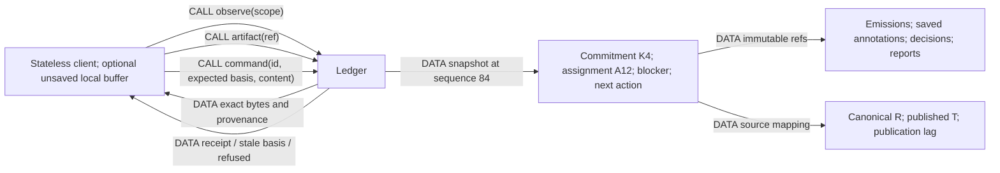
<!-- /render-figure -->

### 5.2.1 Proposed protocol surface

The host transport in `src/host`, not Ledger, owns this binding. It maps the shared envelope to routes and frames and calls Ledger's domain API, so a route or frame change edits no internal module. The live coordinator chat stream is one more authenticated NDJSON route, fed by Engine's read-only `watch` for a scope Ledger authorizes. Its frames carry the pinned runtime's agent events with hidden reasoning and opaque provider fields removed.

Use one versioned command envelope (§5.3), not a separate semantic interface per client. Recommended HTTPS JSON binding: command submission; command receipt lookup by original ID; scoped snapshot/NDJSON observation with polling fallback; immutable artifact reads/uploads; paginated history and scoped coordinator-message views. Exact route names are implementation details; the semantic envelope is shared by all clients. Uploads return immutable refs, not writable paths. A stateless client may keep an outbox of unresolved command IDs/envelopes; it is not a workflow authority.

An observation frame declares protocol version, scope, authority epoch and sequence and is either a complete snapshot or a change with its base sequence. Unknown frame versions refuse with an upgrade instruction. On a gap or reconnect, get a fresh snapshot. A snapshot includes exact available actions and required decision bases as conveniences; the server revalidates every command. It includes the resolved policy revision, task shape path, evidence/verification-skill revision, advisory human checks, document lineage, and canonical/published source mapping. Historical pages have stable IDs/cursors, access scope and explicit completeness; no raw database access is needed for clients or later eval export.

Transport cancellation is not domain cancellation. An accepted receipt is returned only after the accepted state/receipt commit; uncertain requests are queried/retried with their original ID. Semantic refusals include a machine-readable code, affected refs, reason and permitted repair, never client-side state repair instructions.

### 5.2.2 Copyable local-verification handoff (R2-A011)

Expose a **copyable generated prompt** through the same scoped client-facing protocol/artifact views, so the separately designed GPUI/TUI client can copy it. The closed human command `requestLocalVerificationPrompt` names the exact source and retained basis; Ledger checks current source/read scope and basis before accepting it. Engine's existing pure rendering logic produces grounded text from Ledger-supplied immutable Contracts, verification assets, setup/task documentation and evidence; Ledger retains and serves the immutable text, basis and receipt through existing artifact/protocol semantics. No model worker, distributed executor or sixth module is added. “Read-only” here means no source mutation or verification execution: retaining the artifact is an acknowledged write. Regeneration creates a new artifact; the old prompt and its source observation remain historical, never overwritten.

Required content:

- Repository identity and **exact commit/tree or release/artifact** under test, with publication mapping and an honest “not yet published/unavailable” state. Branch names alone are not exact source. If a release is offered, include known version/platform/architecture/digest and source mapping; missing provenance is explicitly unknown, not inferred.
- Proposal and exact Contract refs, acceptance expectations, relevant decisions and remaining findings.
- Setup/build/run tasks actually present in the cited source (mise, just, make or project alternatives), file/ref citations and prerequisites. Label uncertain/missing commands, toolchain, dependencies, fixtures, credentials or permissions; **do not invent a working setup**.
- Existing Linux check evidence with actual OS/CPU, source/verifier identity, outcomes and limits; concrete macOS/native-dependency/framework/packaging/UI/accessibility gaps and useful checks.
- A concise local-agent brief: verify checkout/artifact identity first; work in a human-chosen local clone/installation, not the user's live data; use available project tasks and supported computer-use tools if the human/local agent has them; stop/report missing prerequisites rather than fabricate success; no automatic main merge.
- Reporting guidance: source/artifact identity, macOS/CPU/toolchain, tasks/actions run, expected versus observed behavior, failures, unrun checks and optional screenshots/logs with secrets removed. Human can paste useful findings into an existing coordinator message/document; there is **no automatic import/attestation protocol**.

Illustrative protocol data, not an implemented endpoint or claimed verification:

```json
{
  "kind": "local-verification-prompt",
  "version": 1,
  "basis": {"proposal": "proposal:7", "source": "git:exact-oid", "contracts": ["contract:4"]},
  "verificationAsset": "artifact:verify-revision",
  "linuxEvidence": ["receipt:check-19"],
  "textArtifact": "artifact:copyable-prompt-3",
  "gaps": ["macOS framework behavior", "desktop interaction"],
  "missing": ["documented macOS signing prerequisite"],
  "advisory": true
}
```

The text should read naturally, for example: “Check the exact source identified below on your Mac. Linux evidence covers only the listed checks; it does not establish macOS or UI behavior. Confirm identity, use the cited setup/run tasks, exercise the listed acceptance expectations, and report results and what you could not check.” Expand it with actual retained facts, not template placeholders passed off as facts.

The human may clone/build/install manually or download an appropriate macOS release, then use a local agent such as Codex. Linux binaries/Elixir releases/native dependencies are not portable to macOS merely because CPU architecture matches. A release with unknown source mapping is an alternate artifact to investigate, not an exact-source pass. Prompt availability neither performs verification nor removes a missing automated Linux check. Human/macOS observations remain **advisory**: no completion record gates proposal ready promotion or human main merge. No automatic local-agent launch, laptop enrollment, remote-control channel, server computer use or mandatory release pipeline.

### 5.3 Command, receipt and snapshot contract

**Normative identity vocabulary:** `authorityEpoch` is the credential/command namespace, preserved by ordinary restart. `executorEpoch` changes on **every process start** and fences dispatch permits. Assignment **generation** fences work ownership; **Attempt** identifies an execution within that ownership. Provider-session IDs support conversation continuity, never authority. Historical probe terminology does not add more epoch types.

Illustrative **proposed wire shapes**, not an implemented Render endpoint:

```json
{
  "version": 1,
  "authorityEpoch": "authority-7",
  "commandId": "device-A:01...",
  "workflow": "design-17",
  "expected": {"checkpointRequest": "checkpoint:4", "checkpointSettings": 2, "annotations": 3, "policy": 2, "policyBinding": 1},
  "command": {
    "type": "approveCheckpoint",
    "checkpoint": "seams",
    "artifact": "sha256:...",
    "intake": null,
    "decisionBasis": "sha256:..."
  }
}
```

The host calculates a canonical payload fingerprint covering type, scope, expected basis and command content. Authenticated context is not in this JSON. Human command IDs are namespaced by authorized principal; a second authorized device of the same human may retry the original command and retrieve that human's prior scoped receipt. The accepting device remains immutable provenance, not part of retry identity; receipt-access scope is checked before lookup/disclosure. **Cross-device command recovery remains unverified:** E-CLIENT fingerprints the device too and rejects this retry; fresh-snapshot attachment from another device was demonstrated separately.

**Agent command identity and replay:** the trusted Durable adapter derives a stable namespaced ID from the durable workflow/conversation, assignment/generation/attempt, **`api.taskId` and `api.callId`**. Provider call IDs are not globally unique; model content never selects the ID. Stored arguments and the durable binding reconstruct the same envelope on replay. Any non-pure envelope inputs (such as minted IDs, time or a selected basis) are captured durably under that identity before the first Ledger command, not regenerated during retry; current authorization is still rechecked, never frozen by this capture.

Ledger-only mutation tools declare **`replay: "safe"`** because their entire execution commits deduplicated intents and returns receipts; they never launch shell/network effects inline. Accepted work/effects run separately under their own authority. A safe child under an unsafe ancestor is not restart-safe: the initial server-side policy rejects mutations through unverified or unsafe wrappers, including programmatic nesting. Only explicitly verified replay-safe wrappers with stable nested keys and effective identity may be added later. The commit-before-tool-result crash and nested-replay cases remain required, **unrun** gates (§13). Stable IDs deduplicate replay, not semantic intent: a new model call has a new ID and must independently satisfy domain eligibility, including role-request/emission rules.

```json
{
  "commandId": "device-A:01...",
  "status": "accepted",
  "sequence": 83,
  "result": {"checkpoint": 5, "phase": "modules", "state": "drafting"},
  "facts": ["fact:83"],
  "work": ["assignment:12"],
  "receipt": "receipt:01..."
}
```

A duplicate returns the original result/sequence with a duplicate indicator, not a new transition. A changed payload returns `command_conflict`. A stale request returns `stale_basis`, current relevant references, a readable difference and permitted next actions. It is never automatically rebased. Unauthorized requests disclose no receipt/content. A timeout or canceled request means **outcome unknown**: an admitted commit can complete despite cancellation; the client queries/retries its original ID.

Authorization to read a historical receipt is distinct from permission to execute a new command. An authenticated human may retrieve their accepted receipt after state advances. A revoked worker cannot use deduplication to recover sensitive content; trusted Engine performs recovery. For a genuinely new command, current assignment/role/basis checks still apply.

**Independent snapshot example, not a continuation of the receipt above:** the pending Seams request captured human settings s2; current persistent defaults s3 delegate future Seams/Modules requests.

```json
{
  "version": 1,
  "sequence": 84,
  "workflow": "design-17",
  "phase": "seams",
  "authorityEpoch": "authority-7",
  "hostMode": "active",
  "history": {"head": "history:84", "completeThroughSequence": 84},
  "policy": {
    "revision": 2,
    "bindingRevision": 1,
    "completedReviewLimit": 2
  },
  "checkpointSettings": {"currentRevision": 3, "modes": {"seams": "delegated", "modules": "delegated", "proposal": "human"}},
  "checkpointRequest": {"id": "checkpoint:4", "stage": "seams", "capturedSettingsRevision": 2, "mode": "human", "state": "pending"},
  "proposalProgress": {"integration": "automatic", "readyPromotion": "not-eligible", "forgeState": "not-created"},
  "localVerification": {"promptAvailable": false, "source": null, "missing": ["accepted proposal/Contract and verification basis"], "advisory": true},
  "commitment": {"acceptedIntake": null, "approvedSeams": null},
  "assignments": [{"id": "assignment:12", "generation": 1, "state": "running"}],
  "pendingDecisions": [{"request": "checkpoint:4", "stage": "seams", "mode": "human", "capturedSettingsRevision": 2}],
  "annotations": {"revision": 3, "open": []},
  "effects": [],
  "blockages": [],
  "nextHumanAction": {"type": "reviewCheckpoint", "request": "checkpoint:4", "basis": "sha256:..."}
}
```

Observation begins with an authoritative snapshot and Render sequence. Within an authority epoch, clients discard repeated/older sequence values and obtain a fresh authenticated snapshot on a gap or reconnection; coalesced snapshots replace state at their declared sequence. Postcommit broadcast alone is not an ordered-server contract. Scope and session revocation remain enforced throughout observation. Immutable facts/artifacts are separately retrievable and paginated. Durable `watch` coalesces after 100 undelivered frames and reconnects from current state, so it is diagnostic transport, not Render's historical event log. Slow clients cannot block authoritative commits indefinitely; disconnect cancels only observation.

Use relevant resource revisions rather than one global workflow version. Saving unrelated evidence should not stale an approval. Its basis must include the checkpoint artifact/manifest, annotation-set revision, explicit decisions, intake digest where applicable, the checkpoint request's captured settings/scope, and applicable unrelated policy/workflow-binding revision. Changing persistent checkpoint settings alone does not stale an existing request; changing its emission/annotations does. Adopting away and later back to the same policy does not revive an old pending decision. Changes to any of these require current-basis review.

### 5.3.1 Historical reads and export

Recommended wire contracts, storage-independent:

```json
{
  "artifact": "artifact:revision-23",
  "digest": "sha256:...",
  "mediaType": "text/markdown",
  "byteLength": 4321,
  "kind": "contract",
  "schema": 1,
  "parents": ["artifact:revision-19"],
  "supersedes": ["artifact:revision-19"],
  "source": {"commit": "git:..."},
  "createdBy": {"assignment": "assignment:12", "attempt": "attempt:2"},
  "recordedAtSequence": 83,
  "decisionRefs": ["decision:7"],
  "outcomeRefs": ["review:9"]
}
```

Content identity differs from revision identity: identical bytes can have different roles/lineage; a changed status does not rewrite content. Scoped reads by immutable ref return exact bytes/metadata or a named `missing_content | unsupported_schema | unauthorized` outcome. Current views do not hide rejected/abandoned predecessors.

**New bounded witness:** P-HISTORY-1 retrieves exact historical bytes/provenance and reconstructs accepted/superseded work plus rejected/negative evidence in a fresh process on all three candidates. Its independent Node-builtins reader checks versioned JSONL/content/links against literal expectations without importing the prototype or fixture. This supports the history/export contract, not authenticated reads, full semantic validation or a production wire endpoint.

A history request selects workflow/proposal/assignment and optional kind/outcome filters. A page returns stable record refs, an opaque next cursor, its fixed history cutoff and explicit completeness. Export chooses a fixed cutoff and returns a versioned manifest plus included document/artifact bytes and normalized facts/relationships/outcomes with digests. It declares omitted/redacted kinds, missing data and scope. Preserve classified unknown outcomes: abandonment is not an inferred failure/success, model claims are not runner receipts, and chronological adjacency is not causality. Retain exact role input packets for later reuse; exclude unsent buffers, uncommitted provider streams and unsnapshotted worker files explicitly. It is inspection/history, not a recovery backup. Workers and future eval tools need no SQLite/Git internals.

Snapshots expose ordinary host mode and current authority/executor epochs. There is no disaster-recovery status or protection bookkeeping. Ordinary restart preserves enrollment/authority and fences obsolete execution; history reads retain current authorization. No package restoration or arbitrary data-directory rollback is supported.

### 5.4 Authority, atomic work and retained history — SQLite documents selected

**A019 ownership answer:** Ledger owns accepted Contracts, designs/proposals, saved human edits, annotations, decisions, reports, receipts and history access. Kernel computes lawful changes; Engine consumes immutable inputs; Effects owns source Git/ref/forge operations. The workflow's Record phase writes approved repository knowledge; it is neither the storage module nor a second ledger writer.

**D006 selects A after the A020 comparison:** immutable acknowledged text/document revisions in SQLite, alongside transactional history/authority, receipts and task handoff; canonical source Git remains separate. **B: SQLite plus file CAS** and **C: SQLite plus Git documents** are evaluated feasible alternatives, not selected implementations. `LAB_REV/evaluation-history.md` supports all three through actual pinned Durable transactions, historical reuse/export and clean-directory package restoration; §12 gives measured results and limits.

| Candidate | Leverage and additional burden | Design status |
|---|---|---|
| A — immutable text in SQLite | Document bytes/revision/facts/receipt/task share the existing transaction; no second ordinary-document publication protocol. Full-text growth is real; no compression subsystem was tested. Portable JSONL/text export supplies inspection outside SQL, not native Git history. | **Selected by D006** |
| B — SQL + file CAS | Content precedes SQL reference; adds orphan/publish/package rules. Removes bytes from SQL but adds no Git delta/history/inspection facility. Corpus had no exact duplicates, so it establishes no deduplication benefit. | Evaluated alternative, not selected |
| C — SQL + Git documents | Native inspection/transport and delta-packed history; smallest measured package. Adds rooted objects, SQL-derived parent/head rules, serialized refs, orphans and snapshot-rooted bundling; SQL still owns authority. | Evaluated alternative, not selected; retain its genuine Git-history trade-off |

Canonical **source** Git is required by every candidate. An optional later archival Git projection is neither another authority nor a required service. Ordinary text does not need an external store solely because it is text-heavy; actual large/binary execution artifacts require a concrete size/streaming need before adding a separate mechanism. Neither the selected representation nor its export format migrates the existing skl ledger.

The retained **semantic contract**, independent of backend, is:

- Acknowledged state, fact, command receipt, assignment handoff and next-task identity are atomic. Required document refs refer to already-retained immutable bytes, never a mutable path. Failure publishes no accepted receipt.
- History includes submitted originals, revisions, rejected/abandoned drafts, accepted/superseded Contracts, annotation submissions/dispositions, decision provenance, experiment protocols/negative results, reports, execution/effect observations and lineage. This Ledger document/evidence history is separate from raw Durable transcripts and transient task/live state (§6.5). Unsaved client buffers are outside this promise.
- Each revision has stable identity, content digest/media type, kind/schema, creator/assignment provenance, parent/supersedes relationships, relevant source/policy refs and outcome links. Old versions remain retrievable to authorized workers/design sessions independently of current state.
- Scoped chronological/relationship views and a portable historical export expose these same identities, complete bytes and outcomes for future eval use. Building an eval harness is out of scope. D006 retains all acknowledged document history initially, with no automatic pruning; append-only outcome/decision facts and separate current/accepted pointers preserve it. Secret redaction, authorized export and eventual deliberate deletion require explicit semantics, not silent storage GC. Unsaved buffers, uncommitted provider tokens and unsnapshotted worker files are excluded; no promise covers all raw provider bytes forever.
- Missing/corrupt referenced content blocks affected work with an exact restoration request; it cannot be replaced with a plausible newer version. Cleanup never removes active assignment inputs.

**Demonstrated composition, not product authority:** all three P-HISTORY-1 candidates use actual pinned Durable 1.4.0 transactions to atomically commit revision/fact/pointer, immutable lookup, command receipt and a dormant conversation-owned task. A stores document bytes there; B/C publish immutable content first and may leave reported harmless precommit orphans. Postcommit retries return exact acknowledged work without duplicating the task. The fixtures demonstrate process-crash and clean-directory history/package feasibility, not authentication, current revocation, Kernel legality, tool-replay identity or a full recovery protocol.

In the selected SQLite composition, Ledger resolves immutable facts/document bytes to values, rechecks authority/basis, invokes pure Kernel, and stages next state, facts, receipt, assignment closure/creation, predefined next task and effect intent. No asynchronous lookup, storage handle, model, shell or network call crosses Kernel's interface. Execution begins only after commit. The host composition root supplies private transaction-local task staging from Engine's fixed intent-to-definition mapping; Ledger does not import an arbitrary scheduler or expose transaction callbacks. Kernel knows domain intents, not Durable graph names.

Keep receipt identities/fingerprints and accepted facts individually addressable, not an ever-growing aggregate. Any future compaction must preserve deduplication tombstones or explicitly retire `authorityEpoch` command namespaces. The evaluated alternatives establish content-before-reference and snapshot-rooted packaging feasibility; no orphan collector or production semantic validator was tested. D006 fixes ordinary acknowledged document content in SQLite; exact production schema and any justified large/binary artifact mechanism remain implementation details. Implement the selected protocol directly behind Ledger's existing interface, not a configurable three-backend framework. Scoped authorization, complete semantic validation, owner lock and recovery/`authorityEpoch` rotation/reconciliation remain production gates.

<!-- render-figure: 05 -->
**Figure 5 — Atomic handoff and a lost reply.** Proposed command sequence. CALL invokes behavior, AUTH denotes checked authority, and DATA carries values/results. The shaded region is one Ledger transaction; the later tool-result commit is not part of it. Runtime atomic handoff and all three document compositions have bounded witnesses; D006 selects SQLite document bytes in this transaction. Stable agent-tool replay, authenticated authority and same-human cross-device command recovery remain unrun product gates. Replays return receipts only if current receipt-access authorization permits.

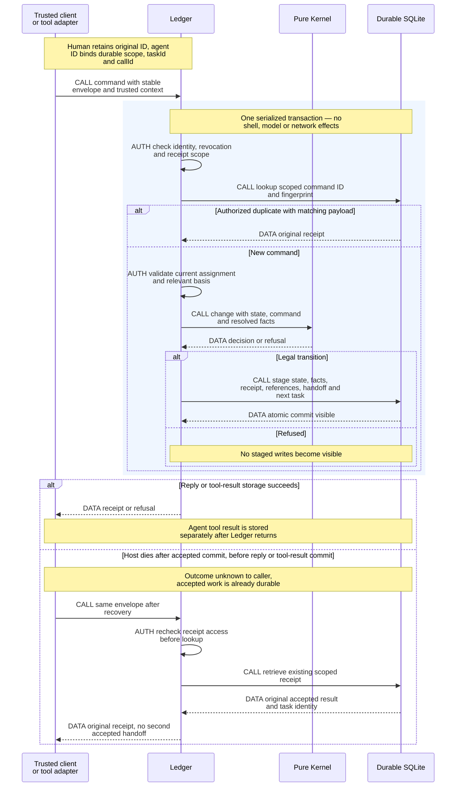
<!-- /render-figure -->

## 6. Engine execution, roles and lifecycle

### 6.1 Domain ownership is not task parentage

Accepted work is rooted in a **separate workflow-owned conversation/task**, not the human chat or submitting tool. The lab demonstrated a tool-owned child being canceled by turn abort; that topology is inappropriate. Tools never use `api.createTask` for accepted work: Ledger's same commit creates the actual workflow-owned task (§5.4), not an abandon-on-restart tool child. Ledger maps Assignment → generation → Attempt → task identity. Closing a client, ending a coordinator turn, or compacting a conversation does not release the Assignment.

Assignment execution facts include planned, starting, running, submitted, blocked and recovering; cancellation progresses through cancel-requested, quiescing and canceled. Slice lifecycle states remain separate. Candidates/challengers belong to checkpoint revisions; experiment workers belong to protocol/candidate identities, not necessarily Slices.

Engine is a bounded ordinary-code scheduler. It selects legal work, renders a packet, starts/reconciles a task, and suspends on durable waits. Proposed policy permits one active delivery assignment per Slice, one writer per workspace and **four executing attempts** across roles. A human-blocked assignment retains ownership, basis and evidence; its execution slot releases only after processes are stopped/quiescent (or none are demonstrably running), never merely on a `blocked` label. Retained workspace count/bytes have separate limits; a released execution slot does not imply free storage. Resumption fences the prior attempt and authorizes a current attempt on the accepted basis after quiescence. Other eligible Slices/candidates may proceed. This is scheduling policy, not weaker ownership/cancellation; no generic DAG engine is needed.

Packets pin input artifact/Contract/source references, assignment/generation and implementation pass where applicable, instruction and policy versions, model/provider/thinking choice, capabilities, budget, expected output and submission method. Every packet includes the project's principle statements; judgment roles receive the relevant full principles, including any cited by Forbidden decisions. Accepted obligations, relevant annotations and required evidence cannot be silently dropped to meet a token budget; inability to fit them is visible blockage or explicit staged reading.

`modelTools` controls presentation, not all programmatic capability. Child configurations are constructed explicitly because pinned Durable inherits parent agent choices. No broad parent tools/credentials/extensions are copied and then merely hidden. Each tool handler validates effective identity, role, generation and current authority. Nested structured outputs are copied into retained artifacts before being used as evidence; they are not permanent evidence by themselves.

### 6.2 Role contracts

Common provenance for every role: exact input refs, instruction/policy/profile versions, model configuration, assignment/generation/attempt, output refs and captured execution receipts. Distinguish model assertions, runner-captured results, host observations and optional human observations. Attribution does not establish truth; independent expected outcomes and judgment remain necessary.

Operational telemetry correlates redacted workflow/assignment/Attempt/revision/task/operation/evidence IDs. Never log bearer/provider secrets or dump model context by default. These diagnostic logs are not authoritative receipts, decisions or retained model/runner evidence.

| Role | Authority, inputs and rendered instructions | Outputs / capabilities / lifecycle |
|---|---|---|
| **Coordinator** | Reads goal, domain/ADRs/principles, source observations, checkpoints, annotations and evidence. Synthesizes alternatives, classifies observable/judgment/product uncertainty, answers every annotation and exposes incidental decisions. May request technical advancement under the checkpoint's captured settings; cannot act as its own challenger/candidate/experiment role, change settings or accept Contracts. | Drafts, contested list, role requests, product questions and intake through Ledger. Read-only source, no coding shell/forge credentials. Recommended workflow conversation continuity with exact phase-packet refresh and fresh replacement when needed. |
| **Challenger** | Reads a pinned draft and relevant full principles. Fixed questions: why this, alternatives/trade-offs, scale, usage, interactions, incidental choices, and what the implementer might copy from a nearby example. | Stable objections linked to nodes/evidence. Read-only source/draft, append-only own report. New non-fork context for each independent challenge round; interruption of that same review may resume its own context. Different deliberately configured model family from coordinator by default. No editing/approval authority. |
| **Candidate** | Independently answers a bounded judgment question under different constraints. Receives common question/constraints, not automatically the favored answer. | Competing interfaces/answer, assumptions, consequences and incidental decisions; own draft only. Separate assignment/context; no winner or acceptance authority. Required candidates finish before synthesis/challenge. |
| **Experiment-candidate** | Receives prewritten protocol digest, controls, fixtures, budget and assigned candidate. May implement only that experiment; cannot revise criteria after seeing results. | Isolated source snapshot, measurements, failures and limits. Own container shell/files/local Git; no other candidate or host credentials; ordinary internet capability under the recorded profile. One writer; seal before comparison. Material deviation creates a new protocol/round. |
| **Experiment-parent** | Reads protocol and sealed read-only candidates; independently applies the decision rule. Cannot silently repair candidates to make the preferred one win. | Comparison report, rerun receipts, numbers and limits, including inconclusive/negative results. Read-only candidate mounts plus separate writable scratch. Corrections request another round; report/evidence retained before cleanup. |
| **Implementer** | Exact accepted Contract/design/principles, verifier requirements, findings/directions, source/base and current pass. Owns code, in-scope choices, **one Audit invocation per pass**, finding dispositions/fixes and relevant rechecks before final sealing. Consequential out-of-scope choices go to the human. | Own writable Linux workspace, bounded disjoint helpers. Retains pass i, pre-fix A_i/reports, fixes/dispositions, checks and final B_i; atomic handoff schedules preparation. Same-pass repairs/restarts keep Audit identity; authorized post-handoff implementation starts a fresh pass/Audit. Assignment/conversation may span passes. Effects alone publishes/integrates. |
| **Audit (within implementation)** | One logical invocation **per implementation pass**, with **fresh non-fork Standards and Contracts contexts**, on retained actual A_i before final B_i. Separate processes/subagents use ordinary scoped review-role Assignments, not new exclusive Slice/source Claims, a post-handoff gate or transferred implementation responsibility. | Independent findings with pass/source/Contract/verifier/input provenance. Implementer fixes/disposes and rechecks within that pass; no inner re-Audit. Interruption resumes the same invocation; a new implementation pass requires fresh contexts/reports. Deterministic retries alone do not. Audit is not a Watchdog pass or review-count increment. |
| **Watchdog** | Fresh non-fork identity/context for each review round; same-review interruption can resume. Exact prepared X_i/T, accepted obligations, advisory checks, pass-i B_i handoff, its actual pre-fix Audit A_i and dispositions, current check evidence and prior-pass findings/directions. Reviews integration and fix effects; no new obligation or scope waiver. | Pass/rework/Needs Human with X-bound evidence. Read-only reviewed source plus scratch for checks; no source edits including Debt Markers. Each completed review counts once, including passing drift rounds. Missing prior source means full review, not reset count. |
| **Human** | Final Proposal/Contract acceptance, out-of-scope product decisions, checkpoint-setting changes and human-routed requests, amendments/supersession, cancellation/recovery and final main merge. Not the scheduler for eligible proposal integration or ready promotion. | Authenticated exact-basis decisions, saved annotations and optional local macOS/UI verification using a copied prompt. No mandatory advisory attestation; may detach at any time. Settings/understanding never become blanket acceptance. |

Different-model-family metadata is explicitly configured, not guessed from name substrings. An unavailable required family blocks or requires a recorded human policy change, never a silent fallback. Diversity reduces shared bias; distinct contexts, identities and capabilities remain required even if the human permits the same model family.

### 6.2.1 One Audit per implementation pass and truthful source provenance

**Human direction (R3-A001):** fresh-context assistance before each implementation handoff, without Audit-driven inner repetition. Each pass i follows **implementation/checks → Audit i on A_i → implementer fixes/disposes/rechecks → final B_i/submission → preparation/verification X_i → Watchdog**. Standards and Contracts are two fresh contexts inside one logical invocation, not two Watchdog rounds. Audit may use separate processes/subagents; implementation retains responsibility. Below, A/B/X abbreviate that pass's A_i/B_i/X_i.

**Proposed economical mechanism:** keep a host-assigned monotonic `passOrdinal` in the existing Slice/Record implementation state, giving `passRef = (workRef, passOrdinal)`, with immutable opening cause/input basis, predecessor and Audit/handoff references. First authorized implementation opens pass 1. Atomic acceptance of sealed B and its preparation task records that pass's handoff; a failed seal/submission or lost reply does not open another pass. The same Assignment/conversation may span passes; Attempt/container/generation replacement alone is not a pass transition. No new Claim, module, scheduler or human ceremony.

After an accepted handoff, an authorized return to implementation opens the next pass: **Watchdog rework**, preparation-conflict resolution/reapplication, or repair of source/verifier definitions following failed prepared-source checks. This remains a new pass even if the eventual bytes equal earlier bytes. Before handoff, initial check repairs and Audit findings/follow-up rechecks stay in the open pass, including fixes after its Audit; no inner re-Audit. Pure deterministic target-drift/preparation retries, operational recovery or rerunning checks without implementation retain the handed-off pass and B; they require current X/check/Watchdog evidence, not a fresh Audit. A failure alone is not a new pass: if repair needs implementation, take the explicit return transition first. A pass admits at most one accepted handoff; duplicate delivery returns that same receipt, while accepting any replacement sealed source, regardless of cause or byte equality, requires a successor pass opened by an explicit authorized return transition.

Kernel validates these transitions; Ledger atomically records pass identity/cause and binds Audit requests, report-role Assignments, findings/dispositions and handoff to it. Only one logical Audit can be requested for that pass. Handoff requires both completed reports and dispositions/rechecks for the **current pass**; neither old-pass reports nor model-selected IDs/different command IDs can satisfy or reset it. Duplicate wakeups/submissions are deduplicated; stale-pass reports cannot complete the new pass. Opening a successor obeys existing current-authority and Watchdog rework-limit rules; it never resets completed-review counts or bypasses a Needs Human stop.

Standards/Contracts contexts use ordinary scoped review-role **Assignments**, staged by Ledger from the implementer's checked role request under the implementation lifecycle. Each has its own assignment-agent principal, read-only A inputs and own report-output scope. The implementer's exclusive Slice/source ownership remains; “no new Claim” means no competing exclusive Slice/source Claim or new workflow gate, not absence of report identity. Use the existing long-lived role-task mechanism where recovery is required, not tool-turn-owned ephemeral children; an interrupted reviewer resumes the same logical Audit invocation.

Before reviewers start, retain an exact immutable source snapshot **A**, its accepted obligations, verifier inputs and role packets. Use the same literal capture discipline and host-owned recorded collection profile as source sealing (§7.2); a quiescent temporary snapshot is not final delivery submission. Sandboxes uses existing `seal` to stop/freeze/capture an execution handle, then `prepare` to provision a fresh writable handle from retained source for the **same implementing conversation and ownership**. This costs a stop/re-provision: running services, build/dependency caches and container-local Git metadata can be lost, and existing setup tasks may need to rerun. Retained source/artifacts and conversation continue, not the live environment. Closing a handle does not close the implementation Assignment or create another exclusive Claim. No pause/resume capture protocol or new workflow handoff is introduced. Audit reviewers receive read-only A; later edits cannot mutate what they saw.

Implementer retains both reports and maps every finding to fixed/considered/dismissed/needs-human with a reason and exact relevant references. Fixed findings identify changes and rechecks on the resulting source; cannot lower accepted expectations to make a check pass. Unresolved product/Contract questions stop normally. The final handoff includes passRef, A, that pass's Audit identity/reports, dispositions, final B and current completion/check table; preparation records link B to each actual X/T. The record says **Audit examined A**, never B/X when they differ. Watchdog sees these differences and independently judges actual prepared X, fixes and integration effects.

Interruption/replacement resumes the **same pass and incomplete invocation**, retaining completed reviewer reports; a completed same-pass Audit is not rerun. New-pass Audit uses fresh Standards/Contracts contexts and A_i, while retaining all predecessor reports with their real provenance. Old Audit completion never substitutes for the new pass's invocation. No post-preparation exact-X Audit or same-pass Audit/fix/re-Audit loop is introduced. Watchdog completed-review accounting is unchanged.

### 6.3 Cancellation

Cancellation commits a generation fence and prohibits new effect admissions/tool starts. Engine then cancels provider activity and calls Sandboxes.stop for the **whole assignment execution environment** (the entire container in the candidate profile), not merely an exec process. Cooperative stop has a short grace period followed by forced termination. Ledger `canceled/quiescent` only after runtime confirmation and outstanding-effect reconciliation; retain the intervening state visibly.

No new writer reuses the workspace until quiescence is established. A surviving/uninspectable process quarantines it. An explicitly authorized replacement uses a new generation/workspace and does not inherit permission to repeat uncertain effects. Heartbeat expiry is diagnostic only. Runtime `orphaned` after aborting a blocked/missing definition means unresolved cleanup/effect risk, not clean cancellation. Late worker output can be retained as quarantined evidence; only trusted reconciliation records observations of already admitted effects.

<!-- render-figure: 06 -->
**Figure 6 — Authority is fenced before execution is known to have stopped.** Proposed lifecycle sequence, separating durable ownership from physical execution. CALL requests behavior, AUTH changes legal authority, DATA reports observations. Cancellation is not instant process death; a blocked label is not quiescence. The two branches are alternatives, not consecutive phases. The four-executing-attempt default remains a policy proposal.

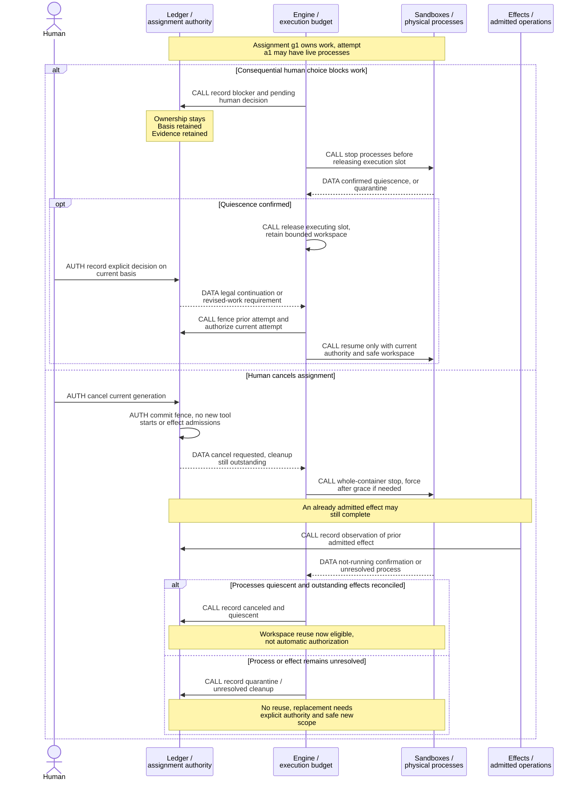
<!-- /render-figure -->

### 6.4 Persistent checkpoint settings and other configuration

**Selected maximum (D001/R2-A001):** only technical **Seams and Modules** approval can be delegated within the workflow's agreed scope; final Proposal/Contract intake acceptance is always human, including shortened paths. New unresolved product decisions, changes to human scope and main merge remain human. Delegating approval does not skip candidates, challenge, evidence, annotation responses or fidelity.

**`agreedScopeRef`** references the existing retained Ground material: the human-authored request/goal/constraints and explicit human clarifications/decisions establishing scope, together with the current task-shape record. Recorded assistant proposals are not thereby agreed. Preserve Ground's existing shape-confirmation rule: a human-supplied shape needs no redundant confirmation; a classifier-proposed shape does. This reference adds no mandatory Ground/scope-approval checkpoint, grant or new record type. Captured scope and existing human-decision refs remain part of the exact decision basis.

**Simple persistent trust dial.** Recommend one persistent configuration record per project, with no per-workflow override hierarchy and three named checkpoint fields: `seams: human | delegated`, `modules: human | delegated`, `proposal: human`. Start human/human/human. Ledger's **latest accepted settings revision is authoritative**. A server file may seed initially empty configuration; thereafter the supported file route is edit-and-explicit-import/reload through the trusted local-admin route, supplying `expectedRevision`. Client changes and imports use the same validation, attributable immutable history and expected-revision checks; stale/concurrent imports refuse visibly. File content is not a second live writer, and restart must not replay an unchanged file over a client edit. No automatic watcher/reconciliation framework. Accepted changes leave pending captures untouched. No project/workflow TechnicalGrant, issuance/revocation ledger, natural-language interpreter or separate enablement ceremony exists in v1.

When Ledger accepts a **checkpoint request**, it captures `{requestId, stage, checkpointSettingsRevision, mode, agreedScopeRef}`. **Kernel enforces at most one pending request per workflow/stage for every principal**, including assignment-agents, humans and host scheduling. While it is pending, emission, rework and retry continue that same request/capture; a different command ID or coordinator cannot obtain a second same-stage request with newer routing. Duplicate command replay returns the original capture. A new request at that stage requires prior resolution or explicit human cancellation/replacement through the ordinary checked route. After an accepted seam resolves, a legitimately revised checkpoint may therefore capture current settings, as may a later stage in the same workflow. Each emission/decision still binds exact bytes, manifest, annotations, scope/human-decision refs and independent evidence. No principal can silently cancel/recreate pending work to change its routing; no new registry, lock type or grant is needed.

**Example:** Seams request C1 captured human at settings s2. The human changes Seams and Modules to delegated at s3. Pending C1 remains human; after C1 resolves, newly requested Modules C2 captures s3 without whole-workflow adoption. Conversely changing delegated to human does not retroactively reroute a pending delegated request; cancel that request/work if immediate stop is intended. Every admission still checks current assignment/cancellation, identity and required evidence. Captured routing is not irrevocable execution permission.

A delegated decision records machine actor, request/captured settings, captured scope and existing human-decision refs, exact emission/manifest/annotation basis and review refs—not a human signature. The existing **challenger review and dispositions on that exact emission** assess classification and scope, exposing unresolved new product/out-of-scope choices before advancement. Already human-decided product constraints may be cited/carried forward: not every product-class node is forbidden. Kernel checks references, closed stage/mode, required reports/dispositions and unresolved flags through common validation; it does not prove the semantic truth of natural-language classification. An author's “technical” label alone is insufficient. Unanswered annotations, inadequate evidence, an unresolved new product decision or changed human scope block delegated advancement. The assignment-agent can request advancement; host scheduling cannot impersonate a human or reviewer. Human `acceptIntake`, amendments and consumed-Contract supersession retain their rules.

**Separate from the trust dial:** implementer-owned choices are freedoms inside accepted Contracts. Autonomous eligible proposal integration (§9.3) is ordinary workflow behavior; it does not require any checkpoint setting, integration grant or per-operation approval. Neither grants main-merge authority.

**D004 is unchanged for unrelated configuration.** Recommend immutable `PolicyRevision` plus one `WorkflowPolicyBinding` for review limit, reviewer-diversity policy, minimum evidence rank and other ordinary execution policy. New defaults apply to future workflows; child assignments inherit their workflow binding. A human `adoptPolicy` names a selected revision and selected active workflow with expected binding revision. Pending decisions affected by this policy change become stale; packets refresh before new starts, historical provenance and counts do not reset. Adoption does **not** replace captured checkpoint settings or become necessary for future checkpoints to use current settings. Immediate revocation of credentials/current assignment authority still applies independently; it is not a scoped technical-grant mechanism.

| Ordinary policy field | Constraint / default |
|---|---|
| `minimumEvidenceRank` | Member of project ladder or fallback; explicit project choice, no waiver of required checks |
| `reviewerDiversity` | Different configured model family recommended; same-family use needs recorded human policy direction, never shared review context |
| `completedReviewLimit` | Nonnegative integer recommended; **2 accepted default**; no invented upper bound |

At limit 0, the initial Watchdog review still occurs but no automatic rework follows a completed non-pass. Every actual completed Watchdog review counts once, including Needs Human and completed drift re-reviews after a pass. Interruptions, duplicate recording, preparation conflicts/errors and Audit do not count. Needs Human stops immediately. Raising/adopting a limit preserves all counts/findings; a valid pass is admissible even at/above the cap. Earlier passing drift rounds can make a later non-pass reach the human sooner; show that history rather than silently exempting it.

**Projects (usable-host amendment).** A host keeps any number of human-added `Project` records, each with a name, an immutable remote, a default branch, a digest-pinned check image and a principles path. A human with project-wide authority adds a project or edits it with an expected revision. `createWorkflow` names one project, which never changes. Effects keeps a private mirror per project and fetches into it before preparation. Engine passes project facts in each Effects operation, and Effects never reads Ledger. The forge target derives from the remote. A device scoped to some workflows sees only their projects, and export includes project revisions.

**Engine settings (usable-host amendment).** Families, model entries and role templates are immutable revisions that a human with project-wide authority changes with `changeEngineSettings` and an expected revision, like policy and checkpoint settings. Engine reads the current revision when it builds a packet, and the packet pins the copied values, so a later revision never changes existing work. API keys and the GitHub token are not settings. They live in a host-only `0600` file outside Ledger, set through an authenticated human route and never returned.

**Deferred, not rejected forever:** per-request natural-language delegation may be designed in a later iteration if useful. It is not unfinished v1 work or a release gate.

### 6.5 Durable assignment continuity, fresh independent roles

**Engineering recommendation R1, not a new human selection or model-quality result:** create a new explicitly configured durable conversation for each assignment. Resume that assignment's own conversation after interruption when its role, accepted basis, current policy/authority and workspace remain valid. Reconcile provider/tool/effect uncertainty, establish prior-attempt quiescence where needed and reacquire execution capacity before continuing. A compatible continuation may use a new Attempt under the same Assignment; it does not reset ownership, obligations or review counts. A fenced replacement gets a fresh conversation with predecessor links and a retained current packet, not an implicit fork or inherited workspace.

| Compared strategy | Leverage / burden | Recommended use |
|---|---|---|
| Fresh packet-only context after every interruption | Simple input provenance, but discards useful same-assignment reasoning and repeats reconstruction despite durable state | Replacement/reconstruction path, not mandatory implementer restart policy |
| Durable conversation per assignment | Preserves committed progress and context while authority stays in Ledger; requires current-basis and workspace checks | Ordinary same-assignment continuation |
| Perpetual Watchdog or coordinator model-dispatch lane | Can summarize a queue, but duplicates Engine scheduling and adds a model transcript to reconcile; accumulated reviewer context risks independence | Do not introduce initially |
| Workflow coordinator continuity plus independent assignment conversations | Sustained design synthesis without shared reviewer context; phase packet refresh prevents reliance on summary alone | Recommended combination |

Engine remains an ordinary-code scheduler, not a model dispatch lane. Coordinator role requests are inputs to checked scheduling, never dispatch authority. Recommend coordinator conversation continuity within one design workflow, refreshing immutable phase-specific packets at every checkpoint/phase and policy adoption; replace on incompatible basis or contamination. Idle retained conversations/durable waits consume storage, not one of the four executing slots. Active generation, compaction and verification consume capacity; a blocked execution releases capacity only after physical quiescence.

**Independent roles:** challengers, candidates and Watchdog start each new independent assignment/review round, and Audit starts each new implementation pass's invocation, in **new non-fork conversations** with explicit tools, model, scope and inputs. A fork copies transcript/configuration and is not independent merely because its instructions changed. Interruption of the same review can resume its own conversation; a genuinely new round is fresh. Candidate blindness includes scoped artifact reads, source mounts, web-result IDs/temporary files and conversation state, not just prompt text. This is enforced input/tool/filesystem scoping, not a comprehensive covert network-channel guarantee. Required model-family diversity stays explicit; absence blocks rather than silently changing family.

**Compaction and authority:** pinned Durable already offers durable select/summarize/place compaction and rejects stale cuts; an always-running model lane is unnecessary. Compaction changes active model context, not authority. Refresh mandatory packet constraints or require staged exact-artifact reads after compaction/reset/model changes. Accepted obligations, annotations, captured checkpoint routing and current-authority checks never depend on a summary remembering them. Record compaction policy and retained source/tail/entry references if needed for historical provenance. A failed blocking compaction can fail generation; expose that failure rather than claiming continuation.

#### Runtime history is not Ledger document history

Source inspection establishes immutable committed transcript entries survive context reset/compaction and can be paged with `Conversation.entries`; historical context is derived with `context({at})`. Native compaction retains a summary and tail, but its default summarizer omits system/thinking and truncates serialized tool-result text to **2,000 characters**. Raw stored entries are not thereby deleted. This is lossy model input, not a completeness or OpenAI-quality guarantee.

| Material | Retention and required treatment |
|---|---|
| Acknowledged Render documents, packets, decisions and decisive evidence | Immutable Ledger revisions/links under D006, independent of the active conversation or summary |
| Committed runtime transcript and terminal task receipts | Retain and expose supported scoped historical records with conversation/assignment/replacement provenance; transcript assertions are not verified evidence |
| Active task checkpoint/memos | Durable during execution, but disappear from terminal representation; retain important execution facts explicitly before settlement |
| Nested results / tool `structuredOutput` | Not a permanent transcript archive; promote required content into Ledger before the caller settles |
| Latest-only live partials, generation/tools/nestedTools state | Coalesced/current-state material cleared on settlement, not every-token history |
| Unsaved buffers, uncommitted provider tokens, unsnapshotted files | Explicitly outside acknowledged retention |

Export reads stored records at a declared consistent cutoff, not watch delivery. Supported transcript/task reads can contribute to the versioned export; no universal `session.log()` or complete runtime-event archive was established. Export labels absent transient material and sensitive/opaque provider fields truthfully. D006 does not require preserving all raw model bytes forever, nor expose hidden model reasoning. Runtime retention/independence cases are future V3/V7/V8 gates, not additional completed experiments.

### 6.6 Native runtime capabilities and focused web access

**Selected R2-A003 scope:** use pinned Durable's native text compaction and SQLite-backed history, bash `rg`/`grep` inside the assignment environment for repository search, and Pi AI's native Claude provider/authentication facilities. Native compaction is not a new SQLite compaction algorithm, nor claimed quality-equivalent to opaque OpenAI compaction. No better-compaction, FFF or Claude-bridge adapter, SDK/session reconstruction, binary/index gate or feature-parity obligation remains. Ordinary native provider/tool cancellation, scoped configuration, committed-result recovery and model-family availability still need verification. There is no general ordinary-Pi extension loader or replacement Pi runner. Under the usable-host amendment, the native Claude provider authenticates with the operator's existing pi OAuth login through a Render credential store that honors pi's lock on the same file. The native `openai` provider serves the ChatGPT family the same way. No bridge is used.

#### Historical bounded web comparison and selected integration

Runtime remains 1.4.0 at the exact pin in §12. These candidates are separately pinned; no current-upstream runtime substitution:

| Candidate / primary source pin | Supported consumption and actual scope | Burden, limits and status |
|---|---|---|
| **pi-web-access 0.45.0**, commit `35e57ef30f4b8ac771f4062a381493993af41ebe` | Documented standalone stdio MCP serves search, fetch, retrieval and source-check. Source exports host-neutral `createWebToolCore` / `createStandaloneWebToolCore`; package has no named public library export map for that core. MCP is the clearer supported external contract; deep import requires packaged-path compatibility checks. | Broad familiar extraction/provider capabilities; more optional paths/config to constrain. Standalone keeps 50 recent results in process memory; no cache-restart guarantee. Shared module result map needs assignment-scoped mediation or process isolation if used by independent candidates. It excludes Pi curator/summaries, Kimi login, Pi-auth OpenAI, page-answer/extract/video modes and direct images as documented. **No blanket OpenAI-key requirement:** keyless Exa MCP is available; only choosing the standalone OpenAI path needs an OpenAI key. Live keyless availability/quality is untested. |
| **Defuddle 0.19.6**, commit `97b20c7022f88b5da73059f08f6b79d2117cb8a9` **plus one search source** | Published `defuddle/node` accepts a DOM Document and URL, returns cleaned HTML/Markdown/metadata. It extracts known pages; **it does not discover URLs**. Pairing with a search provider (e.g. one configured Webfox search capability) remains additional work/dependency, not “Defuddle alone.” | Small extraction surface, but Render must own HTTP timeout/size/redirect/error handling, DOM construction and search mapping. Async extraction can call third-party fallbacks; recommend `useAsync:false` initially. No browser/JS-rendering or extraction-quality parity claim. Latest inspected release fixes Markdown sanitization issues; untrusted output still stays inert. No Durable coupling or built-in result history. |
| **Webfox 4.8.0**, commit `5699168b79ad355806bb03f85cdcffd252f1d0ad` | Published `webfox/durable` exports `createWebfoxExtension`; published `webfox` exports `createWebfox({config,cwd,env})`, returning complete typed result documents. P-WEBFOX-1 imports/registers/dispatches both paths on pinned 1.4.0 with added coding-agent 1.4.0, but **the unmodified direct adapter loses substantive committed result text**: it returns `content`, while Durable expects `output`. | Root-library consumption is selected by R3-A002. Direct calls leave progress-only/empty text despite actual requests; details/status survive. Its complete 78,263-byte result is a 0600 host-temp JSON file, not retained by the committed path. A small root-library tool maps `output` and captures full fixture content; its session-scope digest-keyed sink proves neither assignment-private access nor distinct observation identity/production evidence. Cwd caching/schema capture and ranged dependencies remain concerns; preserve exact locks. |

**Selected by R3-A002:** consume **Webfox 4.8.0's supported root library**, with **Exa primary and Tavily fallback**, behind Engine's few ordinary Durable registered tools for discovery, page contents and scoped result reading. This avoids copying/forking the direct adapter and lets existing Render artifact/filesystem handling own complete-result storage. The completed independent evaluation establishes the direct export's bounded 4.8.0/1.4.0 result-contract incompatibility, not merely uncertainty; import/registration success is insufficient. Root-library fixture consumption delivered complete content through a proper `output` channel and explicit sink. Its installation also contained coding-agent, so it does not prove a clean no-coding-agent dependency closure. No runtime upgrade, fork, generic wrapper framework or all-four-capabilities requirement follows. Answer/deep-research jobs remain optional later choices.

**Human selections versus mechanism:** the human will obtain/provision the Exa and Tavily API keys and permits configured fallback when Exa is unavailable or its allowance exhausted; no routine approval is needed. No paid plan, automatic top-up, numerical spending limit or live call is authorized here. The earlier single-provider-only recommendation is superseded. pi-web-access/keyless MCP, Defuddle plus discovery and other providers remain historical alternatives, not unresolved votes or implementation obligations. Supported library consumption is not a fork; dependency updates require explicit pin/lock review and rechecking this small contract, not silent version substitution. “Maintained upstream” is not a measured maintenance-cost or quality guarantee.

**Proposed small fallback mechanism:** Engine validates/bounds the request, captures explicit configuration and one overall deadline, then calls Exa. At most one primary attempt and one sequential Tavily attempt per input are allowed; no configured transport retries, both-provider fanout or further provider chain. For a bounded batch, only eligible failed inputs enter one fallback batch; preserve each original input identity. Per-attempt timeout must leave time within the overall deadline if fallback is to run. Concrete timeout, input/output bounds and cache settings are engineering values to document/verify, not human-selected numbers. This logic lives in the existing registered-tool implementation, not a provider framework; do not assume Webfox implements automatic chains.

| Primary outcome | Required tool behavior |
|---|---|
| Success, including empty search results or usable partial results for an input | Return it with actual Exa provenance/completeness. Empty is not unavailable; do not query Tavily to improve/rank/top up a successful input. |
| Classified provider unavailability or exhausted allowance | Network/service outage, provider rate/allowance refusal or unavailable primary credential permits Tavily for the affected failed inputs while current authority/deadline remain valid. Report the primary failure/provisioning need even if fallback succeeds; do not discover credentials or top up accounts. Unknown/unclassified failures are explicit errors, not guessed fallback eligibility. |
| Primary per-attempt timeout | Abort/stop local waiting and label primary outcome uncertain, possibly charged. Only after that local attempt settles, with caller still active, current authority and overall time remaining, may Tavily run. No overlapping local attempts; an unsettled attempt or expired overall deadline returns timeout, not fallback. Upstream termination/charge cancellation is not promised. |
| Invalid input or unsupported requested semantics | Reject before provider work where detectable; provider-reported invalid inputs remain named failures. Do not hide validation/semantic errors by changing provider. A per-page not-found/access-denied/extraction failure alone is not provider unavailability. |
| Mixed contents/input results | Retain all primary successes and per-input errors. Retry only failed inputs explicitly classified unavailable/allowance-exhausted (or qualifying timeout); no refetch of successes. Merge only the result envelope, never observation identities/provenance. If a partial input has usable material, keep it labeled partial without automatic top-up. |
| Caller abort, revoked authority, overall deadline or restart interruption | No new fallback admission. Forward cancellation; report canceled/interrupted/timeout or partial outcome honestly. Recovery does not restart either potentially charged attempt. |
| Fallback failure, missing fallback provisioning or exhausted fallback | Return the retained successes as partial, or explicit failure if none, with both attempted-provider failures and any not-attempted reason. No loop back to Exa, third provider, new approval ceremony or false complete result. |

Each attempted provider has a **distinct observation identity**, separate from content digest, linked to the tool request/assignment and input, provider/extractor/version, actual query/URL and normalized request, start/observation time, outcome/failure and completeness/truncation. The bounded committed envelope keeps actual provider attribution and primary/fallback failures; complete relevant details remain scoped. A Tavily success cannot overwrite an Exa failure or appear as an Exa observation. Local result reading never contacts a provider. No actual Exa/Tavily authentication, quality, fallback or Linux-hosted behavior was verified by the existing fixture.

Primary sources: [pi-web-access core/MCP release](https://github.com/nicobailon/pi-web-access/tree/35e57ef30f4b8ac771f4062a381493993af41ebe), [Defuddle Node extraction](https://github.com/kepano/defuddle/blob/97b20c7022f88b5da73059f08f6b79d2117cb8a9/src/node.ts), [Webfox direct Durable implementation](https://github.com/mavam/webfox/blob/5699168b79ad355806bb03f85cdcffd252f1d0ad/src/durable.ts) and [supported library/configuration](https://github.com/mavam/webfox/blob/5699168b79ad355806bb03f85cdcffd252f1d0ad/docs/reference.md). Registry identities and detailed scope/update comparison are retained in `LAB_R2/designer/web-evaluation.md`. The later parent-adopted P-WEBFOX-1 result is in `LAB_R2/evaluation-web.md`: **9 entries, 5 pass/4 fail, exit 1, 5.649008 s**. Four substantive-text assertions fail, not setup/import assertions. Two genuine controls detect lost overflow content and unsafe request replay; §12 preserves details and limits. No live provider, key, paid operation or quality benchmark was run; these fixture results do not close production integration/scope/retention gates.

#### Three different durability questions

**Selected by R3-A003:** selective three-layer evidence retention, not permanent full-result archiving. No numeric cache lifetime, quota, physical cache backend or privacy-deletion schedule was selected:

1. **Transient cache/large-result working data:** bounded assignment-scoped cache IDs and temporary full-result files are conveniences, not durable evidence. They may expire or disappear at restart. Return explicit unavailable/expired; refetch is a **new observation with new identity/time**, never replacement bytes under an old ref. Full-result paging belongs to the same assignment or an explicit read scope; opaque/random IDs alone are not authorization. No default permanent archive of every fetched page.
2. **Committed Durable tool output/transcript:** keep ordinary committed bounded outputs and provenance under native runtime history (§6.5). They survive process restart/compaction according to the runtime contract; an uncommitted request, progress stream, nested structured return or temp file is not thereby durable. Expiring a cache does **not** erase committed output. Disabling runtime result commits is not a simplification: it would change native replay/history semantics and create another custom mechanism.
3. **Explicit retained decision evidence:** before a checkpoint/report/decision relies on material, copy the exact relevant passages and enough context into Ledger with URL, observed/final URL when available, query/request, provider/extractor/version and attempt/observation identity, observation time, content digest, completeness/truncation and assignment provenance. Link it to the claim/decision; retain negative and conflicting evidence. Whole-page retention is warranted only when needed to inspect the claim or reproduction, not every fetch. A digest/URL alone cannot recover missing text. Accepted documents/history and explicitly retained evidence keep D006/R2-A009 semantics; cache GC cannot remove them.

This buys historical citations/reuse/eval inspection without an indiscriminate web archive. Cost: nonpromoted full results may need a new request after interruption, may change, or may be gone forever; bounded transcript snippets may be insufficient to reevaluate an unsupported citation. Missing required supporting material blocks that claim/checkpoint until honestly resolved. A “retain all full results” alternative improves reuse but increases storage, privacy and content-retention burden; a “no durable web outputs” alternative loses ordinary committed history and is **not recommended**. R3-A003 accepts that trade-off; R3-A002 settles backend/provider order. This creates no history-pruning policy, extra archival database or human approval for each evidence selection.

#### Integration responsibilities at the existing Engine seam

Engine's trusted host library may make requests with explicitly supplied configuration/credentials; coding shell stays in containers. Tool handlers revalidate current assignment, generation and read scope; model arguments cannot select host paths, credentials, command providers, arbitrary config files, local videos/browser-cookie profiles, or a foreign cache namespace. No ambient home/config discovery. Host-native library code is trusted implementation, not an arbitrary host-execution tool. Source/package/browser features outside the useful search/fetch slice are not exposed merely because upstream offers them.

Use Durable 1.4.0's **`output`** result contract, forward cancellation/deadlines and preserve partial successes/failures under the rules above. Each potentially charged tool invocation, including fallback progress, uses unsafe replay: interruption does not silently rerun the primary or continue/restart fallback. A later requested retry is new provider work with new observation identities/time and possible duplicate cost, not exactly-once upstream execution. Committed prior output remains native history; uncommitted progress is not invented as durable evidence. Redact configured secrets from logs/errors/evidence; copied page content remains untrusted data.

Complete output, if temporarily stored, uses assignment-private owned storage through the execution/filesystem interface or a Ledger-authorized scoped read of that storage—not an exposed host `/tmp` path or general host read tool. Transient cache contents are not acknowledged Ledger artifacts or document revisions; bytes retained as such follow retained-history rules and cannot be removed by cache cleanup. Bounded model output labels its omissions and provides only a scoped handle. Promoting evidence uses Ledger's existing artifact interface, not a second web database or permanent-cache requirement. These selected semantics still require production verification; fixture capture does not establish them.

## 7. Sandboxes and trustworthy source identity

### 7.1 Linux workers and best-effort normal networking

**Selected v1 scope (R2-A005/R2-A011):** Linux-container execution on the personal macOS host; same CPU architecture as the user's Macs where applicable. Native macOS execution/build/test and desktop automation are deferred. Unsupported native checks are marked unrun with the external local-verification handoff (§5.2.2), never silently run through a host shell or presented as Linux-equivalent evidence. Q-01 is closed, not an initial-release blocker.

**Engineering recommendation:** use ordinary Docker/OrbStack Linux-container networking and existing runtime facilities; no bespoke address-filtered gateway/controller, per-endpoint grant records, generic proxy layer or mandatory separate provider/research containers. Routine package downloads, Git/documentation research and owned verification services should work without approval for each request. Exact flags/image/resource limits are implementation settings to verify, not new user-selected policy.

Preserve purposeful containment: a nonprivileged/nonroot profile where compatible, explicit assignment workspace and read-only evidence mounts, no host home/keychain/SSH-agent/provider/forge/admin credentials, no authority database/private Git metadata/runtime-control socket, no privileged or host-control mode, isolated writable worker Git and allowlisted worker environment. Sandboxes executes coding tools **only inside that assignment's environment**. Model content cannot select host mounts/runtime flags. Resource/storage limits remain proportionate and reported, not silent output truncation.

Engine's native provider and selected web library may run as **trusted host runtime code**, with explicitly configured credentials and no arbitrary model-selected execution/config. Effects alone owns forge credentials/private refs. Web file output remains assignment-private (§6.6); host-native networking does not justify exposing host paths or broad filesystem reads. A helper may be used for a demonstrated package need, but a separate-container topology is not mandatory.

**Honest network limit:** default container networking can reach host, LAN, tailnet/link-local services and other reachable containers. Historical OrbStack default-network control reached a host-loopback endpoint through `host.docker.internal`; its other mount/credential controls were separately constrained. Do not claim denial of all private routes, SSRF, cross-container traffic or source exfiltration. Permitted internet/provider endpoints can receive accessible source/research terms. Unrelated unauthenticated local services are a residual exposure of this trusted personal deployment. Optional operator hardening does not become a v1 architecture/gate.

Reachability is **not authorization**: Render control endpoints authenticate even on loopback; coding workers receive no human/admin/forge credentials or general host shell. Scoped artifact/tool reads, candidate input separation, exact source, effect admission and cancellation remain enforced claims. They are not guarantees of arbitrary network confidentiality. Do not borrow the user's live service for verification just because it is reachable; use owned fixtures and known project prerequisites.

This reconciles D002: ordinary internet remains selected, but its earlier mandatory private-endpoint grants and comprehensive denial recommendation are superseded by R2-A005. Neither unrestricted host control nor a detailed private-service exception policy is thereby selected.

**Evidence and checks:** `LAB_R2/evaluation-network.md` independently assesses existing isolation evidence; no new network probe was needed or run. Verify actual chosen mounts/environment, control authentication, useful package/docs access and own verification service; document controlled host-service reachability and credential exclusions honestly. Retain whole-container stop, literal ingress/egress and no host-shell fallback gates. Do not make exhaustive bypass/private-route denial a release prerequisite. Historical network-none recommendations are superseded; their experimental outcomes remain unchanged. Host OS/runtime/operator are trusted; no VM escape or native desktop guarantee.

### 7.2 Literal ingress, execution and sealed egress

Source identity is host-produced, never accepted from a worker's branch name or report alone.

1. **Resolve:** Effects reads repository identity and exact commit/tree/object format into host-private bare storage using trusted configuration. No host command executes in a worker-owned repository.
2. **Materialize:** Sandboxes walks the Git tree and writes literal blob bytes, symlink text and allowed modes under path/name/size constraints, verifying a manifest against the resolved tree. Do not assume `git archive` is byte-true: export-ignore/export-subst may alter it. Submodule/gitlink expansion is unsupported initially and produces an actionable input request, never an implicit network fetch. `.gitattributes` and `.gitmodules` are inert data.
3. **Execute:** workers may initialize/use an independent container-only local Git repository. Its config, history, refs and hooks never become host authority. Linked host worktrees either break when mounted alone or expose shared refs/hooks if metadata is added; they are rejected as isolation.
4. **Freeze:** seal prevents new execute calls, stops the whole container, waits for confirmed not-running state, and records the generation/runtime identity. Failed quiescence blocks collection. Only trusted collection then accesses the frozen filesystem; no writer is restarted during capture.
5. **Collect literally:** bounded directory traversal without symlink following; regular files opened no-follow and rechecked; symlink targets retained as data; only Git-representable file modes. Use the existing **host-owned recorded project/execution collection profile**, explicitly naming generated/dependency/cache exclusions and retaining the actual exclusion manifest; `.git` metadata remains excluded. Never blindly treat worker `.gitignore` as collection authority or run worker Git/config on the host. A path in the accepted base must not silently disappear because it matches a new exclusion: preserve/collect it or record an actual source deletion/change through normal source handling. New intended deliverables must not be hidden by an exclusion; surface conflicting/unsupported profiles or bounds for correction rather than truncate. Reject reserved/invalid names, collisions, special files, traversal, excess size/count and unsupported filename representations rather than silently normalize them.
6. **Construct:** write literal blobs with `hash-object --no-filters --stdin`, trees with `mktree`, and commits with `commit-tree` in trusted bare metadata and empty host cwd. No host `git add`, checkout, status, worker-configured filter or textconv. Validate objects/names and record base/result commit/tree, parent, manifest, exclusions, byte/entry counts and freeze receipt. Before accepted Ledger references, publish and root required objects in trusted Git under the durability contract (§10); precommit orphans convey no authority. Render diffs inertly with external diff/textconv disabled.

The literal collector demonstrated byte equality, bypassed clean filters (none executed), CRLF preservation, symlink-as-data and FIFO/size rejection for narrow fixtures. Unusual filenames, collision/fsck constraints, hardlink/sparse behavior, quotas and subsequent consumers remain production acceptance checks. Initial collection defaults can start at the tested 64 MiB total bytes / 10,000 collected entries, applying the recorded exclusions without hiding required source; larger repositories or conflicting exclusions need a supported explicit profile, not truncation. Profile selection is ordinary engineering configuration, not new approval/grant bureaucracy. Audit A and final B both pay the same collection/re-provision costs (§6.2.1); actual-source exclusion/bounds behavior remains a production check.

Review materialization uses the same literal ingress. Build/install/merge working-tree interpretation occurs only in a sandbox. Publication transports validated objects without host checkout. Attribute/module changes are surfaced prominently to reviewers and the human; the host never activates them as configuration. Human final checkout/merge remains an explicitly separate operation, not covered by the collector's assurance.

<!-- render-figure: 07 -->
**Figure 7 — Execution, credentials and literal source flow.** Proposed scope with best-effort networking. Absent mounts/credentials and authenticated authority are concrete controls; network destination confinement is not claimed. Host library calls are trusted implementation, never arbitrary host tools.

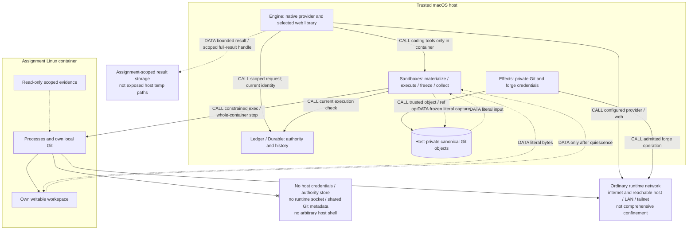
<!-- /render-figure -->

## 8. The full design journey

### 8.1 Task playbooks and legal shortened paths

Use ordinary playbooks in code. The following is the **current set**, not a permanently exhaustive taxonomy: future versions may add playbooks without requiring a v1 DSL, dynamic loader or plugin system. Source: accepted `work-router/behavior.md` B1–B4 and `design-playbook/behavior.md` B1–B5. The source's temporary refusal of design/experiment was a rollout dependency, not Render target behavior. Likewise early brainstorm text saying investigation makes a Slice was superseded by the accepted finding-or-escalation rule.

| Shape | Required path and output | Ceremony omitted; escalation trigger |
|---|---|---|
| Investigation | Ground → cited finding/recommendation, or recorded escalation carrying facts. Read-only consumer source. | No Contract/Slice, implementation, Audit, Watchdog or publication for a finding alone. A code change or new design choice routes to the appropriate shape first. |
| Experiment | Ground → prewritten protocol → isolated candidates → independent comparison → retained evidence/limits. | No implementation commitment/acceptance or delivery PR for throwaway work. Production adoption requires a Contract; evidence does not authorize itself. |
| Bug | Ground/reproduce → one-slice intake whose behavioral rule is the reproduction and expected corrected result → human Contract acceptance → implementation/checks → one Audit → fixes/rechecks → final seal → preparation/verification → Watchdog. | No breakdown quiz or Seams/Modules checkpoints when existing seams suffice. Discovery that changes architecture or product behavior escalates; cannot use “bug” to waive a consequential choice. |
| Performance | Ground/baseline → one-slice measured scenario with method, controls and target → human Contract acceptance → implementation/checks → one Audit → fixes/rechecks → final seal → preparation/verification → Watchdog. | Same ceremony reduction as bug; no unsupported “faster” success. New seams or changed behavior escalate. |
| Change | Ground → existing-seam references → bounded breakdown/Contracts → fidelity/human Contract acceptance → required Record outputs → implementation/checks → one Audit → fixes/rechecks → final seal → preparation/verification → Watchdog. | No new Seams/Modules round merely because code changes. New/changed seams route to design. Amend only never-assigned commitments under normal rules. |
| Design | Ground → Seams → Modules → human Proposal/Contract acceptance → Record, with exact-revision challenge, decisions and evidence, then delivery. | Configured technical Seams/Modules delegation captured per request can remove those human waits, never final acceptance or the checks that make an emission legitimate. |
| Verify-create / verify-maintain | Repository evidence lifecycle in §8.2, invoked directly or as bounded work under an accepted change. | Not new delivery shapes. No product fixes under a read-only maintenance pass; surface them as separate findings/work. |

A bug/perf Contract can be compact prose plus its one behavior and verification mapping; it still identifies obligations, forbidden/delegated choices and source. Do not import the old mandatory four-file layout as ceremony. D006 retains acknowledged Contract text/revisions in SQLite; repository verification/Record files remain separately reviewed source artifacts, not a mandatory four-file Contract layout. Every delivery path uses §6.2.1's per-pass rule, including shortened paths: post-handoff implementation rework gets a new Audit; same-pass finding fixes do not. Every path has an observable terminal check and a retained outcome. Full Gate, Audit and independent Watchdog remain distinct for delivered source; no pstack shortcut silently overrides that accepted target.

### 8.2 Project verification skill: ladder, channels and ownership

**Recovered original contract, not a newly invented universal ladder:** accepted `contract-lint/plan.md` A3 defines fallback **tests → build → inspection** (strongest first). `verification-skill/behavior.md` B1–B7 defines a project-named ordered ladder that **replaces**, not merges with, that fallback. There is no single “live is always best” order for every project.

| Rank in fallback | What it can substantiate | What it cannot imply |
|---|---|---|
| tests | Passed executable checks with independent expected outcomes at the relevant seam. | A green unrelated suite does not prove a UI journey, throughput claim or obligation it never exercises. |
| build | Build/type/static compatibility claimed by the actual command. | Runtime behavior, recovery or user interaction. |
| inspection | Cited source/design inspection, useful for architectural commitments. | Executed behavior or a check that was never run. |

Examples of **project-owned** ladders: numerical library `corpus → tests → build`; interactive service `live-introspected → driven-endpoint → tests → build`. These are examples from the original design notes, not imposed ranks for Render or proof that introspection dominates every surface. Each project explains which channel/check proves which obligation. A channel is not a rank; the same tool can observe weak or strong evidence.

Seven original channels, with reusable Render-owned procedural guidance:

| Channel | Concrete checks and limits |
|---|---|
| Executable oracle | Independent corpus/reference/golden/property cases. Independence of expected results matters more than count. |
| Process | Invoke real CLI/process; assert status, output and side effects. |
| Live runtime introspection | Inspect a running BEAM/node/service through project-supported interfaces; prove the relevant state transition, not merely set internal state to the expected answer. |
| Driven surface | HTTP/UI/TUI/desktop interaction via real handlers, stable selectors or supported automation hooks. Capture action and resulting state/side effects. |
| Tests | Existing project suites at their documented seams; state substitutes and scope. |
| Static | Build, types, lint and structural inspection with truthful limits. |
| Human-observed | Suggested usability/accessibility/experience observations. Advisory under A010, never counted as an automated behavioral pass or required attestation. |

The thin repo-owned asset contains ordered `ranks`, then **Launch, Doctor, Channels, Catalog, Cleanup, Extend, Traps**. Catalog columns: **Name, Channel, Kind, Run, Expectations, Rank**. Row kinds are `generated` (discovery/index, no proof rank), `executed` (runnable repository check), `journey` (retained steps with independent sanity predicate) and `human` (advisory only). Recommend `.render/verify.md` and `.render/journeys/` as simple repo-owned defaults, with explicit path configuration for legacy `.skl/verify.md` / `.skl/journeys/` compatibility. Use one selected asset, not parallel discovery registries or copies; this is an engineering recommendation, not a new permission question. Do not require a prose feature inventory that drifts independently of executable checks.

**Lifecycle responsibilities (recommendation grounded in accepted B7):**

1. **Create:** a bounded verification-author assignment interviews the repository, detects tooling/channels, reuses existing commands/harnesses, binds real prerequisites/expectations, and proves one executed row/journey end-to-end including cleanup and surviving evidence. Unknown observation channels are reported, not supplied with fictitious guidance. Greenfield Seams decides verification strategy; the first eligible Slice creates/bootstraps the usable skill. Minimal build/tests rows are honest scaffolding, not proof of unimplemented behavior.
2. **Use:** Engine renders exact cited rows and their revision into packets; Sandboxes runs authorized commands and returns provenance; Ledger retains receipts; Kernel checks structural coverage, rank membership/bounds and evidence/source identity. Models judge sufficiency. Engine does not choose truth from a process exit alone.
3. **Update with product changes:** the implementer adds or changes affected checks/journeys as part of the accepted Slice and reports verifier changes separately from product changes. A `new <row>` commitment must name that deliverable. No lowering expectations to make the product pass; changed required semantics goes through the appropriate decision/amendment path.
4. **Independently review:** each implementation pass's one Audit inspects the oracle/verification definitions on its actual A_i snapshot and records any checks it runs. Implementer fixes/rechecks afterward; required preparation checks and Watchdog use actual X_i's verifier definitions and record exact digests. Verifier edits before that pass's handoff do not trigger an inner re-Audit; post-handoff verifier repair starts a new pass with its own Audit. A verifier edited by its implementer is not independent expected evidence merely because it is executable.
5. **Maintain:** a bounded verify-maintain assignment runs every executed row and each journey's sanity predicate; checks referenced commands/paths; runs generated discovery and compares dependent rows; records `clean | changed | blocked` **per row before editing**. Proven skill/harness drift can be corrected in its own scope, product regressions are reported without being papered over. Re-execute corrected rows before claiming changed. Recommend on-demand plus change-triggered maintenance initially, not an unasked daily daemon.
6. **Human:** chooses product expectations, acceptable minimum rank and any changed scope; may opt into a maintenance cadence. Does not routinely author commands, reproduce what automation can drive, or attest every merge. Render owns reusable craft/playbooks; the repository owns concrete commands, checks and journeys.

Behavioral obligations cite executed/journey checks, not generated discovery or human observations. Architectural obligations may additionally cite justified inspection. Coverage is many-to-many. Passing rank cannot exceed the weakest required cited behavioral evidence, and a below-minimum or missing check is blocked/non-pass, not automatically demoted to success. Project full suite/typecheck/lint and required cited checks run independently for implementer/Watchdog on their respective exact snapshots; unsupported platform prerequisites are reported as unrun rather than fabricated.

**A010 interaction automation:** source should expose natural production seams and project-supported driving/introspection handles, not Render-specific test backdoors. For a BEAM service, a named local node/remote shell may observe process and domain effects; for JS, an actual route/driver/debug interface may exercise the path. Pin instance identity/config, prerequisites and ownership; isolate fixtures and never borrow the user's live instance implicitly. Do not prescribe Playwright, BEAM, a UI framework or a new automation abstraction for every repository.

The pstack creation skill supports interview-the-repo, end-to-end proof, retained evidence and own-instance cleanup; its maintenance skill reinforces real driving and distinguishing harness drift from product bugs. Its feature-map layout and current autonomy/merge defaults are not imported: accepted skl explicitly chose runnable catalog rows, independent Watchdog and human main merge. [historical R2 research and recommendations](spec-r2-review-disposition.md#research-and-design-recommendations) records immutable comparison URLs and the recommended defaults.

### Ground

Persist prompt and proposed task shape; human confirms a classifier-proposed shape, while a shape the human explicitly supplied needs no redundant confirmation. Escalation retains facts and exposes any new decision requirement. Read context, ADRs, full relevant principles, verifier instructions and affected source. Record the goal, independent done predicate, facts, uncertainty and constraints. No implementation commitment is created. Investigation may finish with a finding; standalone experiment produces evidence; bug/performance/change work can use smaller commitments rather than unnecessary design ceremony.

### Seams

Compare genuinely different module/interface decompositions, dependency categories and verification seams using depth, locality and the deletion test. Stable node IDs identify decision, rationale, alternatives, evidence, class (`observable`, `judgment`, `product`) and recommended default. Required competing candidates run before synthesis; challenger runs before emission. The contested list answers every objection and discloses **what the chosen candidate decided that the question did not ask**. D001/R2-A001 allows technical Seams approval when the request captured delegated settings within the agreed scope. A request captured as human stays human even if defaults later change. Required candidates/challenge/evidence/dispositions still precede advancement; any new out-of-scope product choice stops for a human. A delegated decision records machine execution, captured settings and agreed-scope provenance, not a human approval.

### Modules

Refine shapes within approved seams. Observable uncertainty gets a prewritten experiment protocol: question, hypothesis, falsifier/decision rule, controls, fixtures, failure cases, resource budget and retained outputs. Judgment uncertainty gets competing candidates when required/requested. New product questions outside delegation stop with options and a recommendation. Technical Modules decisions may advance under the request's captured persistent settings after required evidence/challenge. A discovery changing an accepted seam requests a revised checkpoint capturing current persistent routing settings and blocks affected dependent execution while raising any needed pending human decision. It cannot rewrite, amend, erase or supersede historical human Contract acceptance. Changes to product scope or accepted Contracts still require human decisions, and consumed Contracts remain frozen.

### Proposal

Materialize bounded Slices and dependency edges; behavior/architecture/manual obligations; delegated/forbidden decisions; and many-to-many evidence requirements. Each architectural commitment cites an actual approved node or experiment artifact. Structural lint checks identifiers, references, coverage, valid evidence ranks/catalog rows and provenance, not semantic merit.

Fresh fidelity review compares approved Seams/Modules/evidence with the intake for omitted, weakened, strengthened, contradictory or invented obligations. Transcription fixes are distinct from technical design changes requiring new checkpoint decisions and product/Contract changes requiring human direction. Final Proposal/Contract acceptance is always an authenticated human command binding the displayed immutable intake and all required decisions. Configured Seams/Modules delegation cannot call that route as the human or supply acceptance by implication; the same rule applies to shortened-path intake. No Slice issues are published; the proposal PR is a lower-resolution summary, separately published without blocking local work.

Project-tailored verification is a first-class repository asset with concrete ranks, runnable checks and lifecycle responsibilities (§8.2). Each commitment cites the checks that can actually prove it, with required evidence and independent expectations. Implementer and Watchdog run their respective checks on their exact source; deterministic target preparation cannot reuse stale receipts. Usability suggestions remain visible and honestly unperformed unless observed, but no human completion attestation gates readiness or merge validity (A010).

Contract revisions are immutable. Before any assignment, an authenticated human amendment can replace an unstarted Slice's accepted revision. Once `everAssigned`, changed obligations need supersession/replacement, even after release. Dependencies are explicit human direction; validated amendments may alter unclaimed/unmerged edges without cycles or silently abandoning dependents. No report/checklist edit changes a Contract.

### Record

Prepare ADRs, approved principle changes and any explicitly requested design document through a bounded **Record assignment bound to human-accepted Record obligations**. ADRs carry concise evidence summaries and repository-local rationale; private raw logs need not be copied into source. Fidelity review checks the output against approved decisions. Source-changing Record output follows §6.2.1 per implementation pass: implementation/checks, one Audit with fresh Standards/Contracts contexts, implementer fixes/dispositions/rechecks, final sealing/submission, deterministic preparation/required verification and Watchdog, then autonomous qualifying local integration (§9). Audit records actual pre-fix A; Watchdog records prepared X. There is no direct-ref write or unreviewed baseline bypass. Acceptance may create planned Slices, but affected implementation waits for the **recorded qualifying integration** of its required Record baseline, not mere document existence or a pass. Archival/retirement preserves partial delivery and evidence; it never reports superseded work as completed.

### Editable checkpoints and annotations

An emission is immutable bytes plus typed manifest. An editor session is based on that exact artifact. Clients may edit ordinary Markdown without special comment syntax, then upload complete bytes plus base reference. Ledger retains both byte versions and the diff; hunks/concerns get stable IDs within that submission. Editable frontmatter cannot change workflow identity/state or grant authority.

**Save is not approval. Only immutable emitted artifacts are eligible for a human approval or an in-scope delegated technical decision.** Human-edited bytes require a new emission with a regenerated manifest, structural lint, and all required independent exact-revision reviews and dispositions before approval; lint alone cannot authorize semantic changes. Changed behavior/architecture also requires the revised decision and dependent invalidation, not interpreting edits as a new accepted Contract. Approve-with-notes approves the **original emitted bytes**, carrying every saved note forward as explicitly nonbinding; it never approves the edited draft. Rework needs an explicit concern, either edited bytes or a separately saved human reason.

The next emission must map every annotation to acted on, considered, or dismissed with a reason and resulting reference. Ledger can enforce completeness; required independent review assesses adequacy, with the human deciding at human-routed checkpoints and final acceptance. A “why not X” can trigger challenge, “prototype this” an experiment, and “decide X” a product request, but the coordinator's classification is not human authorization.

Concurrent edits retain both submissions and produce an explicit conflict; no last-writer-wins loss. Approval binds the annotation-set revision. If edits win the race, the old approval is refused; if approval wins, later edits become retained change requests, not edits to accepted bytes. Unsaved editor buffers are not durable; clients say so. Reattachment promises all acknowledged records, not unsubmitted keystrokes.

<!-- render-figure: 08 -->
**Figure 8 — Two orderings, no lost acknowledged edits.** Proposed checkpoint protocol; both race orderings have bounded E-CLIENT witnesses. CALL saves data; AUTH requests approval over an exact basis; DATA returns receipts/views. The final note is stricter product policy, not the fixture's direct-draft approval. The alternative branches start from the same initial state.

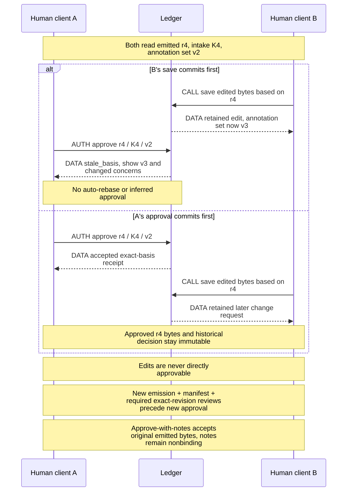
<!-- /render-figure -->

Experiments retain their original protocol, candidate identity, sealed inputs, decisive raw measurements, report and limitations before cleanup. The comparison parent cannot rewrite candidate originals. Negative/inconclusive evidence remains available, and result selection never itself accepts a product choice.

<!-- render-figure: 09 -->
**Figure 9 — What a change invalidates—and what it does not erase.** Proposed impact map. Arrows mean CONSEQUENCE or REQUIRED GATE, never calls or automatic edits. Each row is a separate change scenario. New authority requires the corresponding explicit decision/review; old artifacts, verdicts and approvals remain historical evidence. A consumed Contract is superseded/replaced, not silently amended.

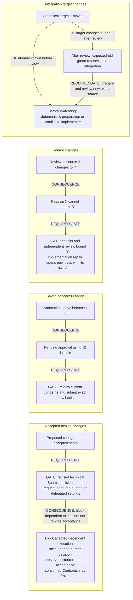
<!-- /render-figure -->

## 9. Git/forge effects and reconciliation

### 9.1 Admission and cancellation have one ordering

Each Operation records kind, exact payload/source/target, authorization basis, stable ID, attempts and observations. **Intent is not permission to send.** Effects requests an admission through Ledger's same serialized transaction line as cancellation/revocation:

1. `planned`: accepted intent, not yet allowed to mutate a canonical ref or contact the remote for mutation.
2. `admitted`: current scope/generation, ordinary operation eligibility, policy and source/evidence checks pass; Ledger commits a unique attempt ID, `executorEpoch` and permit. This is the linearization point. It means “may already be applied/sent,” not proof of a ref update or network packet.
3. The trusted single executor consumes that permit once to dispatch. The permit is internal, never returned to models/clients. Duplicate receipts do not grant another dispatch.
4. Observation and task/domain completion commit atomically, or the attempt remains uncertain.

If cancellation commits first, admission fails. If admission commits first, that attempt **may dispatch or complete after cancellation**; the cancellation view lists it as in flight. The guarantee is no new admissions after the fence, not an impossible guarantee about packet arrival. No check-then-await window grants authority outside this ordering.

If the host dies between admission and dispatch, it cannot prove the request was unsent: recovered admitted attempts are uncertain, not replayed from a fresh permit. A current `executorEpoch` cannot adopt a prior epoch's dispatch permission. Reconcile or block. A lost admission response also follows stable-ID/unknown-outcome handling; it is not permission to allocate another attempt. Verified provider idempotency may justify a specific replay policy; reliable local lookup does not justify blind remote-create retry. Local canonical-ref recovery has the narrower, exclusive-writer reconciliation rule in §9.3.

### 9.2 Forge submodule and concrete operation rules

**Settled placement:** Forge is an internal Effects submodule, not a sixth top-level module, deployed service or workflow-visible provider. Keep one actual forge adapter plus a controlled observation/fault adapter for verification; do not build a provider registry or implement a second real forge just to justify the seam.

**Proposed Forge interface (unverified):**

- `capabilities(repository) → {draftProposalPR, markProposalReady, guardedSourceUpdate, createIdempotency, stableObjectIdentity, mergeObservation, observationCompleteness}`
- `observe(query) → observations` for immutable repository/object identities, proposal PR state, published heads and actual main merge mapping. Results carry observed refs, timestamp/cutoff, completeness and uncertainty; negative/incomplete visibility is never absence proof.
- `apply(admittedRequest) → applied | rejected | unknown`, with a closed request union: publish exact source with expected old head, create draft proposal PR, update its owned summary, **mark the associated proposal PR ready**. The last operation is selected by R2-A008, not a generic PR mutation or main-merge capability. Effects owns admissions, payload identity, retries and reconciliation; the adapter translates provider transport/errors, pagination and capability facts.

Requests use provider-neutral repository/source/target/object references, not labels, CLI commands, GitHub URLs or provider-specific workflow status. External IDs can be opaque tagged values retained by Effects; domain code neither parses them nor chooses GitHub/GitLab branches. Supporting source transport may use Git inside Effects; callers do not need to know if provider ref updates use Git transport or an HTTP operation.

If a provider lacks guarded source updates or verifiable source-to-main mapping, refuse that automated capability and explain the supported manual publication/observation path. If it lacks ready promotion, expose that publication-capability limitation rather than mark an internal flag as a successful forge change; a human's externally performed state change can still be observed, but is not the normal required workflow gate. Do not silently weaken expected-old or report a human merge from a renamed PR state. Adapter “idempotent” support must be substantiated for the specific operation, not inferred from a generic retry claim.

**D005 selected timing:** the first qualifying local integration schedules **one draft proposal PR**, with supporting source publication supplying its valid head; subsequent progress updates that PR's source and lower-resolution summary. Local work never waits for these operations. One logical create intent/association belongs to the proposal; new source heads do not create new PRs. Unknown create outcomes reconcile under the rules below, never automatic recreation. If the adapter cannot create a draft PR, expose a nonblocking unsupported-publication condition rather than silently create a non-draft PR. The summary names intended outcome, integrated scope, canonical/published mapping, evidence summary, remaining blocking findings and advisory human checks; details stay in Ledger views. Never publish private raw artifacts by default. Readiness still requires exact current published mapping; only the human merges main. R2-A008 adds automatic draft-to-ready after all proposal Slices have qualifying integration and the current publication/evidence basis is eligible (§9.3). Expose promotion pending/unknown and observed draft/ready separately; eligibility or an admitted operation is not proof the forge changed. The human's remaining merge action is main merge.

#### Operation rules

| Kind | Required behavior |
|---|---|
| One draft proposal PR create (no Slice issues) | Schedule after first qualifying local integration, with one proposal-scoped create identity; persist/admit before send. Include unique correlation marker and exact payload/source identity. Reconcile complete paginated candidate observations, verify repository/actor/type/content and preserve conflicting observations. Negative listing is not absence proof. A unique verified match may establish association only without unresolved prior-attempt/duplicate-risk history. |
| Proposal PR summary update | Publish current lower-resolution proposal summary, not Slice issues or a backlog of obsolete narratives. Use a clearly host-owned section or explicit overwrite permission. If an externally ready PR becomes internally ineligible after scope/source/evidence changes, this existing update states current ineligibility and gaps; publication can lag or be uncertain, so no instantaneous synchronization is promised. Superseded prose attempts do not block local work; mutable public content never authorizes state. No new redraft/close operation or gate. |
| Source publication | Project host-sealed canonical proposal objects to the authorized forge-hosted source ref using expected-old guarded, non-overwriting updates. Record canonical versus observed published head; divergence blocks publication/final readiness, never silently imports remote content. Same-proposal local work need not wait on publication. No worker remote URL/config is trusted. |
| Local proposal integration | Autonomous by default, with no per-integration approval or standing grant. Require exact passing X including T, satisfied evidence, current assignment/cancellation/policy and no unresolved canonical-ref risk, then expected-old CAS. Journal/readback/reconciliation precede dependency clearance. Unrelated forge uncertainty does not block it. |
| Ready promotion | After all proposal Slices qualify as integrated and current canonical-to-published mapping/evidence is verified, admit `markProposalReady` for the associated immutable PR ID and exact publication basis. Observe before/after; preserve rejected/unknown separately. A lost response is reconciled by reading that same PR/state/head, not creating another PR. If the desired ready state and expected/current mapping are verified, record observed satisfaction without claiming this attempt uniquely caused it. If still draft, confirm outcome/current eligibility before a new admission; retry only under established operation-specific safe semantics. Changed head, closed/merged PR, incomplete observation or conflicting state is an explicit blocker, not success. No duplicate-risk create, arbitrary PR mutation or main merge is authorized. |
| Human main merge observation | Read-only association/target observation establishes integration. It does not fabricate human observations. Suggested human checks remain advisory, and missing attestations are not evidence gaps or merge-invalidity reasons. No machine operation is permitted to merge main. |
| Cleanup | Delete only quiescent owned workspaces whose required source/evidence is retained. Missing cleanup is visible pending maintenance, not lost completion. Dirty/unknown/unowned state is preserved. |

Markers/hashes are **correlation, not signatures**. Body/label edits, copied markers, compromised accounts, pagination, normalization, transfer/deletion and visibility lag limit the inference. Once associated, use the immutable external object identity and audit changes; labels/prose remain projections. The production adapter must paginate fully or explicitly report incomplete observation; it cannot treat truncation or label filtering as complete absence.

If a human explicitly authorizes another attempt while an earlier create is unknown, record **sticky duplicate risk** across all attempts. A transient unique listing cannot discharge it or authorize association-dependent external publication/readiness. This uncertainty does not block otherwise eligible local design, implementation, review or integration. Explicit resolution must account for initiated attempts, identify/close duplicates where applicable, or accept a stated remaining risk with narrowly bounded reversible authority. Another poll is not universal proof of absence. No resolution can waive a Contract or manufacture review.

All otherwise eligible local work, including canonical integration and dependent implementation, proceeds while unrelated PR/publication outcomes are uncertain. The blockage names operation, attempts, last observations, affected dependent actions, and safe choices: inspect, recheck, associate verified object, or explicit risk resolution. No direct store edits are required.

<!-- render-figure: 10 -->
**Figure 10 — Unknown external creation is a real state.** Proposed operation state machine for non-idempotent remote creates, not local-ref recovery. Transition labels distinguish AUTH admission from CALL dispatch and DATA observation; arrows are state transitions. The effects probe supports bounded reconciliation and exposes listing lag, not exactly-once delivery. Negative lookup has deliberately no retry edge; sticky-risk resolution follows §9.2.
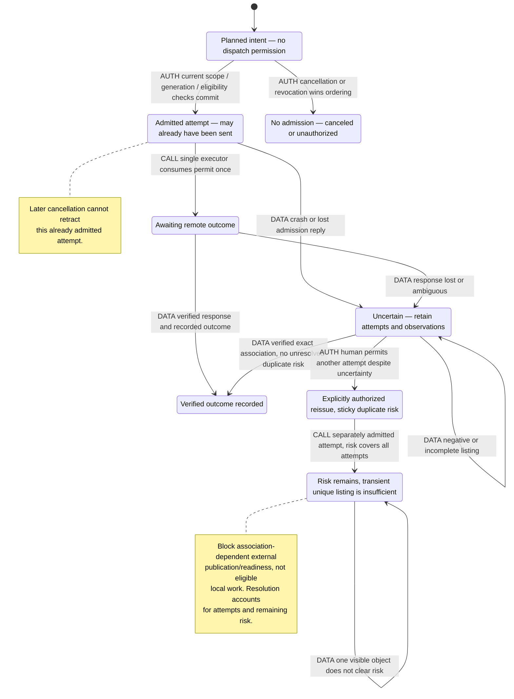
<!-- /render-figure -->

### 9.3 Autonomous proposal integration versus human main merge

**R2-A007 selects autonomous eligible proposal integration by default.** No per-operation human approval, standing grant, project setup ceremony or checkpoint-delegation setting is needed for ordinary proposal progress. Kernel's ordinary closed eligibility rules are the authority for this workflow action; Effects is its trusted executor. Human Contract/product decisions and cancellation remain, and main merge stays human-only. Actual integration capability must still be implemented/verified; a missing capability or unresolved ref outcome is an operational blocker, not a request for an enabling grant.

**Recommended mechanism:** host-private proposal ref is canonical; the forge proposal branch is its publication projection. Effects constructs a squash commit R whose tree is **exactly prepared/reviewed X**, parent expected canonical T, with fixed recorded commit metadata. Pin passRef, B, that pass's Audit A/report/fix-dispositions, X, T, R/tree/parent/metadata, Contracts, required X-checks/Watchdog and current policy/assignment basis in the Operation before admission. A's provenance stays A; it is not relabeled X. Current eligible work automatically proceeds through the same journal/admission/CAS, without a human scheduling wait.

Under the host's exclusive writer ownership, update `git update-ref <canonical-ref> R T` with atomic expected-old OID comparison. No recomputation, conflict resolution or unguarded merge occurs after Watchdog. Verify ref/commit and durable rooted object/ref publication before recording qualifying integration. Current cancellation/assignment/generation, policy/evidence, lineage and unresolved canonical-operation checks are mandatory; autonomously scheduled does not mean unconditionally permitted. Target movement preserves the historical pass, rejects stale CAS, and returns to preparation/current-source verification/Watchdog—not another Audit merely because T moved.

**Source Git and Ledger commits are not atomic together.** Persist intent/admission first; commit verified observation/domain qualification after ref update. Serialize this proposal's integration until the outcome is resolved. After crash and old-executor quiescence, compare ref against recorded T/R: exact R with expected tree/parent can be recorded once; T means no integration currently qualifies and retry requires fresh current admission; anything else is divergence needing explicit reconciliation. Never infer success from intent, dispatch again from a receipt or roll back an unexplained ref. This journal/recovery remains an unrun production gate.

Only recorded qualifying integration clears **same-proposal** dependencies before publication. Cross-proposal edges need observed main integration or separately authorized/reviewed inclusion in the dependent proposal; a prerequisite's private ref alone is insufficient. Main-delivery edges need the observed human main merge. A pass, PR label or published head cannot substitute.

Publication uses independent expected-old remote protection; unexpected remote movement is divergence, not silently imported canonical authority. Credentials and main protection excluding the machine principal gate machine publication, not local integration. Forge lag/unknown creation does not block eligible local work.

**R2-A008 readiness:** all currently required proposal Slices must have recorded qualifying integration (including required Record baseline obligations); canceled, unfinished, blocked or merely passing Slices do not count. Scope changes follow existing human Contract/supersession rules, never silently drop a Slice to finish. Current canonical source must be verifiably published to the associated single PR head, with required automated evidence and no relevant unresolved divergence/association risk. This establishes **promotion eligibility**, not observed ready state. Effects then automatically admits `markProposalReady` for that PR/current publication basis and records/reconciles actual forge state. No human draft-to-ready approval.

Internal eligibility, published mapping, ready-promotion pending/unknown and observed forge draft/ready/merged state are separate views. If current source/evidence/scope changes, recalculate eligibility; an old ready flag does not bless new bytes. The existing host-owned summary update reports current ineligibility/gaps even if the forge ready flag persists, subject to ordinary publication lag/uncertainty. The narrow operation does not merge main, edit arbitrary PRs or introduce automatic redrafting/closing. A ready request admitted before cancellation/source change may complete later; retain its old basis and report actual state/current gaps, not false current readiness. Do not claim provider-atomic head-plus-ready CAS where the forge does not offer it: reobserve before admission and after operation, detect races and retain uncertainty.

Human alone performs final main merge and resolves later conflicts. The final package maps current commitments to canonical/published source, checks, actual Audit A and fixes, Watchdog X, remaining findings, deviations, advisory checks and uncertainties. Observe the actual merge mapping; older/different merged source creates a truthful automated-evidence gap, not invented approval. Missing advisory human/macOS observations is never a validity/readiness gap.

<!-- render-figure: 11 -->
**Figure 11 — Autonomous local progress, independently reconciled publication.** Proposed mechanism, not a cross-store transaction or executed product evidence. Every AUTH arrow is ordinary current eligibility, not a human grant. Final main merge alone is performed by the human.

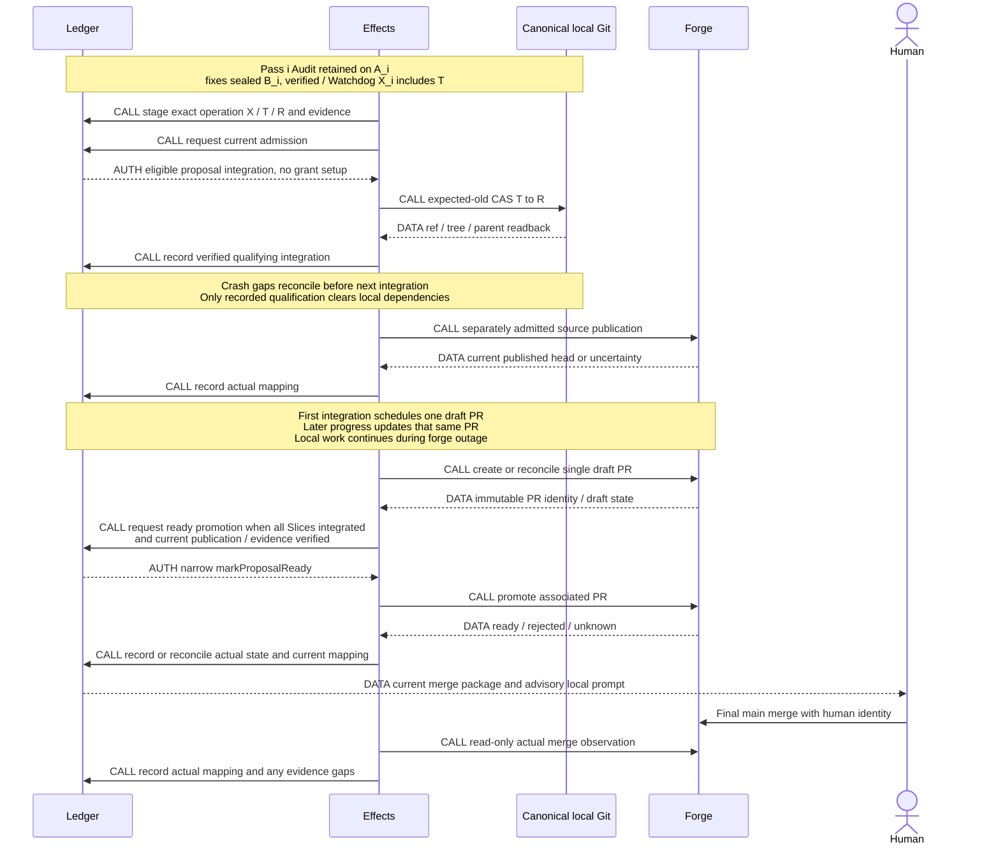
<!-- /render-figure -->

### 9.4 Pre-Watchdog target preparation
**Required by A008 and selected by R2-A010; parent adopted bounded feasibility in `LAB_REV/evaluation-incorporation.md`, not prototype code or a recovery proof.** §12 separates real Git from simulated orchestration and reports remaining gaps. Earlier designers recorded reading the full evaluation/report; the R2 continuation read the complete parent evaluation without a rerun. R3 preserves those results without repeating the research. No extra incorporation probe round is requested now. Original skl semantics are confirmed in `CONTEXT.md` Integration Merge, `prose/procedures/watchdog.md`, and `workflow/integration_merge.go` at `480179ce...`: prepare proposal-target source before review; if target is absent, make a clean ordinary merge, never rebase/reset; abort conflicts to the pre-merge head and return them to the implementer. The code disables rerere. Unrelated inherited target code is not newly reviewed scope, but integration effects are. Historical worktree/remote layout is not an isolation design to copy.

**Recommend a deterministic source-preparation task, not a reasoning-agent conflict detector:**

1. Ledger accepts sealed implementation source B/base T0 and schedules preparation, not Watchdog directly. Engine asks Effects for the current canonical proposal head T1 and immutable objects. After the same recorded-base/object/lineage validation required below, if T1 is already included in B, retain B. The ancestry fast path does not skip validation. A late result cannot pick its own target observation.
2. Effects owns preparation identity `(B,T1,profile/algorithm)` and trusted Git inputs/configuration. **Recommend `merge-tree --write-tree -z` in Effects' host-private bare metadata**, using a fixed supported Git version, minimal explicit environment, host-owned empty HOME and no inherited XDG/config/attribute sources. This avoids ordinary merge's writable worktree/index and abort cleanup; it does not run project code or invoke worker-owned Git metadata. Sandboxes still owns executable project verification. Validate the recorded assignment base as an ancestor of both B and current canonical T1; unexpected rewritten/unrelated lineage blocks rather than accepting a forged base. Retain prepared objects under host-owned preparation roots before accepted Ledger refs; a precommit crash may leave reported orphans, never accepted authority. The bounded prototype supports mechanics, not this complete production protocol. HOME/XDG individual regression sensitivity remains a future gate; no additional design probe is requested.
3. Classify **validated inputs and complete results**, not exit status alone. Resolve both inputs as supported commit objects; verify the documented result framing/object types and preserve stderr/signal information. A valid clean result with exit 0 can yield **new source X**, binding B, T1, result tree, algorithm/profile and receipt. For `merge-tree --write-tree -z`, exit 1 counts as a conflict only with a well-formed conflict result beginning with a valid tree object; an empty path list is not a clean oracle. AM-1 demonstrated that a missing object or blob input can also exit 1 with **empty stdout**: invalid inputs, malformed/missing results, other failures and signals are operational errors that block preparation, not conflict rework. A returned tree alone never establishes cleanliness. A classified conflict preserves sealed B and its original base T0 plus exact conflict detail. Host-authorized conflict repair opens the **next implementation pass** (§6.2.1) and creates/rebinds a **new current Attempt with T1 pinned as its base**, retaining read-only B/T0/T1 and the conflict report as scoped inputs. Prepare a **fresh writable workspace from T1**, never overwrite the retained B workspace or imply resolution. The implementer reapplies/resolves the actual code, completes that new pass's fresh Audit and finding fixes/rechecks, then host sealing records B′ with parent/base T1 in the new pass/Attempt provenance, not mutable original history or a worker-chosen parent. Return directly to implementation with no Watchdog call or completed-review increment. Render never guesses a conflict resolution; verify the resulting combined source and repeat preparation if the target moves again. AM-2's bare `merge.renormalize=true` SIGABRT reinforces that an abort is an operational failure, not a conflict.
4. Run required project verification against X in a preparation/verification attempt before independent Watchdog. Failed checks needing source/verifier repair return to implementation in a **new pass**, without a Watchdog count; an unchanged-source operational retry only reruns the required checks. Reuse the existing verification skill/runner, not a sixth module. **This pass's Audit already ran before B submission (§6.2.1); it is not dispatched on X.** Carry passRef, actual pre-fix A, both reports and dispositions/fix/check records. B and X may differ from A; do not relabel A as exact-X review. Watchdog independently examines actual X including fixes, target and integration effects. Authorized Watchdog rework likewise opens a new implementation pass with a fresh Audit before its next B handoff; no completed old-pass Audit substitutes. Same-pass Audit-finding fixes never cause inner re-Audit. Re-seal/reprepare/reverify changed source and obtain current Watchdog evidence. P-INCORPORATE-1 simulated the prior check/Audit/Watchdog order; its real Git evidence supports preparation mechanics, **not the superseded Audit placement** or actual role execution.

5. Immediately before launching Watchdog, re-observe target. If it changed since T1, prepare again rather than knowingly launch a stale review. Do not hold a long-lived target lock across model review. Preparation attempts are visible separately from completed reviews; churn handling is a liveness choice (recommend one preparation in flight per Slice and coalescing to newest observed target, then a visible pause if repeated changes prevent review).
6. Watchdog reviews exact X/T1 and independently runs required checks. Changes after launch are handled by final expected-old CAS: no recomputation under an old pass. Preserve historical pass, prepare the new source and obtain its required review. Every actual completed drift re-review counts under A007; prior passes are not exemptions. A later non-pass may therefore need human direction sooner; D004 permits explicit cap adoption, and a valid pass is never rejected.

**Rejected simpler-but-wrong alternatives:** reviewing B then merely retrying integration wastes a known-invalid round; passing after a clean merge without checking X misattributes evidence; leaving clean merge/conflict detection to an LLM adds judgment where Git already has a deterministic result. Holding all proposal integrations until every concurrent review finishes avoids some retries but serializes unrelated local progress. No new global coordinator lane or merge framework is needed.

**Future production gates, not extra design probes:** inherited HOME/XDG default-attribute sensitivity; validated sealed import and supported object/path representations; submitted-source/base/target lineage and rewritten-history handling; retained object roots/durable preparation records; actual check identities/Contract/verifier binding, Audit/Watchdog dispatch and authenticated admissions; interruption/dedup and SQL/ref crash reconciliation. Process work must remain outside the accepting transaction. Real clean/conflict/object/error/attribute/CAS fixtures provide bounded mechanics evidence, not these missing guarantees. Operational errors stay blocked; no review/dependency clearance follows parent identity alone. See V1/V5/V6 and §14 stage 5.

## 10. Recovery, persistence guarantees and evolution

### Recovery sequence

Acquire the exclusive store lock; verify supported schemas/definitions, effective persistence settings and storage health; open storage/runtime without remote authentication or dispatching unchecked work; inspect assignments/containers/operations; mint the process's fresh `executorEpoch`, fence old permits and establish OS quiescence or quarantine. Before explicit `resume()`, use **reads and safe commits only** (fences and quarantine marks), never scheduling-enabling submit, abort, wait or compact calls. Containment/termination can be established without those runtime calls. Once unchecked work is fenced, explicitly resume compatible handlers; then abort/wait as needed and reconcile uncertain effects, including §9.3's canonical-ref/Ledger gap, before admitting dependent work. Evidence and receipt views remain available where the understood schema permits. Pinned 1.4.0 has no documented read-only Harness option: do not invent one to bypass startup compatibility or ownership.

Interrupted work resumes only with compatible task meaning and current assignment authority. Missing required source is retrieved from retained objects or blocked with a precise input request. Missing workspace does not reset ownership, review count or decisions. Unsupported/corrupt content is preserved and quarantined, not silently normalized. Supported recovery commands record their reason/basis; manual ledger repair is not the tested recovery procedure.

<!-- render-figure: 12 -->
**Figure 12 — Ordinary restart enables work in guarded stages.** Proposed runtime-continuation activity diagram; no disaster-recovery stages. Arrows mean control order, not data transfer. CALL steps operate the runtime/OS; AUTH gates constrain what may run; DATA steps inspect observations. Blockages are scoped where safe: an uncertain operation need not halt unrelated work. Before explicit resume, no submit, abort, wait or compact call may enable scheduling.

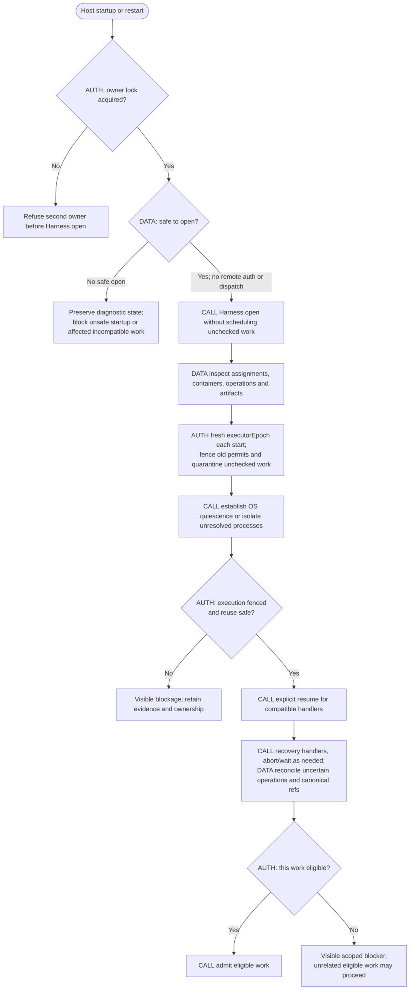
<!-- /render-figure -->

**Retained failure models and preservation priority (A020/A022):**

- **Process crash:** historical atomic commits plus P-HISTORY-1's 24 SIGKILLs support the named transaction/content-publication cases across three actual Durable compositions, not full Render recovery. Interrupted computation repeats only under current assignment/operation rules.
- **Power/host failure:** pinned default SQLite WAL `synchronous=NORMAL`, `fullfsync=0` cannot justify zero-loss acknowledged work. Parent reports the pinned public `NodeSqliteDatabase.exec` before `SqliteStorage.open` permits evaluating `FULL/fullfsync` without patching runtime; P-HISTORY-1 read back WAL / synchronous=2 / fullfsync=1 / checkpoint_fullfsync=1 through the public adapter. Its small follow-up is not a physical-durability or general overhead measurement. No setting alone proves lossless hardware behavior. The battery-backed host reduces one exposure, not all failures.
- **Disk loss/corruption:** disaster recovery is deferred; no off-host cutoff, restore mechanism or physical-loss guarantee is claimed. Retain required live-state/source records and precise corruption blockers.
- **Older-cutoff restore:** outside v1; no startup marker, repair path or legacy compatibility is retained.
- **Disk full/missing content:** failed commit emits no success. Preserve diagnostic/corrupt bytes where possible; restore exact refs or block. Never fabricate approvals or substitute a current draft for a missing historical artifact.

Historical package feasibility observations remain in §12, qualified by the scope amendment; they create no active recovery duty.

### Recommended local persistence profile

**R5:** use SQLite **WAL / synchronous=FULL / fullfsync=1 / checkpoint_fullfsync=1**, configured through pinned public `NodeSqliteDatabase.exec` before `SqliteStorage.open`, and read back the effective values before admitting work. The parent history evaluation observed WAL / 2 / 1 / 1 through that seam. Unexpected settings block admission with an actionable operator error rather than silently weakening the declared profile. This accepts a potential local write cost to favor preservation; the small measured corpus is not a general overhead guarantee. V9 must measure the shared database under **four concurrent Durable transcript/tool-result streams** plus ordinary command/snapshot traffic at FULL/fullfsync; the document-save benchmark is not that workload's performance proof.

Effects separately owns **durable, rooted source publication**: validate required objects, use supported-version trusted-repository fsync settings covering objects/packs and refs (not a writeout-only assumption), complete required synchronization and establish retention roots before accepting Ledger source references. Final ref mutation likewise satisfies the source durability profile before qualifying integration. Git and SQL are still separate commits; preserve the intent/readback journal and harmless precommit-orphan accounting. Settings/readback and source hardening remain distinct V6/V7 gates. No SQLite/Git setting or process-crash probe proves zero physical loss.

These measures reuse existing storage facilities, not replication/failover or a disaster-recovery layer.

### Version policy

Version separately: command format, domain record/artifact schema, instruction bundle, policy/checkpoint settings, sandbox profile, and Durable task definition/checkpoint format.

Initial policy retains a task definition's exact meaning while it has live work. For a semantically incompatible change, register a **new distinct task name** and keep the old handler installed to drain old work; new assignments use the new name. This is Render's policy, not a claim that a name like `assignment-v1` is a built-in interface.
Durable also supports a numeric version on the **same task name**, with `migrate` applied at reservation. Use that only for an explicitly reviewed, tested migration preserving the assignment's authority and checkpoint meaning. Missing migration, throwing migration or older definitions can block; abort of blocked work can yield orphaned state. A deployment must inspect/resolve these states, not reset them. Historical entries are not rewritten by runtime migration; application facts/artifacts carry explicit schema versions/readers and unknown versions refuse.

Reopening a live store requires compatible executable/task meaning and reconciled effects at a quiescent seam. This scope introduces no live-data upgrade, package-based migration, rollback protocol or generic migration engine. Uncertain effects cannot be migrated away.

## 11. Traces and failure-mode acceptance

### Success, including a disproved favorite

Ground retains the uncertain goal. Independent candidates compare seams; challenger identifies an incidental product choice. Human saves annotations and requests a protocol-first experiment, then leaves. A fresh client sees every acknowledged concern and the next decision. Sealed comparison disproves the favorite and retains negative evidence. Revised Seams/Modules answer all concerns under their request-captured routing; product questions and final intake K go to the human. Acceptance creates obligations, not a merge.

Record work, where required, follows the same per-pass delivery order; affected implementation waits for its recorded qualifying integration. In pass 1, implementer checks source, requests fresh Standards/Contracts Audit 1 on A1, fixes/disposes findings and rechecks, then seals B1 and hands off atomically with the preparation task/passRef. Deterministic preparation combines B1 with current T into X1; required checks pass, target is reobserved, Watchdog independently reviews X/T. Its pass permits **automatic current-eligibility admission/CAS/readback/journal qualification**, no grant setup or per-integration approval. Same-proposal dependents continue.

The first qualifying integration schedules one draft PR and supporting publication. Later integrations update it. When every required proposal Slice is integrated and current published mapping/automated evidence/association are verified, Effects automatically promotes the same PR ready and records actual outcome. Human sees the merge package, advisory local-verification prompt and remaining uncertainty, then alone merges main. Observe the actual mapping.

### Audit findings stay in-pass; Watchdog rework starts the next pass

Pass P1's au1 has fresh Standards/Contracts contexts on A1. Findings and pre-handoff check failures are fixed/rechecked within P1 to produce B1; no inner re-Audit. Handoff retains P1/au1/A1, both reports, dispositions and check receipts; **au1 did not inspect B1 or prepared X1**. Interrupted incomplete au1 resumes its existing tasks; completed reports are retained, never rerun merely after container/Attempt replacement.

Watchdog reviews X1 and requests rework. If existing cap/current authority permits implementation, Ledger opens P2 under the same Slice/possibly same Assignment and conversation. Implementer repairs, obtains **fresh au2 on A2**, fixes/disposes/rechecks, seals B2 and hands off for preparation/checks X2 and a fresh Watchdog round. au1 cannot satisfy P2 even if A2's digest matches A1. Pass creation/Audit adds no Watchdog count and never resets the prior completed count; cap/Needs Human still stops unauthorized automatic rework.

### Target drift, real conflict and operational error

Pass P1 handed off B1 based on T0 while another Slice integrated T1. A real validated preparation conflict preserves B1/T0/T1/report and opens P2 with a fresh writable T1 workspace/current rework Attempt, **without a Watchdog review/count**. Implementer resolves/reapplies, runs P2's fresh Audit on A2, fixes/rechecks, then host-seals B2 with base/parent T1. Prepared-source check failure requiring source/verifier repair follows the same new-pass rule. Mere unchanged-source check reruns or operational recovery do not. Missing objects/malformed results/signals block preparation rather than pretending a conflict or pass.

Clean preparation yields X. After checks, reobserve target before Watchdog. If T2 arrives during review, keep the completed X/T1 review/count but CAS refuses. Pure deterministic drift retries retain the handed-off pass/B/its Audit and prepare/verify/review the new combined source; if repair needs implementation, open a successor pass first. No stale verdict or post-review content recomputation under it. Every actual completed drift re-review counts. Two earlier passing Watchdog reviews followed by a later non-pass may reach the human sooner at cap 2; explicit D004 cap adoption is available, counts stay, and any valid current pass remains admissible.

### Persistent checkpoint timing and separate D004 timing

C1 Seams was requested under human settings s2. The human saves delegated Seams/Modules s3. C1 stays human, including its re-emissions; a later Modules request C2 in the same workflow captures s3 **without policy adoption or TechnicalGrant**. Required challenge, annotations and evidence still apply; final Proposal is human. Changing s3 back to human does not retroactively reroute pending C2; ordinary cancellation stops it when immediate stop is intended. Saving a setting never silently cancels/reissues C1. A duplicate same-stage request by any principal continues C1's capture, not s3; Kernel permits a new same-stage request only after resolution or explicit checked human cancellation/replacement. Scope cites human Ground/clarifications, with no new Ground approval gate; exact-emission challenger dispositions must surface unresolved product/scope changes.

A stale server file still says s2 after a client accepts s3. Restart preserves Ledger's s3, not a re-imported s2. A local admin can edit then explicitly import/reload with `expectedRevision: 3`; a stale expected revision refuses, and any accepted import affects new requests only.

Meanwhile workflow W has review policy p2 and one completed Watchdog review. Saving p3 with a larger cap changes future workflows, not W. Human explicitly adopts p3 for W with its binding revision; only applicable policy-dependent bases stale, count/history remain. This adoption neither rewrites C1/C2's captured checkpoint routing nor delays new checkpoint requests from seeing current settings. Revoked device/assignment authority still refuses new admissions immediately.

### Shortened work and growing playbooks

An explicitly human-selected bug shape needs no redundant classifier question. Reproduction and expected correction form one compact human-accepted Slice; no new seam means no Seams/Modules ceremony. Each implementation pass still has checks, its own Audit/fixes, B/preparation/verification/Watchdog and autonomous qualifying proposal integration. Investigation finishes as cited finding/escalation without Slice or delivery PR. Experiment finishes as evidence, never authorization. A future version can add a playbook using existing legal transitions; v1 has no DSL/plugin loader.

### Forge outage, early draft and uncertain ready promotion

R1 qualifies locally while the forge is down. Local dependents continue; publication status is lagging, not falsely ready. Recovery publishes the exact head and creates/reconciles the one draft PR. A lost create response stays unknown; no new PR per head. Later progress updates that same association.

All required Slices now qualify, but the latest Rn is not yet published: show “awaiting publication,” not “awaiting human permission.” Once current mapping/evidence qualify, admit ready operation pr-ready-1. The forge applies it but the reply is lost: show promotion unknown, read the same PR ID and current head/state. Verified ready/current mapping records observed satisfaction; incomplete or changed mapping stays uncertain. Do not create another PR or merge main. If a previously admitted promotion completes after a new source/cancellation, record its old basis and actual state; current readiness is recalculated, not inherited from the ready flag.

### Advisory Mac handoff

The authenticated human client sends `requestLocalVerificationPrompt` for exact commit Rn and basis. Ledger checks source/read scope and exact basis, supplies retained inputs to Engine's pure rendering logic, and retains/returns immutable text, basis and receipt with proposal/Contract refs, cited setup tasks, actual Linux arm64 check receipts, explicit macOS/UI gaps and a missing signing prerequisite. Regeneration retains a new artifact, leaving the old prompt historical; the acknowledged artifact write neither changes source nor executes verification. Nothing ran on macOS. Human copies it to a local agent on a laptop, optionally clones/builds through existing tasks or obtains an appropriately identified macOS release. Linux arm64 does not imply macOS compatibility. Human can paste findings through ordinary messages; no laptop executor, automatic import or formal completion gate is introduced. Unperformed advice does not prevent automatic ready promotion or invalidate human merge.

### Lost handoff reply and unsafe nested route

Submission g1/c17 commits report, assignment closure and next task, then host dies before reply/tool-result commit. Replaying the same stored envelope under host-derived assignment/Attempt + `api.taskId` + `api.callId` returns the authorized original receipt, no duplicate task/review/count. Before-commit death leaves none accepted. HTTP cancellation is not proof of either outcome. A new model call is not this retry and independently checks eligibility. Unsafe/unverified ancestor wrappers refuse mutation; no reliance on prompt-selected IDs. This revised agent crash trace remains unrun product evidence.

### Annotation race and source-specific evidence

A and B read emission r4/intake K4/annotations v2. B's save first makes A's v2 approval stale; retain edits and show changed concerns. A's approval first accepts only r4; B's later edit becomes a retained change request, not modification of accepted bytes. New human-edited content requires re-emission, manifest and independent exact-revision review. Approve-with-notes accepts the original emission with nonbinding notes. A source pass cannot authorize changed source; historical Audit A remains correctly attributed, not erased.

### Selected web fallback, restart and evidence

A normal search/contents request uses Exa only. Exa allowance exhaustion records observation o1/failure; with current authority and time remaining, one sequential Tavily attempt records o2 and its actual results, never relabeled Exa. A mixed contents response retains Exa successes and only sends eligible failed inputs to Tavily. Empty success, invalid input, page-specific failure and usable partial input do not trigger quality fanout. Timeout may have charged Exa; fallback waits for local settlement and never outlives caller cancellation/overall deadline. Both providers unavailable yields explicit failure/partial evidence, not another retry loop.

Under **selected R3-A003 retention**, bounded output commits both providers' actual provenance and any cache handle c7. Exact relevant passages/context, including negative/conflicting material and o1/o2 provenance, are copied into Ledger as e9 before reliance. After restart/expiry c7 may be unavailable; native committed text and e9 remain. Reading c7 never fetches behind the old identity. A later request creates new observation identity/time even for identical bytes/digest and may cost again; it cannot replace e9. Missing required text is an evidence gap, not a substantiated claim. Interrupted primary/fallback work is not auto-replayed; cache cleanup cannot erase committed output, retained evidence or acknowledged document history.

### Cancellation, network reachability and upgrade

Cancel fences g1 before stop; no new tool/effect admissions. An earlier permit may complete and is reconciled. Whole-container termination establishes quiescence or quarantine; no writer reuses uncertain state. Reachable host/LAN services do not grant credentials or Render authority: control endpoints reject unauthenticated requests, mounts remain scoped, but arbitrary unauthenticated local services are a disclosed exposure. Network convenience never creates a host-shell fallback.

Missing definitions/versions block visibly; abort yielding orphaned is unresolved cleanup, not clean cancellation. Restore a compatible handler or explicitly migrate quiescent work with provenance; don't discard ownership to empty the queue.


### Unknown create and explicit risky reissue

An admitted PR create succeeds remotely but listing lags. Negative/incomplete reads keep it unknown, never trigger automatic resend. A unique verified object can establish association only without unresolved duplicate risk. If a human explicitly authorizes another attempt despite uncertainty, sticky risk spans all attempts; one visible object cannot clear it. Association-dependent publication/readiness blocks pending explicit resolution, not eligible local work/integration.

| Failure point | Detection and safe outcome | Check |
|---|---|---|
| Forged/revoked principal or receipt probe | Scope/auth before dedup disclosure or mutation; host context cannot forge human/agent evidence | V1, V4 |
| Concurrent owner or stale generation | OS-lifetime lock; generation fence; second owner refuses | V2, V3 |
| Crash around commit/tool result | Atomic state/receipt/task and stable authorized replay | V2, V3 |
| Missing/corrupt retained content | Restore exact bytes/ref or block; never substitute current draft | V3, V7 |
| Checkpoint settings change | Pending capture stable; new request current; unrelated D004 adoption unchanged | V1, V4, V8 |
| Audit findings / implementation rework | Same-pass fixes retain A_i/Audit i; final B_i then verified/reviewed X_i. Post-handoff implementation requires next-pass fresh Audit; recovery/deterministic retries do not. No count reset or inner re-Audit | V1, V6, V8 |
| Provider/worker interrupted | Compatible continuation or fenced replacement after quiescence | V3, V5 |
| Mount/credential/Git attack | Real execution controls and literal capture; network limits stated separately | V4, V5 |
| Ref/SQL gap, target drift | Exact X/T/CAS/journal before dependency clearance | V1, V6 |
| Unknown create/promotion | Retain intent/attempt/observations, reconcile actual state; no false ready/main merge | V6 |
| Missing definition | Scoped blockage; retain task meaning and current authority, never force replay | V7 |
| Mac prompt gaps / advice unperformed | Exact identity, missing info visible, no fabricated check or completion gate | V4, V8 |
| Cleanup fails / client disappears | Preserve evidence/ownership; disconnect is not cancellation | V4, V8 |

## 12. Evidence, limits and reproducibility

**Historical evidence is retained, including negative outcomes, amendments and unrun limits.** The initial R2 designer recorded reading the complete source specification, both annotation records, disposition and parent runtime/history/incorporation/challenge evaluations; no designer prototype/product suite was implemented or run. Parent's network assessment reuses existing isolation evidence. The initial web comparison was primary-source inspection; the later independent P-WEBFOX-1 execution/evaluation below now establishes bounded pinned-runtime mechanics and negative results, not live quality or product correctness. The replacement designer incorporated the complete parent evaluation/report and adjudicated challenge without new research, probes or installations. R2-A009/A010 accept history/incorporation direction with limits, not prototype code. Old simulated Audit placement, adapter/network recommendations, integration approval policy and Q-01 status are superseded by R2 decisions, not retroactively changed outcomes. R3-A001 corrects the subsequent lifetime-wide Audit interpretation; R3-A002/A003 select web/provider/retention. The R3 designer read all 1,589 source-spec lines and the full R3/R2 notes, R2 disposition, ambition and AGENTS.md; used `skl skill design`; made no product/probe/provider calls and did not inspect/run/use skl tests.

**Historical R2** fresh Fable challenge and parent adjudication completed with no architecture blocker and six bounded corrections, retained below. **R3 independent parent evaluation and fresh Fable challenge are complete:** no blocking finding; four small clarifications applied and checked. No review verdict, source inspection or fixture execution establishes human acceptance or product verification.

All probes were disposable and separate from Render implementation. Initial protocols/failure cases and tests preceded implementations; initial missing-module failures show ordering, not regression sensitivity. **E-CLIENT was not unchanged preregistration:** its retained A1–A6 amendments disclose, in particular, A3's postimplementation refinement of negative `annotationSet` counters from expected 409 to malformed-input 400; both refuse the command. The substantive literal tests retain their preimplementation hashes. Targeted mutants and unsafe controls provide the relevant negative evidence. The independent evaluator inspected meaningful code/tests and reran the adopted suites. Source-linked reports alone were not treated as proof.

**Pin:** `@earendil-works/pi-durable`, `@earendil-works/pi-ai`, `@earendil-works/chord` **1.4.0**; Node **v24.21.0**; Pi CLI **1.4.0**. Upstream tag commit `4a080252f06caf63a525d7873c5d94d3c23887e0`. Sandbox root **`/Users/vr-osxs/infra/pi-durable-design`** contains exact `package-lock.json`, `reference/runtime-provenance.md`, packaged README and `reference/pi-durable-1.4.0-spec.md`. Current upstream main is not the reference. Relevant pinned spec sections include commit cancellation (lines 1723–1726), ownership (2126), blocked definitions/abort (2181–2229), document migration (1599–1624), and tool-created child restart behavior (3177–3180).

| Evidence | Observed result and adopted conclusion | Limits / rejected conclusion |
|---|---|---|
| Durable, independent rerun `results/parent-review` | **45/45**, ~**2.23 s**; **9/9 mutants detected**. Atomic state/fact/task commits, revision race, targeted real SIGKILL, ownership/cancel distinctions, migration and 11-command direct/Durable equivalence. | Toy workflow, faux model, no authenticated approval/full journey/random schedules. Local complete lookup cannot justify GitHub resend. Second owner was two Harnesses in one process plus documented missing cross-process lock, not a tested Render owner lock. No torn SQLite/power-loss/restore proof. |
| Effects, independent offline rerun | **18/18**, **56.9 ms**; **12/12 mutants detected**. Two real sandbox issues (#1/#2) each created once and closed, dropped reply injected after real 201, association recovered without second POST. REST label-filtered listing lagged **5–10 s**. | Live restart was normal process exit, not SIGKILL or real network loss. Caller-provided human metadata and JSON rename store prove neither authentication nor durability. **T6 falsified safe adoption after uncertain reissue**: transient duplicate association is rejected; sticky risk is required. Pagination/label edits/normalization/account compromise remain limitations. |
| Isolation, follow-up independent rerun `results/20261023T153631Z` | **17/17**, ~**29.39 s**. Restricted profiles versus unsafe cwd; default network reached host loopback; shared `.git` rewrote refs/hooks; host status ran planted fsmonitor; `git add` ran a host clean filter and altered CRLF. Literal collector preserved six checked blobs, symlink data and base parent; refused live writer/FIFO/oversize. Whole-container stop halted tested exec-launched detached child. | Narrow OrbStack profile, synthetic secrets/faux provider. Two-second post-stop observation, not arbitrary-runtime proof. No kernel/VM escape protection, production quotas, complete filename/filesystem handling or byte-true ingress demonstration. Original add-based collector is rejected. |
| Client/control, independent rerun `experiments/client/results/parent-review` | **17/17**, **10.55 s**; **128 fixed seeds × 32 = 4,096 scheduled actions**, **4,220 HTTP commands**, **416 concurrent pairs**, **292 reattachments**, **0 monitor violations**; **8/8 mutants detected**. Both annotation/approval race orderings passed **20× each**. SIGKILL of separate client, scripted coordinator and host preserved exact saved bytes and two concerns through restart/fresh B attachment. Actual Durable `render_command`, with a faux provider and server-bound conversation identity, refused forged human approval; an allowed intake positive control passed and an unbound conversation failed. | One terminal checkpoint, not full manifest/annotation/final-acceptance machinery or E-JOURNEY. Actual Durable tool invocation is demonstrated, not arbitrary nested-tool composition. No live-model quality, human comprehension, production private TLS/enrollment/revocation or physical second-machine proof. Reattachment timing excludes host startup. Specific architectural deltas below remain open. |
| New P-INCORPORATE-1, parent independent rerun | **24 behavioral bodies + 3 telemetry-only bounds reporters** (27/27 node:test entries), **4.2588 s**. **14/17 mutants detected**. Real Git 2.54 bare `merge-tree`, fixed-metadata commits, literal blob checks, guarded ref update/readback and attribute/driver cases; AM-1 disproves exit-only conflict classification. | Admission/generation, checks, Audit, Watchdog and ledger are simulated; no SQL/ref crash recovery, worker import/sealing or real role verification. HOME-only/XDG-only mutant survivors expose a default-attributes test gap; GIT_DIR-only survivor is equivalent under explicit `--git-dir`. Parent evaluation adopted bounded feasibility; future production gaps remain, no extra probe now, not Render code. |
| New P-HISTORY-1, parent independent correctness rerun | **50/50 tests, 18 suites, 37.620944 s**, **24 SIGKILLs**, all **6 unsafe controls detected**. Actual Durable transactions for all A/B/C compositions; exact historical reuse/independent export; snapshot-cutoff package and clean-directory restore. **20 preimplementation files: 17 current matches + 3 retained-original matches**, with disclosed amendments. | Not authenticated authority, full semantic validation or hardened import. H09 admission is retained at cutoff: lost post-cutoff admissions/receipts, later revocation, incarnation rotation and safe reconciliation remain unrun. No off-host transport, healthy five-minute target or physical power-loss proof. Benchmark timings below are inspected subagent runs, not parent timing reruns. |
| NEW-RUNTIME, historical parent source-checked synthesis | Exact installed package and pinned compaction/history facts plus Docker/Tailscale facility limits were independently checked. | R2 drops three adapters and exhaustive network/helper design; those old gates no longer apply. No native-provider/web/auth/production-profile or quality pass follows from source inspection. |
| New P-WEBFOX-1, independent parent rerun | **9 entries, 5 pass/4 fail, exit 1, 5.649008 s**. Exact Webfox 4.8.0 with pinned Durable/Pi AI/Chord 1.4.0; direct `content`/runtime `output` mismatch loses substantive text. Full **78,263-byte**, 0600 host-temp JSON is not retained by its committed path. Actual unsafe restart admits once; safe-wrapper control twice. Lost-file and replay controls both detected. Root-library small registered tool captures complete body/tail with bounded output. | Four substantive assertions failed; do not call an integration pass. Session-scope digest-keyed document with conversationId metadata is **not assignment-private authorization, distinct observation identity or production evidence**. No live providers/keys/quality, Linux routing, full scope/retention/backup or product authority. **16 prereg files: 14 current + 2 retained-original matches**, two disclosed amendments; details below. |
| Full product acceptance | Proposed checks in §13, not executed Render behavior. Historical R2 challenge/adjudication complete; **R3 parent evaluation/fresh challenge complete**, with four bounded clarifications applied. | Full journey, per-pass Audit order, captured checkpoint timing, autonomous integration/ready promotion, local prompt, tool replay, production native-provider/web integration, private protocol, restore and quality remain unrun. Optional physical second-device and physical-loss checks are not silently claimed. Independent probes cannot be added into an end-to-end proof. |

<!-- render-figure: 13 -->
**Figure 13 — Historical four-probe coverage, not a product-completion score.** Later incorporation/history/web rows are reported separately in the table above. Observed-evidence matrix; cells are DATA classifications, not calls or authority. **D** means a direct bounded witness for the named narrow claim; **P** means partial support only; **—** means no adopted evidence from that probe for that row. D does not mean production acceptance. Full journey, new tool replay, local integration/recovery, enrollment/revocation/private transport, production restore/incarnation/reconciliation, physical power loss and optional physical second-device validation remain unrun. The detailed table and V1–V9 remain authoritative about scope.

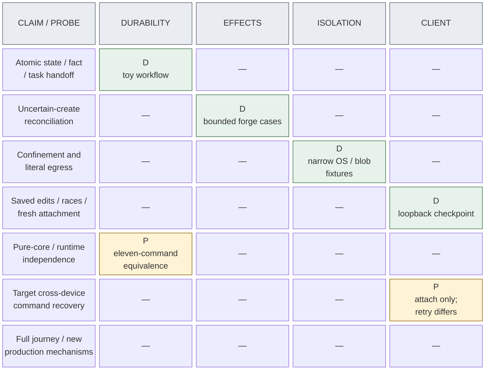
<!-- /render-figure -->

### Runtime source findings and recommendation status

Pinned source evidence establishes native compaction/select/summarize/place behavior, committed transcript history and lossy 2,000-character tool-text input to the default summarizer, terminal checkpoint/memo retirement and latest/nested cleanup. These justify retaining Ledger decision evidence separately from transient runtime material. R2-A003 selects native compaction/search/provider scope; it **does not** require dropped adapter-equivalence checks.

The prior installed-extension inspection remains a historical record: web 0.45.0, FFF 0.11.0, better-compaction 0.7.4 and Claude bridge 0.9.3. **Correction:** the old standalone-web OpenAI-key statement was overbroad; it applies to standalone OpenAI selection, not keyless Exa or all providers. §6.6 and `LAB_R2/designer/web-evaluation.md` now distinguish documented MCP, reusable headless core, Defuddle extraction-plus-discovery and Webfox's published library/direct Durable export. Those initial SDK/peer/source observations were not tests. The later P-WEBFOX-1 evaluation below establishes actual bounded 4.8.0/1.4.0 incompatibility and library capture; it does not establish live quality or production integration.

R1 continuity/fresh contexts, R4 minimal auth and R5 preservation remain recommendations. R2-A003 supersedes old R2's three adapter requirements; R2-A005 supersedes old R3's filtered-gateway/private-grant/helper enforcement. `LAB_R2/evaluation-network.md` checks existing default-bridge host reachability evidence and recommends normal runtime networking with mount/credential/process separation. No network probe was launched. Future §13 checks reflect current scope, not the old six-protocol program.

### Completed Webfox pinned-runtime evaluation and its limits

Independent parent evaluation: `LAB_R2/evaluation-web.md`; report: `LAB_R2/experiments/web/report.md`. Parent preregistration `LAB_R2/web-protocol.md` and experiment records remain unchanged. Parent read actual fixtures, tests, lab implementation, amendments, installed Webfox adapter/root entry and pinned Durable result handling, then ran `./run.sh parent-review` in `LAB_R2/experiments/web`. The designer did not execute that suite. **9 node:test entries, 5 pass/4 fail, exit 1, 5.649008 s** (runner rounded wall time 6 s). W01 has two entries; W08's overflow sensitivity occurs inside W04 before its later text failure, while replay has its own entry. Do not call this eight successful histories or an all-green integration.

**Concrete negative result:** Webfox 4.8.0 `dist/durable.js:109` returns `content`; Durable 1.4.0 `dist/harness/tool.js:434–435` consumes `result.output`, otherwise retained `api.output` progress. Actual Harness dispatches the fixture request, yet W02 commits only `fixture-progress R2-WEB\n`, W03 only progress, and W04/W05 empty substantive text. URL/title/excerpt and partial success/failure identities are lost from that text; details/status/isError survive. Import/registration and invalid/unoffered-tool refusals work with added coding-agent 1.4.0. A host hook mapping content→output is **unrun** and alone would not fix file retention/scope. No claim concerns other versions.

**Full-result and restart witnesses:** direct overflow is complete **78,263-byte** JSON with tail `TAIL-ONLY-R2-WEB-6391` in owned host-temp `web-*/result.json`, mode **0600**, with no conversation-cwd write. History retains the path, not the bytes. The independent observer accepts the reachable canary then rejects its absence after owned-file deletion. Actual child SIGKILL after a fsynced admission marker, reopen and `resume` leaves **one** admission plus visible interrupted error; earlier details/status survive but earlier text is empty. A lab-only safe-replay wrapper yields **two** admissions and is rejected by the single-admission observer. These are two genuine counterexamples, with two restart histories/two SIGKILLs per suite, not setup failures. Real `Conversation.abort` forwards the injected signal and records aborted error; remote termination/billing is not established.

**Supported-library witness, narrowed by parent:** actual root `createWebfox`, explicit local command-provider fixture (no network) and a small registered `render_web_contents` tool use the correct `output` channel. Complete exact body/tail reaches a Durable document; bounded output names digest/length/status/URL, with no Webfox host-temp overflow. But the document has **session scope**, is keyed only by content digest and merely stores caller `conversationId` metadata. No second-conversation authorization/duplicate-content check exists. Adopt complete-result persistence with caller metadata only—not assignment-private access, distinct observation identity or immutable Ledger evidence semantics. Product observation/revision identity must remain separate from content digest (§5.3.1). The command provider is a controlled fixture seam, not a proposal to expose model-selected commands.

**Provenance:** exact Webfox **4.8.0** registry integrity matches preregistration; Durable/Pi AI/Chord **1.4.0** match the original lock/upstream **4a080252f06caf63a525d7873c5d94d3c23887e0**, plus coding-agent **1.4.0**, no nested second runtime. The library trial shares that install and proves no no-coding-agent-install claim. Webfox typebox peer **1.4.3** versus runtime's nested **1.3.27** dispatched/refused the bounded schemas, not universal compatibility. Node **v24.21.0**, darwin-arm64; scripts disabled, cleared environment and probe HOME/temp. About **368 MiB dependency data** is distinct from **~2.9 MiB agent-run results**, with parent results additionally retained.

**Preregistration:** protocol copy is byte-identical to the parent's preregistration; **16 files = 14 current matches + 2 retained-original matches**, independently checked. Two post-run amendments disclosed: W02 supplies the missing unused contents handler to advertise the required capability; W03 permits only Darwin `__CF_USER_TEXT_ENCODING` and checks every request. Original-copy race/reconstruction is disclosed and reconstructed originals match preimplementation hashes. Initial missing-lab-module reds establish setup/order only; neither 16 unchanged current files nor designer-executed tests is claimed.

**Remaining limits:** W03 shows cwd request selection and explicit empty environment apart from the Darwin variable, not Durable ExecutionEnvironment routing/config discovery or assignment confidentiality. An absent foreign canary is weak evidence when the positive own-source assertion fails. Linux/container execution, cross-conversation host-temp reads, generic nested/codemode wrappers, actual provider/key/auth/quality/freshness/rate limits/costs/remote jobs, credential redaction and production scope/retention/privacy deletion/backup remain unrun. No Render authority or final retention policy was implemented. The result supports root-library consumption; **R3-A002/A003, not this experiment, select** Webfox/Exa/Tavily and selective retention. No actual Exa/Tavily authentication, quality or sequential fallback was exercised. No prototype-code adoption, runtime upgrade/fork or additional design experiment follows.

### New history/package feasibility and its limits

Adopted evaluation: `LAB_REV/evaluation-history.md`; protocol and disclosed amendments live under `LAB_REV/storage-protocol.md` and `LAB_REV/experiments/history/`. Parent reviewed the complete implementation/tests/fixtures/export reader/control runner and reran correctness/unsafe controls without another correction. The 20-file hash accounting is **17 current matches and 3 matches to retained originals**, not 20 unchanged current files. Changes were the H04 task-count correction, H06 interleaving diagnostic and added executor-attached unsafe control. Missing-import red evidence establishes ordering only; unsafe controls establish meaningful regression sensitivity.

The six controls detect latest-only history, reference-before-content, missing package content, copying only the live SQLite main file, and automatic restored-task resumption both without and with an executor. Parent inspected the behavioral assertions; incidental fixture failures are not the basis for adoption. The executor-attached control produced two applications versus expected one on every backend. Review tasks are dormant atomic-handoff witnesses, not actual independent reviews.

**Benchmark provenance:** the following is the subagent's measured corpus run inspected by the parent, **not independently timing-rerun**. The corpus is 100 documents × 10 revisions, 36,557,586 total text bytes, approximately 8 KiB–1 MiB each (largest 1,051,161 bytes), with deterministic edits and no exact duplicate revisions. It calibrates these implementations, not future production growth or intrinsic SQL/Git performance.

| Measure | A — SQLite text | B — SQL + file CAS | C — SQL + Git documents |
|---|---:|---:|---:|
| Save p50 / p95 (ms) | 0.409 / 3.491 | 0.687 / 5.414 | 56.886 / 76.552 |
| Old-read p50 / p95 (ms) | 0.048 / 0.542 | 0.047 / 0.640 | 8.546 / 10.086 |
| Complete package (MiB) | 38.0 | 37.5 | 4.2 |
| Restore (seconds) | 0.601 | 2.255 | 8.862 |

All 100 old reads and 20 restored reads per backend matched expected content; independent export readers enumerated 1,000 revisions. C's document bundle is approximately 1.7 MiB and its delta/inspection benefits are real, but its CLI-spawn overhead and extra document consistency protocol are also real in this implementation. A's full-text growth remains; an observed gzip ratio is not a tested compressed SQLite design. No compression subsystem is proposed from these results.

Retain the failed-run history: the initial benchmark had a relative-alternates-path bug for A/B and an **unexplained C timeout at ten minutes, around 95 saves**. The later 99.8-second C success does not explain away that stall. Correctness/control data occupied 943,556 KiB after parent rerun, below the 1 GiB bound; no additional corpus run is requested just to reproduce approximate timings.

**Adopted scope:** exact Unicode/CRLF and immutable revision/content identities; original/revised/rejected/abandoned/accepted/superseded history; acknowledged in-flight checkpoint; preserved fixture human/model/runner provenance; source/verifier links; atomic receipt/dormant task; fresh-process reuse; versioned nonauthoritative JSONL/text export; and enumerated package/corruption/clean-directory restoration cases. C's Git-only export recovers old document text, not status facts, authenticated approvals, receipts or task authority.

**Not established:** product authentication/current revocation/Kernel legality/owner lock, real role execution or tool-replay identity; complete semantic/source-tree validation; hostile-package import safety; orphan GC/multiwriter behavior; missing-post-cutoff admission/receipt recovery, later revocations, incarnation rotation or reconciliation completion; off-host transport/backup file fsync, five-minute protection or physical power loss. SQLite structural integrity and successful Git `cat-file` do not replace retained document digest/length checks. C's prefix-colliding document-ref mapping and untested consistently-manifested tampered bundle must not become production conventions. The prototype's 763 lines are evidence machinery, not Render implementation.

### New incorporation evidence and its limits

Report: `LAB_REV/experiments/incorporation/report.md`; adopted evaluation: `LAB_REV/evaluation-incorporation.md`. Parent independently read all source/tests/fixtures and reran original suite/mutants, verifying all 15 retained preimplementation-file hashes. The earlier designer recorded reading both complete documents, not the test code. The R2 continuation read the complete parent evaluation without duplicating source inspection or reruns; R3 preserves that historical evidence. Keep the three telemetry-only bounds reporters separate from 24 behavioral bodies; they do not add behavioral coverage. The report discloses 25 fixture histories and at least 215 helper Git processes, so a ≤100-process interpretation of the experimental bound was exceeded.

Adopt AM-1's validated input/result classification (§9.4), not the manual's exit-only shorthand. AM-2's `merge.renormalize=true` SIGABRT in bare metadata is operational failure. Environment-sensitive attribute paths are real: hostile global/default attributes can select built-in `merge=union` without a driver process. HOME-only and XDG-only mutants survived because existing canaries depended on inherited driver configuration; the prototype's environment isolation is not thereby shown broken, but regression sensitivity for those independent leaks is missing. The actual full-env sanitizer uses a host-owned empty HOME and omits XDG_CONFIG_HOME; do not call the unmodified prototype exposed. Retain explicit HOME/XDG conflict-outcome regression checks for production V5/V6. The parent adopted bounded feasibility without another probe round; no exhaustive Git certification or universal mutation score is needed. Explicit `--git-dir` makes the GIT_DIR-only survivor equivalent for the tested invocation.

Real Git output/CAS evidence supports mechanics only. Simulated admission/check/Audit/Watchdog ordering illustrates the prior protocol, including now-superseded Audit placement; it does not establish the selected implement-phase/per-pass Audit order, trusted authority, actual verification, production concurrency or SQL/ref crash recovery. Sealing/import, rewritten-target lineage and some filename/conflict forms remain outside the report. The recommended production placement is Effects' sanitized bare merge-tree seam (§9.4), informed by the adopted evaluation; prepared-object retention roots, source/base ancestry and actual durable evidence/admission/journal semantics must not be inferred from the simulator. Figure 13 retains only the four historical probes; it does not silently incorporate this new partial evidence into a product-completion score.

**E-CLIENT evidence does not replace the target design:**

- Device-bound fingerprints reject same-human cross-device retries. Keep principal-scoped command recovery with original-device provenance (§5.3); it remains unverified despite successful fresh-snapshot attachment.
- Fixture worker W can GET all receipts/artifacts. Rejected command replay is not read-resource confidentiality evidence; production must enforce scoped reads and candidate blindness on every path.
- The PID file/stale-PID cleanup is not an OS-lifetime owner lock and does not verify §5.1. The asynchronous `bytesOf` storage callback in `checkpoint.decide` likewise makes this a host/control witness, **not a core-purity proof**; production passes resolved values to Kernel.
- The fixture's direct terminal approval of edited draft bytes is **not adopted product policy**. Human edits require a new immutable emission, regenerated manifest and required independent exact-revision review/dispositions (§8); complete annotation handling, downstream invalidation and final Contract acceptance remain gates.
- The fixture Ledger tool defaults to unsafe replay and accepts model-supplied command IDs. Its allowed/refused invocation proves neither the new stable host-envelope/replay protocol nor safe nested recovery; the commit-before-tool-result crash check remains unrun.
- Postcommit asynchronous broadcasts may repeat/reorder sequences. Monotonic discard/gap-resnapshot behavior (§5.3), or an explicit ordered-server contract, still needs verification; no Durable frame-coalescing result is claimed.

Parent-authored assessments: `parent-evaluation-criteria.md`, `evaluation-durability.md`, `evaluation-effects.md`, `evaluation-isolation.md`, `evaluation-client.md` and `parent-synthesis-review.md`; detailed protocols/reports under the corresponding experiment directories, including `experiments/client/report.md` and its retained amendment diffs/results. These paths provide reproduction, not hidden product requirements.

### Historical challenges and R3 challenge status

The baseline Fable review (`LAB/challenge.md`, parent `LAB/challenge-disposition.md`) and the prior-revision fresh Fable review (`LAB_REV/challenge.md`, parent `LAB_REV/challenge-disposition.md`) remain distinct historical evidence. The latter found no architecture-blocking gap **in the prior design**. The **historical R2** challenge is separately complete in `LAB_R2/challenge.md`, adjudicated by `LAB_R2/challenge-disposition.md`: no architecture blocker in that revision; six bounded corrections below. That R2 challenge reviewed pre-correction candidate SHA-256 `840eb02db28ad1e54aade3d0cb0642d7456262b9328723531e0543ba5a271f0c` without seeing/assuming P-WEBFOX-1 outcomes. Parent adjudication, not every suggested fix, governs these corrections. No verdict establishes implementation or human acceptance.

| Historical finding/correction | Current treatment |
|---|---|
| Baseline F1 agent replay | Stable host-derived task/call envelope, safe Ledger-only commits and rejection of unsafe wrappers retained; actual crash gate unrun. |
| Baseline F2/S1 local progress, prior F-02 human integration rung | Canonical local refs/CAS/journal and independent publication retained. **R2-A007 supersedes human-default approval/grant routes with autonomous eligibility, no setup ceremony.** Human main merge retained. |
| Baseline F3 enrollment | Non-expiring revocable enrollment retained; exceptional supported-restore re-pairing is distinct from routine restart. |
| Baseline F4 / prior F-04 principal establishment | Closed human/assignment-agent/scoped-host command matrix and private host context retained; no sixth module or host impersonation. |
| Baseline F5/F6 schedule/WIP | Distinct pure transition cases, sampled SQLite checks and four executing attempts recommended; release slots only after quiescence, storage separately bounded. |
| Baseline F7 edited draft | New immutable emission/manifest plus required exact-revision review; notes bind original emitted bytes only. |
| Baseline F8/F9; S2 | Filter bypass/literal capture and pre-resume safe-commit distinctions retained. Same-commit task staging retained rather than another materialization protocol. |
| Prior F-01 restore detector | Offline-package-only restoreRequired marker, startup-before-auth/dispatch and atomic local-admin credential/epoch/recovery repair retained. Unmarked arbitrary rollback unsupported. |
| Prior F-03 passed/drift count exemption | Rejected then and now: every actual completed Watchdog review counts, valid passes admissible, D004 cap adoption never resets history. |
| Prior F-05 conflict rework | Retain B/T0/T1/conflicts; new T1-based Attempt/fresh workspace and host-sealed B′. The historical R2 no-new-Audit interpretation is **superseded by R3-A001**: implementation conflict repair opens a new pass with fresh Audit before its handoff, not an exact-X Audit. |
| Prior F-06/N-04/N-05 | Undefined panel removed; Ground human shape confirmation retained when shape not already supplied; no project integration-grant expansion (grant framework now unnecessary). |
| Prior N-01/N-02/N-03/N-06 | Epoch vocabulary retained. Scoped technical grants, post-preparation exact-X Audit and mandatory constrained helper topology **superseded by R2-A001/A006/A005**. Preserve historical reports, not their old prescriptions. |
| Prior N-07–N-11 | Four-stream persistence measurement, trusted OS-owner local admin, immutable historical human acceptance, Record accepted-obligation/integration path and redacted correlation logs retained. Record order now follows R2-A006. |
| Q-01 | **Closed by R2-A011:** native workers deferred, Linux limits explicit, advisory external local-verification prompt required. No native-profile v1 blocker. |

| Historical R2 challenge item | Prior parent disposition and retained correction |
|---|---|
| R3-F01 — duplicate pending request | Accepted: Kernel one pending request per workflow/stage for all principals; rework/retry retains capture. Prior resolution or explicit human cancellation/replacement before a new same-stage request (§3 I2/I12, §6.4, §13). |
| R3-F02 — undefined scope ref | Accepted/refined: retained human Ground/clarifications plus task shape, no new Ground approval gate; exact-emission challenger/dispositions assess classification. Already human-decided product nodes may carry forward; unresolved new product/scope choices block delegation, Kernel checks structure not prose truth (§6.4). |
| R3-F03 — Audit identity/Claim | Accepted: ordinary review-role Assignments/principals, read-only A and own report scope, long-lived role tasks under implementation lifecycle; exclusive Slice/source ownership stays with implementer. Same invocation resumes, no new Claim/gate/module (§6.2.1). |
| R3-F04 — capture cost/exclusions | Accepted cost/profile gap; rejected arbitrary-ignore shortcut/pause protocol. Disclose stop/re-provision losses; host-owned recorded exclusions/manifest never silently omit accepted-base source or intended deliverables (§6.2.1, §7.2). |
| R3-F05 — local prompt command/owner | Accepted: human `requestLocalVerificationPrompt`, exact basis/read scope; Engine pure rendering, Ledger immutable text/basis/receipt retention; no verification execution or gate (§4, §5.2.2). |
| R3-F06 — file/client precedence | Accepted with explicit import semantics: latest accepted settings authoritative; file seeds empty config, later local-admin import/reload requires expectedRevision. No restart override/watcher; stale imports refuse (§6.4). |
| R3-R01 — hypothetical no-draft fallback | Declined new scope/question: existing capability refusal/manual observation is honest and local work stays nonblocking. Only an actual selected-forge limitation may require a later bounded policy choice; no third unresolved choice now. |
| R3-R02 — stale ready projection | Accepted: existing host-owned summary reports current ineligibility/gaps even if ready flag persists, subject to publication uncertainty; no automatic redraft/close or new gate (§9.2–3). |

**Fresh R3 challenge:** `LAB_R3/challenge.md` independently reviewed candidate SHA-256 `e28a91650a9d5aa4e90daff9a3369064e710d038ac3906ae7b24bbfbfefb2616` and found no blocking fidelity or feasibility issue. Parent adjudication in `LAB_R3/challenge-disposition.md` accepts four bounded clarifications, now applied: C-01 makes one accepted handoff identity per pass explicit while preserving idempotent retries; C-02 shows Review's pass reference in Figure 2; C-03 distinguishes transient cache reads from acknowledged Ledger artifacts/history; C-04 distinguishes implementation passes from Watchdog pass verdicts in I19. No new product decision or probe was needed. The current R3 changes, selected policies, proposed mechanisms and completed challenge dispositions are in the [R3 disposition](spec-r3-review-disposition.md). The [R2 disposition](spec-r2-review-disposition.md) remains unchanged historical evidence. Historical evidence files are not hidden new product requirements. Ordinary source/Git/package correctness and authority/recovery checks remain future production work; no repeated broad design research is implied.

**Existing lab reruns** — these commands are real; they do not invoke an implemented Render CLI:

```sh
cd /Users/vr-osxs/infra/pi-durable-design/experiments/durability
./run.sh design-recheck
tools/mutants.sh results/design-recheck

cd /Users/vr-osxs/infra/pi-durable-design/experiments/effects
node --test test/effects.test.mjs
node mutants.mjs

/Users/vr-osxs/infra/pi-durable-design/experiments/isolation/run.sh

cd /Users/vr-osxs/infra/pi-durable-design/experiments/client
./run.sh design-recheck
node tools/mutants.js results/design-recheck-mutants
RACE_REPEATS=20 node --test test/races.test.js
```

Isolation checks its image digest before running: `docker.io/library/node@sha256:06d7adf3e0ef61a13f1d28682726366f97a15aa1888c934d3ecec86c33918b53`, linux/arm64, OrbStack Docker 29.8.2, Apple Git 2.54.0. Reruns write sandbox results and use only labeled disposable containers/synthetic secrets.

Read existing GitHub evidence without mutation:

```sh
gh issue list -R vicrdguez/render-design --label render-design-experiment \
  --state all --json number,state,stateReason,title,author
```

An optional **mutating sandbox-only** rerun is `RENDER_EFFECTS_LIVE=1 node live-run.mjs` from `experiments/effects`; it creates and closes another issue. It is not needed to inspect existing evidence and must never be redirected at a production repository.

## 13. Lean verification strategy and acceptance targets

Retain tests only for algorithmic logic, boundary I/O, integration flows and explicit state-machine transitions. Delete dependency characterization, structural/type-only assertions, prompt wording snapshots and mutation-testing infrastructure. Verify observable behavior at the five module interfaces, with independent literal expected outcomes and prewritten failure cases **before implementation**. Do not inspect/copy/run skl tests. Real SQLite/Git/execution facilities serve their actual seams; scripted models, clocks and controlled external variability make checks deterministic. Keep a check for each distinct regression, not mirrored helper/golden layers. Prompt snapshots and type compatibility do not establish judgment quality or actual integration.

These are **future production targets**, not this revision's executed results. Deleted adapters, enterprise network confinement and native macOS worker support are not unfinished gates.

| ID | Seam / independent oracle | Required result and proposed target |
|---|---|---|
| **V1** | Pure Kernel, cheap direct driver, literal expected obligations/ownership/refusals | Explicit finite-case matrices and meaningful seeded transition schedules, zero invariant violations, with the case or replayable/shrunk failure identified. Changed loop cannot bypass closed principal matrix, Contract freeze, exact decision/evidence, captured checkpoint routing, per-pass Audit/handoff binding or same-/cross-proposal dependencies. Human-only final acceptance/main merge; automatic proposal integration/ready eligibility cannot fabricate evidence. All completed Watchdog rounds count and valid passes remain admissible. |
| **V2** | Ledger on real SQLite, direct and Durable drivers compared to literals | Initial **256 targeted schedules**, zero violations; OS-lifetime **two-process** owner refusal; atomic document/fact/receipt/handoff/task; authorization before dedup disclosure; four executing attempts with blocked ownership retained until quiescence. Larger soak is opt-in. |
| **V3** | Subprocess faults at commit/reply/tool-result, admission/dispatch, preparation and quiescence barriers | Exercise each named critical point explicitly; no partial handoff/duplicate accepted work/manual ledger repair. Identical fresh-fixture repeats are not a required gate. Stable task/call identity and stored envelope recover authorized receipts; unsafe nested mutation refuses. Same-assignment native runtime continuation/cancellation is exercised independently of product authority. |
| **V4** | Two local stateless protocol clients, literal saved bytes and scoped credentials | Exact edit/approval race outcomes; non-expiring enrollment across ordinary restart; revocation closes reads/streams; same-human cross-device receipts; principal forgery refuses before disclosure. Private HTTPS/JSON/NDJSON/poll semantics, monotonic discard/gap resnapshot, scoped history/export and human-requested local-verification text retention without source/verification execution. Reattach **≤5 s** locally. No client UI or physical second machine required. |
| **V5** | Actual Linux profile, controlled canaries, literal source manifests | Verify mount/credential/control-socket exclusions, current tool scope, authenticated reachable control endpoints, whole-container stop and no host-shell fallback. Package/docs/ordinary internet and owned verification services work. **Document host/LAN/tailnet reachability; do not require comprehensive private-route denial.** Literal ingress/egress preserves actual bytes/modes/symlink data; running writer, special-file and quota cases refuse. Native macOS checks reported unsupported/advisory external, not passed. |
| **V6** | Actual private Git refs + Ledger crash barriers, controlled Forge adapter and separately authorized bounded sandbox cases | Automatic eligible proposal integration without approval/grant; exact X/T/CAS/readback/rooting/journal before dependencies. Each implementation pass's Audit A_i with fixes precedes B_i, deterministic X_i/checks then Watchdog. Post-handoff implementation requires a new pass/Audit; no old-pass substitution or same-pass inner re-Audit. Real conflicts return without Watchdog count, operational failures block, T1-based rework preserves originals. Source/target changes invalidate relevant checks/verdict, not rewrite Audit provenance. One draft PR after first integration; later update same identity; all Slices/current publication/evidence trigger automatic ready operation and actual outcome reconciliation. Lost create/promotion, cancellation race, sticky create-duplicate risk and remote divergence never produce false ready/main merge. |
| **V7** | Actual schemas/definitions, historical reads/export and ordinary continuation | Immutable SQLite history, semantic/content validation and scoped access; effective WAL/FULL/fullfsync readback and separate Git/source hardening. Incompatible task definitions preserve inputs/checkpoints/ownership; uncertain effects refuse blind replay. Ordinary restart preserves authority/enrollment and fences obsolete executors. Disaster-recovery tests are deferred. |
| **V8** | Full scripted design/delivery then separately authorized capped model/human trials | Complete and shortened playbooks, independent candidates/fidelity/annotations/negative experiments; verify-create/use/maintain lifecycle. Persistent setting changes affect new requests in active workflows, pending capture unchanged, unrelated D004 rules preserved. Per-pass Audit/fix flow including Watchdog rework, selected Exa/Tavily fallback and three-layer web retention, auto integration/draft/ready, advisory exact-source Mac handoff and truthful platform gaps. Human answers five handover questions in **≤2 min without chat**. Live judgment/search quality assessed separately, not inferred from fixtures. |
| **V9** | Measured local command/snapshot load, excluding model/forge latency | 100 active Slices, two clients, four executing attempts including **four concurrent Durable transcript/tool-result streams** on WAL/FULL/fullfsync: p95 acknowledgement **<250 ms**, snapshot **<1 s**. Test-selection wall times are reported as telemetry, not enforced by a suite-timing meta-test; additional SQLite schedules and history scaling are separate jobs. Historical document-save timings do not establish these budgets. |

Direct product checks cover fencing, stale basis, exact Audit source and pass identity, Watchdog counts, sequential paid web calls, retained provenance/evidence, ordinary integration eligibility, forge uncertainty and sandbox containment. There is no source-mutation runner or required mutation score. Historical mutation results in §12 remain historical evidence, not an active gate. Missed performance targets trigger measurement/simplification, not weaker integrity.

### Concrete current-scope histories

| Area | Failure cases and independent expected result |
|---|---|
| **Checkpoint configuration / D004** | Request human C1 at s2; update s3 delegated; C1 remains human through re-emission/restart/retry. Duplicate same-stage requests from every principal continue C1; they cannot create C1′ with s3. Later C2 or a resolved/replaced-stage request captures current settings without adoption/grant; explicit human cancellation/replacement is checked. Latest accepted settings survive restart despite unchanged stale file; local-admin import/reload with expectedRevision succeeds only against the current revision, stale/concurrent import refuses. Ground scope cites human material without new approval gate; exact-emission challenger flags unresolved new product/scope decisions, while already human-decided constraints remain usable. Pending delegated→human change keeps capture; cancellation fences. Final Contract agent acceptance refuses. Separate review-cap update/adoption/count rules unchanged. |
| **Audit / preparation / review** | P1's two fresh non-fork contexts inspect A1 once; same-pass findings/check fixes produce B1; reports still identify A1. Watchdog sees X1/T/fixes and checks independently. Authorized Watchdog rework opens P2 with fresh Audit A2 before B2, even with same Assignment/conversation/digest; P1 reports cannot satisfy it. Post-handoff conflict/source/verifier repairs likewise open a new pass. Pure deterministic drift/check retries, failed submission, lost reply, restart and replacement do not. Current-pass handoff/report binding is enforced in Kernel/Ledger; duplicate commands cannot allocate extra passes/Audits and pass changes never reset completed-review counts. Ordinary Standards/Contracts review-role Assignments submit scoped reports through existing principals; implementer retains exclusive Slice/source ownership. Long-lived role tasks survive tool-turn abort and resume the same invocation, not another review; Audit never increments Watchdog count. Capture stops/re-provisions the handle, retains source/conversation and may require setup reruns; recorded host-owned generated/cache exclusions must not drop accepted-base source or intended deliverables, and conflicting profiles/bounds refuse visibly. Conflicts preserve B/T0/T1; missing-object/invalid result is error, not conflict. Include HOME/XDG default-attribute conflict sensitivity and exact clean combined-invalid verification. |
| **Native context/provider/tools** | Resume same assignment before/after committed tool result; current role/basis/authority/workspace mandatory. New independent round is non-fork; deliberate inherited-context canary is negative control. Native Claude provider uses supported pinned authentication and only Render-mediated tools; missing configured model/family blocks. Container rg/grep cannot read absent host mounts/foreign scoped inputs. No bridge, FFF or opaque-compaction parity check. |
| **Native compaction/history** | Compact twice, reset and replace with predecessor refs. Literal long output beyond 2,000 characters is preserved in committed history without relying on summary text for exact bytes; important nested/task/live material retained before settlement or explicitly absent. Refresh mandatory packet after compaction/model change. Stale compaction cut refuses; failed blocking compaction visible. Do not invent exact-quality or every-token retention. |
| **Best-effort network/profile** | Controlled ordinary package/docs/own service positives; actual profile mount/env/control exclusions; reachable Render endpoint refuses unauthenticated worker. Record default-network controlled host-canary reachability rather than expecting exhaustive denial. Cancellation/freeze/capture verified separately. No provider/web-helper topology, endpoint grant, private-route matrix or exfiltration gate. |
| **Selected web implementation** | Webfox 4.8.0 root library on pinned Durable 1.4.0: proper output, explicit config, Exa-only success and sequential Tavily on classified primary outage/allowance exhaustion. Controlled fixtures check timeout with/without remaining deadline, local settlement, abort/revocation before fallback, missing credentials, both failures, empty success/no fanout, invalid input/no fallback, partial batches/eligible failed subset only, actual provider/failure attribution and distinct observation IDs even for equal bytes. Interrupted primary/fallback never auto-replayed. Assignment-private large-result paging/tail canary, credential redaction and foreign-handle refusal; inspect actual storage, not cwd. Expiry reports unavailable while committed output/history and promoted Ledger evidence survive. Retained passages/context include relevant negative/conflicting evidence; missing supporting text blocks reliance, whole content retained when needed. Refetch is a new identity/time, never replacement. Real Exa/Tavily auth/quality/fallback/Linux behavior remain unverified; any live checks need separate authorization/provisioning. |
| **Forge readiness** | First integration schedules one create even with later heads. All-but-one Slice, canceled Slice, unfinished Record requirement, missing current publication, stale evidence or unknown association blocks automatic promotion—not eligible local integration. All true schedules ready without human action; lost response reconciles same PR. Ready flag on old source does not satisfy new head; existing owned summary reports current ineligibility/gaps with publication lag/uncertainty, no new redraft/gate. Observe actual human merge, no machine merge request. |
| **Mac/UI prompt** | Exact current/older/unpublished source, verified release versus unmapped artifact, valid tasks versus missing prerequisites, actual Linux OS/CPU/evidence and specific native gaps. Human requestLocalVerificationPrompt checks source/read scope and exact basis; Engine pure rendering and Ledger retention yield grounded text/basis/receipt. Regeneration creates a new immutable artifact; old text remains historical. Refuse unauthorized/stale requests. This acknowledged artifact write does not mutate source, launch an agent, import results or mark any check passed. No advisory completion gate; no Linux-binary macOS portability inference. |
| **Auth/restart** | Two local clients, lost reply/reconnect/revoke while streaming, current scoped reads before receipt recovery. Ordinary restart preserves enrollment and authority; executor fencing remains independent. Local-admin route unavailable to workers. No browser/refresh-token subsystem introduced. |

**Design probes complete; no new broad program.** Existing history/incorporation evidence retains the selected mechanisms with limits; network assessment needs no new probe. P-WEBFOX-1 is complete and independently evaluated (§12): substantive direct-result loss plus complete library capture, not production scoping or live quality. The historical request/closure is `LAB_R2/designer/probe-requests.md`; authoritative preregistration remains `LAB_R2/web-protocol.md`. No further experiment, fork or runtime upgrade is requested. R3-A002/A003 settle backend/provider order and retention; configured limits/provisioning remain engineering work. Future actual-product checks above are still unrun, including real Exa/Tavily behavior.

### Optional physical second-machine work

Still **unrun, optional, low priority and nonblocking** under A023. Historical loopback fixture launcher remains `LAB/experiments/client/tools/demo-host.js`, with smoke transcript under its results; it is not production TLS/enrollment. A later authorized physical trial can securely copy only the intended device fixture credential, tunnel to loopback, attach/read/revoke, then remove disposable credentials and stop the tunnel. No such setup is part of this revision.

After product implementation, optional physical trial: enroll at private HTTPS origin; attach without chat, disconnect first client, answer five handover questions, exercise stale approval and revoke command/stream access. Keep distinct from required local two-client checks and human-copied external Mac verification; neither implies a distributed executor.

## 14. Staged implementation and decision status

This is a **future plan**, not implementation, deployment, migration, live configuration or forge authorization. **R3 independent parent evaluation, fresh Fable challenge and parent adjudication are complete; four bounded clarifications are applied.** Earlier challenges/adjudications remain historical. No native-worker release-scope or web backend/provider/retention selection remains open.

1. **Design accepted by the human.** Independent parent evaluation, fresh Fable challenge and parent adjudication are complete; the four bounded clarifications have been applied and checked. The human subsequently explicitly accepted this specification. The **R3 disposition** records that acceptance while preserving earlier challenge/evaluation records and both historical dispositions unchanged. R3 selections are not reopened or inferred from fixtures. No new probe/research round was needed: remaining actual integration and failure handling are production checks, not demonstrated behavior.
2. **Persistent server/protocol.** Kernel/Ledger, real owner lock, supported schemas/definitions, persistence readback, scoped closed principal matrix and private protocol. Immutable SQLite documents/history/export; stable safe tool envelopes; pending checkpoint captures/new request timing and **separate unchanged D004** adoption. Client-facing local-verification prompt is grounded data, no client UI. Disaster-recovery mechanisms are outside v1.
3. **Native execution and small web capability.** Assignment-scoped continuity, explicit non-fork independent contexts, native Durable compaction, container bash grep/rg and native Pi Claude provider. Existing Linux-container mount/credential/process controls and ordinary networking; literal capture and whole-container quiescence. Implement selected **Webfox 4.8.0 root-library Exa→Tavily** sequential fallback, scoped result files/observation IDs, proper Durable output, cancellation/deadlines and selected three-layer retention; no dropped adapter/runner/framework workload or mandatory helper topology. Native macOS execution stays deferred.
4. **Verification and design playbooks.** Repository verification asset, project ladder, create/update/maintain roles, on-demand/change-triggered maintenance and greenfield bootstrap. Full/shortened journeys, exact emissions/annotations/fidelity/protocols/negative evidence, captured technical approval settings and human final intake. Current playbooks may grow later; no DSL.
5. **Delivery and autonomous local progress.** Existing Kernel/Ledger state records pass identity/transitions and enforces one fresh Standards/Contracts Audit on A_i → same-pass fixes/rechecks → B_i/handoff → validated X_i/checks → Watchdog. New post-handoff implementation, including Watchdog rework/conflict or source/verifier repair, requires a new pass/Audit; recovery/deterministic retries do not. Preserve all lineage and Watchdog counts. Real source rooting/CAS/ref-to-Ledger crash reconciliation qualifies autonomous proposal integration without approval/grants; forge does not schedule local dependencies.
6. **Proposal-only publication and automatic ready.** One Forge submodule/actual provider plus controlled verification adapter. Scoped credentials/main exclusion, source publication CAS, one early draft PR/update identity, narrow ready operation when all required Slices/current publication/evidence qualify. Reconcile unknown create/promotion/readback; no machine main merge or advisory attestation gate.
7. **Personal-tool unattended readiness.** Verify retained-v1 ordinary durability, source/effect safety and cumulative workload commitments. Local two-client checks are required; physical second-device trial stays optional. Disaster recovery and upgrade design remain separate post-v1 work.

### Selected versus recommended versus open

| Area | Status |
|---|---|
| Pure Kernel, accepting Ledger, ordinary Engine, Sandboxes, Effects/Forge | Five-module design retained; no sixth module or generic framework |
| Technical checkpoint routing | **Selected:** persistent settings captured per request, pending unchanged, technical Seams/Modules maximum, final Contract human; no scoped TechnicalGrant |
| Review cap/other config | **Selected D004/A007:** future defaults, explicit active adoption, immediate current-authority revocation; default 2, unchanged counts |
| Audit/order, preparation, proposal integration and ready promotion | **Selected R2-A006–010, clarified R3-A001:** one Audit/fixes per implementation pass before B_i; deterministic X_i before Watchdog; new implementation after handoff gets fresh Audit, not an inner re-Audit. Proposed passOrdinal in existing Kernel/Ledger state enforces binding. Autonomous integration/ready and human main merge unchanged |
| History | **Selected D006/R2-A009, qualified for v1:** immutable SQLite history/export, FULL/fullfsync and separate Git hardening. D003 and package recovery are deferred; no physical zero-loss/RTO claim. |
| Native runtime and worker scope | **Selected R2-A003/A005/A011:** native compaction/grep/native Claude, Linux workers, best-effort networking, native Mac workers deferred, advisory exact-source handoff. Existing Docker/OrbStack normal networking and host-native trusted provider/web libraries recommended, not newly configured |
| Durable contexts / protocol / practical defaults | **Recommendations:** same-assignment continuity, phase-refreshed coordinator, fresh independent contexts, four executing attempts, read-only Watchdog, immutable emissions/decisive evidence; private Serve/loopback JSON+NDJSON/poll and non-expiring 256-bit device bearer |
| Verification asset | **Recommendation:** fallback tests/build/inspection replaced by a project's own ladder; runnable catalog, `.render/verify.md` / journeys with explicit legacy-path support; on-demand/change-triggered maintenance |
| Web backend/provider and result retention | **Selected R3-A002/A003:** Webfox 4.8.0 supported root library, Exa primary/Tavily sequential fallback, human-provisioned API keys; bounded assignment-scoped expiring working cache + native committed output/history + exact relevant Ledger evidence before reliance. Fallback classifications/deadlines/bounds are proposed engineering detail, not proven upstream automatic chains. No paid plan, numeric budget/cache lifetime/quota/privacy-deletion schedule selected; no provider quality/auth/fallback/Linux pass claimed. |
| Backup destination, actual project task prerequisites | Deployment/project facts, not new architecture permission questions; missing details must be displayed honestly |
| Q-01 native macOS scope | **CLOSED:** deferred native workers; no conditional stage acceleration or v1 native-profile blocker |

Future per-request natural-language delegation and additional playbooks remain possible scoped iterations, not unfinished v1 requirements. A later tighter local-Mac integration is justified only by experienced friction, not invented now.

**Conclusion:** keep the personal tool comfortable and the five modules deep. The trust dial needs persistent settings, not grant bureaucracy. Implementation owns one fresh-context Audit and fixes **per pass**; exact current X still governs Watchdog/integration. Ordinary container networking is not a private-network guarantee. Automatic proposal progress ends at human main merge. History and honest evidence remain durable without pretending every cache or Linux check covers more than it does. Selected Webfox/Exa/Tavily fallback and three-layer retention stay behind existing Engine/Ledger seams. R3 parent evaluation and fresh challenge are complete; production checks remain unrun. This is the **human-accepted design**, not an implemented or verified product and not permission to execute effects.
