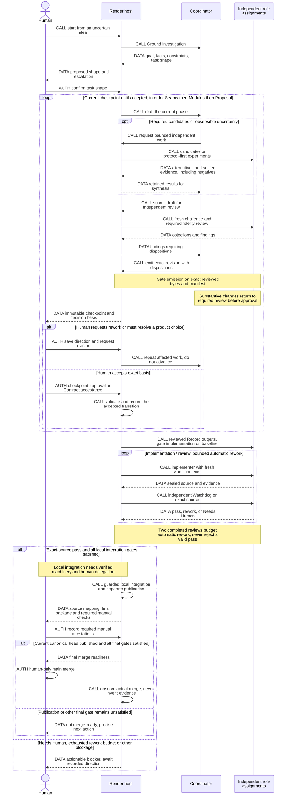
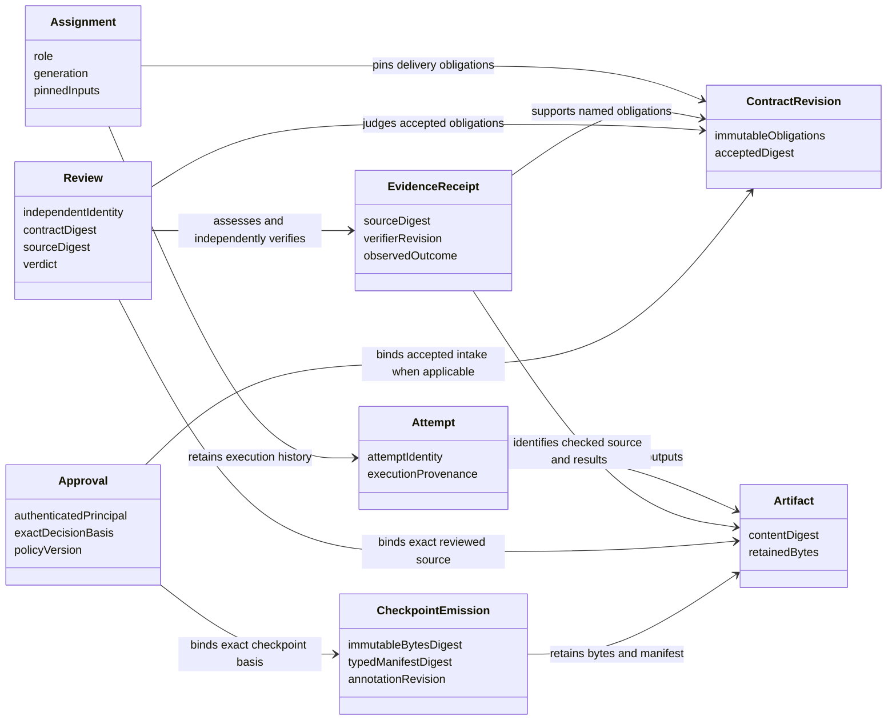
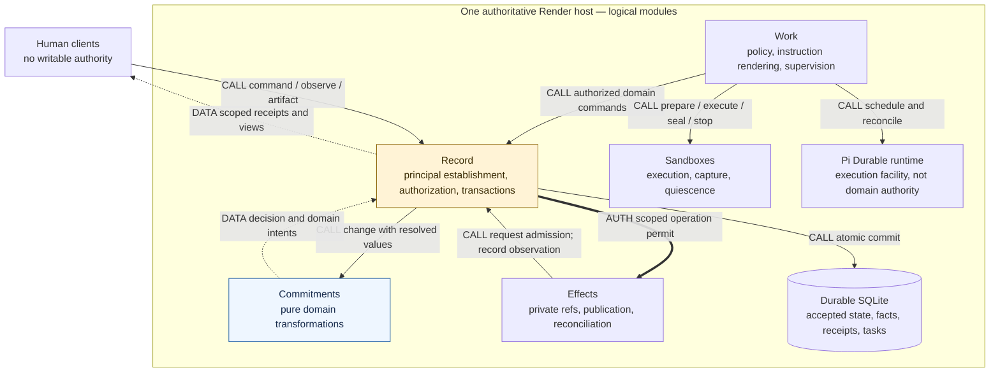
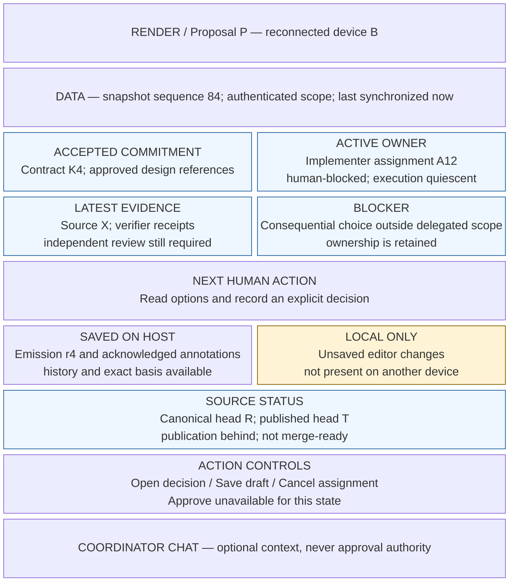
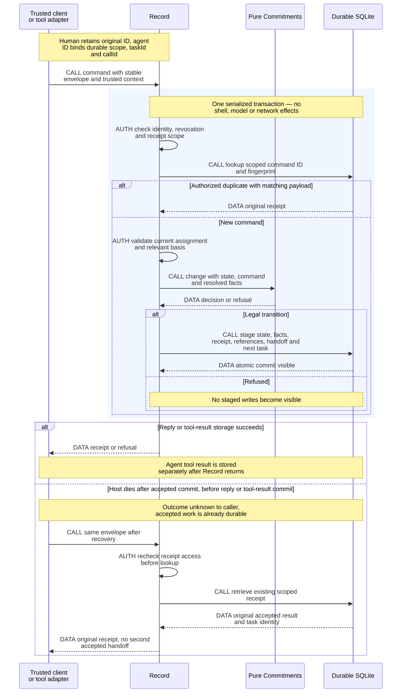
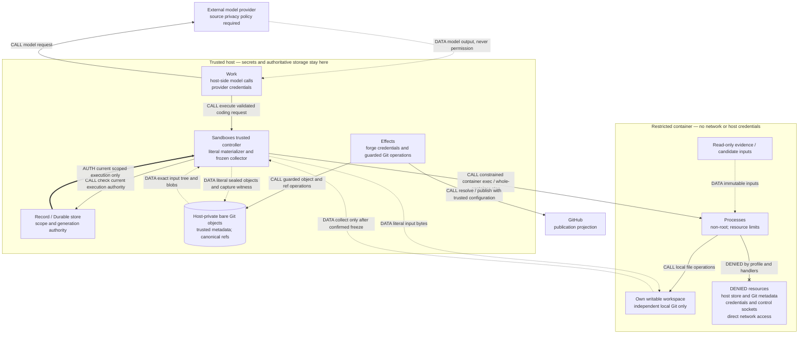
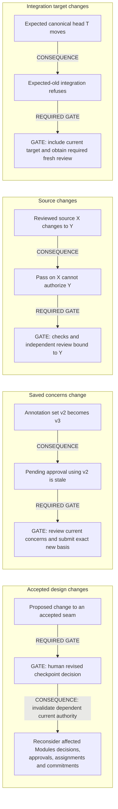
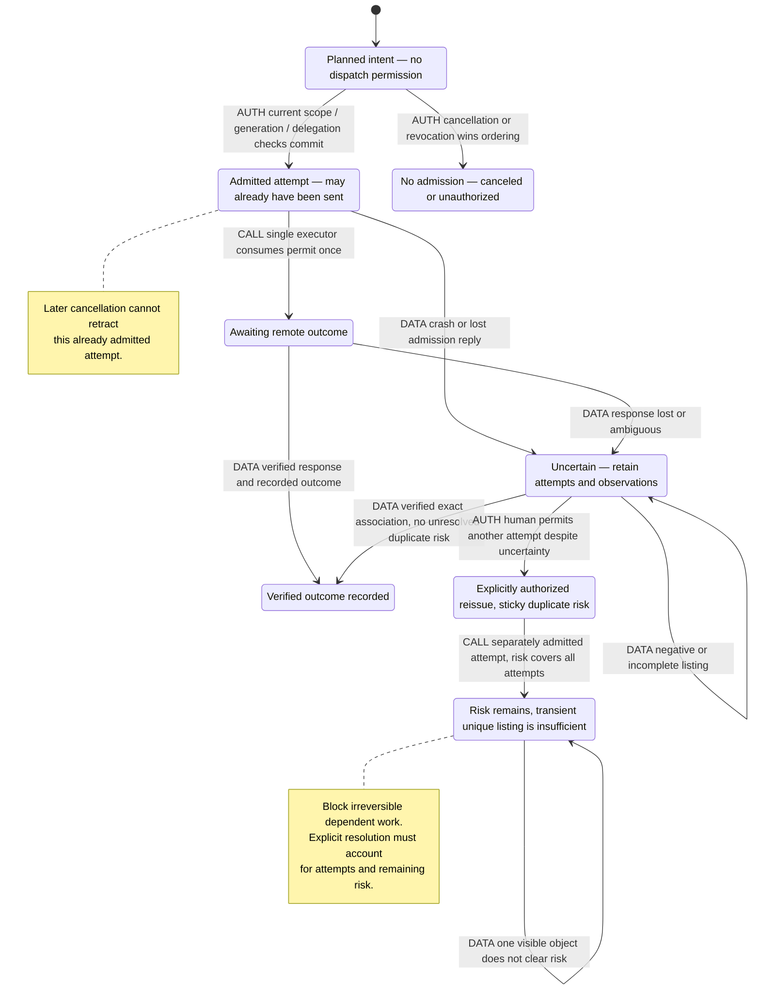
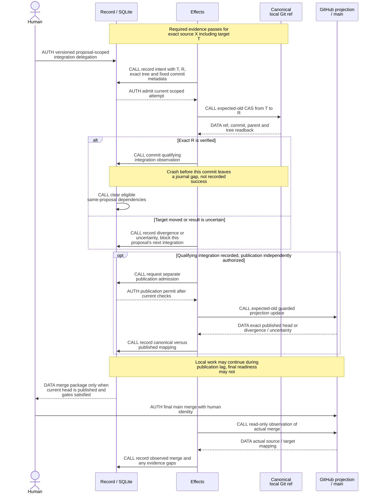
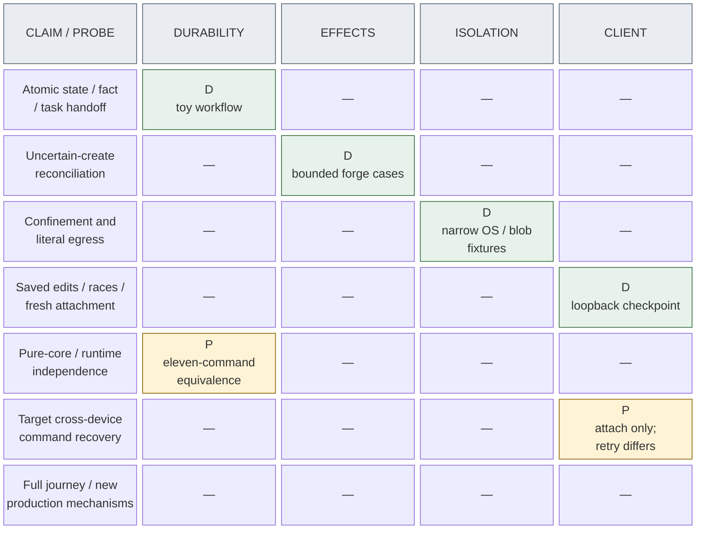

# Render: trustworthy delegated development

**Status:** initial design ready for **human acceptance**, not an implementation or authorization to migrate existing workflows. All four focused prototypes have been independently evaluated, and the final independent challenge is complete and dispositioned (§12). Revised defaults remain proposed; new replay, local-integration and enrollment mechanisms remain unverified implementation gates, not production-proven behavior.

## 1. Outcome, scope, and defaults

Render should let a human take an uncertain idea through design, explicit commitments, implementation, verification, and independent review; leave or switch clients; and resume without reconstructing workflow state or wondering what was authorized.

**One authoritative host runs on this machine. All other devices are clients.** Workflow authority does not live in a conversation, client checkout, GitHub label, or agent judgment. Pi Durable supplies execution facilities; pure domain transformations define legitimate changes; the host enforces authorization and records accepted outcomes.

The intended journey is **Ground → Seams → Modules → Proposal → Record → implementation/Audit → independent Watchdog → human final merge**, including annotated checkpoints, challengers, competing candidates, protocol-first isolated experiments, retained negative evidence, and explicit product decisions.

<!-- render-figure: 01 -->
**Figure 1 — Journey and human gates.** Proposed workflow, not an executed end-to-end trace. Lanes distinguish responsibility, not deployment. CALL requests work; DATA returns retained information; AUTH requests an explicit human decision that the host must validate. Independent roles have separate assignments/contexts even when sharing a lane. Rework repeats the affected phase; it is not approval.


<!-- /render-figure -->

Recommended initial product defaults:

- A small Render web client, accessible privately, with a workflow overview, coordinator conversation, editable review documents, evidence viewer, and explicit approval/cancellation controls.
- Human approval at all three design checkpoints. Seams and product decisions always require a human; final Contract acceptance remains human-owned. Explicit Modules-stage delegation may be added without changing those requirements.
- Read-only Watchdog: suggested Debt Markers or other changes return through implementation and verification rather than receiving a special post-review exception.
- Workers have no host shell, host credentials, network access, or shared Git metadata. Model execution remains host-side; coding tools execute in restricted per-assignment containers.
- Git, not Jujutsu. No decision-model dependency. No automatic final merge. Recommend a host-private canonical proposal ref with GitHub as its publication projection; qualifying local integration may advance same-proposal work under explicit human delegation after targeted verification.
- Revocable 30-day absolute device enrollment with renewable 24-hour sessions; optional non-authoritative next-human-action notifications. These durations and renewal policy require human acceptance.
- Four executing attempts, not four occupied ownership records. Human-blocked work retains ownership; only confirmed process quiescence releases its execution slot, with retained storage limited separately.

These are proposed defaults requiring acceptance, not permissions inferred from this design request.

**Non-goals:** a generic workflow framework or DSL; independent/offline writers; multi-host failover; a speculative adapter ecosystem; ordinary Pi-extension compatibility; exactly-once external effects; automatic principle generation; or a production implementation during this design. Existing skl workflows and configuration remain untouched. No skl tests were inspected, run, or used as references.

## 2. Start from histories, not a module diagram

The following representative histories define what the design must explain. They are designed scenarios, not claims of replaying production sessions.

| History | Required outcome | Failure to defeat |
|---|---|---|
| H1: uncertain idea to delivery | Challenger reveals an incidental choice; an experiment disproves the favorite; revised commitments are explicitly accepted; independently reviewed work reaches human merge. | A persuasive coordinator turns evidence or silence into commitment. |
| H2: annotated checkpoint, abandoned client | Human saves arbitrary Markdown edits, requests rework, leaves; another client and fresh coordinator recover every saved concern. | Lost annotations, overwritten bytes, or dependence on old chat. |
| H3: lost handoff response | One report, assignment closure, receipt and next task survive a crash before reply. | Retrying increments a review round or releases a newer assignment. |
| H4: concurrent clients | An approval and an annotation save against the same basis have one explicit ordering. | An obsolete approval silently authorizes new content. |
| H5: uncertain external creation | A successful remote create with a lost response is reconciled or explicitly blocked. | Negative listing causes a duplicate create. |
| H6: source changes after review | A pass on X remains historical evidence, never permission to integrate Y. | A ready label, source name or old verdict substitutes for exact evidence. |
| H7: canceled worker still alive | Authority is fenced immediately; workspace reuse waits for confirmed quiescence. | A surviving child or old generation writes into replacement work. |
| H8: runtime upgrade | Unsupported persisted work is visible and blocked, with a supported recovery path. | A new handler silently reinterprets an old checkpoint. |
| H9: hostile worker output | Shell, Git metadata, attributes, symlinks and rendered documents cannot acquire host or human authority. | Hidden tools or a different working directory are mistaken for isolation. |

The assurance goal is **safe continuation or a precise actionable blockage at every named failure point**, without manual ledger repair, lost acknowledged human edits, or inferred authorization. Blockage is a successful safety outcome where safe continuation cannot be established; it is never reported as completion.

## 3. Source-backed behavior and intentional changes

### 3.1 Source register and precedence

References below are local, inspectable sources, not claims that the source system already implements Render.

- **U — current intent:** this task, `docs/ambition.md`, and `AGENTS.md`. Repository rules require tests/failure cases before implementation here.
- **T — transcript:** `skl_conversation_transcript.md`, read completely. Later user clarification makes central hosting the only mode and requires pure transformations independent of orchestration topology. Earlier assistant suggestions of distributed writers, a DSL, or putting mandatory independent review solely in the loop are not requirements.
- **D — design method:** `skl skill design`, its `DEEPENING.md` and `DESIGN-IT-TWICE.md` resources; testing and domain guidance. Interfaces include ordering, authority, errors and required configuration, not just method signatures. Depth means leverage; locality means reasons to change concentrate in one place.
- **C — source domain:** `/Users/vr-osxs/dev/skills/CONTEXT.md`, inspected at source revision `480179ce60db591a62562a94b27bf35a32b7505f`. Relevant production claim/handoff source was read to distinguish mechanics from intent, not copied as architecture.
- **A5/A6/A7/A13/A14:** skl ADRs 0005 (contract verification/fidelity), 0006 (private records/ownership/recovery), 0007 (latest-view publication), 0013 (proposal integration versus human main merge), 0014 (amendment and Contract freeze).
- **A18–A22:** skl ADRs 0018–0022: decision classes and lint, repository verification, principles, task shapes, annotated design checkpoints and experiments.
- **L0 — original accepted proposal:** `projects/skills/proposals/design-workflow/proposal.md` at ledger revision `8d4b7651431a2c09ffde521dff1221dfb7abd482`, accepted 2026-10-19.
- **L1 — recorded status and Contracts:** read-only `skl browse` at revision `9a02a327dd6c2e4ac40a985bdbf5d8b5434405d7`. Contract references below use `projects/skills/proposals/design-workflow/<slice>/{intent,behavior,plan}.md`; `B<n>` identifies a behavior obligation, not a test.
- **P — runtime:** pinned Pi Durable 1.4.0 package and commit-specific specification; exact provenance, results, limits and rerun commands are in §12.

**Delivered versus intended:** L1 records `contract-lint`, `verification-skill`, and `principles-tier` integrated into `proposal/design-workflow`, not delivered to main. The proposal remains open and not fully delivered. `checkpoint-engine` and `design-playbook` are dependency-blocked, without reports. `work-router` is now Ready for Implementation with an active decision and an unsatisfied added integration dependency, superseding earlier Needs Human reconnaissance. A seventh integration-only slice exists; its test-related content is not used here. Glossary terms and ADRs marked accepted/pending do not independently establish delivery.

**Accepted future scope:** L0, A22 and L1 require Ground/Seams/Modules/Proposal/Record, editable checkpoints, annotation responses, challengers, candidates, isolated experiments with protocols, product decisions, fidelity review, and resumption from durable records. These remain first-class Render requirements despite partial skl delivery.

**Explicitly deferred in skl:** reflect/principle-writing automation, promotion tooling, role dispatch-with-wait, and repository design documents by default. Render retains the first two deferrals, makes durable role execution core scope, and treats repository design documents as an explicit product choice. This user specifically requested `docs/spec.md`.

### 3.2 Catalogue: invariants versus policy

A **Contract revision** is an immutable accepted set of obligations. An **Assignment** reserves work for a role and generation with exact inputs; an **Attempt** executes it. An **Artifact** is retained immutable content with provenance, not a temporary path. An **Approval** is an authenticated decision over an exact basis. An **Operation** is an intent/attempt to cause an effect outside Record's transaction (local Git or forge), distinct from an observation of its outcome.

| ID | Rule or target behavior | Source and owner | Verification |
|---|---|---|---|
| I1 | One host accepts authority. Clients, chats, exports and forge projections cannot mutate domain state independently. | T late, C, U; Record | V2, V4 |
| I2 | Approval identifies exact request, content/intake, annotation and policy revisions. Defaults, silence, prose and edited metadata are not consent. | C Human Decision, A6, U; Commitments/Record | V1, V4 |
| I3 | Every accepted entry path enforces domain integrity and mandatory review. Changing the loop cannot bypass them. | U; Commitments | V1, V2 |
| I4 | One active assignment generation per exclusive work scope. Old generations cannot submit, release newer ownership, or obtain new effect permits. Timeout is not proof of death. | C Claim, A6; Commitments/Sandboxes | V1, V3, V5 |
| I5 | Accepted state, fact, receipt, report references, assignment handoff and next task commit atomically. | C Phase Handoff, A6, U; Record | V2, V3 |
| I6 | Same command ID and payload returns the same authorized receipt, never another execution. Changed payload conflicts. Authentication/scope precedes receipt disclosure. | A6, U; Record | V2–V4 |
| I7 | Contract obligations cannot drift. Consumed Contracts stay frozen even after assignment release. Human direction within a Contract is not a waiver. | A5/A14, strengthened; Commitments | V1 |
| I8 | Evidence binds exact Contract, source, target observation, verifier inputs and role. A pass on X cannot authorize Y. | C, A5/A18/A19; Commitments/Effects | V1, V5, V6 |
| I9 | Dependencies clear only on qualifying observed integration, never a pass/PR-ready flag. Delegated local integration can clear same-proposal edges independently of publication; cross-proposal/main edges require their separate qualifying observations (§9.3). | C Dependency, A13, proposed local authority; Commitments | V1, V6 |
| I10 | Human alone performs final merge into main. Delegated proposal integration must preserve exact reviewed content and guarded target identity. | C Merge Authority, A13, U; Commitments/Effects | V6 |
| I11 | Saved document revisions, annotations, objections and dispositions are attributable and resumable. No annotation is silently dropped. | A22, checkpoint-engine B2–4, design-playbook B2; Record/Commitments | V4, V8 |
| I12 | Seams and product questions require a human; one acceptance path validates the exact displayed intake and decision basis. | A22, checkpoint-engine B7–8; Commitments | V1, V4 |
| I13 | Coordinator cannot substitute for challenger/candidate/experiment roles or independent Watchdog. Distinct contexts and capabilities are enforced. | A22, design-playbook B3, C; Work/Commitments | V5, V8 |
| I14 | Experiments record criteria before execution, isolate writers, compare sealed inputs, retain negative results, and never create commitments by themselves. | design-playbook B4, checkpoint-engine B5; Commitments/Sandboxes | V1, V5, V8 |
| I15 | Structural lint checks coverage/references/provenance; agents judge merit. Forbidden or unplanned consequential choices are surfaced. | A18–20, design-playbook B5; Commitments/Work | V1, V8 |
| I16 | Local results survive forge failure. Unknown effects remain unknown until justified reconciliation; no blind non-idempotent retry. | A6/A7, T, strengthened; Effects/Record | V3, V6 |
| I17 | Disconnect is not cancellation. Cancellation fences new authority but cannot retract already admitted effects or erase evidence. | U, P; Record/Work/Effects | V3–V6 |
| I18 | Unknown schema/task versions block visibly; upgrades preserve historical meaning and ownership. | A6 schema, U; Record/Work | V7 |
| I19 | Checks, Audit, Watchdog and manual verification are distinct. Completed reviews count once; a rework limit never rejects a passing verdict. | C, A5/A6; Commitments/Work | V1, V8 |
| I20 | Actual handlers and execution profiles enforce capabilities; tool visibility and role prompts alone do not. Untrusted content stays inert. | U, P; all effectful modules | V4, V5 |

Mandatory integrity/authorization rules belong in pure Commitments transformations, enforced by Record on every command. Filesystem/process/credential restrictions additionally require actual enforcement outside the core.

Scheduling policy chooses among legal actions: eligible Slice order, WIP limits, model choice within required separation, extra candidates, bounded retry/backoff, and attended waiting. Policy changes are versioned; they cannot waive obligations, manufacture consent, or substitute missing evidence. The initial automatic rework budget is two completed reviews, counting Needs Human and excluding interruptions/duplicate recording; further rework requires human direction, while a valid pass is always admissible.

<!-- render-figure: 02 -->
**Figure 2 — Evidence and decision relationships.** Proposed conceptual data model, not a database schema. Every link is a DATA reference, not a call, lifecycle transition, or permission. Approvals record authenticated exact-basis decisions; artifacts and review verdicts cannot grant human authority. Multiple evidence records can support multiple obligations.


<!-- /render-figure -->

### 3.3 Deliberate redesigns

| Historical choice | Render choice and consequence |
|---|---|
| Git-ledger files/CLI conventions and supervisor choreography | One transactional host authority and ordinary durable task code. Read-only exports remain possible; no second writable ledger. |
| Suggested event-sourced replay | Versioned current records plus immutable accepted facts and receipts in one store. Recovery does not rerun obsolete scheduling policy. No event framework. |
| Freeze inferred from current Claim/report state | Persist `everAssigned`; release never makes a consumed Contract editable. Amendments create a new accepted revision only before assignment; later changes use supersession/replacement. |
| Body-opaque checkpoints and file-existence-only provenance | Editable Markdown plus a small typed manifest of nodes, reference digests, annotation responses and dispositions. Enforce structure, not prose merit; no DSL. |
| Only experiment report retained | Retain protocol, selected source/fixture snapshots and raw decisive evidence as well. Nothing automatically copies experimental code into consumer source. |
| Watchdog may edit Debt Markers | Read-only Watchdog; implementation applies any change and obtains evidence for the resulting source. Removes a special evidence exception at the cost of a possible extra round. |
| Invocation Auto Mode / possible automatic Proposal acceptance | Explicit scoped delegation, not a lane flag. Initial human Contract acceptance; proposal-branch integration is separately authorized and never main merge. |
| Best-effort publication without durable attempts | Latest-view descriptive updates remain nonblocking. Consequential creates, source updates and integration get durable operation identities and uncertainty handling. |
| Worktree/cwd isolation and ordinary host Git | Restricted execution and literal source materialization/collection. Added containment is justified by observed exploits, not by speculative infrastructure. |

## 4. Compared decompositions and recommendation

The relevant dependencies are pure computation, real local SQLite, owned client transport, pinned Durable/model execution, and true external OS/Git/GitHub effects. Use adapters only where behavior genuinely varies: direct versus Durable execution for verification, scripted versus real provider, controlled versus actual external effects. Do not create future-backend registries.

### Alternative A: phase-owned vertical modules

Design, Delivery and Review each expose `start/advance/observe`, own their persistence, instructions, tasks and recovery, and exchange immutable handoff packages. Host authenticates and routes.

**Depth:** strong phase-local leverage. **Locality:** changing phase instructions is easy, but ownership, cancellation, approval and provenance changes cut across all phases. Atomic handoffs demand shared transaction/identity machinery anyway. H3 and H8 expose the burden: several histories must advance or migrate consistently. Deleting a phase spreads useful behavior, but deleting the shared handoff framework removes indirection. This decomposition favors independent organizational deployments, not this one host.

### Alternative B: Durable task tree as authority

One Workflow Run module exposes `start/signal/watch`. Task checkpoints, child lifecycles and transcript documents represent workflow state; tools signal the parent.

**Depth:** smallest initial interface, strong runtime leverage. **Locality:** graph edits become persistence/meaning edits; parent cancellation and handler migration can alter accepted obligations. H2/H7/H8 require an independent record of approvals, artifacts and ownership anyway. Watch is not an event ledger. Once that record exists, the task tree should be execution, not a second authority.

### Recommended: five deep modules with local reasons to change

| Module and interface | Hidden behavior | Locality and deletion test |
|---|---|---|
| **Commitments**: `change(state, command, verifiedFacts) → decision`; `view(state, scope) → domainView` | Named pure transformations for designs, obligations, approvals, assignments, dependencies, evidence and integration eligibility. Returns next state, facts and concrete work/effect intents or refusal. | Domain meaning changes here. Deleting it spreads rules across clients, tools and recovery. No I/O, clock reads, IDs minted internally, Pi imports or task graph knowledge. |
| **Record**: `command(envelope, authenticatedContext) → receipt`; `observe(scope, cursor?) → snapshot/updates`; `artifact(read/upload) → content/ref` | Private principal establishment; transaction-time authorization/scoping, revision checks, atomic commits, receipts, immutable facts/artifacts, annotations, projections, schema readers and recovery views. | Authority/persistence/client protocol changes here. Deleting it spreads transaction and stale-command logic. Context comes only from trusted adapters; no arbitrary caller-provided database writes. |
| **Work**: `reconcile(workflow) → progress/blockage`; `render(assignment) → packet` | Fixed workflow policy, bounded budgets, role instructions, provider calls, Durable definitions, explicit child configuration, task associations and recovery. Selection/rendering are pure internal seams. | Practice/scheduling/runtime changes stay here. Deleting it makes callers supervisors. |
| **Sandboxes**: `prepare(assignment, profile, inputs) → handle`; `execute(handle, authorizedToolCall) → result`; `seal(handle) → sourceWitness`; `stop(handle) → quiescence` | Per-assignment environment, literal input materialization, tool/process execution, resource limits, frozen capture and termination. | OS/tool execution changes stay here. Four methods describe actual ownership better than hiding execution behind a cosmetic three-method interface. |
| **Effects**: `perform(operation) → observation`; `reconcile(operation) → observation` | Host-private proposal-ref integration and credentialed Git/GitHub publication, exact identities/heads, admission permits, operation reconciliation, bounded latest-view updates and refusal of unauthorized integration. | Git/provider effect semantics change here. Deleting it spreads unsafe retries. It owns private refs and credentials that Sandboxes must never receive. |

Initially these are five modules in one application, not separately deployed processes/packages. **Principal establishment is an internal seam of Record**, with two adapters: HTTPS device sessions and server-bound Durable conversation identities. They produce trusted `authenticatedContext`; no client/model can supply it. Record separately rechecks current scope, revocation and authorization in its transaction before dedup disclosure or mutation. Browser-security changes stay within the HTTPS adapter; pure/core and Record transaction checks need not pass through HTTP. A sixth forwarding module adds no leverage. Sandboxes stays separate from Effects to keep shell execution away from credentials.

A small method count must not conceal a generic interface. `command` is a closed union of actual Render operations: create design, save annotations, emit/rework/approve checkpoint, accept/amend/supersede work, assign, submit result, cancel, decide, admit effect and record observation. It accepts no scripts, user-defined reducers, arbitrary task types, SQL or caller-selected paths. Internally it dispatches to ordinary named pure domain functions, not a compulsory generic event reducer.

<!-- render-figure: 03 -->
**Figure 3 — Modules and authority.** Proposed logical module view—not a deployment or task graph. Solid arrows labeled CALL are invocations; dotted arrows labeled DATA carry values; thick AUTH arrows represent checked permits, not general trust. Record is the accepting authority; Commitments defines domain legality without I/O. Durable executes work but does not define its legitimacy. Transaction-local task staging is detailed in §5.4, not another scheduler here.


<!-- /render-figure -->

## 5. Host, client, authentication and records

### 5.1 Concrete initial deployment

One Render process holds an OS-lifetime exclusive store lock **before `Harness.open`**, through shutdown. A second process refuses before runtime initialization. SQLite's locks are not an owner protocol: the pinned runtime accepted a second open in the probe. The first persistent implementation stage must include this lock and its real two-process test.

The initial transport is a **dedicated HTTPS origin exposed only through Tailscale Serve to enrolled human devices**; the Render listener binds loopback behind that proxy. Tailnet access control restricts eligible devices, but application authentication remains mandatory, including on loopback. Proxy headers are not authority. Do not expose an unauthenticated LAN listener or remote shell. Provisioning is a release task, not performed by this design.

Record's HTTPS principal-establishment adapter handles enrollment/session checks; its Durable adapter resolves server-bound conversation/assignment identity. Both pass trusted context to Record's transaction-time authorization, never a client-authored principal.

For a new, expired or revoked enrollment, a trusted operator action on the host's local administrative interface creates a random, single-use pairing secret, valid for five minutes and scoped to one human principal/device. Exchange at the exact HTTPS origin atomically consumes it and creates a revocable device enrollment plus session. Pairing secrets never enter an agent conversation, log or URL. No worker identity can mint one; the local admin socket is operator-only and never mounted into a worker.

**Proposed default: 30-day absolute enrollment and 24-hour renewable sessions**, with sessions capped by enrollment expiry. Use separate 256-bit opaque `__Host-` session and private browser-held renewal cookies: Secure, HttpOnly, SameSite=Strict, Path=/, no Domain. Store only keyed verifiers/hashes and server-side principal/device, resource scope, expiries and revocation epoch; neither credential is model-visible. Renewal revalidates enrollment, scope and epoch atomically, cannot widen scope, extend the absolute enrollment lifetime or revive revoked authority, and uses the same Origin/CSRF and rate controls as other mutations. Session expiry alone does not require host-local pairing. Durations and renewal are human product/security decisions, not accepted invariants; production protocol/security verification remains required. Rate-limit pairing, renewal and failed authentication. Separate device enrollments identify the initial single human's devices, not fictitious multiple people.

Mutations require exact Origin, CSRF token, and JSON content type; no cross-origin credentialed access. Stream establishment and every command revalidate session and enrollment state. Device revocation commits an enrollment epoch change, invalidates its sessions and renewal credential, rejects new requests, and closes its streams; both expiries are enforced during long-lived observation. Authentication and resource scope are checked **before deduplicated receipts are returned**. Every view, artifact, receipt and stream is filtered by resource/assignment scope, including candidate blindness; mutation refusal alone does not establish read confidentiality. Compromised enrolled human credentials remain a real threat: they confer the owner's scoped authority until revoked. No language model or prompt can make that safe.

Work's provider credentials and internal assignment identities are separate from browser sessions. Models supply command content, not trusted `principal`, `by: human`, capability fields or agent command IDs. The trusted adapter injects effective identity and Record validates it on every direct or programmatic route; nested mutations also face §5.3's replay restrictions. Containers cannot reach a general control endpoint; defense still does not rely on network denial alone.

### 5.2 Initial experience and ordinary Pi compatibility

The web client presents five facts without requiring a transcript: **accepted commitment, active owner, latest evidence, blocker, next human action**. It includes coordinator chat for reasoning, editable Markdown checkpoint documents, diff/history, evidence access, and explicit cancel/rework/approval controls. Chat “looks good” is not an approval command. Unsaved local drafts and host-acknowledged saves are visibly distinct. Export/import supports a preferred local editor without giving clients a writable ledger. An optional operator-configured channel may notify on transitions requiring a next human action; notifications convey no authority and carry no source, secrets or sensitive payload by default. Delivery failure never changes workflow state or blocks the authoritative view.

Agent-authored documents and logs are **inert, plaintext-first**. Initial rendering does not execute Markdown HTML, scripts, embedded images, external resource loads or command links. Escape all content; safe links require explicit navigation and cannot trigger an authenticated mutation. Downloads use attachment disposition and safe content types/nosniff. Apply a restrictive CSP and frame protection. Artifact viewing is a separate attack surface from shell isolation; fixture-token tests alone do not verify it.

**Ordinary Pi CLI/TUI 1.4.0 cannot be assumed to attach.** Pi Durable is the host library, with a different extension interface from ordinary Pi. A future Pi client adapter would speak Record/observation, handle approvals and documents explicitly, and never run a local workflow engine. Existing Pi tools/extensions are not loaded automatically. This initial product deliberately favors correct remote control over an unverified promise of familiar TUI attachment.

<!-- render-figure: 04 -->
**Figure 4 — Reconnecting without reconstructing chat.** Illustrative proposed screen wireframe, not implemented UI or measured usability. Blocks represent screen regions, not calls or processing stages. DATA is a scoped host snapshot; LOCAL content is not acknowledged; ACTION controls submit commands and confer no authority themselves. The example is an implementation waiting on a human choice, so approval remains unavailable.


<!-- /render-figure -->

### 5.3 Command, receipt and snapshot contract

Illustrative **proposed wire shapes**, not an implemented Render endpoint:

```json
{
  "version": 1,
  "commandId": "device-A:01...",
  "workflow": "design-17",
  "expected": {"checkpoint": 4, "annotations": 3, "policy": 2},
  "command": {
    "type": "approveCheckpoint",
    "checkpoint": "seams",
    "artifact": "sha256:...",
    "intake": null,
    "decisionBasis": "sha256:..."
  }
}
```

The host calculates a canonical payload fingerprint covering type, scope, expected basis and command content. Authenticated context is not in this JSON. Human command IDs are namespaced by authorized principal; a second authorized device of the same human may retry the original command and retrieve that human's prior scoped receipt. The accepting device remains immutable provenance, not part of retry identity; receipt-access scope is checked before lookup/disclosure. **Cross-device command recovery remains unverified:** E-CLIENT fingerprints the device too and rejects this retry; fresh-snapshot attachment from another device was demonstrated separately.

**Agent command identity and replay:** the trusted Durable adapter derives a stable namespaced ID from the durable workflow/conversation, assignment/generation/attempt, **`api.taskId` and `api.callId`**. Provider call IDs are not globally unique; model content never selects the ID. Stored arguments and the durable binding reconstruct the same envelope on replay. Any non-pure envelope inputs (such as minted IDs, time or a selected basis) are captured durably under that identity before the first Record command, not regenerated during retry; current authorization is still rechecked, never frozen by this capture.

Record-only mutation tools declare **`replay: "safe"`** because their entire execution commits deduplicated intents and returns receipts; they never launch shell/network effects inline. Accepted work/effects run separately under their own authority. A safe child under an unsafe ancestor is not restart-safe: the initial server-side policy rejects mutations through unverified or unsafe wrappers, including programmatic nesting. Only explicitly verified replay-safe wrappers with stable nested keys and effective identity may be added later. The commit-before-tool-result crash and nested-replay cases remain required, **unrun** gates (§13). Stable IDs deduplicate replay, not semantic intent: a new model call has a new ID and must independently satisfy domain eligibility, including role-request/emission rules.

```json
{
  "commandId": "device-A:01...",
  "status": "accepted",
  "sequence": 83,
  "result": {"checkpoint": 5, "phase": "modules", "state": "drafting"},
  "facts": ["fact:83"],
  "work": ["assignment:12"],
  "receipt": "receipt:01..."
}
```

A duplicate returns the original result/sequence with a duplicate indicator, not a new transition. A changed payload returns `command_conflict`. A stale request returns `stale_basis`, current relevant references, a readable difference and permitted next actions. It is never automatically rebased. Unauthorized requests disclose no receipt/content. A timeout or canceled request means **outcome unknown**: an admitted commit can complete despite cancellation; the client queries/retries its original ID.

Authorization to read a historical receipt is distinct from permission to execute a new command. An authenticated human may retrieve their accepted receipt after state advances. A revoked worker cannot use deduplication to recover sensitive content; trusted Work performs recovery. For a genuinely new command, current assignment/role/basis checks still apply.

```json
{
  "version": 1,
  "sequence": 84,
  "workflow": "design-17",
  "phase": "modules",
  "commitment": {"acceptedIntake": null, "approvedSeams": "sha256:..."},
  "assignments": [{"id": "assignment:12", "generation": 1, "state": "running"}],
  "pendingDecisions": [],
  "annotations": {"revision": 3, "open": []},
  "effects": [],
  "blockages": [],
  "nextHumanAction": null
}
```

Observation begins with an authoritative snapshot and Render sequence. Clients discard repeated/older sequence values and obtain a fresh authenticated snapshot on a gap in incremental updates or reconnection; coalesced snapshots replace state at their declared sequence. Postcommit broadcast alone is not an ordered-server contract. Scope and session revocation remain enforced throughout observation. Immutable facts/artifacts are separately retrievable and paginated. Durable `watch` coalesces after 100 undelivered frames and reconnects from current state, so it is diagnostic transport, not Render's historical event log. Slow clients cannot block authoritative commits indefinitely; disconnect cancels only observation.

Use relevant resource revisions rather than one global workflow version. Saving unrelated evidence should not stale an approval. Its basis must include the checkpoint artifact/manifest, annotation-set revision, explicit decisions, intake digest where applicable, and policy/delegation version. Changes to any of these require renewed review.

### 5.4 Same-store authority and atomic work

Use **one Durable SQLite store**. Same-store state/document, immutable entry and task creation in one commit is demonstrated; there is no justified second store or outbox fallback in this design.

Under the serialized commit, Record validates relevant revisions, invokes Commitments and atomically records:

1. accepted state and sequence;
2. immutable fact, command receipt and required document/artifact references;
3. assignment creation/closure and the actual next durable task;
4. external operation intent where needed, never assumed success.

Record resolves required immutable bytes/facts to values before invoking Commitments; no storage handle or asynchronous lookup callback crosses the pure interface. No model, filesystem capture or network request runs inside that transaction. A throwing/refused transaction publishes none of its staged writes. Task execution starts only after visibility of its accepted inputs. Effect outcome plus terminal task/domain disposition also commit together. Current records are the recovery source; historical facts explain them without rerunning old policy.

**Composition and dependency direction:** the host composition root imports the five modules. Work keeps its fixed domain-intent → pinned task-constructor mapping in a leaf definition file with no Record import. The root supplies Record a private transaction-local staging function backed by that mapping; it creates the predefined next task and returns its identity inside Record's commit, without executing it or choosing policy. Work's execution handlers separately receive Record's command interface, with all wiring complete before dispatch starts. Thus Work calls Record at execution time, but Record does not import Work or expose arbitrary transaction callbacks to callers. Commitments emits only domain intents, never Durable names or graph edges. This is explicit application wiring, not a generic task registry or DSL. Retain demonstrated same-commit assignment/task creation: splitting materialization into a later Work reconciliation adds a planned-without-task window and recovery trigger without sufficient simplification.

Keep receipts/facts as individually addressable records, not an ever-growing JSON map copied on every change. Derived lists/indexes are rebuildable. Initially retain receipt identities/fingerprints and accepted facts indefinitely; any later compaction must retain deduplication tombstones or explicitly reject retired command epochs. Never silently make an old ID new again.

Small checkpoint documents, protocols, reports and command receipts belong in the store. Large retained snapshots/logs use host-owned immutable content-addressed files: write and sync, atomic rename and directory sync, then commit the reference. Before-reference crashes leave only an orphan; accepted references must never point to missing bytes. Upload size quotas and hash checks are mandatory. Inputs needed by active assignments cannot be garbage-collected. Missing/corrupt required content blocks with a named restore/re-upload action, not a guessed replacement.

<!-- render-figure: 05 -->
**Figure 5 — Atomic handoff and a lost reply.** Proposed command sequence. CALL invokes behavior, AUTH denotes checked authority, and DATA carries values/results. The shaded region is one Record transaction; the later tool-result commit is not part of it. Atomic handoff has a bounded witness; stable agent-tool replay and same-human cross-device command recovery remain unrun gates. Replays return receipts only if current receipt-access authorization permits.


<!-- /render-figure -->

## 6. Work execution, roles and lifecycle

### 6.1 Domain ownership is not task parentage

Accepted work is rooted in a **separate workflow-owned conversation/task**, not the human chat or submitting tool. The lab demonstrated a tool-owned child being canceled by turn abort; that topology is inappropriate. Tools never use `api.createTask` for accepted work: Record's same commit creates the actual workflow-owned task (§5.4), not an abandon-on-restart tool child. Record maps Assignment → generation → Attempt → task identity. Closing a client, ending a coordinator turn, or compacting a conversation does not release the Assignment.

Assignment execution facts include planned, starting, running, submitted, blocked and recovering; cancellation progresses through cancel-requested, quiescing and canceled. Slice lifecycle states remain separate. Candidates/challengers belong to checkpoint revisions; experiment workers belong to protocol/candidate identities, not necessarily Slices.

Work is a bounded ordinary-code scheduler. It selects legal work, renders a packet, starts/reconciles a task, and suspends on durable waits. Proposed policy permits one active delivery assignment per Slice, one writer per workspace and **four executing attempts** across roles. A human-blocked assignment retains ownership, basis and evidence; its execution slot releases only after processes are stopped/quiescent (or none are demonstrably running), never merely on a `blocked` label. Retained workspace count/bytes have separate limits; a released execution slot does not imply free storage. Resumption fences the prior attempt and authorizes a current attempt on the accepted basis after quiescence. Other eligible Slices/candidates may proceed. This is scheduling policy, not weaker ownership/cancellation; no generic DAG engine is needed.

Packets pin input artifact/Contract/source references, assignment/generation, instruction and policy versions, model/provider/thinking choice, capabilities, budget, expected output and submission method. Every packet includes the project's principle statements; judgment roles receive the relevant full principles, including any cited by Forbidden decisions. Accepted obligations, relevant annotations and required evidence cannot be silently dropped to meet a token budget; inability to fit them is visible blockage or explicit staged reading.

`modelTools` controls presentation, not all programmatic capability. Child configurations are constructed explicitly because pinned Durable inherits parent agent choices. No broad parent tools/credentials/extensions are copied and then merely hidden. Each tool handler validates effective identity, role, generation and current authority. Nested structured outputs are copied into retained artifacts before being used as evidence; they are not permanent evidence by themselves.

### 6.2 Role contracts

Common provenance for every role: exact input refs, instruction/policy/profile versions, model configuration, assignment/generation/attempt, output refs and captured execution receipts. Distinguish model assertions, runner-captured results, host observations and human attestations. Attribution does not establish truth; independent expected outcomes and judgment remain necessary.

| Role | Authority, inputs and rendered instructions | Outputs / capabilities / lifecycle |
|---|---|---|
| **Coordinator** | Reads prompt, domain/ADRs/principles, source observations, checkpoints, annotations and evidence. Synthesizes and classifies observable/judgment/product questions; must compare alternatives, answer annotations and disclose incidental decisions. Cannot do its own challenger/candidate/experiment work or approve commitments. | Draft artifacts, contested list, product requests and intake. Read-only source; draft writes and role requests through Record, no coding shell/forge credentials. Fresh phase contexts can replace it because ownership is durable. |
| **Challenger** | Reads a pinned draft and relevant full principles. Fixed questions: why this, alternatives/trade-offs, scale, usage, interactions, incidental choices, and what the implementer might copy from a nearby example. | Stable objections linked to nodes/evidence. Read-only source/draft, append-only own report. Fresh context before each checkpoint emission; different deliberately configured model family from coordinator by default. No editing/approval authority. |
| **Candidate** | Independently answers a bounded judgment question under different constraints. Receives common question/constraints, not automatically the favored answer. | Competing interfaces/answer, assumptions, consequences and incidental decisions; own draft only. Separate assignment/context; no winner or acceptance authority. Required candidates finish before synthesis/challenge. |
| **Experiment-candidate** | Receives prewritten protocol digest, controls, fixtures, budget and assigned candidate. May implement only that experiment; cannot revise criteria after seeing results. | Isolated source snapshot, measurements, failures and limits. Own container shell/files/local Git; no other candidate, host credentials or network. One writer; seal before comparison. Material deviation creates a new protocol/round. |
| **Experiment-parent** | Reads protocol and sealed read-only candidates; independently applies the decision rule. Cannot silently repair candidates to make the preferred one win. | Comparison report, rerun receipts, numbers and limits, including inconclusive/negative results. Read-only candidate mounts plus separate writable scratch. Corrections request another round; report/evidence retained before cleanup. |
| **Implementer / Audit** | Exact accepted Contract, design provenance, principles, verifier requirements, findings/directions and source/target inputs. Implementer owns in-scope code and explicit delegated choices; consequential unresolved choices go to the human. Audit assesses Standards and Contracts in fresh read-only contexts, not a new workflow Claim or substitute for Watchdog. | Sealed source, completion/evidence table, unplanned decisions, audit findings/dispositions and handoff. Writable own container; bounded helpers get disjoint workspaces. Source publication only through Effects. One accountable assignment; atomic handoff starts independent review. |
| **Watchdog** | Fresh independent identity/context, exact submitted source, complete obligations/manual checks, implementation/Audit evidence and prior findings/directions. No new obligations, self-review or scope waiver. | Pass/rework/Needs Human with stable findings and source-scoped evidence. Read-only reviewed source plus scratch for checks; no source edits, including Debt Markers. Completed review counts once. Missing prior source means full review, not reset count. |
| **Human** | Product decisions, checkpoint acceptance, scoped delegations, amendments, manual verification, cancellation/recovery decisions and final merge. Interface shows exact basis and consequence. | Authenticated decisions and saved annotations; no ledger filesystem needed. Final merge uses human forge identity outside worker credentials. May detach at any point; conversation recommendations never become authorization. |

Different-model-family metadata is explicitly configured, not guessed from name substrings. An unavailable required family blocks or requires a recorded human policy change, never a silent fallback. Diversity reduces shared bias; distinct contexts, identities and capabilities remain required even if the human permits the same model family.

### 6.3 Cancellation

Cancellation commits a generation fence and prohibits new effect admissions/tool starts. Work then cancels provider activity and calls Sandboxes.stop for the **whole assignment container**, not merely an exec process. Cooperative stop has a short grace period followed by forced termination. Record `canceled/quiescent` only after runtime confirmation and outstanding-effect reconciliation; retain the intervening state visibly.

No new writer reuses the workspace until quiescence is established. A surviving/uninspectable process quarantines it. An explicitly authorized replacement uses a new generation/workspace and does not inherit permission to repeat uncertain effects. Heartbeat expiry is diagnostic only. Runtime `orphaned` after aborting a blocked/missing definition means unresolved cleanup/effect risk, not clean cancellation. Late worker output can be retained as quarantined evidence; only trusted reconciliation records observations of already admitted effects.

<!-- render-figure: 06 -->
**Figure 6 — Authority is fenced before execution is known to have stopped.** Proposed lifecycle sequence, separating durable ownership from physical execution. CALL requests behavior, AUTH changes legal authority, DATA reports observations. Cancellation is not instant process death; a blocked label is not quiescence. The two branches are alternatives, not consecutive phases. The four-executing-attempt default remains a policy proposal.


<!-- /render-figure -->

## 7. Sandboxes and trustworthy source identity

### 7.1 Concrete execution profile and tool flow

Work owns model calls and provider credentials. Sandboxes.prepare materializes exact inputs, allocates one container and records its assignment/profile identity. Work sends only validated coding-tool requests to Sandboxes.execute; commands run via container exec, never host `bash/read/write`. Results return with bounded output and provenance. Model output cannot choose host mount paths or Docker flags.

Baseline profile: pinned Linux image digest; `--network none`; read-only root filesystem; non-root identity; all capabilities dropped; no-new-privileges; only its workspace writable; evidence/candidate inputs read-only; explicit environment allowlist; no home, ledger/store, host Git metadata, Docker socket, SSH agent, keychain or credential mounts. Add enforced CPU/memory/PID/output/workspace limits before production coding. Initial proposed limits are 2 CPUs, 2 GiB memory, 128 PIDs and bounded tool output; temporary writable space is explicit, not an inherited host `/tmp`.

The lab used `node:24-alpine` pinned by digest (§12), not a general production build image. Dependency setup uses an operator-provisioned immutable image/cache, with no repository scripts executed on the host. Network-required work blocks until a separately authorized and verified profile exists. Changing profile invalidates the prior execution assumptions and is recorded. Output sent to a model can itself disclose source: provider/privacy policy is distinct from filesystem isolation.

OrbStack default networking reached host loopback in the lab. In-container UID did not prevent writes to writable host bind mounts; mount scope/mode is the actual demonstrated control. Trust in macOS, OrbStack VM/daemon/kernel and the operator is explicit. This design does not claim protection from a compromised host administrator or kernel.

### 7.2 Literal ingress, execution and sealed egress

Source identity is host-produced, never accepted from a worker's branch name or report alone.

1. **Resolve:** Effects reads repository identity and exact commit/tree/object format into host-private bare storage using trusted configuration. No host command executes in a worker-owned repository.
2. **Materialize:** Sandboxes walks the Git tree and writes literal blob bytes, symlink text and allowed modes under path/name/size constraints, verifying a manifest against the resolved tree. Do not assume `git archive` is byte-true: export-ignore/export-subst may alter it. Submodule/gitlink expansion is unsupported initially and produces an actionable input request, never an implicit network fetch. `.gitattributes` and `.gitmodules` are inert data.
3. **Execute:** workers may initialize/use an independent container-only local Git repository. Its config, history, refs and hooks never become host authority. Linked host worktrees either break when mounted alone or expose shared refs/hooks if metadata is added; they are rejected as isolation.
4. **Freeze:** seal prevents new execute calls, stops the whole container, waits for confirmed not-running state, and records the generation/runtime identity. Failed quiescence blocks collection. Only trusted collection then accesses the frozen filesystem; no writer is restarted during capture.
5. **Collect literally:** bounded directory traversal without symlink following; regular files opened no-follow and rechecked; symlink targets retained as data; only Git-representable file modes. Exclude `.git` metadata and record exclusions; reject reserved/invalid names, collisions, special files, traversal and excess size/count. Reject unsupported filename representations rather than silently normalize them.
6. **Construct:** write literal blobs with `hash-object --no-filters --stdin`, trees with `mktree`, and commits with `commit-tree` in trusted bare metadata and empty host cwd. No host `git add`, checkout, status, worker-configured filter or textconv. Validate objects/names and record base/result commit/tree, parent, manifest, exclusions, byte/entry counts and freeze receipt. Render diffs inertly with external diff/textconv disabled.

The literal collector demonstrated byte equality, bypassed clean filters (none executed), CRLF preservation, symlink-as-data and FIFO/size rejection for narrow fixtures. Unusual filenames, collision/fsck constraints, hardlink/sparse behavior, quotas and subsequent consumers remain production acceptance checks. Initial collection defaults can start at the tested 64 MiB/10,000 entries; larger repositories require an explicit profile, not truncation.

Review materialization uses the same literal ingress. Build/install/merge working-tree interpretation occurs only in a sandbox. Publication transports validated objects without host checkout. Attribute/module changes are surfaced prominently to reviewers and the human; the host never activates them as configuration. Human final checkout/merge remains an explicitly separate operation, not covered by the collector's assurance.

<!-- render-figure: 07 -->
**Figure 7 — Containment, credentials and literal source flow.** Proposed deployment/data-flow view, distinct from the logical modules in Figure 3. Solid CALL edges invoke trusted handlers; dotted DATA edges transport bytes; thick AUTH edges denote scoped permission. Crossed DENIED edges are forbidden access, not usable paths; the denial box lists absent access, not mounted resources. Narrow containment/egress witnesses exist; production profiles and byte-true ingress remain gates. Host OS, VM/daemon and operator are trusted.


<!-- /render-figure -->

## 8. The full design journey

### Ground

Persist prompt and proposed task shape; human confirms shape/escalation. Read context, ADRs, full relevant principles, verifier instructions and affected source. Record goal, independent done predicate, facts, uncertainty and constraints. No implementation commitment is created. Investigation may finish with a finding; standalone experiment produces evidence; bug/performance/change work can use smaller commitments rather than unnecessary design ceremony.

### Seams

Compare genuinely different module/interface decompositions, dependency categories and verification seams using depth, locality and the deletion test. Stable node IDs identify decision, rationale, alternatives, evidence, class (`observable`, `judgment`, `product`) and recommended default. Required competing candidates run before synthesis; challenger runs before emission. The contested list answers every objection and discloses **what the chosen candidate decided that the question did not ask**. Seams always awaits the human.

### Modules

Refine shapes within approved seams. Observable uncertainty gets a prewritten experiment protocol: question, hypothesis, falsifier/decision rule, controls, fixtures, failure cases, resource budget and retained outputs. Judgment uncertainty gets competing candidates when required/requested. Product questions stop with options and a recommendation. A discovery changing an accepted seam requests a revised checkpoint and invalidates dependent approvals/assignments; it does not silently rewrite the past.

### Proposal

Materialize bounded Slices and dependency edges; behavior/architecture/manual obligations; delegated/forbidden decisions; and many-to-many evidence requirements. Each architectural commitment cites an actual approved node or experiment artifact. Structural lint checks identifiers, references, coverage, valid evidence ranks/catalog rows and provenance, not semantic merit.

Fresh fidelity review compares approved Seams/Modules/evidence with the intake for omitted, weakened, strengthened, contradictory or invented obligations. Transcription fixes are distinct from product/design changes requiring renewed human direction. One acceptance command binds the displayed immutable intake and all required decisions; publishing descriptive issues is a separate effect.

The repository's verification instructions define an ordered evidence ladder and a runnable catalog, not a hand-maintained feature inventory. A catalog entry names its execution/observation channel, command or journey, independent expected outcome, prerequisites and rank; generated discovery entries have no passing rank, and human entries belong only to Manual Verification. Contracts cite exact entries or explicitly introduce new ones, covering every behavioral/architectural obligation many-to-many. A greenfield design must settle this verification seam and create its usable checks before relying on them. Implementer and Watchdog independently run the required cited checks and project full test/typecheck/lint gate on their respective submitted/reviewed snapshots in Sandboxes; runner receipts pin the verifier-definition revision as well as source. The declared passing rank cannot exceed the weakest cited evidence supporting the verdict. Lint can validate references, declared coverage and rank bounds; it cannot decide whether a purported oracle actually proves the obligation. Audit/Watchdog must challenge that judgment. Human checks remain explicit and cannot be auto-completed from passing automated checks.

Contract revisions are immutable. Before any assignment, an authenticated amendment can replace an unstarted Slice's accepted revision. Once `everAssigned`, changed obligations need supersession/replacement, even after release. Dependencies are explicit human direction; validated amendments may alter unclaimed/unmerged edges without cycles or silently abandoning dependents. No report/checklist edit changes a Contract.

### Record

Prepare ADRs, approved principle changes and any explicitly requested design document for the canonical proposal ref through a bounded record assignment. ADRs carry concise evidence summaries and repository-local rationale; private raw logs need not be copied into source. Record outputs are reviewed. No direct main write occurs. Acceptance may create planned Slices, but affected implementation waits for its required Record inputs/baseline to exist. Archival/retirement preserves partial delivery and evidence; it never reports superseded work as completed.

### Editable checkpoints and annotations

An emission is immutable bytes plus typed manifest. An editor session is based on that exact artifact. Clients may edit ordinary Markdown without special comment syntax, then upload complete bytes plus base reference. Record retains both byte versions and the diff; hunks/concerns get stable IDs within that submission. Editable frontmatter cannot change workflow identity/state or grant authority.

**Save is not approval. Only immutable emitted artifacts are approvable.** Human-edited bytes require a new emission with a regenerated manifest, structural lint, and all required independent exact-revision reviews and dispositions before approval; lint alone cannot authorize semantic changes. Changed behavior/architecture also requires the revised decision and dependent invalidation, not interpreting edits as a new accepted Contract. Approve-with-notes approves the **original emitted bytes**, carrying every saved note forward as explicitly nonbinding; it never approves the edited draft. Rework needs an explicit concern, either edited bytes or a separately saved human reason.

The next emission must map every annotation to acted on, considered, or dismissed with a reason and resulting reference. Record can enforce completeness; the human/challenger assesses adequacy. A “why not X” can trigger challenge, “prototype this” an experiment, and “decide X” a product request, but the coordinator's classification is not human authorization.

Concurrent edits retain both submissions and produce an explicit conflict; no last-writer-wins loss. Approval binds the annotation-set revision. If edits win the race, the old approval is refused; if approval wins, later edits become retained change requests, not edits to accepted bytes. Unsaved editor buffers are not durable; clients say so. Reattachment promises all acknowledged records, not unsubmitted keystrokes.

<!-- render-figure: 08 -->
**Figure 8 — Two orderings, no lost acknowledged edits.** Proposed checkpoint protocol; both race orderings have bounded E-CLIENT witnesses. CALL saves data; AUTH requests approval over an exact basis; DATA returns receipts/views. The final note is stricter product policy, not the fixture's direct-draft approval. The alternative branches start from the same initial state.


<!-- /render-figure -->

Experiments retain their original protocol, candidate identity, sealed inputs, decisive raw measurements, report and limitations before cleanup. The comparison parent cannot rewrite candidate originals. Negative/inconclusive evidence remains available, and result selection never itself accepts a product choice.

<!-- render-figure: 09 -->
**Figure 9 — What a change invalidates—and what it does not erase.** Proposed impact map. Arrows mean CONSEQUENCE or REQUIRED GATE, never calls or automatic edits. Each row is a separate change scenario. New authority requires the corresponding explicit decision/review; old artifacts, verdicts and approvals remain historical evidence. A consumed Contract is superseded/replaced, not silently amended.


<!-- /render-figure -->

## 9. Git/forge effects and reconciliation

### 9.1 Admission and cancellation have one ordering

Each Operation records kind, exact payload/source/target, authorization basis, stable ID, attempts and observations. **Intent is not permission to send.** Effects requests an admission through Record's same serialized transaction line as cancellation/revocation:

1. `planned`: accepted intent, not yet allowed to mutate a canonical ref or contact the remote for mutation.
2. `admitted`: current scope/generation/delegation/source checks pass; Record commits a unique attempt ID, executor epoch and permit. This is the linearization point. It means “may already be applied/sent,” not proof of a ref update or network packet.
3. The trusted single executor consumes that permit once to dispatch. The permit is internal, never returned to models/clients. Duplicate receipts do not grant another dispatch.
4. Observation and task/domain completion commit atomically, or the attempt remains uncertain.

If cancellation commits first, admission fails. If admission commits first, that attempt **may dispatch or complete after cancellation**; the cancellation view lists it as in flight. The guarantee is no new admissions after the fence, not an impossible guarantee about packet arrival. No check-then-await window grants authority outside this ordering.

If the host dies between admission and dispatch, it cannot prove the request was unsent: recovered admitted attempts are uncertain, not replayed from a fresh permit. A current executor epoch cannot adopt a prior epoch's dispatch permission. Reconcile or block. A lost admission response also follows stable-ID/unknown-outcome handling; it is not permission to allocate another attempt. Verified provider idempotency may justify a specific replay policy; reliable local lookup does not justify GitHub retry. Local canonical-ref recovery has the narrower, exclusive-writer reconciliation rule in §9.3.

### 9.2 Concrete operation rules

| Kind | Required behavior |
|---|---|
| Issue/PR create | Persist/admit before send. Include unique correlation marker and exact payload/source identity. Reconcile complete paginated candidate observations, verify repository/actor/type/content and preserve conflicting observations. Negative listing is not absence proof. A unique verified match may establish association only without unresolved prior-attempt/duplicate-risk history. |
| Latest-view prose update | Publish current relevant human-facing content, not a backlog of obsolete narratives. Use a clearly host-owned section or explicit overwrite permission. Superseded prose attempts do not block local work; mutable public content never authorizes state. |
| Source publication | Project host-sealed canonical proposal objects to the authorized GitHub ref using expected-old guarded, non-overwriting updates. Record canonical versus observed published head; divergence blocks publication/final readiness, never silently imports remote content. Same-proposal local work need not wait on publication. No worker remote URL/config is trusted. |
| Local proposal integration | Requires explicit proposal-scoped human delegation, exact passing source including target T, satisfied evidence, no unresolved relevant effect risk, and expected-old local CAS. Journal intent and reconcile the ref/Record gap before qualifying dependency clearance (§9.3). |
| Human main merge observation | Read-only association/target observation establishes integration. It does not fabricate missing manual attestations; show those separately. No machine operation is permitted to merge main. |
| Cleanup | Delete only quiescent owned workspaces whose required source/evidence is retained. Missing cleanup is visible pending maintenance, not lost completion. Dirty/unknown/unowned state is preserved. |

Markers/hashes are **correlation, not signatures**. Body/label edits, copied markers, compromised accounts, pagination, normalization, transfer/deletion and visibility lag limit the inference. Once associated, use the immutable external object identity and audit changes; labels/prose remain projections. The production adapter must paginate fully or explicitly report incomplete observation; it cannot treat truncation or label filtering as complete absence.

If a human explicitly authorizes another attempt while an earlier create is unknown, record **sticky duplicate risk** across all attempts. A transient unique listing cannot discharge it or enable irreversible downstream work. Explicit resolution must account for initiated attempts, identify/close duplicates where applicable, or accept a stated remaining risk with narrowly bounded reversible authority. Another poll is not universal proof of absence. No resolution can waive a Contract or manufacture review.

Independent local design/review proceeds while unrelated publication is uncertain. The blockage names operation, attempts, last observations, affected dependent actions, and safe choices: inspect, recheck, associate verified object, or explicit risk resolution. No direct store edits are required.

<!-- render-figure: 10 -->
**Figure 10 — Unknown external creation is a real state.** Proposed operation state machine for non-idempotent remote creates, not local-ref recovery. Transition labels distinguish AUTH admission from CALL dispatch and DATA observation; arrows are state transitions. The effects probe supports bounded reconciliation and exposes listing lag, not exactly-once delivery. Negative lookup has deliberately no retry edge; sticky-risk resolution follows §9.2.


<!-- /render-figure -->

### 9.3 Proposal integration versus final merge

**Recommended, unverified default:** the host-private proposal ref is canonical; the GitHub proposal branch is a publication projection. This avoids making the human or forge availability the scheduler for every same-proposal dependency. It requires human acceptance, not merely challenger agreement. Local integration remains disabled until its own targeted checks pass and the human grants a versioned delegation scoped to proposal, repository ID, canonical ref, permitted effects and validity. Revocation participates in admission ordering; no delegation includes main or permits branch/fork substitution.

Effects constructs a host-private squash commit R whose **tree is exactly the reviewed source tree** and whose parent is expected canonical head T; the reviewed source must already include T. Pin T, R, tree and delegation in the Operation before admission, including fixed commit metadata. Under the host's exclusive writer ownership, update the canonical ref with **atomic expected-old-OID comparison** (`git update-ref <canonical-ref> R T`). No content recomputation, conflict resolution or unguarded target merge occurs after review. Verify the resulting ref/commit before recording qualifying integration. Target movement leaves the historical pass intact but requires fresh integration/review; the owner lock does not replace the CAS.

**Git ref and SQLite commits are not atomic together.** Persist intent/admission before the ref update, then commit the verified observation/domain outcome in Record. Block subsequent integration of that proposal until this operation is resolved. After a crash and old-executor quiescence, compare the ref with recorded T/R: R with the exact expected tree/parent permits recording the observed result once; T means no integration currently qualifies, and any retry needs current authority and fresh admission; anything else is divergence requiring explicit reconciliation. Never infer success from intent, repeat a dispatch from a receipt, or roll back an unexplained ref. This journal/recovery path is an unrun V6 gate.

Only recorded qualifying local integration clears **same-proposal** dependencies without publication. A cross-proposal edge requires verified integration into main or separately authorized/reviewed inclusion into the dependent's own canonical proposal; an update to the prerequisite's private ref alone cannot clear it. A main-delivery dependency requires the corresponding observed human main merge. No pass, PR label or mere publication substitutes for these observations.

Publication is an independent operation with expected-old remote protection, canonical-versus-published head status and uncertainty handling. Unexpected remote movement is divergence, never silently imported into canonical authority. Credentials, main protection excluding the machine principal, and the verified remote guarded update gate machine publication in stage 6, not local integration in stage 5. Publication lag can leave eligible same-proposal work running, but **final merge readiness requires an exact verified published-source mapping to the current canonical head**, required evidence/manual checks and no blocking divergence/uncertainty; an unpublished head is not merge-ready.

Human alone performs final main merge and resolves any later conflicts. The final package maps commitments to canonical and published source/evidence, remaining findings, deviations, manual checks and uncertainties. Human merge is an observed external fact; if it used older/different source or lacked recorded manual evidence, Render records the actual mapping and gap rather than inventing satisfaction.

<!-- render-figure: 11 -->
**Figure 11 — Local progress is separate from publication and final merge.** Proposed, unverified local-integration mechanism. CALL invokes an operation, DATA reports identities/observations, AUTH is scoped human delegation or a checked permit. Each SQLite commit and Git ref update is separate; no cross-store transaction is implied. Only same-proposal dependency clearance is shown. Cross-proposal and main-delivery requirements remain as specified above.


<!-- /render-figure -->

## 10. Recovery, persistence guarantees and evolution

### Recovery sequence

Acquire the exclusive store lock; verify supported schemas/definitions and storage health; open runtime without dispatching unchecked work; inspect assignments/containers/operations; fence old executor epochs and establish OS quiescence or quarantine. Before explicit `resume()`, use **reads and safe commits only** (fences, epoch rotation, quarantine marks), never scheduling-enabling submit, abort, wait or compact calls. Containment/termination can be established without those runtime calls. Once unchecked work is fenced, explicitly resume compatible handlers; then abort/wait as needed and reconcile uncertain effects, including §9.3's canonical-ref/Record gap, before admitting dependent work. Evidence and receipt views remain available where the understood schema permits. Pinned 1.4.0 has no documented read-only Harness option: do not invent one to bypass startup compatibility or ownership.

Interrupted work resumes only with compatible task meaning and current assignment authority. Missing required source is retrieved from retained objects or blocked with a precise input request. Missing workspace does not reset ownership, review count or decisions. Unsupported/corrupt content is preserved and quarantined, not silently normalized. Supported recovery commands record their reason/basis; manual ledger repair is not the tested recovery procedure.

<!-- render-figure: 12 -->
**Figure 12 — Recovery enables work in guarded stages.** Proposed recovery activity diagram, not a claim of a completed restore test. Arrows mean control order, not data transfer. CALL steps operate the runtime/OS; AUTH gates constrain what may run; DATA steps inspect observations. Blockages are scoped where safe: an uncertain operation need not halt unrelated work. Before explicit resume, no submit, abort, wait or compact call may enable scheduling.


<!-- /render-figure -->

**Failure models:**

- **Process crash:** demonstrated atomic commits and targeted SIGKILL recovery support this model; interrupted computation may repeat only under assignment/operation rules.
- **Power/host failure:** pinned SQLite WAL defaults to `synchronous=NORMAL`, with `fullfsync=0` in the inspected adapter. Recent acknowledged commits may be lost. Production cannot claim zero-loss authority from these tests. Before unattended production, configure and verify a stronger supported durability profile or obtain explicit acceptance of a stated recovery-point limitation.
- **Disk loss/backup restore:** use a consistent validated backup plus retained artifact manifest; display cutoff, rotate executor epoch and reconcile possibly newer external effects before admitting dependent work. Restoring old state never authorizes reissuing unknown operations. Backup RPO/RTO and actual restore are separate release gates.
- **Disk full/corruption:** no success receipt for failed commit; retain diagnostic bytes, quarantine or restore through supported operations. Never synthesize prior human approvals to make recovery proceed.

### Version policy

Version separately: command format, domain record/artifact schema, instruction bundle, policy/delegation, sandbox profile, and Durable task definition/checkpoint format.

Initial policy retains a task definition's exact meaning while it has live work. For a semantically incompatible change, register a **new distinct task name** and keep the old handler installed to drain old work; new assignments use the new name. This is Render's policy, not a claim that a name like `assignment-v1` is a built-in interface.

Durable also supports a numeric version on the **same task name**, with `migrate` applied at reservation. Use that only for an explicitly reviewed, tested migration preserving the assignment's authority and checkpoint meaning. Missing migration, throwing migration or older definitions can block; abort of blocked work can yield orphaned state. A deployment must inspect/resolve these states, not reset them. Historical entries are not rewritten by runtime migration; application facts/artifacts carry explicit schema versions/readers and unknown versions refuse.

An operator migration runs at a quiescent seam: backup, confirm writers stopped, reconcile admitted effects, transform supported records, validate invariants, record provenance, and resume compatible work or create a fenced new attempt. Uncertain effects cannot be migrated away. Rollback uses a compatible executable/store pair with a declared cutoff and reconciliation, not old code over a newer schema. No generic migration engine is needed for the first explicit v1→v2 transition.

## 11. Traces and failure-mode acceptance

### Success with a disproved favorite

Ground records D without Slices. Candidate B offers a different seam; challenger C identifies shared metadata risk. The human saves two annotations and requests an experiment, then leaves. A fresh client sees the exact saved basis and protocol-needed blocker. Protocol p1 precedes candidate execution; sealed comparison disproves favored A and retains negative evidence. Revised Seams answers both concerns and exposes B's cost. Human approves Seams, Modules, then exact intake K after fidelity review. Record commits Contracts and required Record work; implementation waits for its baseline. Implementation/Audit submit X atomically with Watchdog assignment. Independent Watchdog passes X. Verified delegated local integration uses expected-old canonical-ref update and a recorded observation; same-proposal dependents may proceed while publication waits. Exact current source publication and manual checks establish final merge readiness. Human performs final main merge; the host observes it.

### Lost response at handoff

`submit/g1/c17` commits report H, assignment closure and next task T, then the host dies before reply. Restart/retry returns the same H/T receipt; no new review count or assignment release. Before-commit death leaves none of them. A canceled HTTP wait does not tell the client which case occurred; the original ID resolves it.

On the agent route, kill after Record's commit but before the tool-result commit. The replay-safe Record tool must recover the stored envelope and host-derived assignment/attempt + `api.taskId` + `api.callId` identity, returning the authorized original receipt without another accepted command/task. An unsafe ancestor cannot provide this recovery and is refused for mutations. A newly generated model call is not this retry and must pass current domain eligibility. This required crash trace is **not demonstrated by E-CLIENT**.

### Concurrent edit and stale approval

A and B see r4/intake K4/annotations v2. B saves v3 first; A's v2 approval is refused with the changed basis. If A commits first, B's edit is retained as a later change request and cannot alter approved bytes. Retrying A's original command returns its authorized receipt, not approval of r5.

### Unknown create and risky reissue

Operation op9 is admitted and GitHub creates #12; response is lost. A listing initially omits it, so op9 remains uncertain with no resend. Exact later readback may associate #12 for the single attempt. If another attempt was explicitly authorized during uncertainty, even one visible object stays provisional with sticky duplicate risk; no irreversible dependent integration proceeds until explicit resolution.

### Cancellation and upgrade

Cancel fences g1 before requesting runtime stop. An earlier effect permit may complete and is reconciled; new permits fail. Entire-container termination establishes quiescence or the workspace is quarantined. If a task definition is missing, runtime abort yielding orphaned is shown as unresolved, not clean cancellation. Restore the compatible handler or perform an explicit quiescent migration; never discard the assignment to make the queue empty.

| Failure point | Detection and safe outcome | Check |
|---|---|---|
| Missing/revoked identity or receipt probe | Auth/scope before command and dedup; refuse and disclose no content | V4 |
| Second host / concurrent ownership | OS lock before runtime; exact assignment generation; second owner refuses | V2, V3 |
| Crash around commit/task handoff or before tool-result commit | Atomic receipt/state/task visibility; stable host tool identity and safe replay; unverified nested wrappers refused | V2, V3 |
| Missing/corrupt artifact | Hash/size and retained manifest; re-upload/restore exact bytes or block | V3, V7 |
| Stale approval / conflicting edits | Relevant basis checks; retain both drafts; no implicit rebase | V4 |
| Dead provider / worker interruption | Compatible attempt recovery or fenced replacement after quiescence | V3, V5 |
| Shell/nested tool/content injection | Actual capability handler, restricted profile, inert browser content | V4, V5 |
| Host Git configuration/attributes attack | Literal ingress/egress, no host worker metadata/porcelain | V5 |
| Effect response lost / readback incomplete | Retain admitted/uncertain state; reconcile, never infer absence | V6 |
| Source/target changes or crash after local ref update | Exact source/tree/T binding, expected-old CAS and journal reconciliation; no premature dependency clearance; historical pass retained | V1, V6 |
| Cancel between admit and send | Serialized ordering; show prior admitted attempts, prohibit new admissions | V3, V6 |
| Missing definition / version mismatch | Inspect and report blocked/orphaned; compatible handler or recorded migration | V7 |
| Disk failure / restored older authority | No false success; cutoff/epoch/reconciliation before admitting dependent work | V7 |
| Cleanup fails / human disappears | Preserve evidence and pending actions; disconnect does not cancel | V4, V8 |

## 12. Evidence, limits and reproducibility

All probes were disposable and separate from Render implementation. Initial protocols/failure cases and tests preceded implementations; initial missing-module failures show ordering, not regression sensitivity. **E-CLIENT was not unchanged preregistration:** its retained A1–A6 amendments disclose, in particular, A3's postimplementation refinement of negative `annotationSet` counters from expected 409 to malformed-input 400; both refuse the command. The substantive literal tests retain their preimplementation hashes. Targeted mutants and unsafe controls provide the relevant negative evidence. The independent evaluator inspected meaningful code/tests and reran the adopted suites. Source-linked reports alone were not treated as proof.

**Pin:** `@earendil-works/pi-durable`, `@earendil-works/pi-ai`, `@earendil-works/chord` **1.4.0**; Node **v24.21.0**; Pi CLI **1.4.0**. Upstream tag commit `4a080252f06caf63a525d7873c5d94d3c23887e0`. Sandbox root **`/Users/vr-osxs/infra/pi-durable-design`** contains exact `package-lock.json`, `reference/runtime-provenance.md`, packaged README and `reference/pi-durable-1.4.0-spec.md`. Current upstream main is not the reference. Relevant pinned spec sections include commit cancellation (lines 1723–1726), ownership (2126), blocked definitions/abort (2181–2229), document migration (1599–1624), and tool-created child restart behavior (3177–3180).

| Evidence | Observed result and adopted conclusion | Limits / rejected conclusion |
|---|---|---|
| Durable, independent rerun `results/parent-review` | **45/45**, ~**2.23 s**; **9/9 mutants detected**. Atomic state/fact/task commits, revision race, targeted real SIGKILL, ownership/cancel distinctions, migration and 11-command direct/Durable equivalence. | Toy workflow, faux model, no authenticated approval/full journey/random schedules. Local complete lookup cannot justify GitHub resend. Second owner was two Harnesses in one process plus documented missing cross-process lock, not a tested Render owner lock. No torn SQLite/power-loss/restore proof. |
| Effects, independent offline rerun | **18/18**, **56.9 ms**; **12/12 mutants detected**. Two real sandbox issues (#1/#2) each created once and closed, dropped reply injected after real 201, association recovered without second POST. REST label-filtered listing lagged **5–10 s**. | Live restart was normal process exit, not SIGKILL or real network loss. Caller-provided human metadata and JSON rename store prove neither authentication nor durability. **T6 falsified safe adoption after uncertain reissue**: transient duplicate association is rejected; sticky risk is required. Pagination/label edits/normalization/account compromise remain limitations. |
| Isolation, follow-up independent rerun `results/20261023T153631Z` | **17/17**, ~**29.39 s**. Restricted profiles versus unsafe cwd; default network reached host loopback; shared `.git` rewrote refs/hooks; host status ran planted fsmonitor; `git add` ran a host clean filter and altered CRLF. Literal collector preserved six checked blobs, symlink data and base parent; refused live writer/FIFO/oversize. Whole-container stop halted tested exec-launched detached child. | Narrow OrbStack profile, synthetic secrets/faux provider. Two-second post-stop observation, not arbitrary-runtime proof. No kernel/VM escape protection, production quotas, complete filename/filesystem handling or byte-true ingress demonstration. Original add-based collector is rejected. |
| Client/control, independent rerun `experiments/client/results/parent-review` | **17/17**, **10.55 s**; **128 fixed seeds × 32 = 4,096 scheduled actions**, **4,220 HTTP commands**, **416 concurrent pairs**, **292 reattachments**, **0 monitor violations**; **8/8 mutants detected**. Both annotation/approval race orderings passed **20× each**. SIGKILL of separate client, scripted coordinator and host preserved exact saved bytes and two concerns through restart/fresh B attachment. Actual Durable `render_command`, with a faux provider and server-bound conversation identity, refused forged human approval; an allowed intake positive control passed and an unbound conversation failed. | One terminal checkpoint, not full manifest/annotation/final-acceptance machinery or E-JOURNEY. Actual Durable tool invocation is demonstrated, not arbitrary nested-tool composition. No live-model quality, human comprehension, production TLS/enrollment/browser security or physical second-machine proof. Reattachment timing excludes host startup. Specific architectural deltas below remain open. |
| Full product acceptance | Proposed tests in §13, not executed Render behavior; the final design challenge is separately dispositioned below. | Full design-to-delivery journey, tool replay, local integration/recovery, enrollment/renewal/browser security, live-model quality, power loss/restore and actual second device remain unverified. Passing independent probes cannot be added into an end-to-end proof. |

<!-- render-figure: 13 -->
**Figure 13 — Evidence coverage, not a product-completion score.** Observed-evidence matrix; cells are DATA classifications, not calls or authority. **D** means a direct bounded witness for the named narrow claim; **P** means partial support only; **—** means no adopted evidence from that probe for that row. D does not mean production acceptance. Full journey, new tool replay, local integration/recovery, enrollment/renewal, browser security, power-loss/restore and physical second-device gates remain unverified. The detailed table and V1–V9 remain authoritative about scope.


<!-- /render-figure -->

**E-CLIENT evidence does not replace the target design:**

- Device-bound fingerprints reject same-human cross-device retries. Keep principal-scoped command recovery with original-device provenance (§5.3); it remains unverified despite successful fresh-snapshot attachment.
- Fixture worker W can GET all receipts/artifacts. Rejected command replay is not read-resource confidentiality evidence; production must enforce scoped reads and candidate blindness on every path.
- The PID file/stale-PID cleanup is not an OS-lifetime owner lock and does not verify §5.1. The asynchronous `bytesOf` storage callback in `checkpoint.decide` likewise makes this a host/control witness, **not a core-purity proof**; production passes resolved values to Commitments.
- The fixture's direct terminal approval of edited draft bytes is **not adopted product policy**. Human edits require a new immutable emission, regenerated manifest and required independent exact-revision review/dispositions (§8); complete annotation handling, downstream invalidation and final Contract acceptance remain gates.
- The fixture Record tool defaults to unsafe replay and accepts model-supplied command IDs. Its allowed/refused invocation proves neither the new stable host-envelope/replay protocol nor safe nested recovery; the commit-before-tool-result crash check remains unrun.
- Postcommit asynchronous broadcasts may repeat/reorder sequences. Monotonic discard/gap-resnapshot behavior (§5.3), or an explicit ordered-server contract, still needs verification; no Durable frame-coalescing result is claimed.

Parent-authored assessments: `parent-evaluation-criteria.md`, `evaluation-durability.md`, `evaluation-effects.md`, `evaluation-isolation.md`, `evaluation-client.md` and `parent-synthesis-review.md`; detailed protocols/reports under the corresponding experiment directories, including `experiments/client/report.md` and its retained amendment diffs/results. These paths provide reproduction, not hidden product requirements.

### Final independent challenge: disposition

Fable's completed `challenge.md` and the parent's independently checked `challenge-disposition.md` are retained at the sandbox root. Their disposition is incorporated here, not deferred to an external document or treated as human authorization:

| Finding | Disposition in this design |
|---|---|
| F1 — agent replay gap | Corrected with host identity including task/call IDs and durable scope/envelope, Record-only replay-safe intent commits, server-side rejection of unsafe/unverified wrappers, and workflow-owned tasks. Tool-result crash recovery remains unrun; new model calls still need eligibility. |
| F2/S1 — human schedules every dependency | Revise default to canonical host-private proposal refs and independently journaled local integration/publication. Same-proposal clearance can precede publication; cross-proposal/main and final readiness retain explicit gates. Proposed, unverified and awaiting human acceptance. |
| F3 — daily re-pairing | Recommend revocable 30-day absolute enrollment/renewable 24-hour sessions plus optional non-authoritative notifications. Durations/security trade-off remain human decisions and verification gates. |
| F4 — principal establishment | Name the two-adapter internal Record seam; preserve transaction-time authorization without a sixth forwarding module. |
| F5 — schedule budget | Put 10,000 cheap schedules in pure V1, a few hundred in SQLite V2 and a larger opt-in soak. HTTP prototype timings do not prove an optimized SQLite budget impossible. Targets remain unachieved. |
| F6 — blocked work occupies WIP | Recommend four executing attempts, releasing slots only after quiescence while retaining ownership and independently limited storage. Human policy acceptance remains outstanding. |
| F7 — edited-draft approval | Strengthen the repair: immutable new emission plus required exact-revision independent review, not structural lint alone; notes approve original bytes only. Fixture direct-draft approval is rejected. |
| F8/F9 — evidence/recovery precision | Filters were bypassed, not refused. Pre-resume recovery uses reads/safe commits, not scheduling-enabling calls. |
| S2 — later task materialization | Not adopted: demonstrated same-commit assignment/task creation avoids an extra materialization window/recovery trigger; private concrete wiring is sufficient. |

The four probes retain their narrow evidentiary value. No new mechanism became demonstrated through this review; implementation gates and human acceptance remain outstanding.

**Existing lab reruns** — these commands are real; they do not invoke an implemented Render CLI:

```sh
cd /Users/vr-osxs/infra/pi-durable-design/experiments/durability
./run.sh design-recheck
tools/mutants.sh results/design-recheck

cd /Users/vr-osxs/infra/pi-durable-design/experiments/effects
node --test test/effects.test.mjs
node mutants.mjs

/Users/vr-osxs/infra/pi-durable-design/experiments/isolation/run.sh

cd /Users/vr-osxs/infra/pi-durable-design/experiments/client
./run.sh design-recheck
node tools/mutants.js results/design-recheck-mutants
RACE_REPEATS=20 node --test test/races.test.js
```

Isolation checks its image digest before running: `docker.io/library/node@sha256:06d7adf3e0ef61a13f1d28682726366f97a15aa1888c934d3ecec86c33918b53`, linux/arm64, OrbStack Docker 29.8.2, Apple Git 2.54.0. Reruns write sandbox results and use only labeled disposable containers/synthetic secrets.

Read existing GitHub evidence without mutation:

```sh
gh issue list -R vicrdguez/render-design --label render-design-experiment \
  --state all --json number,state,stateReason,title,author
```

An optional **mutating sandbox-only** rerun is `RENDER_EFFECTS_LIVE=1 node live-run.mjs` from `experiments/effects`; it creates and closes another issue. It is not needed to inspect existing evidence and must never be redirected at a production repository.

## 13. Lean verification strategy and acceptance targets

Tests are redesigned from the catalogue and histories, not skl structure. Test public module interfaces with literal independent expected outcomes. Use real SQLite and real containment at their seams; substitute only models, clocks and external variability where needed. Keep one check per distinct meaningful regression, not mirrored helper/transport/golden layers. Semantic instruction quality needs independent judgment; prompt snapshots alone cannot establish it.

| ID | Seam and independent oracle | Future acceptance target |
|---|---|---|
| V1 | Pure Commitments with cheap deterministic in-memory driver, literal expected obligations/ownership/refusals and input immutability | **10,000 seeded schedules**, zero invariant violations, replayable/shrunk failures; pure I-rule histories and changed-loop/direct-call bypasses; exact-emission review, Contract freeze, eligibility and same-/cross-proposal dependency semantics. |
| V2 | Record with real SQLite and direct/Durable drivers; both checked against independent literal expected outcomes | A few hundred targeted schedules (initial **256**), zero invariant violations and same accepted outcomes across drivers; real two-process owner refusal; four executing attempts, blocked ownership/slot retention until quiescence. Larger storage soak is separate/opt-in. |
| V3 | Subprocess fault injection at commit, reply, admission, dispatch and result barriers, including Record-commit-before-tool-result | **100 repetitions per named critical point** in the extended crash run; no partial handoff/duplicate accepted work/manual repair. Tool replay must return the original receipt with stable task/call identity and envelope; unsafe/unverified nested mutations refuse. These new tool cases remain unrun. |
| V4 | Two actual handlers/clients and saved-byte oracle; malicious role/content fixtures | Acknowledged edits retained; edited bytes cannot be approved without new emission/required review; scoped cross-device receipt recovery and scoped reads; expired/revoked enrollment cannot renew or widen authority, session renewal obeys Origin/CSRF; stale/forged access refused including dedup; monotonic observation/gap resnapshot; inert documents; local reattachment **≤5 s**. |
| V5 | Real execution profile/collector with host canaries, independent manifests and unsafe controls | All named shell/credential/Git/nested-call attacks denied; coding positive control works; ingress/egress exact bytes; running writer/special-file/limit cases refuse; no premature quiescence. |
| V6 | Controlled forge oracle, real host-private Git refs/SQLite crash barriers and bounded remote sandbox cases | No blind uncertain create; sticky reissue risk; admission/cancel ordering; exact reviewed tree including T, local CAS and ref/Record crash reconciliation before delegated integration. Separate publication CAS/divergence and canonical-versus-published readiness checks; no cross-proposal/main clearance by an unrelated local update. New local mechanism remains unrun. |
| V7 | Persisted old/new definitions and schemas, backup cutoff and corrupt/missing inputs | Compatible resume; incompatible blocked with exact cause; no authority reset; validated restore/epoch reconciliation and declared power-loss/RPO/RTO contract. |
| V8 | Full scripted journey then capped real-model/human trials; seeded omission/incidental-choice cases | Full Ground-through-merge-pending trace, negative experiment retained, independent roles and exact evidence; human answers five handover questions correctly in **≤2 min without chat**. Real model quality reported separately. |
| V9 | Measured command/snapshot load, excluding model/forge latency | At 100 active Slices/two clients/four executing attempts: local p95 command acknowledgement **<250 ms**, snapshot **<1 s**. Default deterministic V1 plus sampled V2 suite **<60 s**; bounded subprocess smoke **<5 min**. Extended V3 repetitions, storage soak and real containment/network runs are separate measured jobs, not hidden in these budgets. |

These are targets, not achieved measurements. Ten thousand schedules means cheap pure-driver evidence, not ten thousand SQLite/HTTP runs, containers or GitHub mutations. The V2 sample and larger opt-in soak retain independent expected outcomes; measure budgets rather than extrapolating SQLite impossibility from prototype HTTP timings. Maintain targeted mutation controls—for example, skip fencing, accept old approval, resend unknown create, inherit a host shell—and require the corresponding check to fail on the behavior, not setup. No universal mutation percentage or bloated test platform is required. Missed performance budgets trigger measurement/simplification, not weakened integrity.

### Optional second-machine lab — last and nonblocking

**Not run on a second machine.** The existing `experiments/client/tools/demo-host.js` is a loopback-only fixture host, not production enrollment/TLS/UI. Its local smoke is reported in `experiments/client/results/demo-smoke/transcript.txt`. These are available lab commands, not Render product commands:

1. On the authorized host, optionally set `TMPDIR` to an **existing private sandbox temp directory**, then run:

   ```sh
   cd /Users/vr-osxs/infra/pi-durable-design/experiments/client
   node tools/demo-host.js 8787
   ```

   The launcher binds `127.0.0.1`, creates a 0700 private directory with 0600 fixture header files, and prints its path. Keep `A.header`, `W.header`, `O.header` and `credentials.json` host-side. Copy only `B.header` over an existing secure channel into a private directory on the second machine; `chmod 600 B.header` there. Copying this fixture is not enrollment.
2. On the second machine, substitute the user's existing SSH user/host and run the tunnel in its own terminal; no SSH or network configuration is changed by this design:

   ```sh
   ssh -N -L 127.0.0.1:8787:127.0.0.1:8787 <user>@<host>
   ```

   From the directory containing `B.header`, in another terminal:

   ```sh
   curl -sS -H @B.header http://127.0.0.1:8787/snapshot
   curl -sSN -H @B.header http://127.0.0.1:8787/observe
   ```
3. In another host terminal, set `DEMO_DIR` to the launcher's printed private directory, then revoke B with the actual fixture command:

   ```sh
   curl -sS -H "@$DEMO_DIR/O.header" -H 'content-type: application/json' \
     --data '{"commandId":"demo-3","type":"revoke_device","device":"B"}' \
     http://127.0.0.1:8787/commands
   ```

   B's stream should end; repeating its snapshot request should return 401. Header **contents** stay out of argv/shell history; curl reads the private files. Afterwards stop the host and tunnel, then remove the copied header and disposable fixture directory.

**Future product acceptance**, once implemented and explicitly provisioned: enroll a second device at the private HTTPS origin; attach to the same workflow without its chat; disconnect the first; answer the five handover questions; intentionally submit a stale approval and observe refusal; revoke that device and verify command and stream loss. These remain future acceptance steps, distinct from the fixture commands, two-loopback-client results and unperformed physical second-machine trial.

## 14. Staged implementation and decisions

1. **Architecture gate:** final independent challenge complete and dispositioned here; obtain human acceptance of revised product defaults and remaining limits. No live migration or implementation acceptance is implied.
2. **Persistent human-controlled slice:** Commitments/Record, OS owner lock before runtime, version checks, trusted principal adapters, atomic receipts/tasks, immutable emissions and editable checkpoint flow. Establish secure enrollment/renewal before remote exposure; verify stable agent envelopes/replay including the tool-result crash. Prove H2–H4 before coding workers.
3. **Safe role execution:** Work and exact versioned definitions; concrete Sandboxes profile; literal ingress/egress; complete cancellation/admission fencing and quiescence-gated execution slots. No general shell until capability/collector gates pass. Begin with candidate/challenger/experiment roles.
4. **Full design journey:** Ground through Record, candidates/challengers, protocol-first experiments, product questions, annotation fidelity, exact-revision review and Contract acceptance/amendments. Add actual human handover and bounded real-model quality evaluation.
5. **Delivery and independent review:** implementer/Audit/Watchdog, exact evidence, review counts/manual checks and final package. Enable delegated **local canonical proposal integration only after its own V6 CAS/tree/journal-recovery checks**, permitting same-proposal dependencies to advance while machine forge writes remain disabled. Explicit human publication is possible; verify its exact canonical mapping, not a direct remote edit. Unpublished work is not final-merge-ready.
6. **Credentialed publication/effects:** repository-scoped credentials, main exclusion, verified remote expected-old updates, creates/publication reconciliation, divergence and sticky risk. Publication readiness is separate from local integration; never enable machine final merge.
7. **Production readiness:** validated durability/backup/restore, execution and retained-storage quotas, retention, upgrade/rollback, enrollment/renewal/private transport/browser security and real second-device acceptance. These are release gates; baseline owner locking/auth/containment and targeted local-integration verification are not postponed to this stage.

Each stage delivers a meaningful user history, not speculative infrastructure.

### Decisions requiring human acceptance

| Recommended default | Consequence / decision needed |
|---|---|
| Dedicated private web client; revocable 30-day absolute enrollment and renewable 24-hour sessions | Correct remote control first, not ordinary Pi TUI compatibility. Accept or revise lifetimes/renewal and credential exposure; security verification remains required. |
| Optional next-human-action notifications | Opt in to a channel and privacy policy; no sensitive payload by default, never an authority or required workflow path. |
| Four executing attempts; quiescent human-blocked assignments keep ownership | Avoid idle execution slots without premature reuse. Confirm independent retained workspace/storage limits and fenced resumption policy. |
| Only immutable emissions approvable; edits require new emission and required independent review | Prevent unreviewed semantic edits from borrowing old evidence. Approve-with-notes accepts original emitted bytes, not the draft. |
| Human final Contract acceptance; possible explicit Modules delegation later | Stronger control than inherited automatic Proposal acceptance; more human checkpoint participation. |
| Read-only Watchdog | Cleaner revision evidence, possibly an extra implementation round for Debt Markers. |
| Retain experiment protocols, selected snapshots and raw decisive evidence | More storage/private-data responsibility than report-only retention. Active evidence never pruned; completed-work retention and backup destination need explicit policy. |
| Record outputs on the canonical proposal ref, gated before dependent implementation | No main writes or implementation-before-ADR race; local qualifying integration need not wait on forge publication. |
| No worker network; model/provider egress only from trusted host | Some builds require preprovisioned dependencies or separately reviewed profiles; agree private-source provider policy. |
| Host-private canonical proposal ref; delegated local integration after targeted verification; GitHub projection | Human-only main stays fixed. Accept local same-proposal progress without publication, explicit remote-divergence handling and separate final published-source readiness; machine credentials/protection gate publication, not local integration. |
| Stronger verified durability before unattended production, otherwise explicit limited RPO | Process-crash evidence is insufficient for power-loss promises. Select supported durability/backup policy and acceptance limits. |

Required access already authorized for design: disposable sandbox, test ledger path, private `vicrdguez/render-design`, redacted telemetry and available models. No live ledger/configuration mutations are implied. Production additionally needs operator-provisioned private HTTPS/device enrollment, supported sandbox images/resources, a backup destination, restricted forge identity/main protection, and actual human product/manual decisions. Jujutsu or decision models need a later evidence-backed proposal addressing a measured problem, not an empty adapter slot.

**Conclusion:** Render's central seam is a pure domain authority behind one authenticated transactional interface; runtime topology, shell execution and Git/forge effects remain outside it. The full design journey is first-class without a generic workflow framework. Four independently evaluated probes establish narrow feasibility and unsafe counterexamples, not a finished product. The final challenge is complete and dispositioned; stable tool replay, canonical local integration/recovery, renewable enrollment and other stated production gates remain unverified. This initial design is **ready for human acceptance**, not implemented, accepted on the human's behalf or production-proven.
