# Render client UI specification

**Status:** adopted 2026-11-06 ("the Brief"). It replaces the earlier design, which survives in git history at `fd270d7`. The client is built on **rune**. Evidence is in [`evidence.md`](evidence.md), which labels every claim **measured**, **looked** or **reasoned** and lists what is still owed. Open questions and answered decisions are in [`open-questions.md`](open-questions.md).

**What this is.** The user interface of Render's desktop client. A future terminal client (TUI) shares the grammar and keymap, not the layout. Render's server, protocol and authority model are in the accepted server spec, [`../spec.md`](../spec.md); `S§… L…` cites it. Domain terms follow [`../../CONTEXT.md`](../../CONTEXT.md).

**How to read it:**
- §1–§3: principles, frame, grammar.
- §4: every screen.
- §5–§6: visual language and copy.
- §7–§12: architecture, stack, protocol, failures, accessibility, open questions.
- Appendix A maps every retired or merged ID to what replaced it.

**Supporting files:**

| File | What it holds |
|---|---|
| [`keymap.toml`](keymap.toml) | The one declarative keymap: 109 commands and 6 modal key sets, 176 bindings, lint-clean |
| [`ember-tokens.json`](ember-tokens.json) | Colour, tint, syntax, type, spacing and radius tokens for the three theme variants |
| [`protocol-requirements.md`](protocol-requirements.md) | What the host must send and accept, RQ-01…RQ-50, each checked against the server spec |
| [`failure-catalogue.md`](failure-catalogue.md) | The failure cases, each with its defence and check |
| [`open-questions.md`](open-questions.md) | Decisions, the owner's answers, open items |
| [`evidence.md`](evidence.md) | Measured, looked and reasoned; what is owed |
| [`mockups/`](mockups/) | Renders of the HTML prototype, not rune. The text wins over any image |
| [`wireframes/`](wireframes/) | The normative pixel layout (`layout.md`), text grids for every screen on one fixture (`text-mocks.md`), annotated layout renders |
| [`reference/`](reference/) | `visual-language.md`, `grammar.md` and `stack.md` in full. This spec condenses them |

**Notation:** `␣` = Space (the leader); `⏎` = Enter; `C-x` = Ctrl-x; `M-x` = Alt/Option-x; `D-x` = Cmd-x. `FC-…` are failure cases, `RQ-…` protocol requirements, `KL…` lint rules, `T…` tasks.

---

## 1. Identity and principles

**Identity: Ember, as a modern keyboard tool.**
- Warm graphite, ivory text, and coral for what needs you and where your keyboard is.
- Real type with a scale, icons, square shapes, straight hairlines, surfaces separated by steps rather than rules.
- It keeps the cues power users rely on: tabs, a statusline with a mode badge, `:w`, the ex line rising from the bottom, the ledger seq, a gutter and a block caret.
- It drops the limits of a text grid (one type size, fields pinned to columns, box-drawn bands) and clutter (every fact and key on every screen).
- No pill buttons, cards, translucency, gradients as decoration, oversized buttons or emoji in chrome. (rune's in-text pills, which keep IDs whole, are a recorded deviation: §5.6.)

**The landing view is a shift-handover brief.** Render promises that you can leave, come back and resume without reconstructing what happened.

**Principles:**
1. **Abnormal handover facts show at zero keys; all five are one key away.** The facts are accepted commitment, active owner, latest evidence, blocker and next human action. An abnormal fact lights the Track row on a work view; `K` or `gk` shows all five in full, and lists show them in the peek. They come from structured host fields, never from chat.
2. **Quiet means nothing asks.** A calm screen has colour and nothing that reads as needs-you: no coral fill, diamond or count tag.
3. **Authority is a separate dialect.** Every command that binds human authority lives under `␣a`, reads back its exact basis, and is confirmed with `y`. Nothing else reaches authority: not counts, `.`, macros, hints, links, `Esc`, `C-c`, pointer clicks or host events.
4. **You can only approve what you have been shown.** Authority keys work only in views that show the basis. A readback binds the basis you acknowledged; an unacknowledged change makes it STALE.
5. **Targets are pinned at the first key, against what was drawn.** Host updates never retarget a key in flight.
6. **Chrome and content never mix.** Agent-written bytes are untrusted. They render only in content lanes, and on the Brief only on the content bar. Content can't produce an icon, a fill, a chip, a chrome face or region, or a reference style.
7. **One state, one number.** A count of one state reads the same everywhere it appears.
8. **The same table, two renderers.** One keymap drives rune now and a TUI later.
9. **A printed key works where it is printed, and few are printed.** A key printed as an invitation is a chip and resolves in its active context; a disabled action prints none. The leader menu is the main way to find keys.

---

## 2. Frame and regions

Logical px in a maximised 1512 × 982 window (14″ MacBook Pro). The normative pixel spec per screen is [`wireframes/layout.md`](wireframes/layout.md).

| Region | Box | Surface | Holds |
|---|---|---|---|
| **Tab bar** | 0, 0, 1512, 36 | `surface.side` | Window controls; nav icons, each running one command (Slices `␣os`, Proposals `␣oP`, Agents `␣oa`, Find `␣.`); open views as numbered tabs; count tags at the right |
| **Track row** (work views only) | 0, 36, 1512, 40 | `surface.read` | Track · abnormal-fact slot (§2.3) · action segments |
| **Stage** | work views 0, 76, 1512, 854; Brief and lists 0, 36, 1512, 894 | `surface.read` | One page |
| **Peek** (lists, ≥ 1180 px) | 972, 36, 540, 894; content 500 px wide after its 40 px right padding | `surface.read` | The cursor row's handover |
| **Bottom float** | above the statusline, full width, up to 40 % | `surface.readback`, 2 px coral top rule | Leader menu, palette, `:` line, pickers, handover, filter, readback, stale reply, outbox, URL confirm |
| **Statusline** | 0, 930, 1512, 26 | `surface.bar` | Mode badge, breadcrumb, save state, pending keys, basis token, host segment, seq |
| **Echo row** | 0, 956, 1512, 26 | `surface.side` | Transient messages, one line, ellipsis; an empty reserved row when there is none |

Regions are separated by surface steps, never by rules. The bottom float covers the stage, never the tab bar, statusline or echo row.

**Tabs:**
- Each tab is an orange number, a 14 px icon for the view kind, and a label: `Modules r2 · review`, `render-host · chat`. Local drafts show as a sage `edit` mark and a count.
- The active tab fills with `surface.read` and carries a 2 px coral top rule.
- `{N}gt` goes to tab N, `gt`/`gT` step, `␣␣` lists open views.
- The Brief is tab 1. Lists and work views open as tabs; `␣oc`, `␣oe`, `␣oo` open or focus that object's tab.
- On a narrow window, tabs shrink to number and icon before the tags drop. When even those don't fit, the bar keeps the Brief, the active tab and every tab with drafts, and folds the rest into a `+N` mark that counts them; `␣␣` lists every open view (FC-M74).

**Count tags** sit at the tab bar's right end on every screen while the count is above 0:
- `◆ 4` coral: needs you;
- `× 1` rose: on the host;
- `? 1` mauve: unknown outcomes.

Each tag is 34 × 16 with radius 2, icon and number knocked out, and equals its Brief group count (FC-M35).

**Statusline:**

| Segment | Content |
|---|---|
| Mode badge | Square, 26 px tall, Iosevka 11/14 600 tracked +0.08 em, on `surface.cursor.side`, with a 2 px left edge in the mode's colour (§3.1) |
| Breadcrumb | `Brief › Needs you › 2 of 4`, `render-host › modules › r2 › M4 · observable` |
| Save state | `✎ 2 not saved :w`, while drafts exist. The `:w` chip is live only in Normal and Visual, while writes are on and no float is open; in Insert and COMMAND, and under any float, it is muted and inert (§3.9) |
| Pending keys | As typed, e.g. `␣a` |
| Basis token | On authority views: `basis r2 v3 pol3`; with an unacknowledged change `basis r2 v3→v4 [!] pol3 ]d` (`]d` a chip, omitted while a readback is open) |
| Host segment | See below |
| Seq | `seq 18342`; when the view isn't live, `seq 18350 · as of 14:05:31` |

- **Drop order** on a narrow window: the breadcrumb first (truncating from the left), then the save label, then a calm host segment. The mode badge, the seq and a host segment that isn't calm never drop. The save state outlives the breadcrumb because it guards drafts (FC-M02, FC-M06).
- **The echo row** shows transient messages and never repeats what the statusline shows. It prints no key chips: a key worth printing belongs in a notice. Every message is kept in `:messages`. Anything the user must act on is a notice, never only an echo (FC-L14).

**Host segment:** `homeserver · protected to seq 18340 (2 m) · +2 unprotected`.
- `fg.muted` while the host is active and its last verified off-host backup is within the exposed-work target (300 s). Unprotected acknowledged work shows calmly as `+2 unprotected` until it is older than the target.
- When not calm, it turns `fg` with the `time` mark and plain words:
  - `unprotected since seq 18340 · 7 m`;
  - `backup unavailable`;
  - per `hostMode`: `not accepting changes`, `catching up after a restore`, `blocked on the host`;
  - after a restore and before pairing: `restored · pair this device again`;
  - offline: `○ offline 2 m`.
- `K` on the segment opens the float with the target as a target (`target ≤ 5 min`), the protection (`protected to seq N, verified <time>`), `restore not yet verified` or `verified <time>`, and the host's reason (S§5.3.1 L503).

**Host time** appears where freshness is claimed: `seq N · as of T` when the view isn't live, the readback's state line, notices, and `K` on the seq. An age is the host time at receipt plus the local monotonic time elapsed since, never the local wall clock (FC-M12), so it keeps advancing offline.

**Window widths** ([`wireframes/layout.md`](wireframes/layout.md) §0.1 has the formulas and worked values at 1512, 1200, 1000 and 800 px):
- **1180 to 1512 px:** the work-view axis keeps its 640 px gutter and text column; the paddings shrink first, then the right margin from 320 to 240 px, then the left margin. The Brief's columns keep a 60:40 split. The list peek shrinks to a 440 px minimum.
- **Under 1180 px:** margin notes fold inline, the left margin hides and the text column is centred; the Brief's columns stack; the list peek gives way to the `K` float.
- Fields declare min, max and priority; optional fields drop first; IDs are never cut.

### 2.1 Selection, focus and coral

**Selection:**
- A cursor row is a **square band** on `surface.cursor.read` with a **2 px coral bar** on its left edge, full band height.
- On a **needs-you row** the head is **solid coral, square, full band width**, with text knocked out in `surface.read` and no bar. A row is needs-you when the host says the next act is yours:
  - the Brief: the Needs you group;
  - Slices: wait class `human`;
  - Proposals: an eligible package whose merge you owe (`◆1 merge main · on the forge`);
  - Agents: an assignment waiting on you.
- In documents: a full-width current-line band, the 2 px bar at the gutter, and a coral block caret. The caret is the keyboard, never content.
- One keyboard cursor per window. An unfocused region keeps its band and loses the bar.

**Solid coral** appears only:
- on the `◆` count tag while above 0;
- on the cursor head of a needs-you row;
- on the primary action at the NEXT target when it is one act;
- on an open readback's verb tag and `READBACK` badge, which count as one pair.

Outside a readback there is at most one cursor-borne coral mass, and none on a calm screen.

**Thin coral** (≤ 2 px) is the keyboard only: caret, cursor bar, active-tab rule, the Normal badge edge, the float's top rule, the current search match. Agent content, the streaming tail and a Track stage that isn't yours never draw coral.

### 2.2 Handover values

The five facts as shown in full: in the handover float, the list peek and the Track row's abnormal slot. A field drops whole parts, never characters of an ID.

| Fact | Scope | Full form, then shorter forms |
|---|---|---|
| commitment | Contract | `Contract K·40cc · B1–B5 A1–A6 · accepted by you 10-03 14:32` → `K·40cc · by you` → `K·40cc` |
| | Checkpoint, human | `seams r3 · by you` → `seams r3` |
| | Checkpoint, delegated | `modules r1 · delegated (s3)` → `modules r1 · agent` → `modules r1` |
| | Proposal | `intake K·7d21 · 43 Slices · accepted by you 10-03 14:32` → `K·7d21` |
| owner | Any | `you · implementer as31·g2 blocked`, `no owner · waits for a slot`, `you · main merge` |
| evidence | Slice | `pass 2 · no Watchdog on 3be1f0c` with `◷ not yet shown to you` when unacknowledged; the digest never drops |
| | Proposal | `R4 published #44 · 7/7 Watchdog pass` → `R4 · 7/7 pass` → `R4`. Never a bare verdict |
| blocker | Any | `none`; `none · p2 running (advisory)`; the wait class; a typed blocker (`F16 HARD · aliased callee Axes undefined`) |
| | Eligible proposal | `none · 1 uncertainty`. An uncertainty is reported, not a blocker: eligibility is the host's own view (S§9.3 L1134) |
| next | Any | `Answer Q1 · 3 options`, `Review Modules r2`, `Merge main · on the forge`, `nothing for you yet`. Never the recommendation |

**Who decided:** `user` icon for a human decision; `bot` in `fg.alt` for a machine one, never coral. A delegated decision records a machine actor and the captured settings, not a human signature (S§6.4 L696).

**Review count:** `reviews N of L`, counting every completed Watchdog review including passing drift reviews (S§6.4 L708). At or over the limit: `reviews N · limit L reached`, then `no automatic rework · a passing review still counts`.

### 2.3 The abnormal-fact slot

The Track row's slot shows **one** entry: the highest rung that applies, from host fields (and, for rung 1, this device's outbox), never from chat. `gk` shows all five facts in full.

| Rung | Applies when | Form |
|---|---|---|
| 1. Unknown outcome | a command from this device on this object has no reply, or an effect has an unknown outcome or a duplicate risk | `? rework request · no reply since 14:09:30`; `? duplicate risk since 12:40 · auto-recheck 14:15` |
| 2. Typed blocker | the host's `blocker` isn't `none` | `● F16 HARD · aliased callee Axes undefined` |
| 3. Evidence not yet shown | the latest evidence is newer than what this device has shown you | `◷ pass 2 evidence not yet shown to you` |
| 4. Delegated route | the current stage is delegated | `delegated (s3) · agent decides · saved notes must be answered first` |
| 5. **Calm:** owner or turn state | none of the above | `your review · captured s2`; `turn t42 running · 11 m · 5 tools` |

Rungs 1–4 draw in `fg` with their mark; the calm form draws in `fg.alt` with no mark. Applied to the screens: chat (SC-03) and review (SC-04) are calm; a delegated review is rung 4; evidence (SC-07) and the decision (SC-09) show the F16 blocker, which outranks the evidence not yet shown; the unknown outcome (SC-10d) and the operation view (SC-10e) are rung 1.

---

## 3. Interaction grammar

The complete table is [`keymap.toml`](keymap.toml); the full semantics are in [`reference/grammar.md`](reference/grammar.md).

### 3.1 Modes

| Mode | Badge | Edge | Entered by | Left by |
|---|---|---|---|---|
| Normal | `NORMAL` | coral | default, `Esc` | — |
| Visual | `VISUAL`, `V-LINE` | steel | `v`, `V` | `Esc`, an operator |
| Operator-pending | `NORMAL` + pending keys | coral | `c`, `gc`, `y` | a motion or object, `Esc` |
| Insert | `INSERT` | sage | `i a o I A O` in editors; `c{obj}`, `cc` | `Esc`, `jk` |
| Command | `COMMAND` | orange | `:`, `␣;`, `␣.`, pickers | `⏎`, `Esc`, `C-c` |
| Hint | `HINT` | orange | `gs` | a label, `Esc` |
| Readback | `READBACK` (solid coral, word knocked out) | — | an authority command | `y`, cancel |

The caret shape follows the mode: block, bar, underline, none.

**Contexts** form a tree. A command applies in its listed contexts and their descendants; an inner context may shadow an outer binding only with `shadows = "parent"`.

```
global
├─ list     (Brief, outline, outbox) └─ explorer (Slices, Proposals, Agents lists) └─ slices └─ filter
├─ reader   └─ review · diff · evidence · decision · chat · diagram · settings
├─ editor   └─ prompt · composer · editbuf
├─ picker · readback · hint
handover    (a root of its own: the K / gk float's key set, §3.7)
```

### 3.2 Verbs and objects

vim's operator + motion grammar, with Render's nouns as objects.

**Verbs:**
- `c{obj}` / `cc` annotate in review; `gc` is its alias; `␣mn` notes the paragraph or selection.
- `y` yanks, `␣y` to the clipboard, `gy` yanks the object's stable reference.
- `dd` discards a local draft, `u` undoes that.
- `gd` / `gi` / `gD`: definition, evidence, the bound basis.
- `K`: peek a reference, or open the handover float on a list row. `gk`: the handover with the blocker in full.
- `gx`: external link, with a URL confirm.
- `⏎`/`l` opens the row under the cursor; `-` goes to the parent; `␣n` goes to NEXT (§3.9).

**Objects** (`]x`/`[x`, and text objects where they apply):

| Key | Object |
|---|---|
| `n` | node |
| `a` | unresolved annotation |
| `h` | hunk, or change bar in review |
| `f` | finding |
| `o` | obligation |
| `m` | message |
| `t` | tool call |
| `d` | problem mark |
| `q` | needs-me item, from anywhere |
| `g` | list group |
| `p s w` | paragraph, sentence, word |

`j`/`k` without a count move by visual line in readers.

**Display forms** are atomic:

| Object | Form | Object | Form |
|---|---|---|---|
| emission revision | `r2` | Contract revision | `K·40cc` |
| annotation-set revision | `v3` | digest | `9f3c·a1e2` |
| policy revision | `pol3` | assignment · generation | `as31·g2` |
| policy binding revision | `bind1` | annotation | `@7` |
| node, finding, obligation | as authored (`M2`, `F16`, `B3`) | decision question | `Q1` |
| commit | 7 hex | command | `cmd …7Q4K` |
| checkpoint settings revision | `s3` | checkpoint request | `C2` |
| canonical proposal revision | `R7` | implementation pass | `pass 2` |
| web observation | `o2` | PR | `#44` |

### 3.3 Leader and which-key

```
a ◇ authorize       c chat              d diagnose          f find              h help
m local             o open              r recover           s search            t toggle
␣ views             n next action       q the Brief         u revision history  y clipboard
. find anything     / lines             ; commands          : command history   ' resume
```

Leaves print each command's `desc` from `keymap.toml`. `␣w` is reserved for splits, which are not in v1 (§3.7).

- **`␣o` (open):** overview, chat, evidence, dispositions; `s` Slices list; `P` Proposals list; `a` Agents list; `p` project settings; `l` local-verification prompt.
- **`␣s` (search):** `g` search everything; `f` the Slices filter float (Slices list only; unbound on Proposals and Agents).
- **`␣m` (local, review):** `n` note on paragraph or selection; `s` save (= `:w`); `e` edit emission bytes; `d` diff lens; `o` outline.
- **`␣r` (recover):** `r` refresh, `u` outbox, `q` query receipt, `t` retry with the original ID, `c` reconnect now.
- **`␣t` (toggle):** follow, measure (`␣tw`), prose face (`␣tp`), Mermaid source (`␣tm`). `␣ht` picks the theme variant live.
- **`⌘K`** opens the same bottom float as `␣;`.

**which-key** opens in the bottom float 300 ms after any proper prefix. It is display-only and never consumes a key.
- The root head reads `display only · decides nothing`, with `Esc` `closes`.
- The `␣a` head reads "authorize — every command reads back its exact basis before it binds". It lists all eight authority commands with outlined diamonds in `fg.alt`. A command that can't run here stays listed, greyed, with either a context reason (`settings only`, `not on this view`) or the host's reason (`no task shape to confirm`).

### 3.4 Pinning and the frame boundary

```text
on frame boundary:  apply queued host messages; apply deferred layout after 1.5 s without a key; draw
on key(e):          resolved against the last drawn frame
  first key of a sequence pins {pane, object id, revision, read basis, anchor, layout epoch, ledger seq, authority epoch}
  dispatch resolves by object id and revision, never by row index
```

- **Host messages apply only at frame boundaries.** On rune a key runs in the next frame after `poll` has applied host events, so `poll` copies the drawn cursor-target state first and keys resolve against that copy ([`reference/stack.md`](reference/stack.md) §3).
- **List inserts and reorders freeze while keys arrive,** and apply 1.5 s after the last key.
- **The cursor is attached to an object ID.** A removed row becomes a tombstone (`resolved elsewhere`) until the next unfreeze.
- **No host event moves focus or opens a modal or readback.**
- **Every float keeps the cursor in view** (FC-T19): when a bottom float opens, or the cursor moves under one, the page or list scrolls so the cursor row or pinned target sits fully above it.
- **The send mode is pinned.** A prompt or steer decided in the drawn frame travels in the envelope; a mismatch is refused (`turn_state_changed`) and the draft is kept.

### 3.5 One authority tier: readback + `y`

| Keys | Command | Works in |
|---|---|---|
| `␣aa` | approve checkpoint emission (saved notes ride along as non-binding) | review, diff |
| `␣ar` | request rework | review, diff |
| `␣ad` | answer a decision (option + note) | decision |
| `␣as` | confirm task shape (Ground) | decision, review |
| `␣ac` | accept an intake, a Contract or an amendment; or supersede a Contract. The host's decidable says which: the verb tag reads `◆ ACCEPT` or `◆ SUPERSEDE`, and a supersession's BINDS names the Contract revision it replaces and the new intake, with the host's EFFECT and NOT (assigned work keeps its frozen Contract, S§8 L949) | review, evidence |
| `␣ax` | cancel work: an assignment, or a pending checkpoint request | lists, chat, evidence, review |
| `␣at` | change checkpoint routing | settings |
| `␣ap` | review policy: save a default, or adopt a revision. Editing the draft is a composer; the second `␣ap`, which reads it back, comes after `Esc Esc` returns to settings, because authority never runs in an editor (KL4) | settings |

- **From a list row,** `␣aa ␣ar ␣ad ␣ac` echo `open it first · ⏎` and do nothing. `␣ax` works from lists.
- **Every authority command needs a host decidable:** a basis digest and fields, plus EFFECT and NOT text. Without one the action is unavailable, with the host's reason. The client never derives a basis or invents a consequence.
- **Unsaved drafts first.** If the target has unsaved local drafts, `␣aa`/`␣ar` first offer `save 2 drafts (v3→v5)? y/n`. The readback appears only after the save receipt.

**Read basis.** Each open view keeps, per basis field, the revision and digest it has shown. A field advances only on an explicit act: `]d` landing on the change, `d` in a STALE readback, or opening the stale diff. Scrolling does not count. Until then the change is marked `[!]` in the gutter and the basis token.

**Readback**, in the bottom float on `surface.readback` with the 2 px coral top rule:

```
▓◆ APPROVE▓ render-host · modules r2                fresh · every basis field acknowledged · seq 18356 · host 14:07:10 (0 s ago)
binds                                   carries  3 saved notes as non-binding
request      C2 · captured s2 · human   effect   <host text>
emission     r2  9f3c·a1e2              not      <host text, fixed per command type>
manifest     51d0·08ce
annotations  v5                         [y] confirm   [n] [Esc] [q] cancel   [K] full basis        pinned 14:07:09 at modules r2
decisions    2a83·34a6
intake       none
policy       pol3
binding      bind1
```

- **BINDS** shows every field of the host's basis, known or not, one per line, in the host's order. A missing value reads `none`; a digest without a revision shows the digest alone.
- **Size:** it grows to fit, up to 40 % of the window. The focused pane scrolls so the pinned target sits fully above the float (FC-T19).
- **The basis names the request and its captured settings,** never the current dial (S§5.3 L473).
- **STALE** (a field differs from what was acknowledged): `annotations v6 not yet acknowledged · d shows it`, with `d` a chip; the key bar reads `confirm disabled`.
- **CHANGED** (a field moves while it is open): `y` is disabled the same way.
- **Modal:** while any bottom float is open (readback, `:` line, palette, pickers, which-key, filter, outbox, URL confirm, stale reply, handover), every chip and action segment outside it is `fg.muted` and inert. Under a readback the save chip is hidden.
- **Confirm** is a chip, never a filled button, and only `y` confirms. **A pointer click never confirms authority:** a click on the confirm chip does nothing and echoes `press y to confirm`.
- **Discards:** keys timestamped before the readback was drawn are discarded (FC-T06). Pointer clicks within 400 ms of any float opening are discarded too, so a click can't land in a float that just opened under the pointer (FC-T22). Auto-repeat and `⏎` never confirm. A key arming delay is Q06.
- **On confirm** the envelope carries a fresh command ID, the pinned basis and the pinned `authorityEpoch`. A timeout becomes `? unknown` in the outbox, never "failed".
- **Decision notes** are local drafts until `␣ad y` sends them.

### 3.6 Editors, floats, hints, recovery

- **Editors** (prompt, composer, decision note, edit buffer, policy draft) share one modal controller with a vim subset (`h j k l w b e`, `d c y` with `iw ip i" i(`…, `dd yy cc D C x p P J u C-r .`, `v V`, `jk`/`Esc`). Editors never host authority.
  - The prompt sends with `⏎` in Normal or `⌘⏎` in Insert; `M-⏎` queues a follow-up.
  - **A composer's footer prints only keys bound in Insert** where it is printed: leaving Insert (`Esc`, `jk`), and in the chat composer `⌘⏎` and `M-⏎`. After `Esc`, the statusline's `:w` chip and the Track row's segments carry the rest; in Insert they are muted and inert, because they don't resolve there (KL17).
- **The bottom float** holds the palette and pickers: input on its last line, results growing upward, preview on the right half.
  - Keys: `C-j/C-k` move, `⏎` opens, `C-l` sends results to the Slices list. `C-v`/`C-s` are reserved for splits.
  - Results freeze once you move. `␣.` finds any object, and a typed prefix filters by kind. `:` puts a `:` prompt on the last line.
  - The palette lists all 109 commands with their keys, unavailable ones with the reason.
- **Hint mode** `gs` labels visible targets with home-row chips after the row's state icon. A label moves the cursor and never acts.
- **Jumplist and marks:** `C-o/C-i` and `m{a-z}`/`m{A-Z}`, persisted per device.
- **Recovery:** `␣rr` refresh, `␣ru` outbox, `␣rq` query a receipt (never executes), `␣rt` retry with the original ID and identical bytes (refused for entries from before a host restore), `␣rc` reconnect.

### 3.7 List and diagram keys

**Lists** (Slices, Proposals, Agents):
- `␣os`, `␣oP`, `␣oa` open them as tabs.
- `␣sf` opens the filter float on the Slices list only (context `slices`); on Proposals and Agents it is unbound. In the float `x` toggles a state and `X` shows only it. `:filter a,b`, `+x`, `-x`, `clear`, `save <name>`, `<name>`, `forget <name>` work from `:` on the Slices list.
- `]g`/`[g` move between groups. A filter change keeps the cursor on the same slice when it is still visible.
- **The handover float** (`K` on a row, `gk` on a work view) has its own key set (context `handover`): `j`/`k` move the list cursor and the float follows; `⏎` opens the row's object; `␣n` opens its next action; `K`, `q` and `Esc` close it. Every other key is inert. The badge stays `NORMAL`. The list scrolls so the cursor row stays above the float.

**Splits are not in v1.** `C-h/j/k/l`, the `␣w` and `C-w` groups, and `C-v`/`C-s` in pickers are reserved for them and bound to nothing else ([`reference/grammar.md`](reference/grammar.md) §6). That is why the filter float opens with `␣sf`, not `C-j`.

**Diagram full view** is a float over the window: `h j k l` pan, `+ - =` zoom, and `q`, `Esc` or `⏎` leave it.

### 3.8 The keymap file and its lint

`keymap.toml` holds `[meta]`, `[contexts]`, `[groups]`, `[builtin]` and one `[[command]]` per command, with `id`, `ex`, `desc` ≤ 32, `tier` (local / write / decide), `kind`, `ctx`, optional `wire`, and `keys` with `mode`, `ctx`, `seq` and optional `shadows`, `alias_of`, `tui`, `tui_alt`. Key syntax adds `<D-x>` (Cmd), GUI-only.

| Rule | Checks |
|---|---|
| KL0 | Schema: known fields, keys parse, acyclic context tree |
| KL1 | Reachability: unique `id`/`ex`, everything in the palette |
| KL2 | Prefix-freedom per mode and overlapping context, unless `shadows` |
| KL4 | Authority: decide tier only under `␣a`, never countable or repeatable, never in editors, backed by a host decidable (`wire`), no `readback` field, no `list` context except cancel; routing and policy only in `settings` |
| KL5 | Reserved keys bind only local commands |
| KL7 | Every wire type is in the protocol catalogue |
| KL8 | which-key labels exist |
| KL9 | Terminal representability. A `<D-x>` binding passes only as an alias of a command that also has a terminal-representable binding. No Option + printable key in an `editor` context |
| KL10 | Docs drift |
| KL12 | One object char means one object |
| KL14 | Insert bindings are editing keys, `Esc`, `jk`, `<C-CR>`, `<M-CR>` or `<D-CR>` |
| KL16 | `alias_of` names a command of the same tier with overlapping context |
| KL17 | **At render:** every visible chip resolves in its active context (stage tab, Insert, float, statusline, writes off, readback). Strict in Insert: a composer footer's chip must be bound in Insert. While any bottom float is open, only its own chips are judged; the rest must be dimmed |
| KL18 | No Vim built-in (`gn gN gv gJ gu gU g~ g? gq gw g; g,`) is bound to another meaning |
| KL19 | Over the chrome copy table: a key display form outside a chip slot fails |
| KL20 | **Chip budget:** at most 3 chips in the stage at first sight, plus at most 1 in the statusline, and none in the echo row. Floats and composer footers are exempt; tab numbers aren't chips |

### 3.9 Printed keys and NEXT

**The rule: a key printed as an invitation must work where it is printed,** written `<keys> <action>` with the keys in chips. Few are printed:
- the primary action's key;
- `⏎` on the cursor head;
- the first-note hint `c`;
- `:w` while drafts exist and writes are on;
- `]d` while a basis field is unacknowledged;
- `␣rc` on the offline notice;
- `:filter clear` and `]g` on a filtered list.

Key lines appear in floats and composer footers. A disabled action prints no chip. The echo row prints none. Everything else is found through the leader menu, the palette and `␣hk`. **Tooltips** on nav icons, tabs and segments only repeat what which-key shows (the command's `desc` and keys); no information exists only in a tooltip. Host text never names a client key. The one plain-word key is the echo after a click on the confirm chip, `press y to confirm`, because the `y` chip it points to is on screen.

**NEXT** is the Track row's primary action segment:
- It prints the authority key only when this view is the NEXT target and the key resolves here; everywhere else it prints `␣n`.
- The label names the act, never the option (`◆ ␣ad Answer Q1`); the readback names the option.
- It never carries the recommendation.

**`␣n`** (`next.go`, a jump, so `C-o` returns) opens the NEXT target of the current workflow, or of the cursor row. When the target is outside Render (main merge), `␣n` opens the URL confirm. `⏎` acts on the row under the cursor and never stands in for NEXT.

---

## 4. Screens

Each screen gives its purpose, layout and rules. [`wireframes/layout.md`](wireframes/layout.md) is the pixel spec and [`wireframes/text-mocks.md`](wireframes/text-mocks.md) has every screen on one fixture. Renders are listed in [`mockups/README.md`](mockups/README.md); **the text wins over any image.**

**Shared work-view axis:**
- left margin x 172–372;
- gutter x 396–436;
- text x 436–1036 (600 px);
- right margin x 1076–1396.

### SC-01 Frame

The frame of §2: tab bar, Track row on work views, stage, peek on lists, bottom float, statusline, echo row.

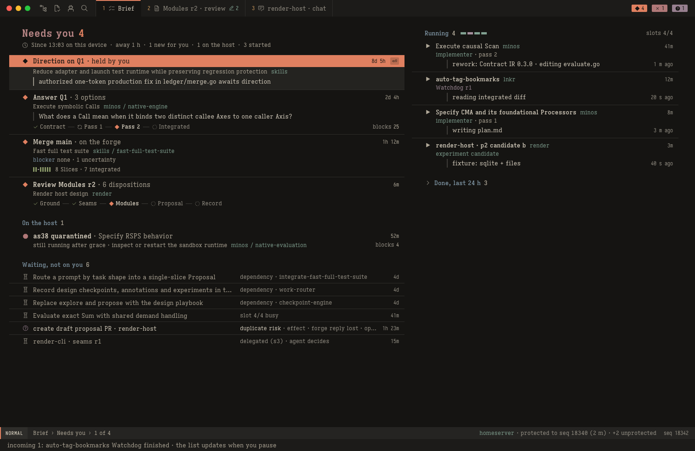

### SC-02 The Brief (landing view)

Answers "what is mine, what is stuck, who is working, what changed" with zero keys (T01). It replaces the queue and its card: the row carries the ask, so no card is needed.

**Layout:**
- Left column x 48–868: Needs you, On the host, Waiting.
- Right column x 924–1464: Running, Done.
- Reading order matches `j` order. Under 1180 px the columns stack.
- Title `Needs you 4` in `page.title` rose with a coral count. Calm: `Nothing needs you`.

**Needs you** (oldest first). Each entry is square and hairline-separated:
- **Head:** state mark, then the **move** (14/20 600) built from the host's typed `next` fields (`actionKind`, `target`, `why`, `options`), then the time. Examples: `Answer Q1 · 3 options`, `Merge main · on the forge`.
- **Byline:** work title, plus project and proposal in sage.
- **Ask:** shown only when the host marks the field as content (RQ-50), such as a decision's `question` or a coordinator sentence. It sits on the 2 px content bar in `prose.small` (13/19), at most two lines; a longer text is cut at the last whole word that fits and ends in `…`. The whole text is read in the handover float (`K`) and on the object itself (`⏎`) (FC-Q29). A host value keeps its label: `blocker none · 1 uncertainty`.
- **Foot:** the Track and `blocks N`, when the host gives them.

**Groups:**
- **On the host:** operator remedies, with the failed mark and the host's words (`still running after grace · inspect or restart the sandbox runtime`).
- **Waiting, not on you:** 28 px dense rows (title, reason, time). A persistent state word leads the reason (`duplicate risk · effect · forge reply lost · op9 reconciling`), with the `?` mark. A delegated request waits here: `delegated (s3) · agent decides`.
- **Running:** three-line rows.
  - Line 1, chrome: title, project, and the time running.
  - Line 2, chrome: role in its hue, then `pass N`.
  - Line 3: `lastActivity` is agent-reported (RQ-50), so it is **content**: one line of `prose.small` on the 2 px content bar, as sent, ending in `…` when long (`rework: Contract IR 0.3.0 · editing evaluate.go`). Its host timestamp (RQ-33) stays in chrome at the right of that line, in `mono.small` `fg.muted`: `1 m ago`.
  - **Slot pips:** one per slot, 12 × 5, role hue, plus the words `slots 4/4`.
  - A cancelled run holding its slot is an outlined pip: `slots 4/4 · 1 held by a cancelled run` (FC-M36).
- **Done, last 24 h:** collapsed. A row carrying `merged source differs from reviewed R7` stays visible under the header.

**Which group** comes only from the host's `mode` and `nextHumanAction`, never from slice-state heuristics.

**Keys:**
- The landing cursor sits on the oldest Needs you entry.
- `j k ⏎ ␣n ]g za K`.
- `K` opens the handover float, with its own key set (§3.7): `j`/`k` move and the float follows, `⏎` opens, `␣n` opens next, `K`/`q`/`Esc` close.
- An authority key on a row echoes `open it first · ⏎`.

**Since you left** answers "what changed while I was away" from what the client can observe.
- **Presence:** you are present while the window is key and visible, the screen awake and unlocked, a key or pointer event arrived within the last 5 min, and the Brief tab is focused.
- **Recording:** while you are present, each drawn frame updates `seenBrief = {authorityEpoch, seq, host time, rows [{id, group, stateClass}]}` in the device-local store.
- **The line:** when presence ends, that record is frozen as the return base. On your next return the line reads `Since 13:03 on this device · away 1 h · 1 new for you · 1 on the host · 3 started` (host times), or, when no row moved, `Since 13:03 on this device · away 1 h · nothing changed`. It counts row moves between groups, not every event in between, and stays until you leave again. When you never left, there is no line.
- **Changed rows** take a `ui.strong` title until the cursor visits them. `za` lists exactly the counted rows, old group → new group.
- **On this device:** the record is device-local, so what you did on another device isn't known here.
- **After a restore** (new epoch): `the host was restored · rows as they stand now`, with no counts.
- **No host requirement:** the line compares two snapshots the client already holds.

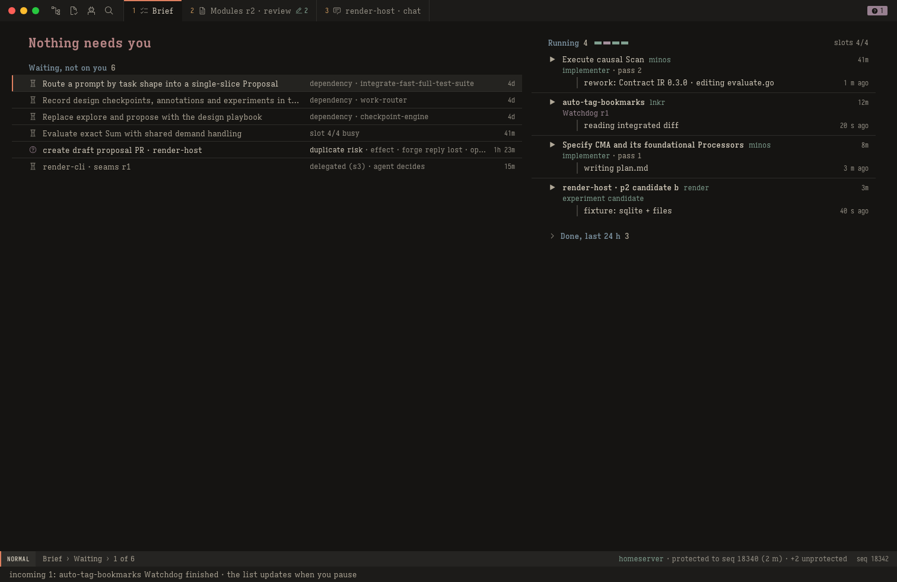

### SC-03 Chat, prompt and steering

**Layout:**
- **Roster** in the left margin: `coordinator`, `a candidate queued 10m`, `b candidate running 3m`, `c candidate queued 10m`, `challenger r1 done 2h`, in role hues. The key never truncates (FC-Q18).
- **Transcript** on the text axis. **Artifacts** in the right margin, beside the message that produced them.
- **Composer** at the page foot.

**Messages:**
- Header band: role icon in the gutter, name in its hue (you steel, reviewers mauve, workers sage, the coordinator neutral `fg`), and time. Model, assignment, turn and receipt are on `K`.
- The human message sits on the 8 % steel band; only a host `human` role produces it.

**Tool calls:**
- One 28 px square row on a tint chosen by the host's recorded outcome, with a 1 px `border.strong` edge and no icon.
- The outcome word sits at a fixed x, bold when failed or unknown.
- Two or more adjacent `ok` calls fold to `2 tool calls · ok`. Failed and unknown never fold.
- `za` expands, `]t`/`[t` move.
- **Web calls:** the detail is `<provider> · <primary> <primary outcome> · <duration>`, e.g. `ok · Tavily · Exa failed · 2.4 s`. The primary's phrase never drops. `K` and `za` give the class (`failed: allowance`, `timeout · outcome uncertain · may have been charged`) and one row per attempt.

**Streaming tail:** a `fg.muted` block, never coral.

**Composer:**
- Square, on `surface.side`, with no icon. Its footer, in Insert: `Esc jk leave Insert · ⌘⏎ sends · M-⏎ queue as follow-up`. Its header says before you send whether the send prompts or steers:
  - `→ steer · turn t42 running · delivers after the current tool call`;
  - `→ prompt · turn t42 ended · sending starts a new turn`.
- Pending steers sit directly above it with their delivery state. `␣cx` interrupts; `Esc` never does.
- A steer that arrives after the turn ended is refused with `turn_ended`; it is kept as a draft and offered as a follow-up.

**Track row:** the workflow's Track (`◆ Modules r2 awaiting you`), the slot's calm form, the turn state (`turn t42 running · 11 m · 5 tools`), and `◆ ␣n Modules r2`.

**Follow:** follow is on while the cursor is on the last message. Any upward motion pauses it, `37 new ↓` sits at the column foot, and `G` resumes.

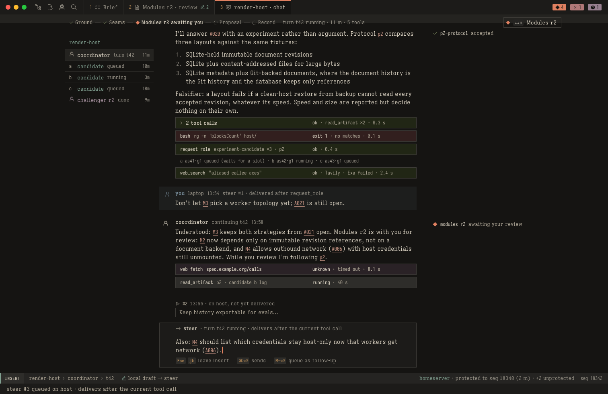

### SC-04 Review (absorbs SC-05 diff and SC-06 dispositions)

One page for reading an emission, seeing what changed since the previous round, and checking your notes were answered.

**Left margin:**
- Header: `modules r2`, the digest, the emission time.
- Outline of nodes with note marks.
- Round summary: `Previous round r1 · 6 notes · 4 acted on · 1 considered · 1 dismissed · 0 unanswered`.
- Challenger summary, experiments.

**Document:**
- The emission's own `h1` (20/28 rose, with its rule) and `h2` orange.
- Node IDs in the gutter; the class word (`observable`, `judgment`, `product`) at the heading row's right end.
- Change bars in the gutter, `fg.muted`, from host byte ranges, stepped with `]h`.
- Frontmatter collapsed to one line.

**Margin notes:**
- Saved notes (`@7 M2 ¶3 · saved v3 · 14:01`) and local drafts (sage `edit` · `not saved`).
- From round 2 on, previous-round notes that need a read: `dismissed · read the reason`, `product question`.
- Each note sits at its anchor's y, or below the previous one. A wide block is an obstacle.
- A note pushed more than about two lines below its anchor collapses to its header line, unless the cursor is on its anchor; notes pushing the cursor's note collapse too.
- Under 1180 px notes fold inline under their paragraph.

**Writing a note:**
- `c{motion}`, `gc{motion}` or `␣mn` opens the composer in the margin at the anchor: 320 px wide, up to 8 lines, footer in Insert `Esc jk leave Insert · stays on this device until you save`.
- `Esc Esc` keeps a local draft; `:w`/`␣ms` saves the set.
- First-note hint: a ghost `+ note c` at the cursor line, until 3 notes on this device (FC-K19).

**Lenses:**
- `␣md` shows a side-by-side prose diff r1 → r2 at full stage width, with `]h` between hunks. When the source changes `.gitattributes` or `.gitmodules`, a chrome notice from a host flag says so.
- `␣om` lists every note of the previous round with the host's disposition; `⏎` the note on r1, `gd` the reference on r2.

**Track row:**
- `✓ Ground — ✓ Seams — ◆ Modules — ◌ Proposal — ◌ Record`, then the slot's calm form `your review · captured s2`, then `␣ar rework` and `␣aa approve`.
- The two actions have equal, neutral weight.
- **Delegated:** the stage draws the `bot` icon, never coral, and the slot (rung 4) reads `delegated (s3) · agent decides · saved notes must be answered first`, then the segment `␣ax cancel`.

**Intake views** show the fresh fidelity review's verdict as an evidence row before `␣ac`.

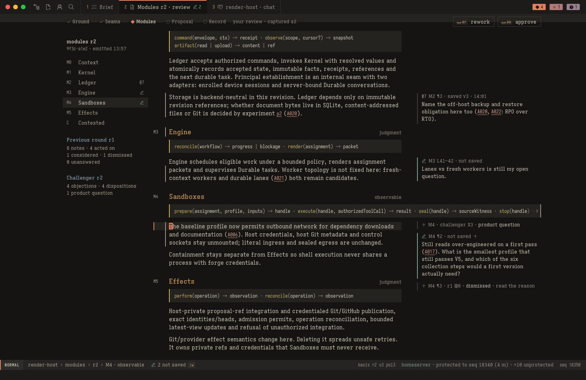

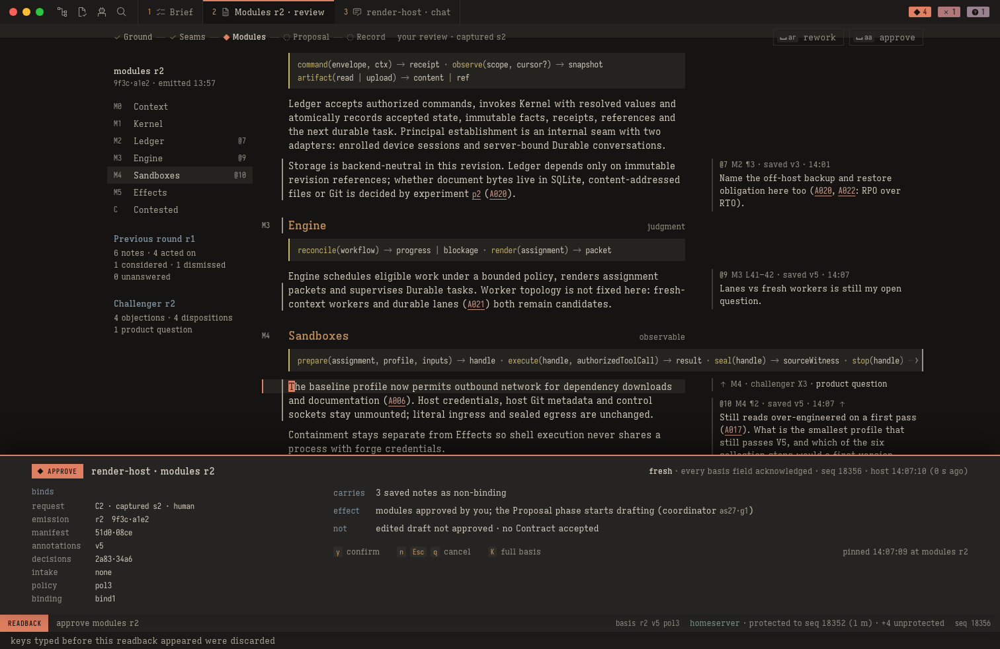

### SC-07 Evidence

**Proof chain:** the Track at pass zoom, vertical on the text axis, with marks in the gutter:

```
✓ Audit examined a6dcb53   standards ✓ · contracts ✓ · 6 findings: 4 fixed, 1 considered, 1 needs you
✓ submitted      5712d1a   after fixes and rechecks
✓ prepared       3be1f0c   = 5712d1a + target 06500de · checks pass · attempt 2 (target moved once)
◌ Watchdog       none yet on 3be1f0c                                                     reviews 1 of 2
```

- The record says what each role saw (S§6.2.1 L632). The Audit node never carries staleness (FC-M40).
- **Findings** follow, with the host's disposition words (`Audit 6 · Watchdog r1 1`). Then the obligation × source matrix, whose Watchdog column reads `none yet` until a round exists.
- After the matrix: gate receipt, catalog rows with their kind, web passages as content with chrome provenance, native checks (`unrun on Linux · see local prompt`, `␣ol`).
- **Left margin:** passes (`pass 2 current`, `pass 1 historical` with its counted rounds), obligations, findings.

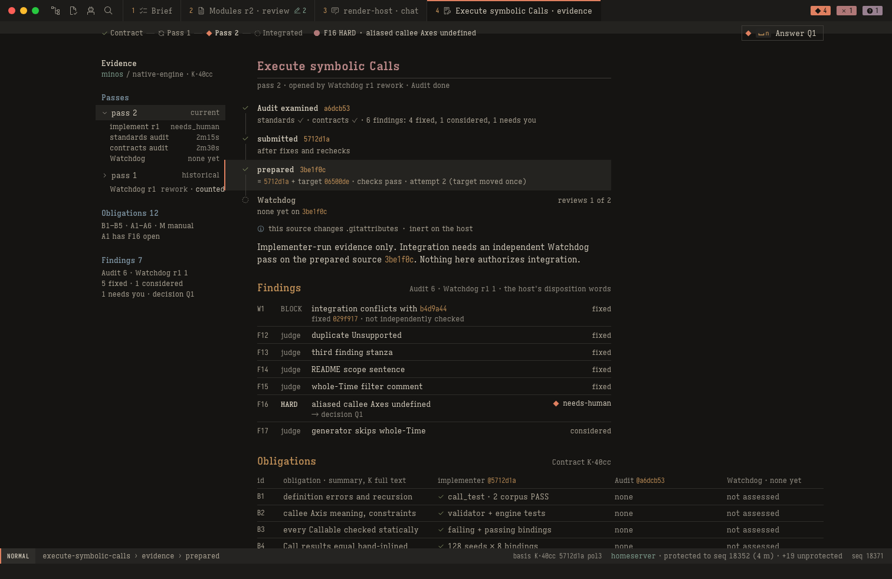

### SC-08 Agents list

The spec's groups:
- `Executing 4 · slots 4/4 · retained workspaces 7 · 2.3 of 20 GiB`;
- On the host (quarantine, `orphaned · cleanup unresolved`);
- Held;
- Queued.

**Rows:** mark, slot, assignment, workflow, role in its hue, state, since. State is the host's execution fact plus its cancellation state.

**Peek:** last activity as content on the 2 px content bar with its host time in chrome (as on the Brief), the lifecycle, and the host's remedy (`your move, on the host: inspect or restart the sandbox runtime · a replacement needs a new generation`). A row is needs-you when the assignment waits on you, and then takes the solid head.

### SC-09 Decision with readback

**Layout:**
- The question as content `h1`, then its lede.
- Provenance: `blocking decision Q1 · from implement report r1 · 10-25 09:52 · waiting 2d 4h · blocks 25 · reviews 1 of 2`.
- Evidence bullets with references.
- Options under `coordinator recommends 1`. Each has its number, title (14/20 600), body (14/21) and a square `recommended` tag; the cursor is the band with the 2 px bar.
- Your answer, as a composer: header `your answer · local · editing`, footer in Insert `Esc jk leave Insert · stays on this device until you answer`. The Track row's `◆ ␣ad Answer Q1` sends it with the option.
- **Margins:** left `This Slice` and `History`; right related references (`gd`).

**Track row:** `◆ ␣ad Answer Q1`, solid coral. The readback names the option: `answer option 1 · accept the current dispositions · your note, 2 lines, sent with the answer`.

**Recovery decisions** (`kind: recovery`) use this view. The operation's facts are in the margin, BINDS includes the observations, and each option kind has its own fixed NOT text.

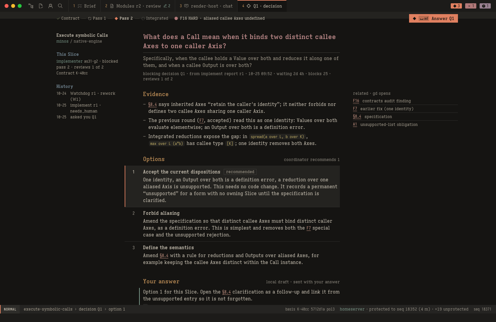

### SC-10 States

| State | What shows |
|---|---|
| **a. Offline** | Statusline `○ offline 1 m · seq 18356 · as of 14:06:58`. Notice band at the top of the stage: `Offline since 14:06:59 · showing seq 18356 · 1 local draft safe · saving and deciding are off` with `␣rc retry`. Actions show `· off`; the save state drops its `:w` chip; `:w` echoes `not sent, offline`. No offline queue |
| **b. Fresh snapshot** | Echo: `reconnected after 1m22s → fresh snapshot at seq 18364 · drafts, marks, jumplist and pins kept`. Changes stay unacknowledged (`[!]`, basis token `]d`). The "what changed" list ends with `complete through seq N` or `partial · more on the host` |
| **c. `stale_basis`** | The float becomes the reply: `Your approval was NOT recorded. Nothing was approved.` You sent beside host has, one row per field, in display forms; what changed; the note. Its key line: `⏎ open @11 (acknowledges it)`, then the words `approve or rework again after you read @11` with no chips, because the authority keys don't resolve in the float. The draft is kept |
| **d. Unknown outcome** | Track-row slot (rung 1): `? rework request · no reply since 14:09:30`, with both segments `· off`. The outbox float (`␣ru`): `no reply · the host may have accepted it · other decisions on modules r2 are off until this settles`, with `␣rq query the receipt (never executes)` and `␣rt retry with the same ID and bytes`. `not_found` is not proof it wasn't accepted. `command_conflict` reads `the host already has a different request under this ID · nothing new was done · open the object and act again` |
| **e. Uncertain external effect** | The operation view: Track `✓ admitted 12:40 — ? outcome unknown — ◌ resolved`, slot `? duplicate risk since 12:40 · auto-recheck 14:15`; kind `create draft proposal PR`; observations; what it blocks and what continues; safe choices; and the Decide row, whose `⏎` opens the host's recovery decision (SC-09). A sticky duplicate risk stays until the host records a resolution |
| **f. Revoked** | Notice band, frozen view, statusline `✗ revoked 14:20:05 · seq 18402 · as of 14:20:05`, segments `· off`. The client stops retrying; drafts are kept on the device |
| **g. Unsupported** | `unsupported by this client (v0.3)` for unknown resource kinds, shown as metadata with decisions on that object off. An unknown basis field name never disables a command. An unreadable protocol version gives one whole-client state: `this client (v0.3) is too old for the host's protocol · update it` |
| **i. Can't show** | Where the content would be: `content missing on the host · <ref> <digest>`, `the host can't read this record's format (schema N)`, or `not visible to this device`. Decisions on it are off; it never falls back to another revision |

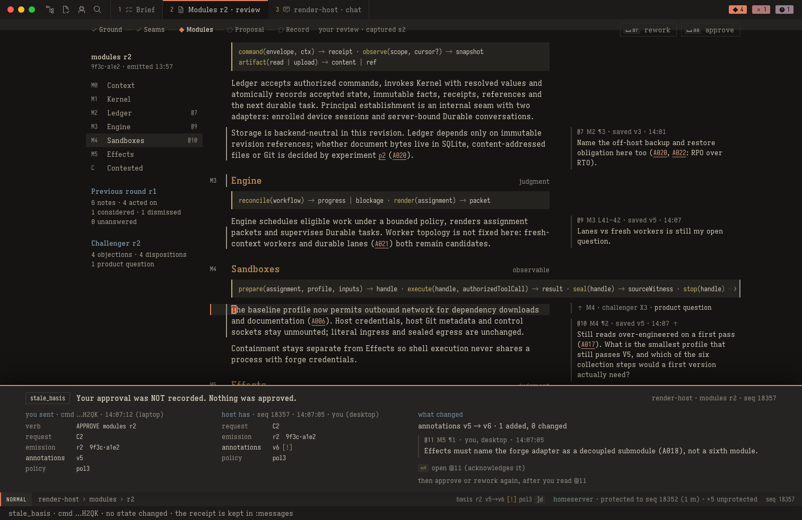

### SC-10h Host restored from a backup

The message appears once, in a notice band on the Brief, in plain words.

1. **Not paired.**
   - Host segment: `restored · pair this device again`.
   - Notice: "The host was restored from a backup and no longer knows this device. Ask the host's admin to pair it again. It reconnects by itself after that. Nothing on this device is lost: your drafts and unsent requests stay here." The notice carries `␣rc try now`; the echo row prints no chip.
2. **Catching up.**
   - Host segment: `catching up after a restore`. The seq shown may be older than before; it is accepted because the epoch changed.
   - Notice: "The host was restored from a backup, so recent changes may be missing. It is catching up. Until it finishes you can read and draft, but not save or decide."
   - Outbox entries read `can't be sent again after a restore`. `␣rt` is refused; `␣rq` asks the host, and the outbox float's key line prints it.
   - The since-line reads `the host was restored · rows as they stand now`.

### SC-11 Palette and pickers

The bottom float, with input on the last line:
- `␣;` commands (also `⌘K`), `␣.` any object with a kind prefix (`slice:`, `doc:`, `agent:`), `:` the ex line.
- Results show their keys; unavailable commands are listed with the reason.
- The preview renders content as content.
- The theme picker (`␣ht`) uses the same float and switches the variant live.

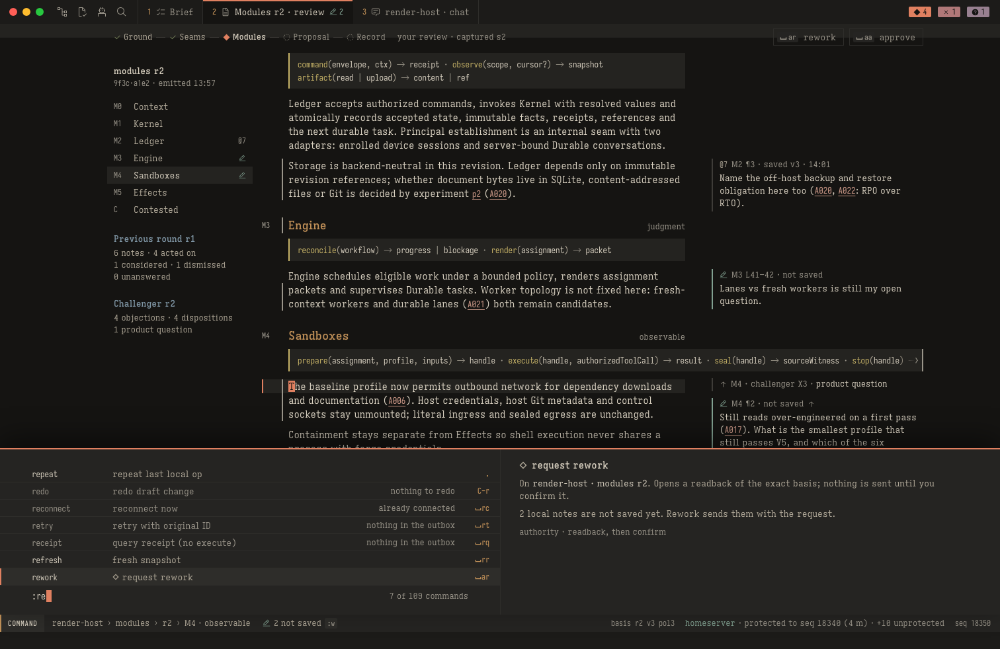

### SC-12 which-key

The bottom float, display-only (§3.3).

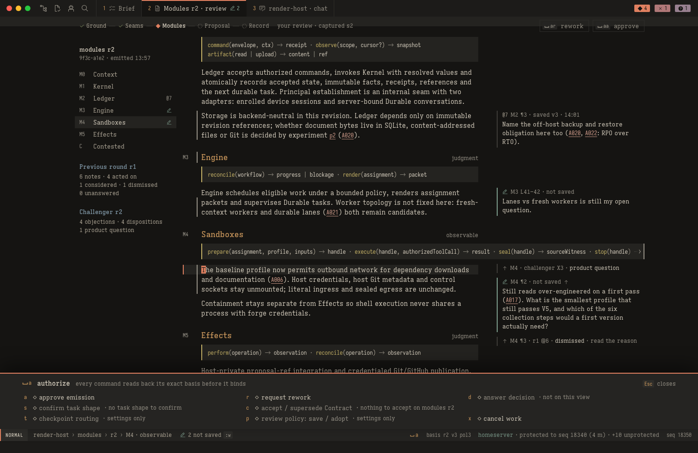

### SC-13 Hint mode (`gs`)

Labels sit at the start of each target's text after its state icon, shift right to avoid overlap, and are frozen at `gs`. A label moves the cursor and never acts. The statusline reads `hints · 16 targets · a label moves there and never acts`; `Esc` cancels, and nothing prints it as a chip.

### SC-14 Mermaid diagrams

Diagrams render in place with rune-mermaid; `␣tm` shows the source.
- Styles (`style`, `classDef`, `class`, `:::class`, `linkStyle`, `rect` tints) are stripped before layout.
- A figure spans from the text column's left edge to the pane's right content edge, at natural size when it fits, otherwise scaled down while every label stays ≥ 12 px.
- Wider still: a "wider than view" panel with natural width, label size, node and edge counts and `⏎ full view`. Never a clipped picture.
- A parse error shows the source with the line and column.

### SC-15 Reading layout

The measure as a maximum, centred in a wide pane; native word wrap with IDs, key names, paths and inline code kept whole; blocks that grow right and scroll with the clip cue (§5).

### SC-16 Slices and Proposals lists

**Slices** (`␣os`):
- Title `Slices 3 of 72`; filter words (`needs human × · awaiting review ×`) and `saved: review-queue`; `Filter` (`␣sf`, Slices only).
- A row whose wait class is `human` takes the solid needs-you head when the cursor is on it.
- 28 px dense rows with hairlines, grouped by proposal in dependency order: mark, slice, status, waiting, blocks.
- Hint line: `69 open slices hidden by the filter · :filter clear shows them · ]g next group`.
- **Filter float** (`␣sf`): a scope tree with small multiples, states with counts in scope, and saved filters, with `x` and `X`.
- **Empty state:** names the scope and filter, shows matches elsewhere, prints `:filter clear`, and keeps the needs-you count. Count tags never follow a filter (FC-R07).

**Proposals** (`␣oP`): two-line rows of 52 px, exactly two lines at every width.
- **Line 1:** name, then the progress strip (the Slices' small multiples, or for a phased workflow the shape and the host's path: `design · ✓ Ground ✓ Seams ◆ Modules ◌ Proposal ◌ Record`), counts printed only when non-zero, and status.
- **Line 2:** `[? duplicate risk · ]ready: <eligibility>[ (<first gap>)] · forge: <state>`.
  - `ready:` is eligibility only.
  - The forge field carries promotion and the observed forge (`draft #41 · promoting (for R7)`, `ready #44`, `open #41`, `PR unknown`).
  - Narrow widths drop whole parts. The line never wraps.
- A legend sits under the rows; superseded is drawn `−`. `⏎` opens the Proposal page.
- A row is needs-you when it is an eligible package whose merge you owe (`◆1 merge main · on the forge`); with the cursor on it, it takes the solid head.

**Peek** (both lists, ≥ 1180 px): the cursor row's handover. On Proposals this is the four readiness views and the Slice counts. `K` opens the float instead, and the peek gives way while it is open.

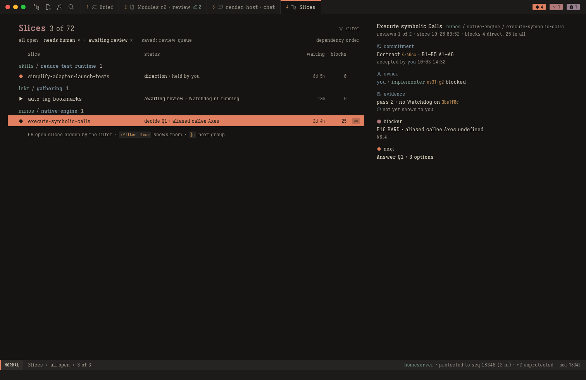

### SC-17 Project settings

One reader view per project (`␣op`, context `settings`), on the text axis. It holds checkpoint routing and review policy and shows the basis before any authority key.

```
Checkpoint routing · render · s3 · by you 10-21 09:12
  seams      delegated        modules   delegated        proposal  human · always
  applies to new checkpoint requests · pending ones keep what they captured
  pending   seams C1 · captured s2 · human
Review policy · default pol3 · for new workflows
  completed-review limit 2 · minimum evidence rank tests · reviewer diversity different family
  workflows    render-host pol3 (bind1) · minos/native-engine pol3 (bind2)
History  s3 by you 10-21 · pol3 by you 10-20 · s2 by local admin import 10-12
```

- `j`/`k` step field by field.
- **`␣at`** on seams or modules toggles human ↔ delegated. Proposal is always human (`the proposal field is not editable · final acceptance is always yours`). The readback BINDS the settings revision and field; host EFFECT and NOT name the pending requests that keep their capture.
- **`␣ap`** on Review policy opens a local draft, then reads back old → new. `␣ap` on a workflows row adopts the current default.
- **Stale or concurrent changes** refuse through the stale reply. `d` on a STALE policy readback rebases the draft field by field; a field both sides changed shows `[≠]` with both values, and `y` stays disabled until you edit it.
- **Key budgets:** T27 ≤ 8 keys (`␣op j ␣at y`); T27b ≤ 21 command keys.

### SC-18 Local-verification prompt

An advisory text artifact for a human's local agent (S§5.2.2 L357–386). `␣ol` opens the newest prompt for the current proposal in the reader, with no notes margin. The chrome header comes from the artifact's fields:

```
Local check prompt 3 · advisory · nothing waits on this
  source   R7 7f2c815 · published as PR #41 head
  gaps     macOS framework behaviour · desktop interaction
  missing  documented macOS signing prerequisite
```

- Key line: `gg␣yG copies it`, `:request-prompt makes a new one for the current source`. Yank copies the artifact's source bytes.
- An older prompt says `for an older source (R5) · current is R7`.
- Advisory: never a Needs you row, a blocker or a flag.

### SC-19 Proposal page (absorbs the merge package and the Proposals card)

"Is this proposal on track?" and "may I merge?" are one page at different times.
- **Head:** content `h1` (the proposal title) and a subtitle with the intake and acceptance (`skills/fast-full-test-suite · intake K·5b20 · 8 Slices · accepted by you 10-14 11:05`).
- **Track row:** one tick per Slice, then the primary action.
  - **When the host's next action is `mergeMain`:** `◆ ␣n Merge main · on the forge` (solid coral), which opens the URL confirm in the float: `open https://github.com/vicrdguez/skills/pull/44 ? y/n`. No machine merges main.
  - **Not eligible:** no merge action; NEXT is neutral (`◆ ␣n Answer Q1`) when its target is elsewhere.
- **Body, in order,** all above the fold at 1512:
  1. **What could stop you,** counted by kind (`findings 1 · uncertainty 1`), never pooled. Not eligible: the gaps lead (`gaps 2 · …`).
  2. **Source:** `R4 2c91e07 canonical · published · PR #44 ready`.
  3. **Checks:** `7/7 Slices · required checks pass on their prepared source · weakest rank tests (minimum tests)`.
  4. **Readiness:** always four rows (eligible, published, promotion, on the forge), never one bar (FC-M49).
  5. **Advisory:** `suggested · not run`, with no mark, and the local prompt line. Missing advisory observations are never a gap.
  6. **Slices,** in dependency order: `<name>  K·xxxx  pass 2  Watchdog r2 pass on <digest>  2 fixed`. Columns sit next to the name; `Audit examined` and per-Slice R are on `K`. `⏎` opens that Slice's evidence.
- **After the host observes the merge,** NEXT reads `nothing for you yet`. A merged source that differs from the reviewed one adds an evidence-gap row to Source (S§9.3 L1136).

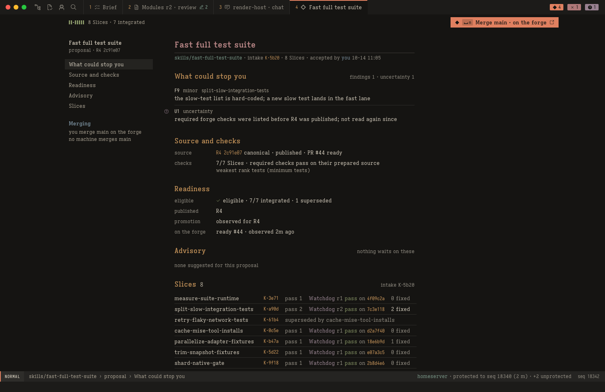

---

## 5. Visual language

Full rules: [`reference/visual-language.md`](reference/visual-language.md). Tokens: [`ember-tokens.json`](ember-tokens.json).

### 5.1 Variants and surfaces

- `ui.theme` in `~/.config/render/client.toml`: `ember` (default), `ember-soft`, `ember-light`, or `auto`.
- `␣ht` switches live within one frame (rune `Tx::instant()`); type and layout don't change.

| Token | Ember | Ember Soft | Ember Light |
|---|---|---|---|
| `surface.read`: stage, active tab | `#151412` | `#1c1b19` | `#f0e8d8` |
| `surface.side`: tab bar, echo row, composer | `#1c1b19` | `#242320` | `#e6dac4` |
| `surface.bar`: statusline, chips | `#252422` | `#2c2b28` | `#d8ccb0` |
| `surface.cursor.read`: cursor band | `#242320` | `#2a2927` | `#e6dac4` |
| `surface.cursor.side`: mode badge | `#2e2d2a` | `#353430` | `#ddd0b8` |
| `surface.code` | `#242320` | `#2a2927` | `#e6dac4` |
| `surface.readback`: bottom float | `#252422` | `#2c2b28` | `#ddd0b8` |
| `border.subtle`: hairlines | `#2e2d2a` | `#353430` | `#cec2a8` |
| `border.strong` | `#3e3c38` | `#444240` | `#b8ac96` |
| `fg` / `fg.alt` / `fg.muted` | `#d8d0c0` / `#b0a898` / `#999489` | same, muted `#a19c92` | `#282418` / `#585040` / `#5e5646` |

### 5.2 Colour roles

Each hue names one family, in chrome, on short fields whose type the client knows from a host field.

| Hue | Means |
|---|---|
| **Coral** | what needs you; where your keyboard is (§2.1) |
| **Steel** | a label; the `you` role |
| **Orange** | literal machine text: IDs, digests, revisions, key chips, tab numbers |
| **Gold** | code as a thing: inline code, the code block's rule and language label |
| **Salmon** | you can go there: references and links, in content only |
| **Sage** | where it lives (project, host name); the worker role |
| **Mauve** | independent review: every reviewer's role name |
| **Olive** | it passed: short typed outcome words |
| **Rose** | it failed: short typed outcome words |

- **Titles and headings:**
  - Page titles: rose 22/28, no rule.
  - Content `h1`: rose 20/28 with a 1 px rule.
  - `h2`: orange.
  - `h3` and below: `fg`. `strong` steel; `em` neutral italic.
- **Rose titles:** a failed mark always has its icon and word, and a title has neither (FC-S22).
- **State marks** always carry their icon: needs you (coral filled diamond), failed (rose `stop-sign--filled`), stale (steel `time`), unknown (mauve `help`), local (sage `edit`), ok (olive `checkmark`).
- **Stays neutral:** body prose, host sentences, row titles, field values, timestamps, counts, surfaces.
- **The colour budget:**
  1. Solid coral only as §2.1 lists.
  2. Thin coral follows the keyboard.
  3. One hue, one family, in chrome.
  4. Neutral leads.
  5. Olive and rose label nothing in chrome except outcomes, plus the rose titles above.
  6. Tints are block-level only and paired with a word.
  7. Syntax colour lives only inside code blocks.

### 5.3 Tints

Tool tints by host outcome:

| Outcome | Ember | Soft | Light | Word |
|---|---|---|---|---|
| ok | `#212615` | `#292d1b` | `#cfd5b6` | `ok` |
| failed | `#321f1e` | `#3a2625` | `#e8cbc1` | **bold** `exit 1` |
| unknown | `#2a2226` | `#32292d` | `#dacfcb` | **bold** `unknown` |
| running | `#2e2d2a` | `#353430` | `#d8ccb0` | `running · 40 s` |
| cancelled | `surface.side` | | | `cancelled` |

Also: the human band (8 % steel) and diff add/del (15 %). The word, at a fixed position, carries the outcome for colour-blind readers.

### 5.4 Type

Two families, both v34.9.1, SIL OFL 1.1, bundled: **Iosevka Etoile** for chrome and prose, **Iosevka** for code, IDs, keys and numeric columns. Ligatures and contextual alternates off.

| Token | Size / line | Weight | Use |
|---|---|---|---|
| `page.title` | 22/28 | 700 | Brief and list titles; rose, count coral; no rule |
| `prose.h1` | 20/28 | 700 | Content `h1` and work-view titles; rose; 1 px rule |
| `prose.h2` | 17/24 | 600 | orange |
| `prose.h3` / `h4` | 15/22 / 14/20 | 600 | `fg`; h4 has `space.6` above. h5 and h6 are 13/19 600 in `fg.alt`, uppercase and italic |
| `move` | 14/20 | 600 | Brief entry heads |
| `group` | 13/18 | 600 | group heads, steel |
| `prose` | 14/21 | 400 | body |
| `prose.small` | 13/19 | 400 | content on the 2 px content bar: the Brief's ask, margin notes |
| `ui` | 13/18 | 400 | rows, tabs |
| `ui.small` | 12/16 | 400 | bylines, Track, statusline, echo |
| `mono` | 13/20 | 400 | code blocks, diffs |
| `mono.small` | 12/16 | 400 | times, digests in rows |
| `key` | 11.5/16 | 500 | chips (orange) |
| `badge` | 11/14 | 600, +0.08 em | mode badge, readback verb tag (uppercase) |

**Spacing:** 2, 4, 8, 12, 16, 24, 32.

**Radii:** 0 everywhere, except 2 px on Render-drawn key chips, count tags and hint labels. In-text pills take rune's fixed metrics (§5.6).

**Elevation:** the bottom float casts an upward shadow, drawn with rune's `box_shadow` at a negative y; tooltips are square on `surface.side` with a 1 px `border.strong` and a small shadow.

**Heights:** tab bar 36, Track row 40, statusline 26, echo row 26, dense row 28.

**Separators:** straight 1 px `border.subtle` hairlines between rows and entries.

### 5.5 Action segments

- Square and key-first: `␣aa approve`, `◆ ␣n Modules r2`.
- **Neutral:** 1 px `border.strong`.
- **The primary at the NEXT target, one act:** solid coral, text knocked out.
- **Disabled by host or connection state:** a dashed 1 px `border.subtle` edge (rune's `border_dash`), `fg.muted`, no chip, and `· off` after the verb; the reason is on `K`.
- **While any bottom float is open, or in Insert:** `fg.muted` and inert, in their usual shape.

### 5.6 Reading layout and Markdown

- **Measure:** `measure.prose` = 80 × the mean advance of the bundled reference paragraph at 14 px, floored to 4 px: **600 px**. It is a maximum; the column is centred in wider panes.
- **Wrapping:** prose uses rune's native wrap (UAX #14).
  - **One pill rule.** Inline code is a drawn pill. IDs, paths and key names in prose and chrome stay whole as transparent pills, but only when they contain an internal break opportunity (`-`, `/`, `.`); a token without one stays whole anyway. Up to 40 characters. This is the default proposed in Q45, which stays open until the SC-04 Markdown test confirms it. Breaks after hyphens in words are fine.
  - A token longer than the measure wraps anywhere inside the measure. **The renderer never inserts characters.**
- **Pills:** in-text pills use rune's fixed metrics at the pin (about 7 px a side at 15 px, radius 5 pt). This is a **recorded deviation** from the square chip, because rune's `PillStyle` sets only colours and icon. Inline code is gold on a `surface.code` pill.
- **Blocks that don't wrap** (code, tables, diagrams) grow right from the text column's left edge up to the pane's right content edge, never over the gutter. Beyond that they scroll, and each clipped edge shows the cue: a 32 px fade to the block's surface, a 2 px `fg.muted` edge rule and a caret.
- **Code blocks** are Render's own element: `surface.code`, a 2 px gold left rule, a gold language label, Iosevka 13/20, no wrap. They are coloured by rune-kit's scanners through an Ember map: colour only, no per-token bold or italic. TOML, Elixir, Markdown fences, unlabelled fences and other languages render plain, with no guessing.
- **Markdown** is CommonMark + GFM (tables, task lists, strikethrough, autolinks, footnotes), GFM alerts, YAML frontmatter and `mermaid` fences. Raw HTML, math and wiki links render as literal text.

| Block | Rendering |
|---|---|
| Paragraph | `prose`, 12 px between paragraphs |
| Headings | `h1` rose with a rule, `h2` orange, `h3` and below `fg`; two cues per level |
| Lists | markers `• ◦ ▪` in `fg.muted`, 24 px per level |
| Tables | header rule, row rules, no vertical rules; cells wrap at words; grow right, then scroll |
| Blockquote | a 3 px `border.strong` bar; Etoile italic `fg.alt` |
| Alerts | the quote shape plus the kind word; no icon, no hue |
| Frontmatter | one client-drawn line, `frontmatter · 6 fields`, with `za` |
| Links | prose face, salmon, solid underline, `kind.link_active` under the cursor; `gx` confirms |
| Images | not loaded; a placeholder with alt text and host |

**Streaming:** completed blocks freeze; the kit re-parses from the start of the last top-level block. An unclosed fence renders as code so far.

### 5.7 References

A token in content that exactly matches a label in the host's reference index (RQ-42) renders as a reference:
- **resolved:** Iosevka 500 salmon with a solid underline;
- **dangling:** Iosevka `fg.muted` with a solid underline, where colour tells it from a resolved one. `gd` stays put and the echo gives the host's reason.

Matching is exact and case-sensitive on whole tokens, ASCII plus `·` and `§`. It never happens inside code, tool output or drafts.

A Markdown link keeps the link style whatever its text. Reference, inline code and link differ by shape:
- a reference is Iosevka with an underline;
- inline code is a pill;
- a link is in the prose face.

### 5.8 Icons, marks and motion

- **Icons:** IBM Carbon 11.90.0 (Apache-2.0), drawn with rune's `icon()` and tinted. Sizes are 14–16 px in rows, tabs and gutter, and 12 px in small multiples.
- **Failed and unknown** are told apart at a glance by shape: filled octagon against outline-with-`?`.
- **Role icons:** `user` (you, steel), `bot` (agents; the coordinator's in `fg.alt`), `bare-metal-server` (host).
- **Motion:** a 600 ms state-change tint on a row (rows never move) and a 90 ms fade for floats. The readback's coral rule is at full opacity from its first frame. Reduced Motion sets both to 0.

### 5.9 Chrome versus content

1. **Lanes.** Tab bar, Track row, statusline, echo row, floats, hint labels, message header bands, tool-call rows, the Brief's heads, bylines and labelled values are chrome. Content renders only in content containers: documents, messages, the content bar.
2. **Typography.** Content can't choose a face, size or colour. Content sits on the 2 px content bar wherever it appears outside a document or transcript.
3. **Icons, chips, fills and tints are chrome.** Code blocks are always neutral. Emoji stay glyphs inside content. Images are not loaded.
4. **Provenance.** Author, role, the human band, tool outcomes, references and readbacks come only from host records. Hue isn't provenance.
5. **Inert rendering.** No HTML. Bidi, zero-width and control characters show as visible escapes. Lookalike IDs are not linked and get `warning--alt` in the gutter.
6. **Titles.** A content `h1` always carries its rule and sits in the text column; the Brief's chrome title has none, sits at the Brief's origin, and carries a coral count when not calm (FC-S23).
7. **Size cap:** a content block clips at 2,000 lines.

---

## 6. Copy rules

- **No bare dash in a field.** Empty values are words: `no owner · waits for a slot`, `none yet`, `none`, `nothing for you yet`. In BINDS: `intake none`.
- **One state, one number.** Work counts name their unit: `Running 4 · slots 4/4`, `4 executing · slots 4/4`, never a bare `4/4`.
- **Plurals by count:** `1 line`, `2 lines`.
- **Revision labels** use their display form (`r2`, `v3`, `pol3`, `bind1`, `s3`, `R7`, `K·40cc`).
- **Role words** come from the host's role label.
- **The echo never repeats** what the statusline or a notice already shows.
- **Plain words for failures** the user must act on. Internal terms (epoch, deduplication, cutoff) go only in `K` details.
- **A time that hasn't happened isn't printed:** `not observed yet`.
- **Host-written text and authored IDs** are shown as sent, never rewritten. NOT is a fixed set per command type and option kind. Host text never names a client key.
- **Agent-written text** (a decision's question, a coordinator sentence) is content. On the Brief it appears only on the content bar.
- **A host value** shown outside its usual place keeps its label: `blocker none · 1 uncertainty`.
- **`lastActivity`** prints as sent, with its own host time.
- **An invitation is written `<keys> <action>`,** with the keys in chips. All chrome copy lives in one table, which KL19 lints.
- **A disabled action** reads `<verb> · off`, with the reason on `K`.
- **An action names the act, not the option:** `Answer Q1`, `Merge main · on the forge`.
- **Delivery-model words** in chrome: `Audit examined`, `submitted`, `prepared`, `reviews N of L`, `your review`, `delegated`, `on the forge`, `duplicate risk`.
- **The recommendation is attributed:** `coordinator recommends 1`. It never appears in NEXT.
- **Text never truncates IDs.** Paths truncate as `…/leaf`. Rows drop whole fields; column captions don't truncate.
- **The since-line says what it measures:** `Since 13:03 on this device · away 1 h · …`.

---

## 7. Client architecture

```
 wire ──► HostAdapter ──Inbound──► [queue] ──frame boundary──► reduce(state, msg) ──► ClientState ──► view ──► rune layout ──► draw
             ▲                                                                              │
             └──── Outbound ◄── envelope(cmd, pin) ◄── keys (resolved against the last drawn frame)
          local store (device only): drafts, marks, jumplist, read bases, last-seen seqs, seenBrief, outbox
```

- **HostAdapter** is the only code that knows wire shapes. It can `connect`, `subscribe(scope)`, `send`, `query_receipt` (never executes), `fetch` and `poll`.
- **reduce** is pure: `(ClientState, Inbound | LocalEvent) → ClientState`. Replaying snapshot + updates equals a fresh snapshot.
- **The view** is built on rune, using rune-kit's Markdown and rune-mermaid. Render writes:
  - its prose paragraphs with pills;
  - its code-block element;
  - margin-note placement;
  - the key-pinning copy in `poll`;
  - the modal controller.
- **Reading checks** run on rune's own layout: AccessKit line runs and `--tree` element boxes ([`reference/stack.md`](reference/stack.md) §3).
- **The local store** holds device-only state that snapshots never overwrite: drafts (a journal written on every edit pause), marks, jumplist, read bases, last-seen seqs, `seenBrief` (§SC-02) and the outbox. There is no offline command queue and no resume cursor; reconnects take a fresh snapshot.
- **Presence** for "since you left" comes from window key and visibility, screen sleep and lock, and input events. Where rune doesn't expose occlusion, key-window plus input idle is enough (open-questions.md).

---

## 8. Stack

Full detail: [`reference/stack.md`](reference/stack.md).

- **rune** (github.com/anomalyco/rune), pinned to `dev` @ `781e2b6d`, with `rune-kit` and `rune-mermaid` from the same revision. Bump deliberately.
- **Fallbacks:** GPUI first, mygo second. nsh is dropped.
- **Latency targets** L1–L6 and the E-RUNE-1 results are in `stack.md` §6–§7. Four live streams side by side cost 20–28 ms frame CPU p99, which the owner accepted.
- **First implementation tests** (`stack.md` §8): on-screen key latency in a real window, real IME, NSEvent `input_time`, and the SC-04 Markdown screen.

---

## 9. Protocol requirements

The client is stateless and needs structured data from the host. The full list, each item checked against the server spec, is [`protocol-requirements.md`](protocol-requirements.md). The load-bearing ones:

- **Indexes:** the attention index across projects (RQ-01, RQ-27); agents (RQ-33); the slices scope with a host-owned lifecycle vocabulary (RQ-41).
- **The five facts as data** (RQ-03); a structured next action with `actionKind`, `target`, `why` and `options` (RQ-04); typed blockages with `downstream` (RQ-12).
- **Authority:** a host-computed basis per decidable object (RQ-05, RQ-39); permitted actions with EFFECT and NOT per command type and option kind (RQ-06); structured `stale_basis` (RQ-07); a receipt query that never executes and typed refusals (RQ-08, RQ-36).
- **Delivery:** pass lineage per Slice, which draws the Track (RQ-44); readiness as four views (RQ-26); web attempts (RQ-46); task shape and path (RQ-27); the merge package (RQ-49).
- **The Brief:** `lastActivity` with its own host time (RQ-15, RQ-33); each free-text field marked as content or host value (RQ-50).
- **Restore:** `authorityEpoch`, `hostMode` and the backup block on every snapshot (RQ-18); the epoch in every envelope (RQ-24).
- **Conversations** with stable IDs, roles, tool-call outcomes and a pinned send mode (RQ-09); sibling conversations and turn artifacts (RQ-30); a reference index (RQ-42); one multiplexed stream (RQ-43).

Several of these are **open requests to the server spec**, among them RQ-15/33's activity time, RQ-50's authorship mark, RQ-06's EFFECT and NOT text, and the cross-workflow indexes. `protocol-requirements.md` §5 lists them with citations.

---

## 10. Failure handling

Every failure case, its defence and its check is in [`failure-catalogue.md`](failure-catalogue.md).

### 10.1 Host restore (S§5.3, S§5.3.1)

- **Epochs:**
  - Within one `authorityEpoch`, a repeated or older sequence is discarded.
  - A **new** epoch means the host was restored. The client then discards cached sequence comparisons, pins, open readbacks and pending mutation authority; resnapshots every scope; and never rejects the restored snapshot as numerically older.
- **Old outbox entries** become `unknown after restore`. `␣rt` is refused for them; `␣rq` still asks the host. A missing receipt means "outcome unknown", not "not sent".
- **Pairing again:**
  - Backed-up device credentials are refused after a restore. Pairing again is the host's local-admin flow.
  - The client keeps its reconnect schedule, re-reads its credential store on each attempt, and `␣rc` tries at once.
- **While `hostMode` is not `active`:** writes and authority keys are paused, and the echo says why per mode (`Saving and deciding are paused while the host catches up`). Drafts keep working.

### 10.2 Other rules

- **Unknown outcome:** a timeout is `? unknown`, never "failed". Other authority commands on that object are disabled until it settles. Retry reuses the command ID and identical bytes.
- **Stale basis:** never auto-rebased. The stale reply shows what moved and the permitted next actions.
- **Offline:** drafts stay local, and host writes and decisions are off. There is no offline queue.
- **Revocation:** a distinct event. The client stops retrying and keeps drafts.
- **Sequence gap:** a fresh snapshot, keeping local state.
- **Unknown resource kind:** shown as unsupported, decisions off. Unknown basis field names are rendered, never fatal.
- **Spoofing:** tool outcomes, authors, human bands, references and readbacks come only from host records and chrome lanes. Agent text on the Brief sits on the content bar (§5.9).
- **Pinning:** keys always act on the drawn frame (§3.4).
- **Reads:** missing, unreadable or unauthorized content shows as itself and never falls back to another revision.
- **Advisory is never a gap:** a missing human or macOS observation doesn't block or mark anything.

---

## 11. Accessibility, contrast and colour-vision deficiency

- **Contrast:** all text ≥ 4.5:1 and marks ≥ 3:1 on every surface and tint it sits on. Measured on the 76 prototype renders in Ember and Light: 0 failures over 9,985 text elements and 2,386 marks ([`evidence.md`](evidence.md)). The knocked-out text on the coral head is 6.51:1 in Ember and 4.55:1 in Light.
- **Shape first:**
  - Every state has a distinct icon and a word.
  - Failed vs unknown is filled against outline-with-`?`.
  - Tool outcomes carry their word at a fixed position, bold for failed and unknown.
  - Reference, inline code and link differ by face and pill, not only by hue.
- **Keyboard only:** every command is reachable without a pointer, and every printed chip resolves where printed (KL17, measured at render on the prototype with Insert strict). The leader menu, the palette (`␣;`, `⌘K`) and hint mode make keys discoverable.
- **Pointer:** rows, segments, tabs and nav icons are clickable. A click never confirms authority: on the readback's confirm chip it does nothing and echoes `press y to confirm`. Clicks within 400 ms of a float opening are discarded. Pointer behaviour is unmeasured (Q41).
- **Motion** honours Reduced Motion.
- **Type:** prose 14/21 at a 600 px measure; chrome text is never below 11 px, diagram labels never below 12 px.
- **Known gaps:** no screen-reader design yet; real IME is unverified (`stack.md` §8).

---

## 12. Open questions

All open items, answered questions (with the owner's 11-05 and 11-06 decisions) and defaults are in [`open-questions.md`](open-questions.md). The open items:
- Q39, the human timing trials: five handover questions in ≤ 10 s, the first-note trial, the alarming-title trial, the grey test;
- Q40, presence detection for "since you left";
- Q41, pointer behaviour;
- Q42, the known key-budget misses: the Slices filter path at 10 keys against 8, since `C-j` stays reserved for splits, and T14 approve (`⏎ ␣aa y`) at 5 keys against 4;
- Q43, the stack's first implementation tests: on-screen key latency, real IME, NSEvent `input_time`, the SC-04 Markdown screen;
- Q44, Q45, Q47 and Q48, rune's gaps: pill metrics, the transparent-pill gap, margin-note placement, colour-only syntax (Q46, the float's shadow, is closed: rune has `box_shadow`);
- Q49, the measure check through rune is owed at 14 px.

Defaults set on 11-06, open for the owner to overturn: Q50 a pointer click never confirms; Q51 `lastActivity` is content; Q52 footers print only keys that work where printed, and every float mutes the chips outside it; Q53 splits are not in v1; Q54 the abnormal-fact slot's ladder.

---

## Appendix A: retired and merged IDs

| Old | Now | Notes |
|---|---|---|
| SC-01 frame: bufferline, handover strip, statusline, echo, minibuffer | SC-01 frame: tab bar, Track row, statusline, echo row, bottom float | The strip's facts moved to the Track row (abnormal), the handover float and the list peek. The minibuffer became the bottom float |
| SC-02 needs-me queue + card | SC-02 the Brief | The card is gone; the row carries the ask |
| SC-05 emission diff | SC-04, `␣md` lens | merged |
| SC-06 annotation disposition map | SC-04, `␣om` lens | merged |
| SC-08 Agents (explorer tab) | SC-08 Agents list, with peek | |
| SC-16 slice explorer (three panes) | SC-16 Slices and Proposals lists, with peek | Scope tree and state filter moved into the filter float (`␣sf`) |
| SC-19 merge package; SC-16 Proposals card | SC-19 Proposal page | The package is the proposal's eligible state |
| §1 principle 1 "five facts always one glance away" | §1 principle 1 | Abnormal facts at 0 keys; all five at 1 key |
| `explorer.tab_next` / `explorer.tab_prev` | `view.tab_next` / `view.tab_prev` (`gt`/`gT`, global) | The explorer's sidebar tabs are now views |
| — | `open.proposals` (`␣oP`); `␣sf` on `filter.cmd`; `<D-k>` on `palette`; `<D-CR>` on `chat.send` | added |
| — | KL20 chip budget | added; KL9 gains the `<D-x>` alias clause; KL14 allows `<D-CR>`; KL17 now runs at render |
| FC-Q20 side-pane quote scale | FC-S25, FC-Q02 | retired |
| FC-Q25 strip value ladders | Track row, handover float and peek; FC-Q10 keeps IDs whole | retired |
| — | FC-T22, T23, M64–M73, S23–S25, K26, K27, L14, Q28 | added (failure-catalogue.md) |
| — | RQ-50 authorship of text fields | added |
| `queue.open` "needs-me queue" (`␣q`, `:queue`) | `queue.open` "the Brief" (`␣q`, `:queue`, alias `:brief`); `]q`/`[q` "needs-you entry" | renamed, same IDs and keys |
| — | Q39–Q54 (open-questions.md) | added: human trials, presence, pointer, the filter path, the stack's first tests, rune's gaps, the measure through rune at 14 px |
| Q35 v1 languages through tree-sitter | rune-kit's scanners (Q48) | closed |
| Q36 side-pane content step | the content bar for content outside documents | superseded |
| `win.left/down/up/right`, `win.vsplit`, `win.split`, `win.close`, `win.balance`, `win.maximize`; picker `C-v`/`C-s` | — | removed: splits are not in v1; their keys are reserved (§3.7) |
| — | context `handover` and modal `handover.keys`; context `slices` (`␣sf`, `:filter`) | added |
| — | FC-M74 tab-bar overflow, FC-Q29 the ask clamp | added |
| Q46 the float's shadow on rune | `box_shadow` at a negative y | closed |
| Dotted links, dashed dangling references | Solid underlines; colour tells them apart | rune draws solid underlines only |
| Render-owned line breaker | rune's native wrap with pills | accepted with the rune switch |
| tree-sitter v1 set of 12 grammars | rune-kit's 13 scanners; TOML, Elixir and Markdown fences plain | tree-sitter optional later |
| Pele + QuickJS + usvg/resvg Mermaid | rune-mermaid | |

---

## Appendix B: the workbench

The workbench (`~/dev/render-ui-design/`) holds the experiments, the prototype (`experiments/e10-modern/proto/`), the design record of this direction (`design/alt-modern/direction.md`, with the diagnosis and the challenge), and the decision history. A builder doesn't need them.
