# Render client UI specification

**Status:** final design, written 2026-10-30. The rules below are decided. Their evidence is in [`evidence.md`](evidence.md), which keeps **measured**, **proposed** and **pending** apart. Some evidence is still owed, notably the human re-runs, a review baseline against the user's nvim workflow, and GPUI on-screen latency. Defaults the user may still change are in [`open-questions.md`](open-questions.md).

**What this is.** The user interface of Render's native desktop client, built on **GPUI**, with a future terminal client (TUI) sharing the same grammar and keymap. Render's server, protocol and authority model are specified in [`../spec.md`](../spec.md). This document specifies what the client shows and how it is driven, and what it needs from the host.

**How to read it:**
- §1–§3: identity, layout, grammar.
- §4: every screen, with a mockup and a wireframe.
- §5–§6: visual language and copy.
- §7–§12: architecture, stack, protocol, failures, accessibility, open questions.

**Supporting files:**

| File | What it holds |
|---|---|
| [`keymap.toml`](keymap.toml) | The one declarative keymap: 116 commands, 184 bindings, lint-clean |
| [`ember-tokens.json`](ember-tokens.json) | Every colour, tint, syntax, type, spacing and radius token for the three theme variants, loadable by a client |
| [`protocol-requirements.md`](protocol-requirements.md) | What the host must send and accept, RQ-01…RQ-43 |
| [`failure-catalogue.md`](failure-catalogue.md) | 157 failure cases, each with its design defence and the check that guards it |
| [`open-questions.md`](open-questions.md) | Decisions, the user's answers and the current defaults |
| [`evidence.md`](evidence.md) | Measured, proposed and pending |
| [`mockups/`](mockups/) | Renders of the **HTML prototype**, not GPUI (see its README) |
| [`wireframes/`](wireframes/) | The normative pixel layout (`layout.md`), text grids for every screen (`text-mocks.md`), and the user-approved tldraw drawings, which predate phases 4–6 |
| [`reference/`](reference/) | The full design references: `visual-language.md`, `grammar.md` and `stack.md`. This spec condenses them; where a detail is not here, it is there |

**Notation:** `␣` = Space (the leader); `⏎` = Enter; `C-x` = Ctrl-x; `M-x` = Alt/Option-x. `FC-…` are failure cases, `RQ-…` protocol requirements, `Q…` open questions, `T…` tasks.

---

## 1. Identity and principles

**Identity: Ember.** Warm graphite, ivory text, and one coral spark that means *you are needed here*. Ember's quieter accents name things, so the eye can tell a human turn from an agent turn, code from prose, a reference from a word, and a passed tool call from a failed one, without the screen turning into a rainbow. The palette is MIT, © 2026 Hossam Saraya.

The client is **keyboard-native and dense**, in the spirit of nvim and Doom Emacs, but a modern GUI:
- real type and icons;
- sharp 1 px lines and small radii (0–4 px);
- calm surfaces.

It is neither a terminal clone nor the macOS default or a SaaS dashboard: no pills, sheets, translucency, gradients, oversized cards or emoji in chrome.

**Principles:**
1. **The five handover facts are always one glance away:** accepted commitment, active owner, latest evidence, blocker, and next human action. They come from structured host fields, never from reading chat.
2. **Dark cockpit.** Normal is quiet. Colour and the coral spark mark only what needs the human. A calm screen has **zero coral pixels**.
3. **Authority is a separate dialect.** Every command that binds human authority lives under `␣a`. It reads back its exact basis and is confirmed with `y`. Nothing else reaches authority: not counts, `.`, macros, hints, links, `Esc`, `C-c` or host events.
4. **You can only approve what you have been shown.** Authority keys work only in views that show the basis. A readback binds the basis you acknowledged, and an unacknowledged change makes it STALE.
5. **Targets are pinned at the first key, against what was painted.** Host updates never retarget a key in flight.
6. **Chrome and content never mix.** Agent bytes are untrusted. Content can't produce an icon, a tint, a chrome face, a chrome region or a reference style of its own.
7. **One state, one number.** A count of one state reads the same everywhere it appears.
8. **The same table, two renderers.** One keymap drives GPUI now and a TUI later.

---

## 2. Layout and regions

Logical px in a maximised 1512 × 982 window (14″ MacBook Pro). The normative pixel spec per screen is [`wireframes/layout.md`](wireframes/layout.md).

| Region | Height | Surface | Contents |
|---|---|---|---|
| **Bufferline** | 30 | `surface.bar`, bottom 1 px `border.subtle` | Open views as tabs (16 px icon + `ui` label; the active tab has a 2 px `rule.focus` underline). Right end: attention counts, the **host segment**, then the ledger seq and host time |
| **Handover strip** (workflow views only) | 48 | `surface.bar` | Five columns, COMMITMENT · OWNER · EVIDENCE · BLOCKER · NEXT; caption `ui.label`, value `ui`. NEXT prints its key |
| **Panes** | rest | main pane `surface.read`, side panes `surface.side` | The reading area is the surface with the most contrast against text; side areas are one step quieter |
| **Statusline** | 24 | `surface.bar` | Mode badge, breadcrumb, SAVE and DECISION segments; right: ledger seq, host time, position |
| **Echo / minibuffer** | 26 | `surface.side` | Transient messages; the `:` command line in `mono` |

**Floats** (which-key, pickers at 30 % height, peek, readback) dock full-width above the statusline and never cover the bufferline or statusline. **When a readback opens, the focused pane scrolls so the pinned target sits fully above it.** A target taller than the space puts its first line at the pane top.

**Host segment.** It reads `homeserver · protected to seq 18340 (2 m)`:
- `fg.muted` while the host is active and its last verified off-host backup is within the host's exposed-work target (300 s).
- Unprotected acknowledged work shows calmly as `+3 unprotected` until it is older than the target. Then the segment takes the stale mark and names the problem in plain words, e.g. `unprotected since seq 18340 · 7 m`, `catching up after a restore` or `backup unavailable`.
- After a restore: `restored · pair this device again`.
- A 16 px gap and a 1 px rule separate it from the seq/time segment.
- It never drops on a narrow window while it is not calm.

**Attention counts** in the bufferline:
- `◆` = NEEDS YOU (decisions you take in the client);
- `✗` = ON THE HOST (operator remedies);
- `?` = unknown outcomes.

Each is shown only when non-zero, and each equals its section header and the statusline (`3 need you · 1 on the host`).

**Panes and density:**
- Every pane has a 40 px gutter, a chrome lane for node IDs, note bars, role icons and marks.
- List rows are 26 px; dense tables 24 px.
- Pane padding: 16 px horizontal, 12 px top.
- At least 28 list rows show at full size (34 measured).

**Narrow windows:**
- Fields declare min, max and priority. Optional fields drop first, then fields truncate by kind; IDs are never cut.
- Column captions may wrap to two lines at a word boundary, never truncate.
- **Statusline drop order:** cursor position → SAVE label → DECISION label → the basis summary shortens to its revisions (`r2 v3 pol3`) → the breadcrumb truncates from the left. Mode, seq and host time never drop.
- **Bufferline:** tabs shrink to icon + number before the counts or host segment drop.

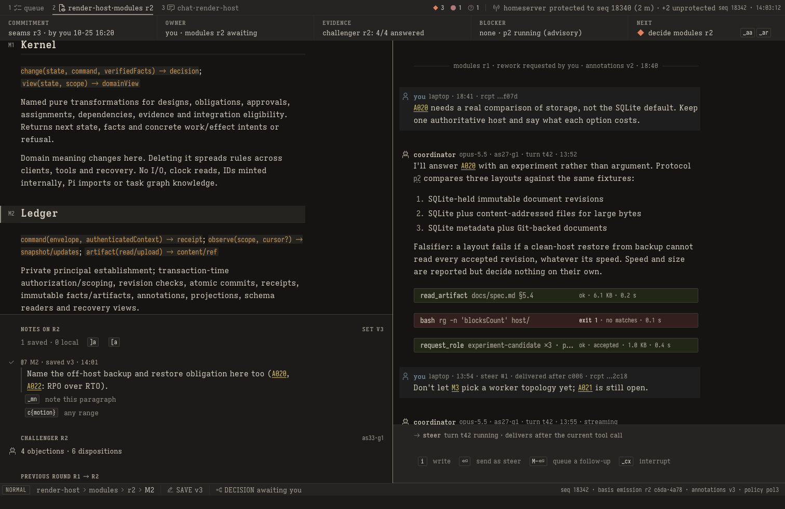
*SC-01 workspace frame, HTML-prototype render (E-PROTO-5), not GPUI. Wireframe: [`wireframes/wireframe-00-frame.png`](wireframes/wireframe-00-frame.png) (phase-3 drawing; [`layout.md` §0](wireframes/layout.md) is current).*

---

## 3. Interaction grammar

The complete table is [`keymap.toml`](keymap.toml); the full semantics are in [`reference/grammar.md`](reference/grammar.md). This section is what a builder must implement.

### 3.1 Modes

| Mode | Badge | Entered by | Left by | Keys do |
|---|---|---|---|---|
| Normal | `[N]` | default, `Esc` | — | motions, operators, leader, `g z ] [` families |
| Visual | `[V]`/`[VL]` | `v`, `V` | `Esc`, an operator | extend a selection anchored to immutable bytes |
| Operator-pending | `[O]` | `c`, `gc`, `y` | a motion or object, `Esc` | wait for an object |
| Insert | `[I]` | `i a o I A O` in editors; `c{obj}`/`cc` (opens a composer) | `Esc`, `jk` | text only; the leader is inactive |
| Command line | `[:]` | `:`, `␣;`, `␣.`, pickers | `⏎`, `Esc`, `C-c` | minibuffer editing |
| Hint | `[H]` | `gs` | a label, `Esc` | every key selects a label |
| Readback | `[◆]` | an authority command | `y`, cancel | confirm, cancel, inspect only |

Mode badges are outlined chips: neutral, except Insert (sage border) and Readback (coral border).

**Contexts** form a tree. A command applies in its listed contexts and all their descendants; an inner context may shadow an outer binding only by declaring `shadows = "parent"`.

```
global
├─ list     (queue, outline, outbox) └─ explorer └─ filter
├─ reader   └─ review · diff · evidence · decision · chat · diagram (full view)
├─ editor   └─ prompt · composer · editbuf
├─ picker · readback · hint
```

### 3.2 Verbs and objects

vim's operator + motion grammar, with Render's nouns as objects.

**Verbs:**
- `c{obj}`/`cc` annotate in review and diff; `gc` is its alias. `␣mn` notes the paragraph (Normal) or the selection (Visual); it is the discoverable entry, listed in which-key.
- `y` yanks, `␣y` to the clipboard, and `gy` yanks the object's stable reference.
- `dd` discards a local draft, and `u` undoes that.
- `gd`/`gi`/`gD`: go to definition / evidence / the bound basis.
- `K` peeks; `gk` shows blocker details; `gx` opens an external link with a URL confirm.
- `⏎`/`l` opens; `-` goes to the parent.

**Objects**, as `]x`/`[x` motions and text objects where they apply:

| Key | Object |
|---|---|
| `n` | node |
| `a` | unresolved annotation |
| `h` | hunk |
| `f` | finding |
| `o` | obligation |
| `m` | message |
| `t` | tool call |
| `d` | problem mark |
| `q` | needs-me item, from anywhere |
| `g` | list group |
| `p s w` | paragraph, sentence, word |

**Readers:** `j`/`k` without a count move by visual (wrapped) line, as the user's nvim `j`→`gj` does; with a count they move by logical line.

**Display forms** are namespaced and atomic; they never break across lines.

| Object | Form | Object | Form |
|---|---|---|---|
| emission revision | `r2` | Contract revision | `K·40cc` |
| annotation-set revision | `v3` | digest | `9f3c·a1e2` |
| policy revision | `pol3` | assignment · generation | `as31·g2` |
| policy binding revision | `bind1` | annotation | `@7` |
| node, finding, obligation | as authored (`M2`, `F16`, `B3`) | decision question | `Q1` |
| commit | 7 hex | command / receipt | `cmd …7Q4K` |

### 3.3 Leader and which-key

Grounded in the user's nvim: `mapleader = " "`, `timeoutlen = 300`, fzf-lua leaders, `C-h/j/k/l`, `]d`, `gd gi gD gk K`, Insert `jk`.

```
a ◆authorize  c +chat  d +diagnose  f +find  h +help  m +local  o +open  r +recover  s +search  t +toggle  w +window
␣ views  . find  / lines  ; commands  : history  ' resume  q needs-me  u history  y clipboard
```

- **`␣m` (local, review):** `n` note on paragraph or selection · `s` save annotations (= `:w`) · `e` edit emission bytes · `d` diff with previous · `o` outline.
- **`␣o` (open):** overview, chat, evidence, dispositions · `s` slice explorer · `a` its Agents tab.
- **`␣r` (recover):** `r` refresh · `u` outbox · `q` query receipt · `t` retry with the original ID · `c` reconnect now.
- **`␣t` (toggle):** follow, measure (`␣tw`), prose face (`␣tp`), Mermaid source (`␣tm`). `␣ht` picks the theme variant live.
- **which-key** opens after 300 ms on any proper prefix. It is a non-modal, display-only panel that never consumes a key. Authority leaves carry `◆` in `fg.alt`, never coral.

### 3.4 Pinning and the frame boundary

```text
on frame boundary:  apply all queued host messages; apply deferred layout after 1.5 s without a key; paint
on key(e):          handled immediately against the last painted frame
  first key of a sequence captures the pin {pane, object id, revision, read basis, anchor, layout epoch, ledger seq, authority epoch}
  dispatch resolves the target by object id and revision, never by row index
```

- **Host messages apply only at frame boundaries.** So the state a key meets is the frame the user saw.
- **List inserts and reorders freeze** while keys arrive. They apply 1.5 s after the last key, even with a prefix pending.
- **The cursor is attached to an object ID.** A removed row becomes a tombstone (`resolved elsewhere`) until the next unfreeze.
- **No host event moves focus or opens a modal or readback.**
- **The send mode is pinned.** A prompt or steer decided in the frame the user saw travels in the envelope, and a mismatch is refused (`turn_state_changed`); the draft is kept.

### 3.5 One authority tier: readback + `y`

| Keys | Command | Works in |
|---|---|---|
| `␣aa` | approve checkpoint emission (saved notes ride along as non-binding) | review, diff |
| `␣ar` | request rework | review, diff |
| `␣ad` | answer a decision (option + note) | decision |
| `␣as` | confirm task shape (Ground) | decision, review |
| `␣ac` | accept intake / Contract / amendment | review, evidence |
| `␣ax` | cancel an assignment | lists, chat, evidence |

- **From a list row**, `␣aa ␣ar ␣ad ␣ac` echo `open it first · ⏎` and do nothing. `␣ax` works from lists, because its readback (assignment, generation, effects in flight) is the whole object.
- **Every authority command needs a host decidable:** a basis digest and fields, plus EFFECT and NOT text. Without one, the action shows as unavailable, with the host's reason. The client never derives a basis or invents a consequence.
- **Unsaved drafts first.** If the target has unsaved local drafts, `␣aa`/`␣ar` first offer `save 3 drafts (v3→v4)? y/n`. The readback appears only after the save receipt.

**Read basis.** Each open view keeps, per basis field, the revision and digest it has shown. A field advances **only on an explicit act**:
- `]d` landing on the change;
- `d` in a STALE readback;
- opening the stale diff.

Scrolling does not count. Until then the change is *not yet acknowledged*: marked `[!]` in the sign column and the strip, counted in the statusline, and reachable with `]d`.

**Readback** (a float on the grey `surface.readback`, 2 px coral top rule, 16 px coral diamond; no coral fill):

```
◆ APPROVE render-host · modules r2
  BINDS   emission r2 9f3c·a1e2 · manifest 51d0·08ce · annotations v5 · decisions 2a83·34a6 · intake none · policy pol3 · binding bind1
  CARRIES 4 saved notes as non-binding
  EFFECT  <host text>
  NOT     <host text, fixed per command type>
  STATE   fresh · seq 18356 · host 14:07:10 (0 s ago) · every basis field acknowledged
  y confirm · n Esc q cancel · K full basis
```

- **BINDS** renders **every field of the host's basis**, known or not, in the host's order, wrapped in one block. A digest without a revision shows the digest alone; a missing value shows `none`, never a dash.
- **Size:** the float grows to fit, up to 40 % of the window.
- **STALE** (any field differs from what was acknowledged): `annotations v4 not yet acknowledged · d shows it`, and `y` is disabled.
- **CHANGED** (a field moves while the readback is open): `y` is disabled.
- **Typeahead:** keys timestamped before the readback was presented are discarded. Auto-repeat and `⏎` never confirm.
- **On confirm** the envelope carries a fresh command ID, the pinned basis and the pinned `authorityEpoch`. A timeout becomes `[?] unknown` in the outbox, never "failed".
- **Decision notes** are local drafts until `␣ad y` sends them.

### 3.6 Editors, pickers, hints, recovery

- **Editors** (prompt, composer, decision note, edit buffer) share one modal controller with a vim subset (`h j k l w b e`, `d c y` with `iw ip i" i(`…, `dd yy cc D C x p P J u C-r .`, `v V`, `jk`/`Esc`).
  - Composers open inline under their range. Their footer reads `Esc Esc done · :w saves · ␣ar sends with rework`.
  - `⏎` in a Normal prompt sends; `M-⏎` queues a follow-up.
  - Editors never host authority.
- **Pickers** follow the user's fzf-lua layout: bottom-docked, full width, 30 % height, preview at 50 %.
  - Keys: `C-j/C-k` move, `⏎` opens, `C-v/C-s` split, `C-l` sends the results to the explorer.
  - Results freeze once the user moves.
  - `␣.` finds any object; a typed prefix filters by kind (`slice:`, `doc:`, `agent:`).
  - Previews render content as content.
- **Hint mode** `gs` labels visible targets with home-row chips placed after the row's state icon. Selecting a label moves the cursor and never acts.
- **Jumplist and marks:** `C-o/C-i` (100 entries per device) and `m{a-z}`/`m{A-Z}`, persisted per device.
- **Recovery verbs:** `␣rr` refresh · `␣ru` outbox · `␣rq` query a receipt without executing · `␣rt` retry with the original ID and identical bytes (refused for entries from before a host restore) · `␣rc` reconnect.

### 3.7 Explorer and diagram keys

- **Explorer (SC-16):**
  - `␣os` opens it and `␣oa` opens its Agents tab; `gt`/`gT` switch tabs.
  - Panes: `C-h/C-l` between panes, `C-j/C-k` inside the sidebar.
  - Filters: `x` toggles a state, `X` shows only it; `:filter a,b`, `+x`, `-x`, `clear`, `save <name>`, `<name>`, `forget <name>`.
  - `]g`/`[g` move between groups.
  - A filter change keeps the cursor on the same slice when it is still visible.
- **Diagram full view** is a float: `h j k l` pan, `+ - =` zoom (fit to 200 %), and `q`, `Esc` or `⏎` leave it.

### 3.8 The keymap file and its lint

`keymap.toml` holds `[meta]`, `[contexts]`, `[groups]` (which-key labels), `[builtin]` and one `[[command]]` per command:
- **Fields:** `id`, `ex`, `desc` ≤ 32, `tier` (local / write / decide), `kind`, `ctx`, optional `wire`, and `keys` with `mode`, `ctx`, `seq` and optional `shadows = "parent"`, `alias_of`, `tui`, `tui_alt`.

**Lint rules:**

| Rule | Checks |
|---|---|
| KL0 | Schema: only known fields, keys parse, the context tree is acyclic |
| KL1 | Reachability: unique `id`/`ex`, everything in the palette |
| KL2 | Prefix-freedom per mode and overlapping context, unless `shadows` |
| KL4 | Authority: decide-tier only under `␣a`, never countable or repeatable, never in editors, backed by a host decidable (`wire`), no `readback` field, and no `list` context except cancel |
| KL5 | Reserved keys bind only local commands |
| KL7 | Every wire type is in the protocol catalogue |
| KL8 | which-key labels exist |
| KL9 | Terminal representability |
| KL10 | Docs drift |
| KL12 | One object char means one object |

---

## 4. Screens

Each screen gives its purpose, regions and behaviour, then its mockup (an **HTML-prototype render**, not GPUI) and its wireframe. [`wireframes/layout.md`](wireframes/layout.md) is the normative pixel spec. The tldraw drawings predate phases 4–6; [`wireframes/README.md`](wireframes/README.md) lists what changed since. [`wireframes/text-mocks.md`](wireframes/text-mocks.md) has a text grid for every screen.

### SC-01 Workspace frame

The frame every view uses (§2): bufferline, handover strip on workflow views, gutter-led panes, statusline, echo. Floats dock above the statusline.

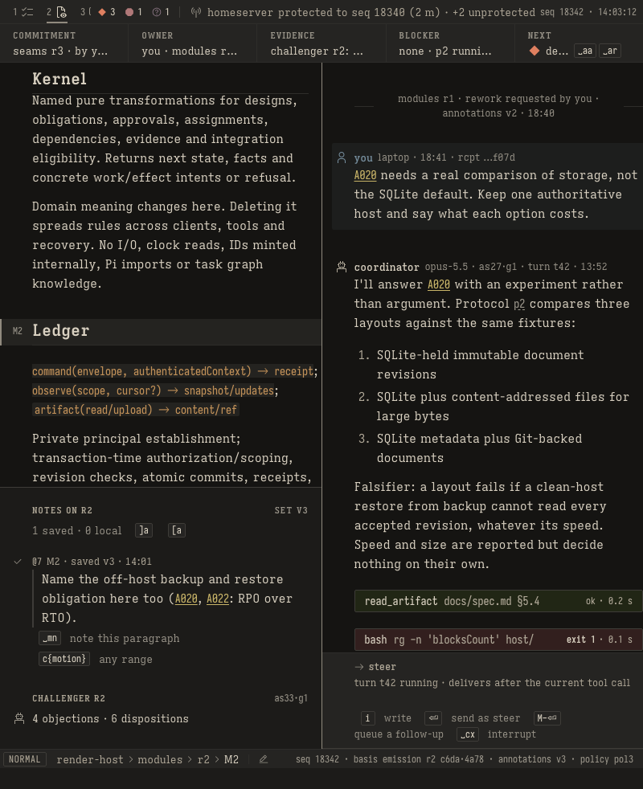
*HTML-prototype render, 800 px window. Wireframe: [`wireframe-00-frame.png`](wireframes/wireframe-00-frame.png).*

### SC-02 Needs-me queue (the landing view)

The andon board that answers "what needs me" with zero keys (T01).

**Layout:** the queue list is the main pane, `surface.read`, 992 px. The handover card is the side pane, 519 px.

**List** (rows 26 px, group header 24 px). The columns are:
- state icon;
- project (`ui.small` `fg.muted`);
- item (path truncation `…/leaf`);
- reason (`fg.alt`);
- waiting (`mono.small`, 60 px);
- downstream (`mono.small`, 84 px, the host's transitive count).

**Groups:**
- **NEEDS YOU · 3**: decisions you take here, each with the coral diamond, oldest first.
- **ON THE HOST · 1**: operator remedies such as a quarantine, with the failed octagon and no diamond.
- **WAITING · NOT ON YOU**: dependencies, slots and the forge, oldest first.
- **RUNNING · 4 · slots 4/4**: rows first, slots named. They differ while a cancelled assignment holds its slot through the grace period.
- **DONE · LAST 24H**.
- **PROPOSALS**: small multiples in the host's dependency order.
- A legend, with the diamond in `fg.alt`.

**Card:** the five facts for the cursor row, meta (`rework 1/2 · downstream 4 · 25 in all`), QUESTION in `prose.small` on a content bar, `coordinator recommends 1`, option titles with a `recommended` chip, and ACTIONS with key chips.
- The strip's and card's NEXT never carry the recommendation; it is the coordinator's, not the system's.
- No field is a bare dash: `no owner · waits for a slot`, `none yet`, `none` or the wait class, `nothing for you yet`.

**Calm state:** NEEDS YOU empty, and no coral anywhere.

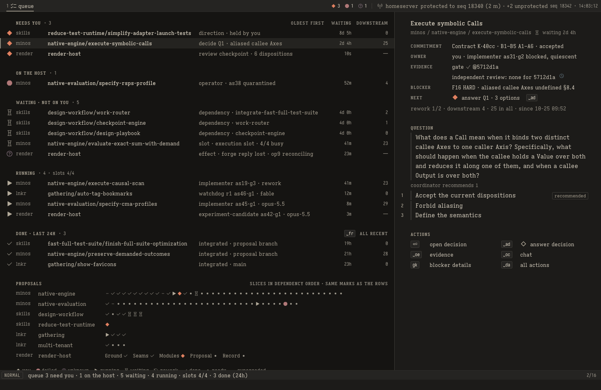
*HTML-prototype render. Also [Light](mockups/proto-SC-02-queue-ember-light.png), [800 px](mockups/proto-SC-02-queue-ember-800.png), [calm](mockups/proto-CALM-queue-ember.png). Wireframe: [`wireframe-SC-02.png`](wireframes/wireframe-SC-02.png) (phase 3; it lacks ON THE HOST and the slots header).*

### SC-03 Chat reader, prompt and steering

**Layout:** the transcript is the main pane, 1171 px, with the prompt docked under it on `surface.bar`. The info pane is the side pane, 340 px: CONVERSATION, STEERING QUEUE, ARTIFACTS IN THIS TURN, OTHER CONVERSATIONS, OUTLINE.

**Messages:**
- Text column x 331–879 (548 px measure) with a 40 px gutter.
- Every message's text starts on that one left edge. **There is no per-message author bar.**
- The header band holds the role icon in the gutter, the name (you steel, reviewers mauve, workers sage, the coordinator neutral `fg`), then model, assignment and time in `ui.small`.
- The human message alone sits on the 8 % steel band. Only a host `human` role produces it.
- Gap between messages: 24 px.

**Tool calls:**
- Collapsed to one 28 px row on a tint chosen by the host's recorded outcome, with a 1 px `border.strong` edge and **no icon**.
- Tool name in `mono` `fg`; arguments `fg.alt`, truncated.
- A fixed 216 px **outcome column**: the outcome word first (`ok`, `exit 1`, `running · 40 s`, `unknown`, `cancelled`), then detail and duration. Failed and unknown words are bold `fg`.
- `za` expands the output (`mono` 13/20, at most 12 lines, then `… 37 more lines · K`).

**Code blocks** grow right from x 331 up to x 1155, with a 2 px orange left rule, an orange language label and syntax highlighting. **Inline code** is Iosevka 14 orange on a `surface.code` chip. **References** are gold Iosevka 500 with a solid underline.

**Prompt:**
- Its header says before you send whether `⏎` prompts or steers (`→ steer · turn t42 running · delivers after the current tool call`).
- `␣cx` interrupts; `Esc` never does.
- A steer that arrives after the turn ended is refused with `turn_ended`; the client keeps it as a draft and offers it as a follow-up.

**Info pane rows are structured:** key · role · state · time (`b · candidate · running · 3m`), from host fields.
- Whole fields drop from the right.
- The key (candidate letter, assignment) never truncates.
- The steering-queue quote is `ui.quote`: at most 3 lines, on the content bar.

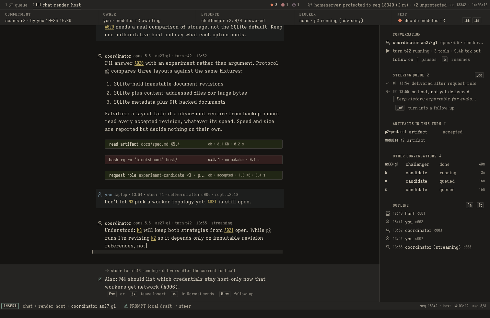
*HTML-prototype render. Also [tool expanded](mockups/proto-SC-03-chat-tool-expanded-ember.png), [candidate, Soft](mockups/proto-SC-03-chat-candidate-ember-soft.png), [Light](mockups/proto-SC-03-chat-ember-light.png), [800 px](mockups/proto-SC-03-chat-ember-800.png). Wireframe: [`wireframe-SC-03.png`](wireframes/wireframe-SC-03.png) (phase 3; it still draws author bars, gutter dots and a gold coordinator).*

### SC-04 Checkpoint review, annotation and documents

**Layout:** outline is a side pane (220 px); the document is the main pane (930 px; text x 432–980, gutter x 392–432 with node IDs and note bars); notes are a side pane (360 px).

**Notes:**
- `c{motion}`, `gc{motion}` or `␣mn` opens an inline composer anchored to the bytes of `r2`. `Esc Esc` keeps the note as a local draft `[+]`, and `:w`/`␣ms` saves the set.
- The NOTES pane ends with `␣mn note this paragraph · c{motion} any range`. Its empty state reads `No notes on r2 yet` with the same key line and `V…c notes a selection`.
- Note bodies are `prose.small` on the content bar.

**Documents** render Markdown per §5.6:
- headings with rules;
- tables and code that grow right from the text column (x 432–1135, never over the gutter);
- sticky section headings whose band covers the pane and whose text aligns with the column;
- frontmatter collapsed to one line.

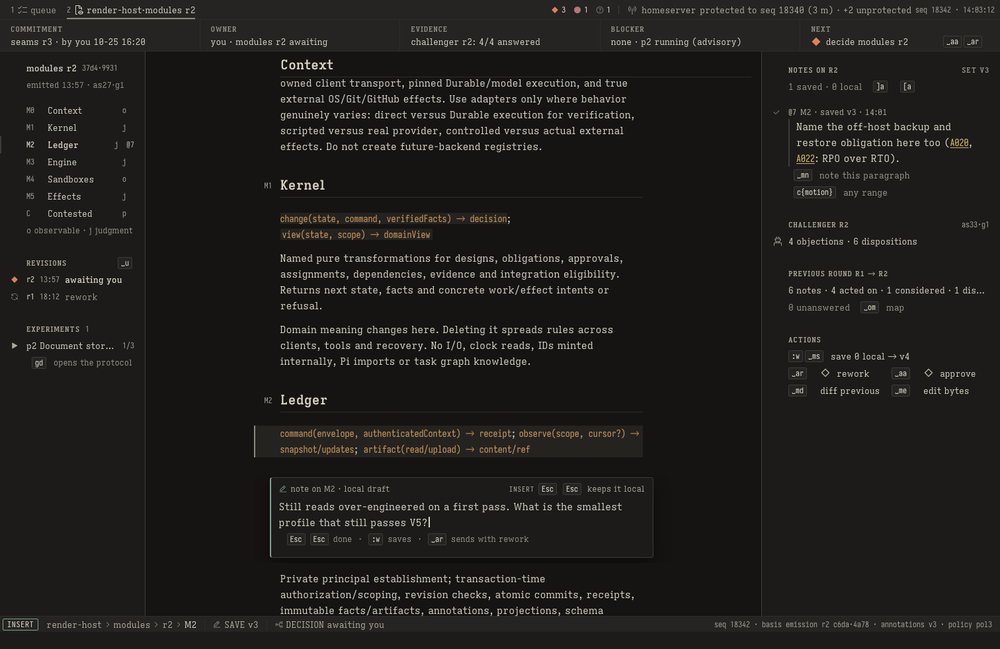
*HTML-prototype render. Also [note here](mockups/proto-SC-04-note-here-ember.png), [notes empty](mockups/proto-SC-04-notes-empty-ember.png), [Markdown, Light](mockups/proto-SC-04-markdown-ember-light.png), [Markdown with references](mockups/proto-SC-04-markdown-cursor-ember.png), [breakout](mockups/proto-SC-04-markdown-breakout-ember.png), [code](mockups/proto-SC-04-markdown-code-ember.png), [table at 800 px](mockups/proto-SC-04-markdown-table-ember-800.png). Wireframe: [`wireframe-SC-04.png`](wireframes/wireframe-SC-04.png) (phase 3).*

### SC-05 Emission diff r1 → r2

Side-by-side prose diff:
- Each side wraps at words, and only the first line of each source line carries its sign.
- Hunks are the client's own; the host cites nodes and byte ranges (RQ-32).
- `]h` moves between hunks; notes anchor on the new side.
- Diff lines use the `diff.add`/`diff.del` tints with `+`/`−` signs.

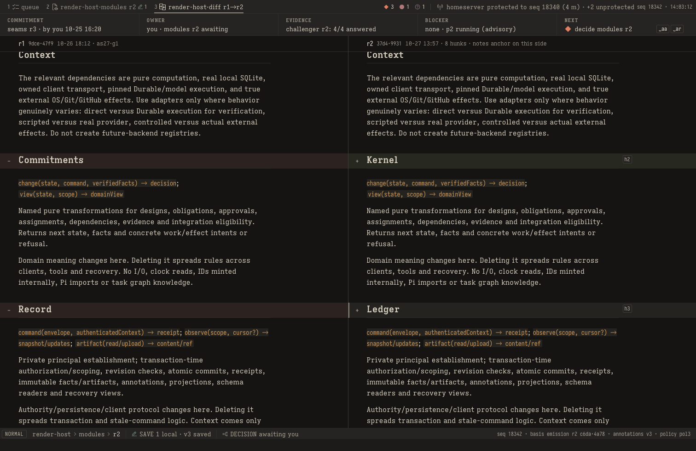
*HTML-prototype render. Text grid: [`text-mocks.md` SC-05](wireframes/text-mocks.md).*

### SC-06 Annotation disposition map

Every note of the previous round, mapped to the host's disposition (acted on, considered, dismissed) and to where in the new emission it went.
- The host enforces completeness.
- Dismissals and product questions are flagged with the diamond **outline** in `fg.alt`, not coral.

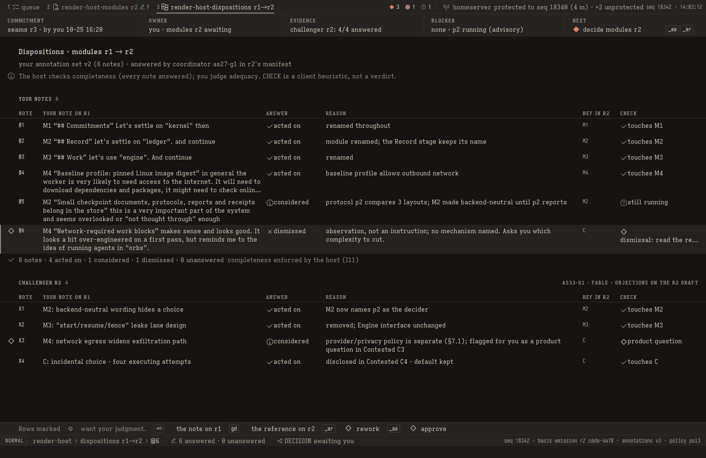
*HTML-prototype render. Text grid: [`text-mocks.md` SC-06](wireframes/text-mocks.md).*

### SC-07 Evidence and receipts

The source binding comes first, then the obligation × source matrix of host summaries (`K` gives the full text) and findings.
- Finding ↔ obligation links appear only where the report records one.
- Gate passes use the olive `checkmark` in evidence.

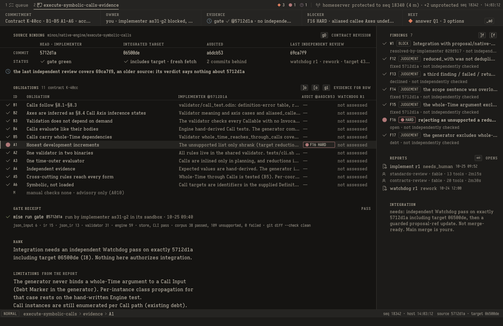
*HTML-prototype render. Text grid: [`text-mocks.md` SC-07](wireframes/text-mocks.md).*

### SC-08 Assignments and agents (the explorer's Agents tab)

The same table is the main list of SC-16's Agents tab (`␣oa`):
- `EXECUTING · 4 · slots 4/4`;
- ON THE HOST, holding the quarantine;
- HELD (ownership kept, no slot);
- QUEUED.

Each row: icon, slot, assignment `mono`, workflow path, role, state, since. Model and last activity move to the preview. The preview holds the lifecycle list.

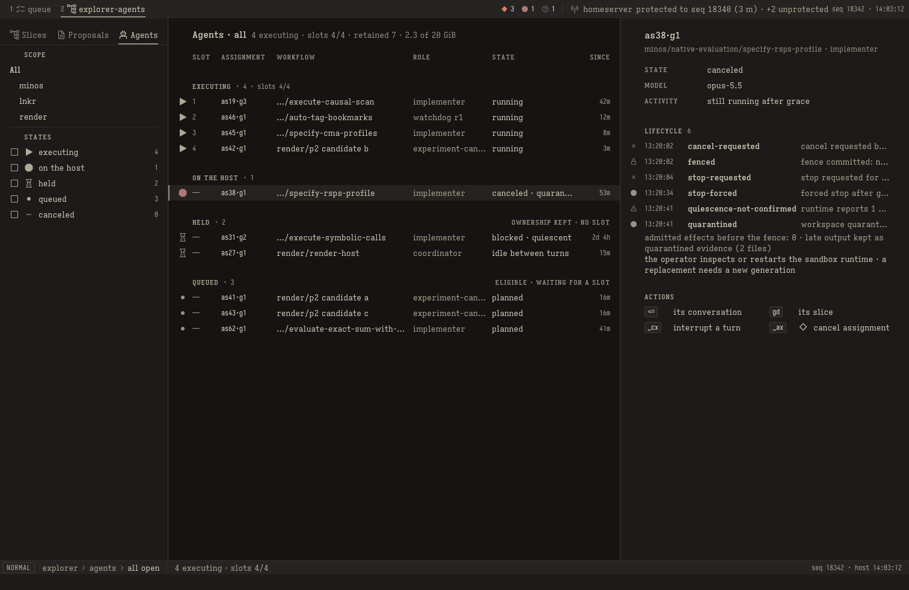
*HTML-prototype render. Also [the standalone table](mockups/proto-SC-08-agents-ember.png).*

### SC-09 Decision with readback

**Layout:** decision text is the main pane (text x 311–859); the context column is a side pane (380 px).
- The question, then EVIDENCE bullets with references.
- OPTIONS: each title in Etoile 15/24 700 on its own line, its body below, a `recommended` outlined chip, and the cursor bar on the current option. No diamond.
- YOUR ANSWER: a local draft.

**Readback:** 1512 × 200 from y 732, growing to fit; as in §3.5. When it opens, the pane scrolls so the cursor option, title and body, sits above it.

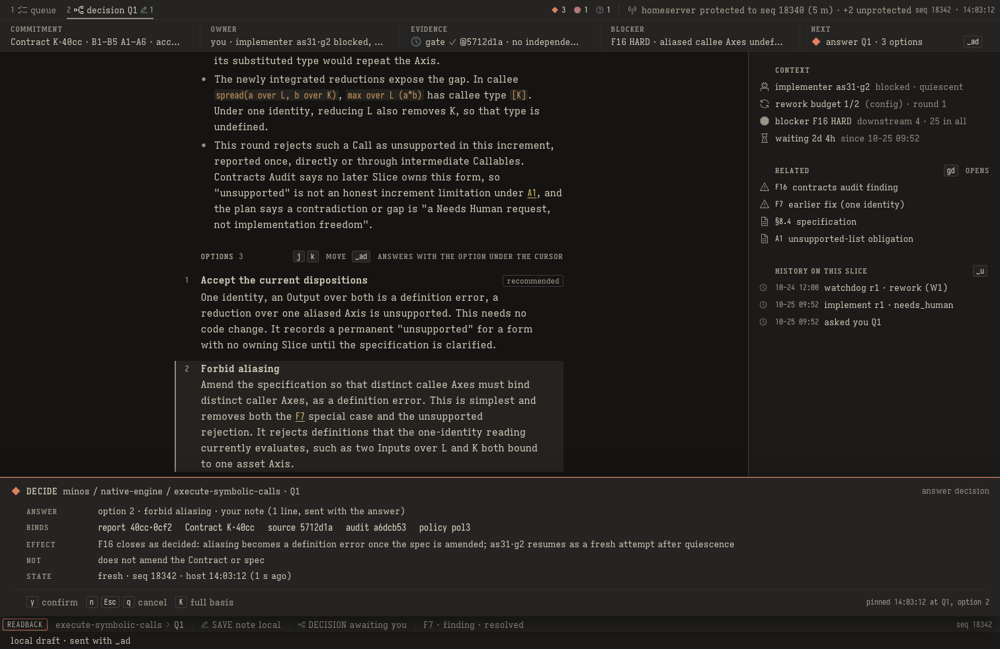
*HTML-prototype render. Also [decision](mockups/proto-SC-09-decision-ember.png), [approve readback, Light](mockups/proto-SC-09-approve-readback-ember-light.png), [stale readback](mockups/proto-SC-09-stale-readback-ember.png). These renders still show a bare dash in BINDS; the spec shows `none`. Wireframe: [`wireframe-SC-09.png`](wireframes/wireframe-SC-09.png) (phase 3; it draws a coral fill, but the readback is grey).*

### SC-10 Reconnect, stale and unknown-outcome states

| State | What the user sees |
|---|---|
| **a. Offline** | `○ offline 2m · last seq` in the bufferline; one notice line (`OFFLINE since … · showing seq … · 2 local drafts safe · host writes and decisions disabled · ␣rc retry`); every strip value marked stale. `:w` is not sent and there is no offline queue |
| **a′. Reconnected** | A fresh snapshot keeps drafts, marks, jumplist, pins and read bases; changes stay *not yet acknowledged* until `]d`/`d` |
| **b. `stale_basis`** | "your approval was NOT recorded · nothing was approved"; YOU SENT vs HOST HAS, in display forms (`r2`, `v3`, `pol3`); what changed; permitted next actions |
| **c. Unknown outcome** | The outbox (`␣ru`): `[?]` entries with "the host may have accepted it". Other decisions on that object are disabled until it settles. `␣rq` queries and never executes; `not_found` is not proof it wasn't accepted; `␣rt` retries the identical envelope |
| **d. Unknown external effect** | View only in v1; reissue and risk resolution are deferred |
| **e. Revoked** | The client stops retrying; drafts are kept on the device; the view is frozen |
| **f. Unsupported** | `unsupported by this client (v0.3)` for unknown resource kinds, with decisions on that object disabled. An unknown *basis field name* never disables a command |
| **g. Sequence gap** | Echo only: a fresh snapshot, with everything local kept |

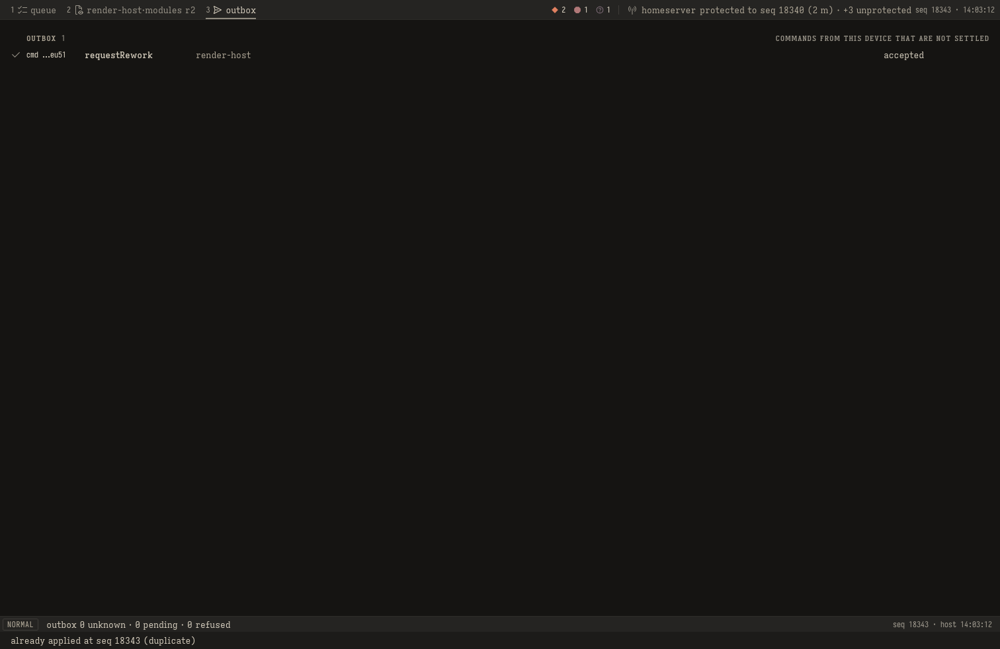
*HTML-prototype render. Also [offline](mockups/proto-SC-10a-offline-ember.png), [stale basis](mockups/proto-SC-10b-stale-basis-ember.png), [unknown effect](mockups/proto-SC-10d-op9-ember.png), [revoked](mockups/proto-SC-10e-revoked-ember.png). Text grids: [`text-mocks.md` SC-10](wireframes/text-mocks.md).*

### SC-10h Host restored from a backup

Two states in sequence (§10.1). All copy uses plain words: no epoch, deduplication or cutoff. Each line stays within the text column, and the message appears **once**, in a notice under the strip; the echo shows only the key hint.

1. **Not paired.**
   - **Bufferline:** `homeserver · restored · pair this device again`, stale mark.
   - **Notice:** "The host was restored from a backup and no longer knows this device. Ask the host's admin to pair it again. It reconnects by itself after that. Nothing on this device is lost: your 2 drafts and 1 unsent request stay here."
   - **Echo:** `␣rc try now`.
2. **Catching up.**
   - **Bufferline:** `homeserver · catching up after a restore`. The seq shown is older than before, and is accepted because the host was restored.
   - **Notice:** "The host was restored from a backup, so recent changes may be missing. It is catching up. Until it finishes you can read and draft, but not save or decide."
   - **Outbox:** "This request may or may not have reached the host before the restore. It can't be sent again as it was. When the host is ready, open modules r2 and ask again if you still need to." `␣rt` is refused; `␣rq` asks the host.

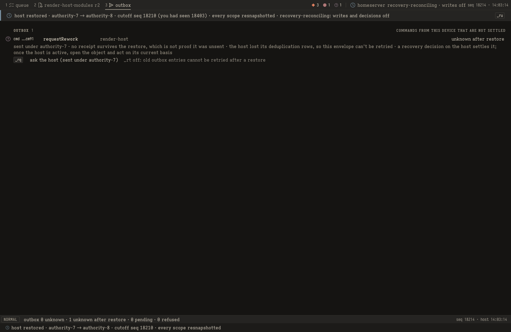
*HTML-prototype render, made **before** the copy above was rewritten: it still shows internal terms and a repeated message. Also [not paired](mockups/proto-SC-10h-restore-refused-ember.png), [Light](mockups/proto-SC-10h-restore-reconciling-ember-light.png). Current copy: [`layout.md` SC-10h](wireframes/layout.md), [`text-mocks.md` SC-10h](wireframes/text-mocks.md).*

### SC-11 Picker (`␣.` find any object)

The user's fzf-lua layout:
- bottom-docked, 30 % height, list left and preview right;
- a typed prefix filters by kind;
- `C-l` sends the results to the explorer as a scope.

The theme picker (`␣ht`) uses the same float and switches the variant live.

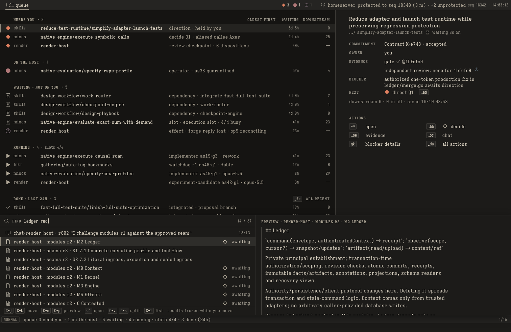
*HTML-prototype render. Also [theme picker](mockups/proto-SC-11-theme-picker-ember.png).*

### SC-12 which-key

A display-only panel above the statusline:
- the `␣a` header reads "authorize — every command reads back its exact basis before it binds", once, with no footer;
- authority leaves carry the diamond **outline** in `fg.alt`.

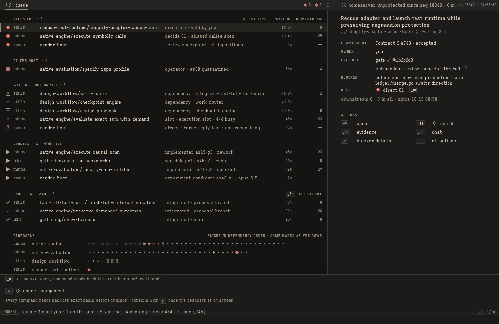
*HTML-prototype render. Also [root, Soft](mockups/proto-SC-12-whichkey-ember-soft.png). Wireframe: [`wireframe-SC-12.png`](wireframes/wireframe-SC-12.png).*

### SC-13 Hint mode (`gs`)

Labels sit at the start of each target's text after its state icon, shift right to avoid overlap, and are frozen at `gs`. A label moves the cursor; it never acts.

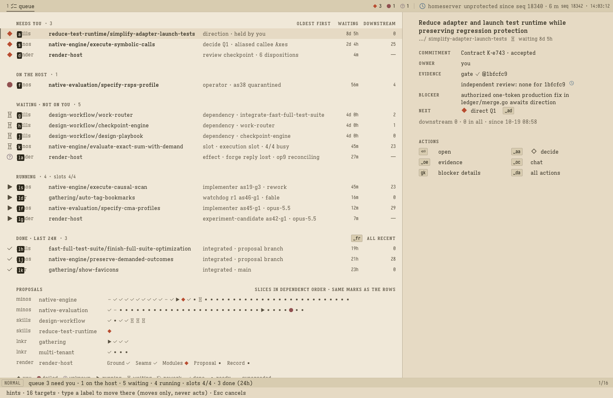
*HTML-prototype render, Light.*

### SC-14 Mermaid diagrams

Diagrams render on open (`␣tm` shows the source).
- **Width:** a figure spans from the text column's left edge to the pane's right content edge (703 px in SC-04). It is drawn at natural size when it fits.
- **Scaling:** otherwise it is scaled down while every label stays ≥ 12 px (scale ≥ 0.86 for 14 px edge labels, ≥ 0.92 for 13 px fragment labels).
- **Wider still:** a 96 px **"wider than view"** panel: 20 px `diagram` icon, caption, natural width, "labels would be N px here", node and edge counts, `⏎ full view`. Never a clipped picture.
- **Full view** is a float over the window (§3.7).
- **Parse errors** show the source with `stop-sign--filled` and the line and column.
- **Tokens:**
  - nodes `surface.bar` with `border.strong`;
  - text `fg`;
  - edges `fg.muted`;
  - edge labels `fg.alt`;
  - the frame `surface.code`.

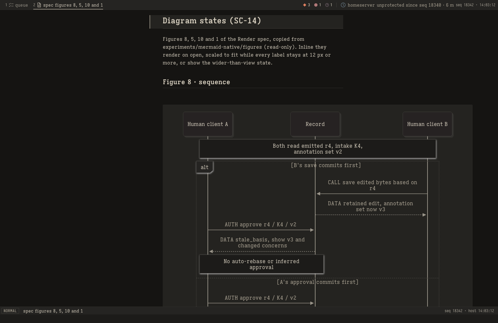
*HTML-prototype render with **mermaid.js as a stand-in for Pele**. Also [scaled](mockups/proto-SC-14-mermaid-scaled-ember.png), [wider than view, 800 px](mockups/proto-SC-14-mermaid-wider-ember-800.png), [full view](mockups/proto-SC-14-mermaid-full-ember.png). Wireframe: [`wireframe-SC-14.png`](wireframes/wireframe-SC-14.png) (phase 3; its widths and centring are superseded).*

### SC-15 Reading layout

The reading rules on one page (§5.5):
- the measure as a maximum, centred in a wide pane;
- word wrap with atomic IDs;
- a long URL breaks with a continuation mark;
- blocks that grow right and scroll with the overflow cue.

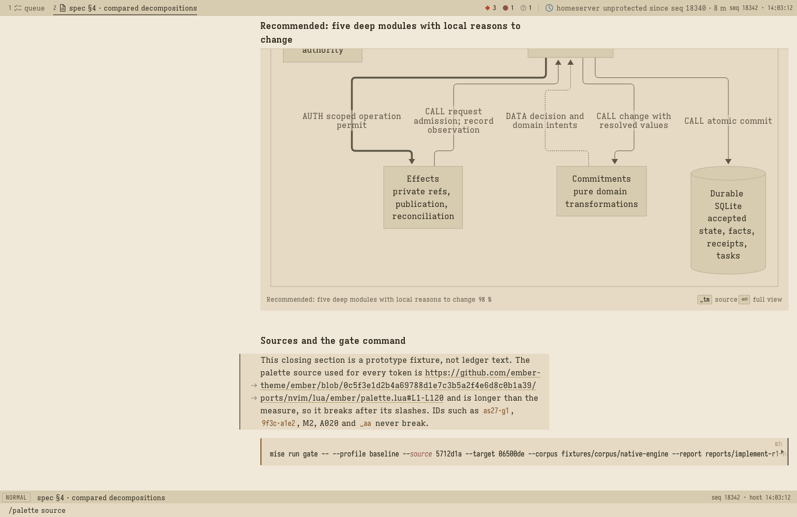
*HTML-prototype render, Light. Also [800 px](mockups/proto-SC-15-reading-800-ember.png).*

### SC-16 Slice explorer

**Layout:** sidebar 280 px (minimum 240), the filtered list 750 px (main pane), and the preview 480 px (the SC-02 card).

**Sidebar:**
- Tabs: **Slices** · Proposals · Agents.
- **SCOPE tree:** All open → project → proposal, with counts that match the filter. Each proposal name gets its own line, and its small-multiple strip sits on a second line.
- **SAVED** filters, kept on this device.
- **STATES:** a multi-select filter with counts in scope. The order and labels come from the host's vocabulary; its state icons are drawn in `fg.alt` (controls, not live states).

**List:** the queue's row anatomy, grouped by proposal, in dependency order. Filter chips sit above it; the footer reads "69 open slices hidden by the filter · x in STATES widens it".

**Empty state:** names the scope and filter, shows matches elsewhere and how to widen, and keeps the needs-you count. The bufferline count never follows a filter.

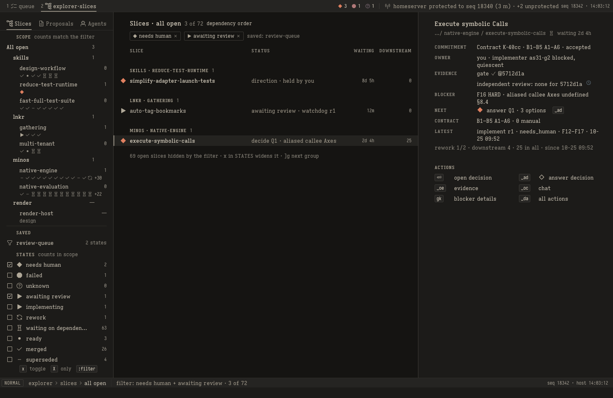
*HTML-prototype render. Also [Proposals tab](mockups/proto-SC-16-proposals-ember.png), [empty](mockups/proto-SC-16-empty-ember.png), [calm, Light](mockups/proto-SC-16-calm-ember-light.png). Wireframe: [`wireframe-SC-16.png`](wireframes/wireframe-SC-16.png) (phase 3; the tree strips moved to their own line).*

---

## 5. Visual language

Full rules: [`reference/visual-language.md`](reference/visual-language.md). Every token is in [`ember-tokens.json`](ember-tokens.json).

### 5.1 Theme variants

- **Config:** `ui.theme` in `~/.config/render/client.toml`: `ember` (default), `ember-soft`, `ember-light`, or `auto` (macOS appearance chooses `ember` or `ember-light`).
- **Live switch:** `␣ht` switches within one frame; type and layout don't change.
- **Diagrams on a switch:** cached SVGs are re-coloured and re-rasterised, visible ones at once and off-screen ones lazily.

### 5.2 Surfaces and text

Main panes use the surface with the most contrast against text (`surface.read`): the darkest in the dark variants, the lightest in Light. Side panes are one step quieter.

| Token | Ember (dark, default) | Ember Soft | Ember Light |
|---|---|---|---|
| `surface.read`: main panes | `#151412` | `#1c1b19` | `#f0e8d8` |
| `surface.side`: side panes, floats, echo | `#1c1b19` | `#242320` | `#e6dac4` |
| `surface.bar`: bufferline, strip, statusline, chips | `#252422` | `#2c2b28` | `#d8ccb0` |
| `surface.cursor.read` | `#242320` | `#2a2927` | `#e6dac4` |
| `surface.cursor.side` | `#2e2d2a` | `#353430` | `#ddd0b8` |
| `surface.code` | `#242320` | `#2a2927` | `#e6dac4` |
| `surface.readback` | `#252422` | `#2c2b28` | `#ddd0b8` |
| `surface.selection` | `#3e3c38` | `#444240` | `#b8ac96` |
| `border.subtle` | `#2e2d2a` | `#353430` | `#cec2a8` |
| `border.strong` | `#3e3c38` | `#444240` | `#b8ac96` |
| `rule.focus` | `#908a7e` | `#908a7e` | `#787060` |
| `fg` | `#d8d0c0` | `#d8d0c0` | `#282418` |
| `fg.alt` | `#b0a898` | `#b0a898` | `#585040` |
| `fg.muted` (nudged to ≥ 4.5:1 everywhere) | `#999489` | `#a19c92` | `#5e5646` |

**The cursor row** is the pane's cursor surface plus a 2 px `rule.focus` bar. In the reading area, the cursor surface equals `surface.code`, so on code lines and inline-code chips the bar is the cursor cue.

### 5.3 Colour roles

Colour has **two channels**, separated by element type:
- **state** colour, on marks and state tints only;
- **kind** colour, on short labels: author names, inline code, code chrome, references.

Body prose, headings, list titles and chrome IDs are never accent-coloured.

**State marks:**

| Token | Ember (dark, default) | Ember Soft | Ember Light |
|---|---|---|---|
| needs you (`state.attn`, coral) | `#e08060` | `#e08060` | `#b84c30` |
| failed (`state.blocked`, rose) | `#b07878` | `#b07878` | `#905050` |
| stale (`state.stale`, steel) | `#7890a0` | `#7890a0` | `#3a6080` |
| unknown (`state.unknown`, mauve) | `#988090` | `#988090` | `#706070` |
| local (`state.local`, sage) | `#80a090` | `#80a090` | `#386858` |
| ok (`state.ok`, olive) | `#8a9868` | `#8a9868` | `#4a6830` |

**Kind roles.** The coordinator, the default voice, is neutral (`fg`). Gold means **navigable** and nothing else.

| Token | Ember (dark, default) | Ember Soft | Ember Light |
|---|---|---|---|
| you (steel) | `#7890a0` | `#7d94a3` | `#3a6080` |
| reviewers (mauve) | `#9b8493` | `#a08a98` | `#6b5b6b` |
| workers (sage) | `#80a090` | `#80a090` | `#386858` |
| code (orange) | `#c09058` | `#c09058` | `#83552b` |
| references (gold) | `#c8b468` | `#c8b468` | `#67581b` |
| link underline (gold) | `#c8b468` | `#c8b468` | `#7a6820` |

**Coral** marks only "needs your decision now" and the open readback (its 2 px top rule and 16 px diamond).
- Legends, which-key and filters draw the diamond in `fg.alt`.
- Operator remedies get the failed octagon, not the diamond.

**The colour budget (no rainbow):**
1. Coral as above, and nothing else.
2. State colour only on marks and state tints; kind colour only on short labels and the human band.
3. At most three kind hues per pane (a chat uses steel, gold, orange); a fourth role falls back to `fg.alt`.
4. Lists stay neutral, so they scan by state.
5. Tints are block-level only and paired with a word.
6. No accent in chrome captions, bars or tabs.

Syntax colour lives only inside code frames and doesn't count toward the budget.

### 5.4 Tints and tool-call blocks

| Token | Ember (dark, default) | Ember Soft | Ember Light |
|---|---|---|---|
| tool ok (olive hue) | `#212615` | `#292d1b` | `#cfd5b6` |
| tool failed (rose hue) | `#321f1e` | `#3a2625` | `#e8cbc1` |
| tool unknown (mauve hue) | `#2a2226` | `#32292d` | `#dacfcb` |
| tool running (neutral) | `#2e2d2a` | `#353430` | `#d8ccb0` |
| tool cancelled (neutral) | `#1c1b19` | `#242320` | `#e6dac4` |
| human message band (steel 8 %) | `#1d1e1d` | `#232424` | `#e1ddd1` |
| diff add | `#27281f` | `#2d2e25` | `#d7d5bf` |
| diff del | `#2c2321` | `#322927` | `#e2d1c4` |

**How the tool tints are built.** Each takes the hue of a 36 % accent blend, held at one lightness (`base2` in the dark variants, `bg_alt` in Light). They are "subtle but noticeable" (the user), and text contrast is kept.

**Visibility targets** (ΔE2000; measured equal on pixels; [`evidence.md`](evidence.md) §1.3):
- ok and failed ≥ 10 from `surface.read`, and ≥ 16 from each other;
- unknown ≥ 7 from `surface.read`, and ≥ 5 from ok and failed;
- running ≥ 3 from `surface.code` and ≥ 6 from `surface.read`;
- a quiet cap of ≤ 14 from `surface.read`.

**Tool blocks** come **only from host tool-call records** with an `outcome` field. They sit between messages, never inside one.
- No icon; the outcome word carries the outcome for colour-blind readers.
- A running block is told from a code block by shape: a code block has the orange rule and a language label.
- Tints change instantly when an outcome arrives.

### 5.5 Typography

**Two families,** both v34.9.1 and SIL OFL 1.1, bundled and checked at startup:
- **Iosevka Etoile** for chrome and prose;
- **Iosevka** for code, IDs, keys, key chips, the command line and every fixed numeric column.

Etoile has a 0.520 em x-height, tabular digits, and one advance across weights; Iosevka is exactly 0.5 em (measured, [`evidence.md`](evidence.md) §1.2). Ligatures and contextual alternates are switched off explicitly (Iosevka's default build has them on, measured), and zoom is global only.

| Token | Family | Size / line | Weight | Use |
|---|---|---|---|---|
| `ui.label` | Etoile | 11/14 | 700 | UPPERCASE, +0.06 em: captions, strip labels, field names |
| `ui.small` | Etoile | 12/16 | 400 | metadata, header bands |
| `ui` | Etoile | 13/18 | 400 | chrome text, list rows, statusline |
| `ui.strong` | Etoile | 13/18 | 600 | pane titles, author names, unseen rows (rows are otherwise regular) |
| `ui.title` | Etoile | 15/20 | 600 | card and view titles |
| `ui.quote` | Etoile | 13/18 | 400 italic `fg.alt` | excerpts in side panes, ≤ 3 lines |
| `mono.small` | Iosevka | 12/16 | 500 | key chips, hints, numbers |
| `mono` | Iosevka | 14/20 | 400 | code blocks, diffs, digests |
| `prose` | Etoile | **15/24** | 400 | body |
| `prose.small` | Etoile | 15/24 | 400 | side-pane content, on the content bar |
| `prose.table` | Etoile | 14/22 | 400 (header 700) | table cells |
| `prose.h1` … `h6` | Etoile | 24/32, 20/28, 17/26, 15/24, 13/20, 13/20 | 700 (h6 600 italic) | h1/h2 with a rule under; h5 uppercase `fg.alt` |
| `prose.code`, `prose.ref` | Iosevka | 14/24 | 400 / 500 | inline code, references |

**Spacing:** 2, 4, 8, 12, 16, 24, 32 px. **Radius:** 0 for panes, 2 px for chips, blocks and tool calls, 4 px for floats.

**Elevation:**
- floats use `surface.side`, a 1 px `border.strong` edge and a soft shadow;
- the readback uses `surface.readback`, a 2 px coral top rule and a stronger shadow;
- no translucency or blur.

### 5.6 Reading layout and Markdown

**Measure:** `measure.prose` = 68 average characters of the prose face, computed at startup from a bundled reference paragraph, giving **548 px** at 15 px. It is a maximum, and the column is centred in wider panes. Composers are measure + 32 px wide and grow to 8 lines.

**Wrapping:**
- Prose breaks only at spaces, with no justification and no hyphenation.
- IDs, key names and inline code up to 40 characters never break.
- A token longer than the measure breaks after `/ - _ . ·`, with a continuation mark in the gutter.
- **The renderer never inserts characters into content.**

**Blocks that don't wrap** (code, tables, diagrams) **grow right** from the text column's left edge up to the pane's right content edge, never over the gutter. Beyond that they scroll (`zl`/`zh`; `0` resets), and each clipped edge shows a 32 px fade, a 2 px `fg.muted` edge rule and a 16 px caret at the vertical middle. `K` opens a block full width.

**Markdown** is CommonMark + GFM (tables, task lists, strikethrough, autolinks, footnotes), GFM alerts, YAML frontmatter and `mermaid` fences. Raw HTML, math and wiki links render as literal text.

| Block | Rendering |
|---|---|
| Paragraph | `prose`, 12 px between paragraphs |
| Headings | the type scale; two cues per level; no heading hues |
| Lists | markers `• ◦ ▪` in `fg.muted`, 24 px per level, hanging indent |
| Task lists | 14 px boxes in the marker column, `fg.muted`/`fg.alt`, never olive and never in the gutter |
| Tables | header rule, row rules, no vertical rules; cells wrap at words; columns ≤ min(measure, 480 px); grow right, then scroll |
| Blockquote | a 3 px `border.strong` bar on every line; Etoile italic `fg.alt` |
| Alerts | the quote shape plus the kind word; **no icon, no hue** |
| Frontmatter | one line, "frontmatter · 6 fields · `za`", the width of the text column |
| Code | `surface.code`, a 2 px orange rule, an orange language label, `mono` 14/20, syntax-highlighted |
| Inline code | orange on a `surface.code` chip |
| Links | prose face, `fg`, dotted gold underline; the echo shows the URL; `gx` confirms |
| Images | not loaded in v1; a placeholder line with alt text and host |
| Footnotes | superscript markers; `gd` jumps to the note |
| Sticky headings | the band covers the pane; text and rule align with the column |

**Streaming:** completed blocks freeze, and only the trailing block re-parses. An unclosed fence renders as code so far.

### 5.7 References

A token in content that **exactly matches a label in the host's reference index** for its workflow scope (RQ-42) renders as a reference:
- **resolved:** Iosevka 500 gold with a **solid** underline, and no chip;
- **dangling** (in the index, but no target): `fg.muted` with a **dashed** underline. `gd` stays put and the echo gives the host's reason.

**Matching:**
- exact and case-sensitive, on whole tokens;
- ASCII plus `·` and `§` (the display-form characters), so homoglyphs never match;
- never inside code or tool output, and never in drafts.

A Markdown link keeps the link style whatever its text. Reference, inline code and link differ by **shape**:
- a reference has a solid underline and no chip;
- inline code has a chip and no underline;
- a link is in the prose face with a dotted underline.

A reference claims only that the label is a real object that `gd` opens, never that the sentence around it is true.

### 5.8 Code highlighting

- **Engine:** tree-sitter (`tree-sitter-highlight` 0.27.1).
- **Colours:** Ember's own nvim capture → colour mapping, with three changes so coral never appears:
  - keywords are orange bold;
  - Ember's other coral uses (builtins, macros, tags, labels, diff deletions) are rose;
  - constants are mauve.
- **Comments** use `fg.muted` italic.
- **Contrast:** every syntax token is ≥ 4.5:1 on `surface.code` in all three variants (the `syntax` block of [`ember-tokens.json`](ember-tokens.json)).
- **Text only:** syntax colour is text colour and weight, never a background. A `diff` fence colours its text, never line backgrounds.

**The 12 v1 languages:**

| Language | Language | Language |
|---|---|---|
| rust | typescript + tsx | javascript |
| json | toml | yaml |
| bash | sql | python |
| markdown | diff | elixir (`tree-sitter-elixir` 0.3.5, Apache-2.0: ship its notice) |

Others (fish, go, nix, lua, c, css, html, dockerfile, odin) are the target set: one crate and one alias row each, when needed. **Unlabelled or unknown fences render plain; no guessing.** Highlighting runs off the UI thread; code paints plain first, and only colour and weight change.

### 5.9 Icons and marks

IBM Carbon (`@carbon/icons` 11.90.0, Apache-2.0), monochrome SVG in token colours. Sizes: 16 px in rows, tabs, strip and gutter; 12 px in small multiples; 20 px for empty states. Icons supplement labels, never replace them.

| State | Icon | Colour | TUI |
|---|---|---|---|
| needs your decision | ◆ filled diamond (custom glyph) | coral | `◆` |
| failed / quarantined / refused | `stop-sign--filled` | rose | `✗` |
| unknown | `help` | mauve | `?` |
| running | `play--filled--alt` | `fg.alt` | `▸` |
| waiting | `hourglass` | `fg.muted` | `#` |
| rework | `renew` | `fg.muted` | `↺` |
| ready | dot (custom glyph) | `fg.muted` | `·` |
| done | `checkmark` | `fg.muted` (olive in evidence) | `✓` |
| superseded | `subtract` | `fg.muted` | `×` |
| stale / unacknowledged · local draft · conflict · suspicious | `time` · `edit` · `compare` · `warning--alt` | steel · sage · rose · `fg.muted` | `[!] [+] [≠] ⟨!⟩` |

- **Failed vs unknown at a glance.** At 16 px the octagon reads close to a filled disc. The difference from unknown is **filled against outline-with-`?`**: measured silhouette distance 0.736, and it survives every CVD simulation.
- **Role icons:** `user` (you, steel), `bot` (agents; the coordinator's in `fg.alt`), `bare-metal-server` (host).

### 5.10 Motion

Two meaningful motions:
- a 600 ms state-change tint on a row (rows never move);
- 90 ms fades for floats and the readback, whose coral rule is at full opacity from the first frame.

Reduced Motion (or `ui.motion = "off"`) sets both to 0.

### 5.11 Chrome versus content (anti-spoofing)

1. **Lanes.** Gutter, bars, strip, statusline, echo, floats, hint labels, message header bands and tool-call blocks are chrome. Content renders only in content containers.
2. **Typography.** Content cannot choose a face, size, tracking or colour. Content never takes the chrome caption style (11–12 px uppercase, +0.06 em). Side-pane content sits on the 2 px content bar, which chrome never has.
3. **Icons and tints are chrome.** Code blocks are always neutral. Emoji stay glyphs inside content. Images are not loaded.
4. **Author, role, the human band, tool outcomes and references** come only from host records.
5. **Inert rendering.** No HTML. Bidi, zero-width and control characters show as visible escapes. Lookalike IDs are not linked and get `warning--alt` in the gutter.
6. **Size caps:** a content block clips at 2,000 lines.

---

## 6. Copy rules

- **No bare dash in a field.** Empty values are words built from host nulls and wait classes: `no owner · waits for a slot`, `none yet`, `none`, `nothing for you yet`. In BINDS: `intake none`, or a digest alone when there is no revision. A dash stays only as a value in numeric columns.
- **One state, one number** wherever it appears (§2). Work counts always name their unit: `RUNNING · 2 · slots 4/4`, never a bare `4/4`.
- **Plurals by count:** `1 line`, `2 lines`.
- **Revision labels** use their display form (`r2`, `v3`, `pol3`, `bind1`, `K·40cc`).
- **Role words** come from the host's role label, never a guess.
- **The echo never repeats** what the statusline or a notice already shows.
- **Plain words for failures** the user must act on. Internal terms (epoch, deduplication, cutoff, `recovery-reconciling`) go only in `K` details.
- **Host-written text** (EFFECT, NOT, reasons) is shown as sent. NOT is a fixed set per command type.
- **The recommendation is attributed:** `coordinator recommends 1`. It never appears in the strip's NEXT.
- **Text never truncates IDs.** Paths truncate as `…/leaf`. Structured rows drop whole fields, never characters of the key. Column captions wrap rather than truncate.

---

## 7. Client architecture

```
 wire ──► HostAdapter ──Inbound──► [queue] ──frame boundary──► reduce(state, msg) ──► ClientState ──► layout ──► paint
             ▲                                                                              │
             └──── Outbound ◄── envelope(cmd, pin) ◄── keys (immediate, against the last painted frame)
          local store (device only): drafts, marks, jumplist, read bases, last-seen, outbox
```

- **HostAdapter** is the only code that knows wire shapes. A second wire dialect changed only adapter files (measured).
  - It can `connect`, `subscribe(scope)` (one multiplexed stream when the host offers it), `send`, `query_receipt` (never executes), `fetch` (artifacts by digest and range, message pages, facts since a seq) and `poll`.
  - **Inbound:** `Snapshot` and `Update` (each with scope, `authority_epoch`, ledger seq, scope seq; snapshots also with host status), `Delta`, `Receipt`, `StaleBasis`, `Fetched`, `Unknown` (adapter-generated on timeout), `Revoked`, `CredentialRefused`, `Disconnected`.
- **Frame boundary:** host messages are queued and applied between frames. Keys are handled at once against the last painted frame (§3.4).
- **reduce** is pure: `(ClientState, Inbound | LocalEvent) → ClientState`. The update model is resource-granular typed upserts plus the facts each update commits. Replaying snapshot + updates equals a fresh snapshot (measured).
- **ClientState:**
  - `conn` and the host status (`authorityEpoch`, `hostMode`, backup block);
  - scope cursors per authority epoch;
  - the attention index, agents, slices (explorer only), workflows and conversations;
  - the reference index per scope;
  - immutable artifacts cached by digest;
  - the outbox (command ID, epoch, envelope bytes, state);
  - unsupported notes.
- **Layout** is the client's own block renderer on GPUI's text system. It applies §5.5–§5.6 and exposes every line's source offsets and every element's box, so the reading checks run on real layout output.
- **The local store** holds device-only state that snapshots never overwrite: drafts (a journal written on every edit pause), marks, jumplist, read bases, last-seen seqs and the outbox. There is no offline command queue and no resume cursor; reconnects take a fresh snapshot, and "what changed" comes from facts since a seq.

---

## 8. Stack

Full detail: [`reference/stack.md`](reference/stack.md).

| Part | Decision |
|---|---|
| UI framework | **GPUI**, one pinned snapshot. **No GPUI Kit**: its TextView measured 35–145× too slow for streaming |
| Own components | Block renderer with Render's own line breaker (GPUI's wrapper is not used for prose); virtual list keyed by message ID; a modal (vim) controller shared by all editors; text input with IME handled before keys (Render's guard) |
| Markdown | **`pulldown-cmark` 0.13.5** (MIT): tables, footnotes, strikethrough, task lists, metadata blocks, GFM alert kinds (verify at pin; else a small alert pre-pass). Completed blocks frozen, trailing block re-parsed; non-streaming documents parsed whole |
| Highlighting | **tree-sitter** + `tree-sitter-highlight` 0.27.1; the 12 v1 grammars (§5.8); on the parse worker |
| Mermaid | **Pele in the client** via `rquickjs` (about 230 lines plus a 730 KB bundle; C compiler at build time, which tree-sitter needs anyway). The pipeline is `source → strip_styles → Pele (fontSize 16, Etoile measurer) → substitute palette tokens → usvg/resvg (font_size 16, font_family "Iosevka Etoile", bundled fonts loaded) → GPUI image`. SVG is cached per source digest. The host serves source only |
| Fonts | Iosevka and Iosevka Etoile 34.9.1 TTC, bundled. Collections split at build time; only the faces Render uses are registered. Startup check: each role resolves to its bundled face (by glyph data, not name), mono is monospace, weights keep advance. Fallbacks: mono → Menlo, Etoile → system UI font, with an echo |
| Icons | Carbon 11.90.0 SVG paths through GPUI `svg()` |
| Config | `~/.config/render/client.toml`: `ui.theme`, `ui.font.mono`, `ui.motion` |

**Latency targets** (proposed; L1 met offscreen, the rest pending on screen):
- L1: processing p99 ≤ 4 ms, idle and under a 4 × 2,000 tok/s firehose;
- L2: key → first presented frame p99 ≤ 2 refresh intervals;
- L3: ≤ 1 % late frames, no hitch > 50 ms;
- L4: incremental parse p99 ≤ 2 ms;
- L5: RSS ≤ 500 MB;
- L6: cold start ≤ 1 s.

Render at most once per refresh, and never block key handling on drawable acquisition.

---

## 9. Protocol requirements

The client is stateless and needs the host to send structured data rather than prose. The full list, with screens and status, is [`protocol-requirements.md`](protocol-requirements.md). The load-bearing ones:

- **Indexes:** an attention index across projects (RQ-01) with slot usage as `slots {used, total}`; proposal summaries in dependency order (RQ-27); agents (RQ-33); the slices scope with a host-owned lifecycle vocabulary and `open` flags (RQ-41).
- **The five facts as data** (RQ-03); a structured next action (RQ-04); typed blockages with `downstream {direct, transitive}` (RQ-12).
- **Authority:**
  - a host-computed decision basis for every decidable object, with per-field revisions and digests (RQ-05, RQ-39). Approve binds the artifact and manifest, annotations, decisions, intake, policy and policy binding;
  - permitted actions with EFFECT and fixed NOT text (RQ-06);
  - a structured `stale_basis` (RQ-07);
  - a receipt query that never executes (RQ-08, RQ-36).
- **Restore** (spec r2 §5.3, §5.3.1):
  - `authorityEpoch`, `hostMode` and the backup block on every snapshot (RQ-18);
  - the epoch in every envelope (RQ-24);
  - receipt statuses `authority_epoch_mismatch`, `recovery_required` and `outcome_unknown_after_restore` (RQ-08).
- **Conversations** (RQ-09): stable message IDs; role class and display label; tool calls with `outcome` (`running | succeeded | failed | cancelled | unknown`), exit code and timing; steering with delivery state; a pinned send mode, refused with `turn_state_changed` on mismatch.
- **Sibling conversations and artifacts as structured fields** (RQ-30): the `candidate` letter, a role `label`, and artifacts with optional kind and time.
- **A reference index** per workflow scope (RQ-42): `{label, kind, target | null, state, reason?}`.
- **One multiplexed stream** for a list of scopes, with per-scope sequence and readiness (RQ-43).
- **Forward compatibility:** the client declares its version and kinds, and the host marks unsupported objects (RQ-20).
- **Withdrawn:** host-rendered diagrams (RQ-40). Diagrams render in the client.

---

## 10. Failure handling

Every failure case, its defence and its check is in [`failure-catalogue.md`](failure-catalogue.md): 157 cases, in categories M (misleading state), T (wrong target), S (spoofing), K (keyboard), L (lost input), W (wire), R (re-entry), P (performance) and Q (reading quality). The rules a builder must not miss:

### 10.1 Host restore (spec r2 §5.3, §5.3.1)

- **Epochs:**
  - Within one `authorityEpoch`, a repeated or older sequence is discarded.
  - A frame with a **new** epoch means the host was restored. The client discards cached sequence comparisons, pins, open readbacks and pending mutation authority; resnapshots every scope; and never rejects the restored snapshot as numerically older.
  - An ordinary host restart keeps the epoch.
- **Old outbox entries** become `unknown after restore`.
  - `␣rt` is refused for them, because the host lost its record of those requests and an identical retry would become a new command.
  - `␣rq` still asks the host. A missing receipt is "outcome unknown", not "not sent".
  - The user opens the object and acts afresh on its current basis once the host is active.
- **Pairing again:**
  - Backed-up device credentials are refused after a restore.
  - Pairing again is the host's local-admin enrolment flow, not a client command.
  - The client keeps its reconnect schedule, re-reads its credential store on each attempt, and `␣rc` tries at once.
- **While `hostMode` is not `active`:** writes and authority keys echo "Saving and deciding are paused while the host catches up". Drafts keep working.
- **Copy** is in plain words, shown once (SC-10h).

### 10.2 Other failure rules

- **Unknown outcome:** a timeout is `[?] unknown`, never "failed". Other authority commands on that object are disabled until it settles. Retry reuses the command ID and identical bytes (FC-M04, FC-L03).
- **Stale basis:** never auto-rebased. The stale panel shows what moved, in display forms, and the permitted next actions (FC-M01, FC-M34).
- **Offline:** drafts stay local, and host writes and decisions are disabled. There is no offline queue: `:w` must be repeated after reconnecting.
- **Revocation:** a distinct event. The client stops retrying and keeps drafts.
- **Sequence gap:** a fresh snapshot, keeping local state.
- **Unknown resource kind:** shown as unsupported, with decisions disabled. Unknown basis field names are rendered, never fatal.
- **Spoofing:** tool outcomes, authors, human bands, references and readbacks come only from host records and chrome regions (§5.11).
- **Pinning:** keys always act on the painted frame (§3.4).

---

## 11. Accessibility, contrast and colour-vision deficiency

- **Contrast** (WCAG 2.x, computed by `ember_tokens.py` and measured by the prototype's CONTRAST check):
  - all text ≥ 4.5:1 on every surface and tint it can sit on, in all three variants (worst 4.55);
  - marks, underlines and rules ≥ 3:1 (worst: Light coral 3.20);
  - syntax ≥ 4.5:1 on code surfaces;
  - references 6.68 / 6.04 / 4.61;
  - ▲-nudged tokens: `fg.muted` in all variants; mauve in all; Soft steel; Light orange, gold, rose and reference gold.
- **Shape first:**
  - Every state has a distinct silhouette (measured under protanopia, deuteranopia and tritanopia), and every mark has a word label.
  - Failed vs unknown is filled against outline-with-`?`.
  - Tool outcomes carry their word at a fixed position, bold for failed and unknown, because the olive and rose tints are only ΔE 3–4 apart for deuteranopes.
  - Reference vs inline code vs link differ by underline, chip and face.
  - The cursor in code frames is the 2 px bar.
- **Keyboard only:** every command is reachable without a pointer (measured: 116/116, 0 pointer events). which-key, the palette (`␣;`) and hint mode make keys discoverable.
- **Motion:** honours Reduced Motion.
- **Type:** 15/24 prose with a 548 px measure. Chrome text is never below 11 px (captions), and diagram labels never below 12 px.
- **Known gaps** (pending, [`evidence.md`](evidence.md) §3):
  - no screen-reader design yet;
  - real IME is unverified in GPUI;
  - the human style check of the final faces (Q36) is still owed.

---

## 12. Open questions and current defaults

All questions, answers and defaults are in [`open-questions.md`](open-questions.md). Open now:

| Q | Question | Current default |
|---|---|---|
| Q36 | Side-pane content: size step or weight? | `prose.small` 15/24 on the content bar, which the user kept; the fallback is weight (chrome 500, content 400) |
| Q30 | Explorer defaults | `review-queue` on first open; three tabs; saved filters device-local (the user kept named filters) |
| Q31 | Light variant and `auto` | Light's reading area is its lightest surface; `auto` maps dark → `ember` |
| Q32 | Slice lifecycle vocabulary | owned by the host, with `open` flags |
| Q34 | Markdown alerts | neutral (no hue, no icon) |
| Q23 / Q24 / Q25 | Coral reserved for "needs you"; Carbon icons; two motions | the recommendations stand as defaults; still open for the user |
| Q06 | Arming delay before `y` counts | none, unless trials show reflexive confirms |
| Q21 | Human trials | the (a)–(c) re-runs, the review baseline and the reading comparison are owed on `trial-phase5` |

The user has answered: Iosevka / Etoile everywhere (Q01, Q02, Q28), the gold underline for references (Q33), the languages (Q35, staged to 12), a neutral coordinator (Q29), the live theme picker kept, and named filters kept.

---

## Appendix: workbench references

The supporting Markdown files cite the design workbench's files. In this folder:
- `visual-language.md`, `grammar.md` and `stack.md` → [`reference/`](reference/);
- `wireframes.md` → [`wireframes/layout.md`](wireframes/layout.md);
- `screens.md` → [`wireframes/text-mocks.md`](wireframes/text-mocks.md).

The workbench (`~/dev/render-ui-design/`) also holds the experiments, the prototype, the fake host, the decision records (`dispositions-1…3.md`) and the changelog, which are history, not requirements.
