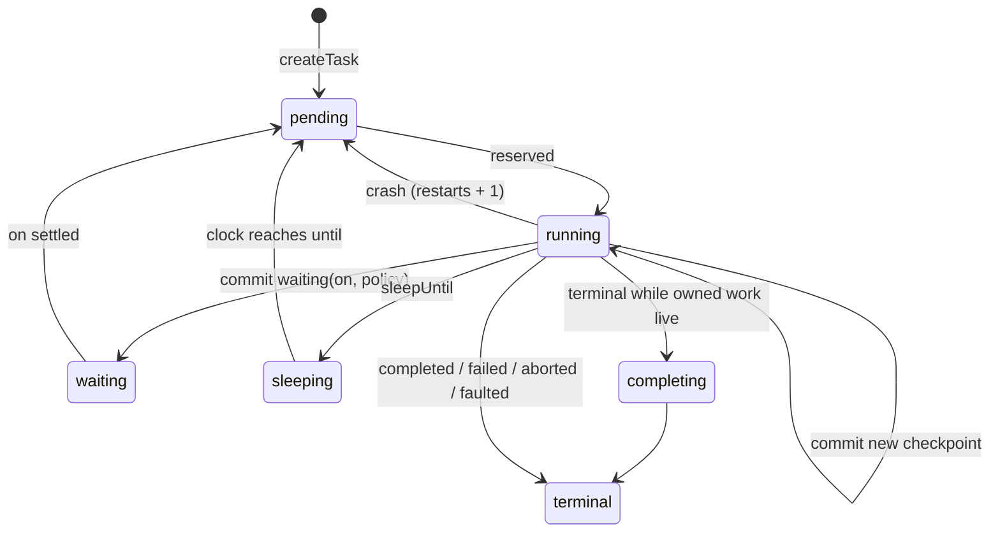

# Grounding: what a tau extension builds on

Platform reference for keel's designers. It describes tau (this repository) on `@earendil-works/pi-durable` 1.5.2 as read from the documentation and source on this branch. It recommends no design.

**Citation key.** `PD/` = `node_modules/@earendil-works/pi-durable/`. Other paths are repository-relative. "(inferred)" marks a conclusion drawn from code or types but stated nowhere. "Unknown" marks what I could not establish. The README's `test/examples/` are not shipped in the installed package, so they were not read.

## Overview

Tau is one server process that hosts **projects**. A project has a name, an absolute working directory and an ordered list of extensions. It has its own SQLite store, pi-durable `Harness` and registry (`docs/host.md:32`). Everything durable lives in that store: conversations, immutable transcript entries, typed JSON documents, task records and submissions. Every change goes through one serialized line of atomic commits (`PD/README.md`, "Concepts"). Tau's core adds three things on top: **decisions** (durable requests for a human answer), **events** (entries in a per-store log conversation), and a **host** that loads extensions and serves an authenticated HTTP API to clients (`docs/design.md`, "Core layers").

An extension is trusted TypeScript supplying tools, prompt sections, hooks and task definitions. One that also exports `entry` is a *workflow* a client can start (`docs/extensions.md:3`). Durability follows pi-durable's rules: a crashed phase reruns from its top, a tool reruns only if replay-safe, and effects outside the store get no transactional help.

## Key Concepts

| Term | Meaning |
| --- | --- |
| `Tx` | The transaction surface handed to a commit callback (`PD/dist/types.d.ts:895-957`). |
| Conversation | A transcript of immutable entries plus per-conversation documents and an agent (`pi.agent`). Ownerless or owned by a task. |
| Entry | An immutable record `{ id, conversationId, kind, model?, data?, head?, edits?, byTaskId? }`. Only `model` messages reach the model (`PD/dist/types.d.ts:413-428`). |
| Document | Typed JSON state scoped to the store (`session`), a conversation, or a task (`PD/dist/types.d.ts:46-56`). |
| Task | A durable state machine: named phases, a checkpoint, an outcome. Built-in kinds are `pi.generation`, `pi.tool` and compaction (`PD/README.md`, "Concepts"). |
| Submission | Input, a passive write, or a continue handed to a conversation, with an optional `requestId` (`PD/dist/harness/types.d.ts:31-66`). |
| Agent | Model, thinking level, extensions, tools, `modelTools`, instructions, `cwd`, `maxTurns`, compaction. Stored by name and resolved at each use (`PD/dist/harness/types.d.ts:394-434`). |

## How It Works

### 1. The store and commits

- **One line, atomic commits.** `harness.commit(tx => …)`, `conversation.commit`, `runtime.commit` (tasks) and `api.commit` (tools) each run one atomic transaction. "Either all of it is stored or none of it" (`PD/README.md`, "Concepts"). A throwing callback rolls back that commit only (`PD/README.md:929`, rule 3).
- **Ordering rule.** "Within a commit, table reads come first, followed by at most one `submit(tx, draft)` and then table writes. … Document reads and writes can occur anywhere" (`docs/primitives.md:143`). Table reads include `tx.task`, `tx.entry`, `tx.scan*`, `tx.conversation`, `tx.submissionByRequest`. Table writes include `appendEntry`, `createTask`, `createConversation`, `forkConversation` and `emit`. Breaking the order throws `ReadAfterWrite` "on every path" (`PD/dist/harness/types.d.ts:779-780`; `PD/dist/errors.d.ts:7-11`). `configure` is a document write (`PD/dist/harness/agent.js:65-68`). So are `request`, `withdraw` and `decision` (`docs/primitives.md:81`), and they may appear anywhere in the order.
- **No Harness reads inside a callback.** "Inside the callback read only through `tx`: `snapshot()`, `watchDoc()`, `getTask()`, and the other Session and runtime reads may queue on the line the callback holds, and then never resolve" (`PD/dist/types.d.ts:251`, `:1046`).
- **What "committed" means.** `commit()` "resolves once the commit is stored and published, after every earlier commit's outcome". The callback may start before an earlier commit is stored, "so act on what it computes only once the commit resolves" (`PD/dist/types.d.ts:1045-1052`). SQLite runs in WAL mode with `synchronous = NORMAL`: "commits survive process crashes; the newest may be lost on power or host failure" (`PD/README.md:869`; `docs/design.md:66`).
- **Deferred commits.** A commit can opt into `persistence: { kind: "deferred" }`. Deferral applies only when the commit changes nothing but existing conversation documents with `history: "latest"` and `fork: "initial"`. Such a commit is visible immediately and stored up to about `withinMs` later. A crash loses it (`PD/README.md:851`; `PD/dist/types.d.ts:1022-1039`).
- **Storage failure.** A storage error fails the whole Harness. Pending calls reject with `SessionFailed` and the Harness closes. "Reopen to recover" (`PD/README.md:927`). No code in `core/src` watches `harness.closed` (grep), so I infer a failed project stays down until the server restarts (inferred).

### 2. Conversations

- **Creation.** `tx.createConversation({ ownership })` or `tx.forkConversation(parent, at, { ownership })` inside a commit (`PD/dist/types.d.ts:915-920`). Harness conveniences such as `createConversation`, `fork` and `root` also accept `agent` and `init` in the creating commit (`PD/dist/harness/types.d.ts:486-491`).
- **Ownership kinds.** A *conversation* is either `{ kind: "ownerless" }` or `{ kind: "task", taskId }` (`PD/dist/types.d.ts:380-386`). Conversations have no "conversation-owned" kind. That kind exists for *tasks*: `{ kind: "conversation" }` or `{ kind: "task", taskId }` (`PD/dist/types.d.ts:349-355`). The owner edge is immutable and is "used for attribution, subtree abort, and subtree idle waits" (`PD/dist/types.d.ts:394`).
  - Aborting or failing the owning task aborts the owned conversation's work. "The parent is idle only once the child is" (`PD/README.md:763-764`).
  - A task-owned conversation outlives a terminal owner. "Once a subagent's owner task is terminal, a later task in its conversation is a top-level node" (`PD/README.md:814`).
  - No owner cascade reaches an ownerless conversation; only its own abort does (inferred). `scanConversations({ ownerTaskId | ownerConversationId })` lists owned ones (`PD/dist/types.d.ts:744-750`).
- **How a conversation gets its agent.**
  - A new ownerless conversation "starts empty". A new task-owned one "copies the stored agent of its owner task's conversation". A fork keeps its parent's agent as of the fork entry (`PD/dist/harness/agent.js:172-185`).
  - Unset fields follow the host. In tau, unset `extensions` resolve to the project default, which is `coding-tools` plus project extensions without `entry` (`core/src/host/catalogue.ts:43-50`; `core/src/host/projects.ts:291`). An unset model makes runs fail with `no_model` (`PD/README.md`, "Busy Conversations"). An unset `cwd` becomes the server's `process.cwd()` (`core/src/command/command.ts:68`).
- **`configure(tx, id, change)`.** "A given field replaces the stored one, `null` clears it, `undefined` changes nothing" (`PD/dist/harness/types.d.ts:435`). `extensions`, `tools` and `modelTools` take objects but store names (`PD/README.md:402`).
- **When a change takes effect.** From the next model request; an in-flight request keeps its settings. Tool calls and hooks use the agent their phase resolved, but the environment is built from the current `cwd` at each use, "so a `cwd` or extension change can reach calls the model already made" (`PD/README.md:402`). `instructions` is a stored string. "An existing conversation keeps its stored instructions" after a reload (`docs/extensions.md:387`).
- **Deletion.** None. "Tau has no call to delete a conversation" (`docs/design.md:74`). `Tx` has no delete operation (`PD/dist/types.d.ts:895-957`).
- **Submitting input.** `submit(draft, ctx)` returns a `Submission` (`wait`, `status`, `abort`); `submit(tx, draft)` admits inside a commit and returns a `SubmissionId` (`PD/dist/harness/types.d.ts:771-786`). Tasks and tools get invocation-bound handles from `runtime.conversation(id)` / `api.conversation(id)` (`:106-121`). `type: "input"` defaults to `whenBusy: "followUp"` (queued in `pi.inbox`, starts the next run); a steer joins after the current tool round; `"reject"` and `whenIdle: "reject"` throw `ConversationBusy`/`ConversationIdle` (`PD/README.md`, "Busy Conversations"). A `write` of only `kind`/`data` appends at once, even mid-run (`PD/README.md:557`). A `continue` never queues (`:52-66`).
- **`requestId`.** "Host-provided deduplication key, scoped to the conversation" (`PD/dist/types.d.ts:457`). A repeat with the same ID returns the existing submission (`PD/README.md:129`). I found no comparison of content, so a repeat with different content returns the original (inferred). The host prefixes client IDs with `client:<device>:` (`core/src/host/calls.ts:461`).
- **Why first input waits for a later commit.** Conversation creation is a table write, and `submit(tx, …)` must precede every table write. The handle must also be obtained before the commit, because Harness reads cannot run inside it. So a commit can create and configure a conversation but cannot submit to it (`docs/extensions.md:82`; `PD/dist/harness/types.d.ts:483`). A crash between the two commits leaves a configured conversation with no input (inferred).
- **Failed runs.** Queued items stay queued "until the next input, queued write, or continue" (`PD/README.md:561`); tau sets only `extensions` in settings, so `afterFailedRun` stays `keep` and `maxTurns` is unlimited (`core/src/host/projects.ts:291`).

### 3. Entries and documents

- **Entry kinds.** `defineEntry<D>(kind)` returns a kind string and an `is()` guard. It has no version, schema or validation (`PD/dist/entries.d.ts:3`). Append with `tx.appendEntry(token, conversationId, { data, model? })`. Read with `tx.entry(token, id)`, which returns `undefined` if the kind differs. List with `tx.scanEntries({ conversationId, minEntryId?, maxEntryId?, order? }, limit, cursor)`, which defaults to descending order and has no filter by kind (`PD/dist/types.d.ts:751-760`, `:902`). Tasks and hooks also have `entries()` over raw history, "which compaction never changes" (`PD/README.md:680`). Entries are immutable and cannot be deleted. Raw `appendEntry` bypasses inbox placement, unlike `submit({ type: "write" })` (inferred from `PD/README.md:557`).
- **Documents.** `defineDoc<T>({ kind, version, scope, history?, fork?, initial, checkpointWhen, migrate? })` (`PD/dist/types.d.ts:61-70`):
  - `scope`: `"session"` (one per project store), `"conversation"`, or `"task"`.
  - `history`: conversation documents only. `"latest"` keeps current state. `"rewindable"` adds `snapshotAsOf(token, conversationId, entryId)`.
  - `fork`: `"initial"`, `"current"`, or `"asOf"` (rewindable only). It decides what a fork starts with (`PD/dist/types.d.ts:34-45`).
  - `initial()`: runs when `tx.doc(token, …)` finds the document absent, and creates it. Opening a document for read inside a commit therefore writes it the first time (`core/src/store/decisions.ts:89-93`).
  - `checkpointWhen(value, ops, info)`: required. Returning `true` stores a full base instead of a delta, which bounds replay (`PD/dist/types.d.ts:68-69`).
  - `tx.retireDoc(...)` retires an incarnation. A later `tx.doc` creates a new one (`PD/dist/types.d.ts:951-956`). Task documents are retired when their task ends (inferred from `PD/dist/types.d.ts:958-966`).
- **Shape changes between code versions.** A migration hook exists: `migrate?(value, fromVersion)`.
  - A stored version lower than the code's version runs `migrate`. Without `migrate`, the read throws "requires migration".
  - A stored version higher than the code's throws.
  - At an equal version, the stored value is returned as is, with no shape check (`PD/dist/documents.js:78-97`). A field added without a version bump therefore reads as absent (inferred).
  - A migration "stores a base at once" when written (`PD/dist/session/transaction.js:515`). Reload checks no document versions (`core/src/host/reload.ts:65-96` checks tasks only).
  - A throw inside a commit callback rolls the commit back. Inside a task phase it faults the task (`PD/README.md:929`).
- **Reading outside a commit.** `snapshot(token, …, ctx)` exists on Harness, `runtime`, tool `api`, hook `api` and section `input.read`. It returns committed state, or `undefined` when the document was never created. It does not run `initial` (`PD/dist/session/session.js:415-433`). Watches: `watchDoc`.
- **Not re-exported by tau.** `tau/durable` exports `defineDoc` and `defineEntry`. It does not export `defineDocFamily` (keyed documents), `section`, `wrapTool`, `ToolTask`, `CompactionTask`, `AssistantEntry` or `PromptSection` (`core/src/extension/durable.ts:1-46`). Workspace lint forbids extensions from importing `@earendil-works/*` directly (`tools/check-boundaries.mjs:57-62`).

### 4. Tasks

- **Definition.** `defineTask<I, S extends { phase }, R>({ name, version, initial(input), phases, abort, migrate?, hooks? })` (`PD/dist/types.d.ts:318-341`).
  - Each phase handler "must commit a changed checkpoint or a terminal outcome through `runtime.commit()`; returning without durable progress faults the task" (`PD/dist/types.d.ts:211-212`). The scheduler enforces this at once: if the checkpoint equals the one the phase started with, the task faults ("returned without durable progress", `PD/dist/harness/scheduler.js:2170-2173`). Committing the same state again "is not" progress (`:2309-2312`).
  - `runtime.commit` can return `running` (new checkpoint), `waiting`, `sleeping` or `terminal` (`PD/dist/types.d.ts:207-209`). It rejects once the task carries an abort mark (`:248-250`).
- **Outcomes.** `completed`, `failed` (explicit), `aborted`, `orphaned` (a definition is missing and the task is aborted), and `faulted` (an uncaught throw, no progress, or the restart limit) (`PD/dist/types.d.ts:557-590`).
  - `completing`: a decided outcome waiting for owned work to drain (`PD/README.md:794`).
  - Non-terminal states: `pending`, `running`, `waiting`, `sleeping`.
- **Child tasks and joins.** `tx.createTask(Task, input, { ownership: { kind: "task", taskId } })` creates a child in the owner's conversation (`PD/dist/types.d.ts:349-355`). A phase parks with `{ status: "waiting", checkpoint, on: [ids], policy }`.
  - `allSettled` resumes once all are done.
  - `failFast` aborts the rest on the first non-`completed` outcome (`PD/dist/harness/scheduler.js:2820-2823`) and may name only owned tasks (`:2356-2357`). `allSettled` may name other tasks.
  - `runtime.outcomes(ids)` reads the results (`PD/README.md:793`).
  - Abort runs bottom-up, children first (`PD/README.md:795`).
- **Ownership and `background`.** A conversation-owned task joins the conversation's ordinary scope. `stop` and `waitForIdle` reach it. `background: true` is for "conversation-owned tasks only: excluded from ordinary idle waits, conversation aborts, and cascades" (`PD/dist/types.d.ts:370`). `conversation.abort(ctx, { background: true })` crosses that boundary (`PD/dist/harness/types.d.ts:96-104`). `conversationId` places a task in another conversation (`PD/dist/types.d.ts:364-369`).
- **What survives a restart.** All committed records survive. On open, every `running` task returns to `pending` with `restarts + 1` (`PD/dist/harness/scheduler.js:244-246`). Its phase reruns from the top: "there is no sleep in the middle of a phase" (`PD/README.md:162`).
  - Lost on restart: in-memory waits, `runtime.setTimer` (`PD/dist/types.d.ts:297-302`), and invocation-bound handles.
  - The count resets when a task commits a new state. At `restartLimit` (default 5, which tau does not change) a task of an extension kind ends `faulted`, with reason `restart_limit` (`PD/README.md:216`; `docs/host.md:28`). A graceful close does not count.
  - Tasks created with `abandonOnRestart` are aborted when a later Harness starts (`PD/dist/types.d.ts:371-377`).
- **Timers.** `runtime.sleepUntil(until, nextCheckpoint, ctx)`, or `{ status: "sleeping", until, checkpoint }` from `commit`, stores a durable wake on the Harness clock. Startup resumes overdue sleeps (`docs/host.md:28`). An abort mark does not wait for a sleep (`PD/dist/types.d.ts:614`). There is no recurring timer.
- **Learning it is running again.** No "resumed" flag reaches a phase. Available signals: the record's `restarts`, the count of consecutive crash cut-offs since the last state change (`PD/dist/types.d.ts:666-673`); `runtime.memo(name, candidate)`, a durable first-writer-wins value (`:257-259`); and `runtime.ownedTasks()`, which includes tasks "an earlier invocation created, before a restart" (`:269-273`).
- **Upgrades.** Reload refuses dropped task kinds, lower versions, and removed phases without a version bump, comparing against the *loaded* code (`core/src/host/reload.ts:65-96`). A higher installed version uses `migrate` at reservation, and without one the task blocks (`docs/extensions.md:389`). "On restart, Tau has no old task definitions to compare with the installed code. A stored task can fault if its phase was removed" (`docs/design.md:68`).

### 5. Tools

- **`defineTool({ name, description, parameters, execute, replay?, executionMode?, callers?, structuredOutputSchema?, outputLimits?, deferred?, prepareArguments? })`** (`PD/dist/harness/types.d.ts:279-317`).
  - `replay` defaults to `unsafe`.
  - `executionMode`: "One sequential call makes its whole round sequential". The default comes from `settings.toolExecution`, which is `parallel` (`PD/dist/harness/agent.js`, `resolveSettings`).
  - `callers`: `["model"]`, `["tools"]`, or both (the default).
  - Tools with the same name: the last selected extension wins silently (`docs/design.md:72`).
- **Each call is a durable `pi.tool` task.** "Its intent is committed before `execute()` runs" (`PD/README.md:277`). After a crash:
  - A replay-safe tool reruns `execute` from the top.
  - An unsafe tool gives the model an `interrupted` error result. Its nested calls and the child tasks it created are abandoned (`PD/dist/harness/types.d.ts:232-233`).
  - A throw becomes an error result for the model.
  - "The same call" on a rerun is the same tool task, with the same `api.taskId` and `api.callId`. The documented idempotency pattern is "a receipt keyed by `api.taskId`, write it atomically with the publication" (`docs/extensions.md:64-66`).
- **The `api` object** (`PD/dist/harness/types.d.ts:186-277`): `commit(tx => …)` (atomic, on the call's task); `taskId`, `conversationId`, `callId`; `now()` (Harness clock); `snapshot`/`snapshotAsOf`/`watchDoc`; `conversation(id)` (a handle with both `submit` forms, `abort`, `waitForIdle`); `createTask` (its own commit); `getTask`, `waitForTask`, `memo`; `details(value)` (UI channel, beside `output` for the model and `structuredOutput` for programs); `env`, `agent()`, `models`, `output()`, `diagnostic()`. Nothing on it aborts an arbitrary task.
- **Nested calls.** `api.executeTool(name, args, ctx, { key? })` runs a tool as a child `pi.tool` task, keyed by call position or explicit key. A replay-safe caller rerun "in the same order, or [with] the same keys, gets the nested calls it already made back"; an interrupted nested call follows its own `replay` policy (`PD/README.md:328`). Nested calls ignore `executionMode` (`PD/dist/harness/types.d.ts:263`), and depth is unbounded (`PD/README.md:331`).
- **`control`.** `terminate: true` ends the run without another model request "when every result of the round asks for it". `handoff` resets the context and continues. `addTools` loads deferred tools (`PD/dist/harness/types.d.ts:123-134`).

### 6. Sub-agents

- **Foreground pattern** (`PD/README.md:725-770`). A replay-safe tool, in one commit, reuses `tx.scanConversations({ ownerTaskId: api.taskId }, 1)` or creates the child with `ownership: { kind: "task", taskId: api.taskId }` and `configure`s it. It exposes the child ID through `api.details`, submits through `api.conversation(child)` with `requestId` derived from `api.taskId`, and awaits `wait()`. A rerun finds the same child and submission.
- **How the answer returns.** `wait()` resolves to a settled submission. `done` carries `answer: EntryId`, the assistant entry. `unanswered` carries a `reason` (`PD/dist/types.d.ts:461-548`). Reading the answer's text means reading that entry's `model` message (`PD/README.md`, "Quick Start"). The wait is in memory. Only the submission record and the child's transcript are durable.
- **Background pattern** (example 22, described at `PD/README.md:770`, not shipped). Each child belongs to a *background anchor task*, which keeps the parent's Esc and idle waits away from it. A *background reporter task* delivers each message and "posts the answer back to the parent as a follow-up input once it arrives". Request IDs prevent duplicates across restarts.
- **Several at once.** A tool may await several children concurrently in memory (inferred: nothing forbids it). A task can own child tasks and park in `waiting` on them with `allSettled` or `failFast`. `waiting.on` takes task IDs only. No durable wait exists on "conversation idle" or "submission settled" (inferred from `TaskState`, `PD/dist/types.d.ts:604-611`).
- **Abort propagation.** Aborting or failing the owning call aborts the child. A non-replay-safe call interrupted by a crash counts as failing. A `background` task stops the cascade (`PD/README.md:763-765`).
- **What tau's `role()` adds.** It runs `tx.createConversation({ ownership })` followed by `configure(tx, id, settings)` in the caller's transaction. Its type requires `model` and `extensions` (`core/src/extension/helpers.ts:15-28`). It sets no `cwd`, records nothing, and returns only the ID. It performs a table write, so the caller's commit can do no table reads or submits afterwards. In a task-owned conversation, "supplied settings do not clear inherited settings" (`docs/extensions.md:38`).

### 7. Decisions, annotations and events

- **Record.** `Decision = { id: "subject#n", subject, title, basis: EntryId, choices, conversation, then: { task: name }, requestedAt }` plus a status: `open`, `answered` (with `choice`, `annotations`, `by`, `at`, `continuation`), `superseded`, or `withdrawn` (`core/src/store/types.ts`; `docs/primitives.md:5-36`).
  - The basis entry's `data.text` is what the human reviews. An annotation is `{ text, range? }` in UTF-16 units; without a range it covers the whole basis.
  - Decision state lives in session documents of the project store (`core/src/store/decisions.ts:65-87`). Subjects are therefore project-wide. Two conversations using the same subject share one open slot (inferred).
- **`request(tx, draft)`** works on documents only. The caller supplies `requestedAt`. An empty subject throws `TypeError` (`docs/primitives.md:46-81`).
  - No open decision for the subject: a new one opens.
  - An open decision with every field except `requestedAt` equal: returned as is, and nothing is written. Fields compared: title, basis ID, conversation, `then` task name, choices (`core/src/store/decisions.ts:126-135`).
  - Any other difference: the open decision is marked `superseded` and a new one opens.
- **`withdraw(tx, subject)`** marks the open decision `withdrawn` and does nothing if none is open. **`decision(tx, id)`** reads a decision.
- **Answering.** Only the host answers, through the authenticated `answer` call. No package export lets an extension answer (`docs/primitives.md:117-121`). In one commit, an accepted answer records the answer, clears the open slot and creates the `then` task. That task has `ownership: { kind: "conversation" }`, `conversationId: decision.conversation` and `background: true`, and its input is `{ decision, choice }` (`core/src/store/decisions.ts:202-219`). Annotations are not in the input and must be read through `decision(tx, id)`. The task is looked up by name when the answer arrives (`docs/design.md:66`).
- **Every answer outcome**, checked in this order (`core/src/store/decisions.ts:186-301`):

| State | Outcome |
| --- | --- |
| ID missing | `unknown_decision` |
| superseded/withdrawn | `not_open`, carrying the subject's current open decision if any |
| answered, fields differ | `conflict`, carrying the answered decision |
| answered, same fields, continuation not faulted | `repeated: true`, nothing written |
| answered, same fields, continuation faulted | creates a **replacement** task with a new task ID and the same input, `repeated: true`. If the task is not installed: `extension_not_loaded` |
| open, basis differs | `stale_basis` |
| open, choice not offered | `unknown_choice` |
| open, a range outside the basis text | `bad_annotation` |
| open, task not installed | `extension_not_loaded`. The decision stays open |
| open, all checks pass | answered, `repeated: false` |

  At the host level the call can also return `unknown_project` and the transport refusals (`bad_request`, `unauthorized`, `too_large`). A storage failure returns `unknown` with `storage_failed`, and the outcome is unknown (`docs/protocol.md:13-40`).
- **A stopped conversation or direct input leaves decisions alone.** `stop` aborts ordinary work, and "Open decisions and background tasks remain" (`docs/host.md:105`). The `input` call submits text and never touches decisions (`core/src/host/calls.ts:446-475`). An open decision stays answerable until the extension supersedes or withdraws it, and its continuation runs against whatever state exists then (see also `docs/extensions.md:70`).
- **Events.** `emit(tx, kind, data)` is a table write that appends an entry to the store's ownerless event-log conversation; `EventData = { text, at, conversation? }` plus any fields (`core/src/store/events.ts:18-35`). `eventLog(tx)` returns the log ID; reading events means scanning its entries; clients watch `timeline`. The host refuses runs in the log (`core/src/host/calls.ts:145-146`). The core emits nothing for decisions (`docs/primitives.md:139`).

### 8. Prompt sections and hooks

- **Sections.** An extension's `sections` render in order "before each request". The agent's `instructions` render last (`PD/README.md:378`). A section is `{ key, render(input, ctx), tag? }` (`PD/dist/harness/types.d.ts:331-337`), and `section()` simply builds that object (`PD/dist/harness/define.js:10-12`).
  - `input` holds `conversationId`, the resolved `agent`, `env`, `read` (committed snapshots only) and `shown`.
  - `shown` is the "sections already in effect after replaying the active transcript" (`:327`, computed at `PD/dist/harness/generation.js:73-84`).
  - Results are stored as positional `pi.system` entries, and "only what changed is sent again" (`PD/README.md:378`). After a compaction or reset head with no later system entry, a complete baseline is rewritten (`PD/dist/harness/prompt.d.ts`, `planSystemEntries`).
  - A throwing section keeps its previous text and is reported.
  - Sections are not hidden by tool filters (`docs/extensions.md:54`).
- **Compaction** is on by default (`PD/dist/harness/agent.js:10-15`): the model sees a summary, older entries stay stored, and `configure({ compaction })` overrides it per conversation (`PD/README.md`, "Compaction").
- **Hooks.** `hook(Task, handlers)` builds `{ task: name, handlers }` (`PD/dist/harness/define.js:14-16`). `tau/durable` exports only `GenerationTask`, so a tool or compaction hook needs a hand-built `{ task: "pi.tool", handlers }` object (inferred). Hooks run only in conversations that select the extension (`PD/README.md:678`).
  - Generation: `beforeRequest`, `beforeProviderRequest`, `afterResponse`, `onYield`, `afterTools`, `afterRun`. Tool: `beforeTool` (block or rewrite), `afterTool` (replace the result). Compaction: `beforeCompact` (`PD/dist/harness/types.d.ts:907-1003`).
  - Hook `api` reads only. It has snapshots, entries and memos but no `commit` (`:891-905`).
  - `afterRun` returns `runEndTask(Task, input)` tasks. They become children of the generation and keep the conversation busy. `stop` aborts them and a crash resumes them. They run after an answer or a terminate round, never after a failure or abort (`PD/README.md:709-711`).
  - Tasks can declare their own `hooks` for others to handle, dispatched through `runtime.hooks.each` (`PD/dist/types.d.ts:216-222`).

### 9. Options, the workflow `entry`, and the host

- **Module contract.** `{ extension, entry?, options? }` (`core/src/host/index.ts:37-45`).
  - The loader checks that the name matches the folder and `^[a-z0-9][a-z0-9-]{0,62}$` (and is not `coding-tools`), that `options.schema` is a closed object, and that `entry` is an object or function (`core/src/host/extensions.ts:25-55`).
  - Task names must be unique across extensions (`:80-87`).
  - **A workflow is a module with `entry`** (`core/src/host/calls.ts:198`). It is excluded from the project default (`core/src/host/catalogue.ts:43-50`).
- **`options(ext, schema)`** defines the session document `<ext>.options` (version 1) with `get`, `set`, and `read`, which merges defaults and throws on invalid or incomplete values (`core/src/extension/helpers.ts:30-73`). A `format: "model"` string (`provider/modelId`) is checked against server models only by the host, in `setOptions` and `create` (`core/src/host/options.ts:46-50`); `read` compiles without that format, which pi-schema treats as an annotation (`helpers.ts:46`; `node_modules/@earendil-works/pi-schema/dist/types.d.ts:13`). A `format: "secret"` value is shown to clients as `true` and stored in plain text (`docs/extensions.md:40`). `modelRef` does not validate (`helpers.ts:75-78`).
- **`create`** with a workflow requires that the project lists the extension, that its code is loaded, that it has `entry`, and that its options are valid. In one commit it then creates an **ownerless** conversation, runs `entry(tx)`, and calls `configure(tx, id, { cwd: workdir, ...entry })` (`core/src/host/calls.ts:300-334`). An `entry` that sets `cwd` therefore overrides the workdir. `entry` runs after the conversation table write, so table reads inside it throw `ReadAfterWrite` (inferred from the commit-order rule). Repeating `create` creates another conversation.
- **Load and reload.**
  - Startup scans `~/.tau/extensions/`, imports each `index.ts` with jiti (no module cache), rejects `.js` outside `node_modules`, installs `coding-tools` and listed extensions into each project registry, then resumes each harness (`core/src/host/loader.ts:38-72`; `core/src/host/projects.ts:304-323`). Top-level code runs on every load and reload, "even when it later refuses the reload" (`docs/extensions.md:60`). Reload: `docs/extensions.md:374-402`; in-flight work finishes on old code.
  - One module object is installed into every project that lists it, so module-scope variables are shared across projects in memory (inferred from `projects.ts:228`).
- **Projects.** A project has a name, an absolute workdir (`^/`, `calls.ts:217`) and an ordered extension list. `bind` is idempotent and returns `conflict` on different fields. `addExtensions` only appends. Structural calls run one at a time (`docs/host.md:130`).
- **Client calls** are listed at `docs/host.md:66-91` (`create`, `input`, `continue`, `stop`, `setModel`, `answer`, `faults`, the `open`/`inbox`/`timeline` streams, and others).
  - `input`, `stop` and `open` work on **any** conversation in the project, including extension-created ones, except the event log (`calls.ts:134-157`).
  - `open` shows entries and only the built-in `pi.*` documents. Extension documents are not in the view (`PD/dist/harness/view.d.ts:15`).
  - `stop` is `conversation.abort()` without `background` (`calls.ts:499-503`).

### 10. Execution environment

- Tau builds `new NodeExecutionEnv({ cwd: target.cwd ?? process.cwd() })` for every tool call, section render and `runtime.env()` (`core/src/command/command.ts:68`). The environment comes from the conversation's current `cwd`.
- `coding-tools` provides `read`, `write`, `edit` and `bash`, which touch files "only through the call's environment" (`PD/README.md`, "Tools"). `api.env.exec(argv)` runs a program without a shell (`PD/README.md`, "Environment").
- **No isolation beyond tool lists and `cwd`.**
  - Every `NodeExecutionEnv` has the same `id` ("Every local environment sees the same files", `PD/dist/env/node.d.ts:5`).
  - `cwd` is a starting directory, not a jail (inferred: no path confinement on the interface).
  - Shell children inherit the server's `process.env` (`PD/dist/env/node.js:205-212`).
  - "Extensions are trusted code, not sandboxed code" (`docs/design.md:60`).
  - The core has no git primitive. Git is reached through `bash` or `env.exec` (grep of `core/src`).

### 11. Prose loading and packaging

- `prose(directory, file, slots)` reads the file synchronously **when called**, normally at module scope during import, so each load and reload re-reads it (`core/src/extension/helpers.ts:85`; `core/src/host/loader.ts:39-41`). The set of `{{name}}` placeholders must equal the declared slots or `prose` throws, failing the import (`helpers.ts:86-93`). Rendering is one unescaped pass (`helpers.ts:94-95`). Text already stored as `instructions` does not follow file changes (`docs/extensions.md:387`).
- Packaging: `nix/packages.nix:69-82` copies an extension's `src/` contents to the artifact root and links its declared npm dependencies. `package.json` and anything outside `src/` do not ship, and the flake sees only tracked files (`AGENTS.md`). Prose must therefore live under `src/`.

### 12. Testing

- `tau/testing` (`core/src/extension/testing.ts`) provides:
  - `openStore(storage, { registry, models, env?, now? }, ctx)`, which opens a Harness and creates the decision documents and event log. The scheduler starts paused, so call `harness.resume()` (`core/src/store/host.ts:18-34`).
  - `createModels`, `fauxProvider` (with `setResponses([...])`), `fauxAssistantMessage`, `fauxToolCall` and `fauxText`.
  - `fauxAnswer(store, id, { basis, choice, annotations })`, the real answer logic with device `!test` (`core/src/store/testing.ts:12-19`).
- Storage is `MemoryStorage` or `openNodeSqliteStorage`. Without `env`, coding tools return errors (`PD/README.md`, "Environment"). The host, projects, client calls and options masking are not provided.
- **Kill and restart.** No helper exists. The repository's recovery tests run a child Node process on a SQLite file and wrap `Storage.commit` in a `Proxy` that sends `SIGKILL` before or after a matching batch. A second process reopens the file (`extensions/w2/test/fixtures/crash.ts:13-37`; `extensions/w2/test/recovery.test.ts:19-41`). `Harness.close()` closes its storage (`PD/dist/types.d.ts:1053-1054`), so reopening a closed `MemoryStorage` is not possible (inferred).
- **Runtime.** Measured `nix develop -c test-w2`: 17 tests in 1.6 s; in-memory tests 4–40 ms each, SIGKILL child-process scenarios about 250 ms each.

## What is absent

Each item was checked against the source or docs cited.

- **No scheduler or recurring timer.** Only per-task `sleepUntil` and in-memory `runtime.setTimer` (`PD/dist/types.d.ts:297-315`). The core may add no "scheduler, loop, background process" (`docs/design.md:41`).
- **No deletion** of conversations or entries, no unbinding of projects, no removal of a project's extensions (`docs/design.md:74`; `Tx` surface). No restarting or deleting of faulted tasks (`docs/design.md:68`). Documents can only be *retired* (`tx.retireDoc`).
- **No cross-project state.** Every store, document scope and decision belongs to one project (`docs/host.md:32`). Only module memory is shared.
- **No general migration mechanism.** Task `migrate` and document `migrate` exist. Entries and options documents have no versioning (`helpers.ts:41` fixes version 1). Same-version shape changes go unchecked.
- **No durable join on conversations.** `waiting.on` takes task IDs. Idle and submission waits are in memory.
- **No way for an extension to answer a decision, and no decision expiry.** The `Decision` type has no deadline.
- **No abort of arbitrary tasks from extension code.** Only `runtime.abortOwned` (owned tasks) and `handle.abort` (a conversation scope) exist.
- **No entry query by kind** and no listing of documents from `Tx`.
- **No client visibility of extension documents** in `open`.
- **No git or worktree support** in the core (§10).

## Where Things Live

| Path | What |
| --- | --- |
| `docs/*.md` | Tau's documentation |
| `core/src/extension/` | Author API: re-exports, `helpers.ts`, `testing.ts` |
| `core/src/store/` | Decisions, events, `openStore` |
| `core/src/host/` | Loader, reload, projects, client calls, options |
| `PD/README.md`, `PD/dist/types.d.ts`, `PD/dist/harness/types.d.ts` | pi-durable's contract |
| `nix/packages.nix` | Extension artifact |

## Gotchas

- **Docs vs source, faults.** `docs/host.md:28` and `docs/extensions.md:72` describe faults only as "repeated interruptions without durable progress". The scheduler also faults on the **first** return of a phase that changed nothing (`PD/dist/harness/scheduler.js:2170-2173`).
- **Docs vs source, `create`.** `docs/host.md:99` says `create` configures "the working directory and the workflow's `entry`". The code spreads `entry` after `cwd`, so `entry` wins (`calls.ts:333`).
- **The brief's outcome list is incomplete.** Terminal outcomes also include `failed` and `orphaned`, and conversations cannot be conversation-owned.
- tau's `onReport` prints only `migration_failed` and `task_outdated` (`projects.ts:282-290`). Faulted tasks surface only through `faults`.
- A repeated `stop` can abort a newer run, and a repeated `create` creates a second conversation (`docs/protocol.md:19`).

## Unknowns

- Unknown: what an answer does when `decision.conversation` no longer resolves or never existed. `request` does not check it (`decisions.ts:101-153`).
- Unknown: whether a restart with a removed phase at the same version faults or blocks the task. `docs/design.md:68` says only "can fault".
- Unknown: whether `api.commit` in a tool rejects after the call is aborted, as `runtime.commit` does.
- Unknown: whether a fresh tau-level harness is reopened after `SessionFailed` without a server restart. No code was found that does it.
- Unknown: what the faux provider does once its scripted responses run out.
- Unknown: whether an installed extension outside the workspace can import `@earendil-works/*` from its own `node_modules`, and what a second copy of pi-durable would do. The loader aliases only `tau*` (`loader.ts:176-186`).
